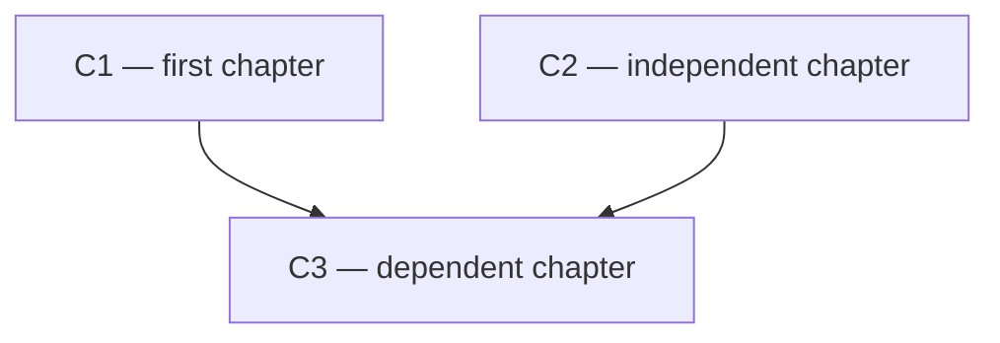

# <Suite> — Rollout

**Architecture:** [00-architecture.md](00-architecture.md) ·
**Decisions:** [gaps-and-decisions.md](gaps-and-decisions.md) ·
**Chapters:** [chapters/](chapters/) · **Ledger:** [run-ledger.md](run-ledger.md)

**Loop branch:** `feat/<suite>`
**Release branch:** `main`

## Execution contract

- **Prerequisite:** <commit, suite, or `none`>
- **Implementer:** one `chapter-implementer` per implementation chapter, in an
  isolated worktree
- **Orchestrator:** the chief of staff owns scheduling, integration, live gates,
  the ledger, and the release PR
- **Integration:** chapter branches merge into the loop branch only; the release
  branch is changed only by the release PR
- **Global gate:** `<command>`

## Dependency graph

Show every chapter and every hard dependency. A chapter may have no incoming
edge and still be scheduled in parallel with other root chapters.



## Chapter scheduling matrix

`depends_on` is a hard completion dependency. `touches` lists repository-relative
paths or globs; overlapping entries are integration conflicts unless the
rollout defines a narrower ownership split. `execution` is either
`chapter-implementer` or `chief-of-staff`.

| ID | Chapter | depends_on | touches | execution | Gate | Status |
| --- | --- | --- | --- | --- | --- | --- |
| C1 | [Chapter title](chapters/01-slug.md) | none | `apps/api/app/features/example/` | chapter-implementer | `pytest ...` + `./ci.sh` | planned |
| C2 | [Another independent chapter](chapters/02-other-slug.md) | none | `apps/web/src/features/example/` | chapter-implementer | `npm test ...` + `./ci.sh` | planned |
| C3 | [Live check](02-live-runs.md) | C1, C2 | production API | chief-of-staff | manual checklist | planned |

## Parallel batches

List every batch explicitly. Chapters in one batch start concurrently after all
listed prerequisites are integrated. Explain why their `touches` sets and
contracts do not conflict. If a batch is intentionally smaller than the ready
set, record the capacity or risk reason.

| Batch | Ready after | Chapters launched together | Why safe | Integration order |
| --- | --- | --- | --- | --- |
| B1 | prerequisite | C1, C2 | disjoint `touches`; no dependency between them | C1, then C2 |
| B2 | B1 integrated | C3 | depends on C1 and C2 | C3 |

## Critical path and integration

State the longest dependency path, the chapters with shared-file conflicts, and
the order in which those changes integrate. Implementation parallelism does not
make conflicting merges parallel.

## Chapter plans

Each executable chapter contains the following frontmatter and sections:

```yaml
---
id: C1
name: "Chapter 1 — Example"
overview: "One independently shippable outcome."
depends_on: []
touches:
  - apps/api/app/features/example/
execution: chapter-implementer
isProject: false
---
```

Required sections:

1. `Goal`
2. `Design decisions`
3. `Files` and do-not-edit boundaries
4. `Red tests` with one happy-path and one negative-path test per slice
5. `Green`
6. `Refactor gate` with an explicit outcome
7. `Verification`
8. `Out of scope`
9. `Git workflow`

## Per-chapter gate

```bash
<narrow chapter tests>
<lint/typecheck/build commands>
./ci.sh
```

The chapter is not green until the paired tests, refactor audit, and local
gate pass. The chief of staff updates the ledger; implementers do not.
