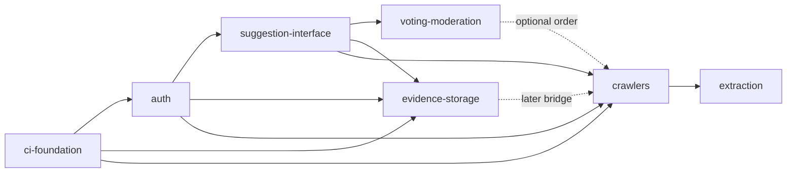

# Plans

Design and implementation plans for `redtape`. One folder per body of work; plans stay in the repo so
they version alongside the code they describe.

## Folders

### [discovery-admin-flow/](discovery-admin-flow/) — Flow-only discovery admin

Make the pipeline flow page the only discovery admin view. Move the figures of the catalogue, coverage, tasks and documents views into the flow response, remove those views and their endpoints, show one discovery menu link, and reduce the language menu to flags. Eight chapters in seven batches.

| Doc | What it is |
| --- | --- |
| [00-architecture.md](discovery-admin-flow/00-architecture.md) | Current admin surface, flow response contract, invariants |
| [01-rollout.md](discovery-admin-flow/01-rollout.md) | Eight chapters, dependency graph, parallel batches, per-chapter gate |
| [gaps-and-decisions.md](discovery-admin-flow/gaps-and-decisions.md) | Settled decisions, and open questions with their defaults |
| [chapters/](discovery-admin-flow/chapters/) | One executable plan per chapter |

Status: planned — no chapter started. Orchestrate with **chief of staff**; loop branch `feat/plans-discovery-admin-flow`.

### [web-frontend/](web-frontend/) — Wave 2 visual alignment

Restyle the existing document list, detail, and location-picker screens: custom Chakra theme (red
brand, Iceberg headings, Inter body), app shell polish, and native Chakra compound components. Does
not add dependency-tree, social, or auth UI — those remain in
[docs/planning/directions/web-frontend/](../docs/planning/directions/web-frontend/README.md).

| Doc | What it is |
| --- | --- |
| [00-architecture.md](web-frontend/00-architecture.md) | Visual contract — tokens, typography, component rules, screen inventory |
| [01-rollout.md](web-frontend/01-rollout.md) | Ten chapters, dependency graph, invariants, per-chapter gate |
| [gaps-and-decisions.md](web-frontend/gaps-and-decisions.md) | Settled brand and scope boundaries |
| [chapters/](web-frontend/chapters/) | One executable plan per chapter |

Status: chapters 1–4 are done (test harness, not-found, red theme, color mode, app shell); see the
[rollout](web-frontend/01-rollout.md) for the rest.

### [document-matrix/](document-matrix/) — Domain × life-situation organization

Two independent taxonomies (domain: car, housing, work…; life situation: moving, birth of a child, job
loss…) as many-to-many tags on documents, Germany seed, filter and matrix APIs, and a web matrix page
with list filters. Postgres only. Ten chapters across data model, backend and frontend.

| Doc | What it is |
| --- | --- |
| [00-architecture.md](document-matrix/00-architecture.md) | Vocabulary, model, seed taxonomy, API and UI contract |
| [01-rollout.md](document-matrix/01-rollout.md) | Ten chapters, dependency graph, invariants, per-chapter gate |
| [gaps-and-decisions.md](document-matrix/gaps-and-decisions.md) | Settled decisions and open seams |
| [chapters/](document-matrix/chapters/) | One executable plan per chapter |

Status: shipped — all ten chapters done. Open seams and deferred work (list-card tags, curation): [gaps-and-decisions.md](document-matrix/gaps-and-decisions.md).

### [floating-nav/](floating-nav/) — Floating navigation

Replace the top toolbar with two circular floating buttons (gothic R brand button, burger menu), move
colour mode (sun/moon switch) and language (submenu) into the menu, drop the Iceberg wordmark, and remove
the matrix view. Frontend only, six chapters.

| Doc | What it is |
| --- | --- |
| [00-architecture.md](floating-nav/00-architecture.md) | Target UI, component tree, visual and accessibility contract |
| [01-rollout.md](floating-nav/01-rollout.md) | Six chapters, dependency graph, invariants, per-chapter gate |
| [gaps-and-decisions.md](floating-nav/gaps-and-decisions.md) | Settled decisions and open seams |
| [chapters/](floating-nav/chapters/) | One executable plan per chapter |

Status: planned — no chapter started. First: [chapters/01-remove-matrix.md](floating-nav/chapters/01-remove-matrix.md).

### [frontend-ui-menu/](frontend-ui-menu/) — Menu panel and floating chrome

Remove the stray document-list chevron, consolidate floating controls into a single R menu trigger, port
eggs-style `KeyValueRow`, and rebuild the app menu as four key–value rows (profile, documents, colour,
language). Frontend only, four chapters. Orchestrate with **chief of staff**; loop branch
`feat/plans-frontend-ui-menu`.

| Doc | What it is |
| --- | --- |
| [00-architecture.md](frontend-ui-menu/00-architecture.md) | Target menu and chrome |
| [01-rollout.md](frontend-ui-menu/01-rollout.md) | Four chapters, execution order, loop branch |
| [gaps-and-decisions.md](frontend-ui-menu/gaps-and-decisions.md) | Settled decisions (UI-only Google, etc.) |
| [chapters/](frontend-ui-menu/chapters/) | One executable plan per chapter |

Status: planned — first: [chapters/01-remove-list-chevron.md](frontend-ui-menu/chapters/01-remove-list-chevron.md).

### [web-gui-harmonization/](web-gui-harmonization/) — Shared tables and visual language

Harmonize RedTape’s GUI with the recorded reference patterns: restrained raised surfaces, consistent
typography and table tokens, one DataTable for discovery admin data, readable coverage tables, and a
typed server-side contract for sorting, filtering, search, and pagination. Frontend plus the bounded
API list contract, eight chapters, and chief-of-staff orchestration on
`feat/plans-web-gui-harmonization`.

| Doc | What it is |
| --- | --- |
| [00-architecture.md](web-gui-harmonization/00-architecture.md) | Visual principles, surface inventory, DataTable architecture, and list contract |
| [01-rollout.md](web-gui-harmonization/01-rollout.md) | Eight chapters, dependencies, gates, smoke checklist, and release protocol |
| [gaps-and-decisions.md](web-gui-harmonization/gaps-and-decisions.md) | Table/card boundary, elevation, query state, and open seams |
| [chapters/](web-gui-harmonization/chapters/) | Executable red → green → refactor chapter plans |
| [run-ledger.md](web-gui-harmonization/run-ledger.md) | Chief-of-staff chapter and release tracking |

Status: chapters 1–8 are done on the loop branch; the release PR to `main` and the manual browser smoke
([admin-tables.md](../docs/operations/admin-tables.md#release-smoke-checks)) are pending.

### [ci-foundation/](ci-foundation/) — Postgres-backed API CI

Run API tests against Postgres in GitHub Actions and local `./ci.sh` (today every DB test is skipped on
SQLite), fail loudly when the database is missing, and verify migrations round-trip with a single head.
Prerequisite for the document-collection suites. Backend and CI only, three chapters.

| Doc | What it is |
| --- | --- |
| [00-architecture.md](ci-foundation/00-architecture.md) | Problem, target state, design |
| [01-rollout.md](ci-foundation/01-rollout.md) | Three chapters, dependency graph, invariants, per-chapter gate |
| [gaps-and-decisions.md](ci-foundation/gaps-and-decisions.md) | Settled decisions and open seams |
| [chapters/](ci-foundation/chapters/) | One executable plan per chapter |

Status: shipped — all three chapters done. See [01-rollout.md](ci-foundation/01-rollout.md) for outcomes.

### The document-collection pipeline

Five suites, in dependency order, take the catalogue from hand-seeded to crawler- and community-grown:
people and crawlers submit through one interface, evidence backs every claim, votes and moderators decide,
and a scheduled crawler produces the first real traffic through all of it.

`evidence-storage` chapters 1–2 (the object-store port and the S3 adapter) have no suggestion
dependency; the `crawlers` suite now builds that port itself (its chapter 13, Cloudflare R2 first) and
stores its snapshots and screenshots as staging `discovery_artifact` rows, so it no longer waits for
`evidence-storage`. Attaching those artifacts to suggestions as `evidence` rows is a later bridge owned by
`evidence-storage`. `voting-moderation` (API side largely implemented) and `crawlers` proceed in parallel.

### [auth/](auth/) — Login, roles and machine API keys

Supabase Auth (email magic link) for humans, verified by the API via JWT/JWKS; a local `app_user` table
with roles; hashed API keys for machine clients such as crawlers. Twelve chapters across backend and web.

| Doc | What it is |
| --- | --- |
| [00-architecture.md](auth/00-architecture.md) | Vocabulary, request flow, data model, API contract |
| [01-rollout.md](auth/01-rollout.md) | Twelve chapters, dependency graph, invariants, per-chapter gate |
| [gaps-and-decisions.md](auth/gaps-and-decisions.md) | Settled decisions and open seams |
| [chapters/](auth/chapters/) | One executable plan per chapter |

Status: shipped — all twelve chapters done. Open seams: [gaps-and-decisions.md](auth/gaps-and-decisions.md).

### [suggestion-interface/](suggestion-interface/) — One submission API for people and crawlers

A `suggestion` model and API for proposing new documents and new dependency edges; validated, deduplicated,
pending until voted on. Eleven chapters across backend and web.

| Doc | What it is |
| --- | --- |
| [00-architecture.md](suggestion-interface/00-architecture.md) | Vocabulary, data model, payloads, API contract |
| [01-rollout.md](suggestion-interface/01-rollout.md) | Eleven chapters, dependency graph, invariants, per-chapter gate |
| [gaps-and-decisions.md](suggestion-interface/gaps-and-decisions.md) | Settled decisions and open seams |
| [chapters/](suggestion-interface/chapters/) | One executable plan per chapter |

Status: shipped — all eleven chapters done. Open seams: [gaps-and-decisions.md](suggestion-interface/gaps-and-decisions.md).

### [evidence-storage/](evidence-storage/) — Screenshots and fetch evidence in Cloudflare R2

An `ObjectStore` port with an S3-compatible adapter (R2 in production, MinIO locally), an `evidence` table
recording what was fetched and when, and upload/read endpoints. Nine chapters.

| Doc | What it is |
| --- | --- |
| [00-architecture.md](evidence-storage/00-architecture.md) | Vocabulary, design, data model, API contract |
| [01-rollout.md](evidence-storage/01-rollout.md) | Nine chapters, dependency graph, invariants, per-chapter gate |
| [gaps-and-decisions.md](evidence-storage/gaps-and-decisions.md) | Settled decisions and open seams |
| [chapters/](evidence-storage/chapters/) | One executable plan per chapter |

Status: planned. Chapters 1–2 (the port and the adapter) are absorbed by crawlers chapter 13; the first chapter to build is [chapters/03-evidence-model-migration.md](evidence-storage/chapters/03-evidence-model-migration.md).

### [voting-moderation/](voting-moderation/) — Votes, thresholds and promotion

Signed-in users vote pending suggestions to approval or rejection; approval promotes a suggestion into the
real catalogue; every vote, transition and moderator override is recorded in an append-only event log.
Twelve chapters.

| Doc | What it is |
| --- | --- |
| [00-architecture.md](voting-moderation/00-architecture.md) | Vocabulary, data model, thresholds, promotion |
| [01-rollout.md](voting-moderation/01-rollout.md) | Twelve chapters, dependency graph, invariants, per-chapter gate |
| [gaps-and-decisions.md](voting-moderation/gaps-and-decisions.md) | Settled decisions and open seams |
| [chapters/](voting-moderation/chapters/) | One executable plan per chapter |

Status: planned — no chapter started. First: [chapters/01-vote-model-migration.md](voting-moderation/chapters/01-vote-model-migration.md).

### [crawlers/](crawlers/) — Discovery crawler

A queue-based, document-first crawl layer on the discovery staging path: new task kinds in the existing
`discovery_task` table (payload harvest, page extraction, screenshot capture), a kind-filtered claim, retry and
multi-batch draining, deduplicated document candidates with provenance, rendered HTML snapshots and screenshots
(Cloudflare Browser Run quick actions on the free plan, throttled and budgeted; no browser in the repository)
stored in an object store (Cloudflare R2, capped by the application), a budget ledger that guards every free allocation (chapter 23), manual candidate emit to pending `new_document`
suggestions, and admin screens for documents and their evidence. Workers stay HTTP-only. Replaces the earlier
standalone `apps/crawler` design. Twenty-three chapters; loop branch `feat/crawlers`. LLM extraction is the next suite, [extraction/](extraction/).

| Doc | What it is |
| --- | --- |
| [00-architecture.md](crawlers/00-architecture.md) | Vocabulary, task kinds, document-first strategy, storage, tables, admin surface |
| [01-rollout.md](crawlers/01-rollout.md) | Twenty-three chapters, dependency graph, invariants, per-chapter gate (GitHub Actions) |
| [gaps-and-decisions.md](crawlers/gaps-and-decisions.md) | Settled decisions, open seams, risks |
| [run-ledger.md](crawlers/run-ledger.md) | Chapter outcomes and live-gate run IDs |
| [chapters/](crawlers/chapters/) | One executable plan per chapter; chapter 22 is the operator checklist, chapter 23 the free-tier guards |

Status: built on the loop branch `feat/crawlers` (chapters 1–6 already reached `main` in a staged release): chapters 1–17, 19, 20 and 23 merged, chapter 18 (a hand-written page extractor) deferred and optional, because the [extraction](extraction/) suite is the main path, chapter 21 (docs sync) done, chapter 22 published as the [operator checklist](../docs/operations/crawlers-operator-checklist.md) for the operator to tick. The release PR to `main` is pending and the live gates wait for it; see [run-ledger.md](crawlers/run-ledger.md).
CoS orchestration and known gaps: [`docs/operations/loops/crawlers.md`](../docs/operations/loops/crawlers.md).

### [extraction/](extraction/) — LLM information extraction

Turns the rendered snapshots of `crawlers` into grounded document candidates, requirement edges and
domain/life-situation tags: an in-house page cleaner, a Cloudflare Workers AI JSON-mode call behind an `LlmClient`
port (free plan, neuron budget kept in the crawlers budget ledger), deterministic grounding of every quote, and
staged candidates, mentions and edges in the existing discovery tables. A new budgeted task kind `llm_extract`
in the same queue; nothing is ever emitted automatically. Twenty chapters (E1 to E20); loop branch `feat/extraction`.

| Doc | What it is |
| --- | --- |
| [00-architecture.md](extraction/00-architecture.md) | Flow, cleaner, extraction model, tagging, edges, budget |
| [01-rollout.md](extraction/01-rollout.md) | Twenty chapters, dependency graph, invariants, gates, where to resume |
| [gaps-and-decisions.md](extraction/gaps-and-decisions.md) | Settled decisions, open seams, risks |
| [02-live-runs.md](extraction/02-live-runs.md) | The live drain, the `ext-5` eval and decision X16, run by the chief of staff |
| [run-ledger.md](extraction/run-ledger.md) | Chapter outcomes, live-gate run IDs and the session hand-off |
| [chapters/](extraction/chapters/) | One executable plan per chapter |

Status: chapters E1 to E18 are built on the loop branch `feat/extraction`, on local CI only (GitHub Actions minutes are
exhausted until about 2026-11-01), and are on `main` through the release PRs
[PR #229](https://github.com/vadim-schultz/redtape/pull/229) (E11, E10, E1 to E6) and
[PR #240](https://github.com/vadim-schultz/redtape/pull/240) (E7 to E9, E12 to E18). Added on 2026-10-30 and planned:
E19 (a neuron overshoot rule so a day reaches its cap) and E20 (a quote-grounded rate), then the live runs of
[02-live-runs.md](extraction/02-live-runs.md) (first live drain, `ext-5` eval, final model decision X16; provisional pick
`@cf/qwen/qwen3-30b-a3b-fp8`). The loop branch is behind `main` and must be fast-forwarded first. Operator steps are in
the [operator checklist](../docs/operations/extraction-operator-checklist.md). Nothing is emitted automatically. CoS
orchestration and known gaps: [`docs/operations/loops/extraction.md`](../docs/operations/loops/extraction.md).

### [candidate-view/](candidate-view/) — Public candidate list and item view

A public, read-only view of the staged document candidates: `/candidates` (every candidate as a card, ranked by a
five-flag completeness: domain, life situation, dependencies, snapshot, screenshot) and `/candidates/:id` (title,
description, ingress and egress dependency cards, and a hand-rolled SVG flow diagram with smooth arrows into and out
of the title card). One completeness read model is shared with the admin list. Also: the screenshot collection that
makes the pages worth opening (a `capture requeue` tool and a chief-of-staff live run, because production has none), a handful of highest-ranking candidates completed by hand (a file-driven `candidates curate` tool, manual tags that override the consensus, a second live run) so the pages can be checked against full data,
a public screenshot proxy with immutable caching, the admin documents table brought to the DataTable contract (toolbar
in the table header, every column sortable and filterable, bounded titles with a tooltip, a Ready filter), and distinct
admin catalogue and coverage pages. Eleven chapters and two live runs; loop branch `feat/plans-candidate-view`.

| Doc | What it is |
| --- | --- |
| [00-architecture.md](candidate-view/00-architecture.md) | Vocabulary (ingress, egress), completeness model, API and UI contract, diagram design |
| [01-rollout.md](candidate-view/01-rollout.md) | Eleven chapters, dependency graph, invariants, execution order, gates |
| [02-live-runs.md](candidate-view/02-live-runs.md) | LR1 screenshot collection and LR2 showcase curation, run by the chief of staff |
| [gaps-and-decisions.md](candidate-view/gaps-and-decisions.md) | Settled decisions, open seams (curation gate), risks |
| [run-ledger.md](candidate-view/run-ledger.md) | Chapter outcomes and live-run record |
| [chapters/](candidate-view/chapters/) | One executable plan per chapter |

Status: built — all eleven chapters are merged on `feat/plans-candidate-view` and both live runs are recorded; the manual smoke and the deploy are pending.
Operator guide and release smoke checks: [`docs/operations/candidate-view.md`](../docs/operations/candidate-view.md).
CoS orchestration: [`docs/operations/loops/candidate-view.md`](../docs/operations/loops/candidate-view.md).

### [candidate-view-polish/](candidate-view-polish/) — Evidence screenshot, headings and a sitewide body panel

Five independent fixes found on review of the candidate item page: tiered, best-effort cookie-consent
dismissal before the Cloudflare screenshot is captured (CSS hide, script-click accept, detect-and-flag —
no new Worker/Puppeteer infra), a full-height scrollable screenshot instead of a cropped one,
plain-language "Documents you need first"/"Documents that need this one" headings in place of
Ingress/Egress, the sources list behind a collapsed accordion, and a `surface.base` body panel in
`AppLayout` so every page shows a visible boundary against the canvas. Frontend plus one ingest chapter,
five chapters, no dependencies between them.

| Doc | What it is |
| --- | --- |
| [00-architecture.md](candidate-view-polish/00-architecture.md) | The five decisions and their file-level rationale |
| [01-rollout.md](candidate-view-polish/01-rollout.md) | Five independent chapters, invariants, per-chapter gate |
| [gaps-and-decisions.md](candidate-view-polish/gaps-and-decisions.md) | Settled decisions and open seams (AppLayout opt-out, CMP coverage) |
| [chapters/](candidate-view-polish/chapters/) | One executable plan per chapter |

Status: planned — documentation suite only; implementation starts with
[chapters/01-screenshot-consent-tiering.md](candidate-view-polish/chapters/01-screenshot-consent-tiering.md).

### [discovery-layer/](discovery-layer/) — Catalogue ingest and admin pipeline

Staging ingest (GovData/PVOG/FIM/LeiKa) via `apps/discovery-ingest`, machine discovery API, read-only admin at `/admin/discovery/*`, machine emit to [suggestion-interface](suggestion-interface/00-architecture.md) (`pending` only). **Loop-complete without** voting-moderation, evidence-storage, or crawlers — those suites consume or extend staging later.

| Doc | What it is |
| --- | --- |
| [00-architecture.md](discovery-layer/00-architecture.md) | Staging graph, pipeline stages, admin review |
| [02-staging-model-and-api.md](discovery-layer/02-staging-model-and-api.md) | Tables, routes, ingest package layout |
| [01-rollout.md](discovery-layer/01-rollout.md) | 20 in-loop chapters + 3 deferred, CoS execution order, TDD gate |
| [gaps-and-decisions.md](discovery-layer/gaps-and-decisions.md) | Loop boundary, auto-enqueue, deferred chapters |
| [chapters/](discovery-layer/chapters/) | Executable chapter plans |

Status: shipped — twenty in-loop chapters on `feat/plans-discovery-layer` (release PR to `main` pending).
Deferred: chapters 16 (claim evidence), 20 (crawler frontier adapter), 21 (LLM extract). Operator runbook:
[`docs/operations/discovery-layer.md`](../docs/operations/discovery-layer.md). CoS orchestration:
[`docs/operations/loops/discovery-layer.md`](../docs/operations/loops/discovery-layer.md).

### [discovery-admin-ui/](discovery-admin-ui/) — Discovery admin UI and menu navigation

Remediate the missing `/admin/discovery/coverage` route and silent admin loading states, make catalogue
failures diagnosable, and expose allowlisted discovery links through the existing Documents menu. The
suite also adds a full-width Home action and replaces Browse Documents/Suggest text with accessible
existing-library icons.

| Doc | What it is |
| --- | --- |
| [00-architecture.md](discovery-admin-ui/00-architecture.md) | Route, component, data-state, and menu contract |
| [01-rollout.md](discovery-admin-ui/01-rollout.md) | Five chapters, dependency graph, invariants, and gates |
| [gaps-and-decisions.md](discovery-admin-ui/gaps-and-decisions.md) | Settled admin visibility, reuse, icon, and Home decisions |
| [chapters/](discovery-admin-ui/chapters/) | Executable chief-of-staff chapter plans |

Status: planned — documentation suite only; implementation starts with
[chapters/01-route-contract-and-coverage.md](discovery-admin-ui/chapters/01-route-contract-and-coverage.md).

### [discovery-admin-remediation/](discovery-admin-remediation/) — Blank admin pages and missing menu links

Fix the blank `/admin/discovery/*` pages (a descendant `<Routes>` declared with an absolute path under the
splat mount), make the admin probe resilient to Render cold starts, and show an explicit hint instead of
silently hiding the discovery menu links. Tests run through the real route tree. Both admin guards stay.
Orchestrate with **chief of staff**; loop branch `feat/plans-discovery-admin-remediation`.

| Doc | What it is |
| --- | --- |
| [00-architecture.md](discovery-admin-remediation/00-architecture.md) | Findings, failure paths, target route and probe contract |
| [01-rollout.md](discovery-admin-remediation/01-rollout.md) | Four chapters, dependency graph, invariants, gates |
| [gaps-and-decisions.md](discovery-admin-remediation/gaps-and-decisions.md) | Settled route, guard, retry, and menu decisions |
| [chapters/](discovery-admin-remediation/chapters/) | Executable chief-of-staff chapter plans |

Status: planned — first: [chapters/01-live-triage-probe-and-routes.md](discovery-admin-remediation/chapters/01-live-triage-probe-and-routes.md).
CoS orchestration: [`docs/operations/loops/discovery-admin-remediation.md`](../docs/operations/loops/discovery-admin-remediation.md).

### [discovery-online/](discovery-online/) — Scheduled discovery and Supabase keep-alive

Move catalogue refetch and task drain off laptops onto **GitHub Actions** against production Render (machine API) and Supabase (OpenPLZ path only). Unified **6-day maintenance cycle**: OpenPLZ every 3 days, discovery on alternate days. **Staging-only** scheduled runs (no auto-emit). **Idempotent refetch** (OpenPLZ parity) in chapter 5.

| Doc | What it is |
| --- | --- |
| [00-architecture.md](discovery-online/00-architecture.md) | GHA scheduler, Render/Supabase topology, secrets |
| [01-rollout.md](discovery-online/01-rollout.md) | Ten chapters, dependency graph, invariants |
| [gaps-and-decisions.md](discovery-online/gaps-and-decisions.md) | Supersedes discovery-layer D4; idempotency policy |
| [chapters/](discovery-online/chapters/) | Executable chapter plans |

Status: shipped — ten chapters on `feat/plans-discovery-online` (release PR to `main` pending).
Operator runbook: [`docs/operations/discovery-online.md`](../docs/operations/discovery-online.md).
CoS orchestration: [`docs/operations/loops/discovery-online.md`](../docs/operations/loops/discovery-online.md).

### [discovery-online-smoke/](discovery-online-smoke/) — Production discovery GHA batch 500 + local CI

Remediate **GovData OZG catalogue fetch** failing with Render `500` on `POST /catalogue/batch` (likely `FEDERAL_JURISDICTION_ID` vs OpenPLZ Germany UUID) and pin **local `./ci.sh`** API pytest to Postgres on `127.0.0.1` (parity with GHA). **Documentation and CoS chapters only** until chapter-implementers run.

| Doc | What it is |
| --- | --- |
| [00-architecture.md](discovery-online-smoke/00-architecture.md) | Symptom, failure path, hypotheses |
| [01-rollout.md](discovery-online-smoke/01-rollout.md) | Four chapters, invariants |
| [gaps-and-decisions.md](discovery-online-smoke/gaps-and-decisions.md) | Jurisdiction id canon, CI local-only |
| [chapters/](discovery-online-smoke/chapters/) | Executable chapter plans |

Status: shipped — CoS: [`docs/operations/loops/discovery-online-smoke.md`](../docs/operations/loops/discovery-online-smoke.md).

### [pvog-v7-ingest/](pvog-v7-ingest/) — PVOG Suchdienst v7 scheduled ingest

Fix **PVOG Suchdienst catalogue run** in Platform maintenance (`400` on bare v7 list): deterministic **Lebenslagen facades tree walk**, `serviceDescriptions` pagination, and live row mapping in `discovery-ingest`.

| Doc | What it is |
| --- | --- |
| [00-architecture.md](pvog-v7-ingest/00-architecture.md) | Symptom, target flow, tree-walk contract |
| [01-rollout.md](pvog-v7-ingest/01-rollout.md) | Three chapters, execution order |
| [gaps-and-decisions.md](pvog-v7-ingest/gaps-and-decisions.md) | Leaf codes, dedupe, max_pages, external_id |
| [chapters/](pvog-v7-ingest/chapters/) | Executable chapter plans |

Status: planned — first: [chapters/01-v7-tree-walk-client.md](pvog-v7-ingest/chapters/01-v7-tree-walk-client.md). CoS: [`docs/operations/loops/pvog-v7-ingest.md`](../docs/operations/loops/pvog-v7-ingest.md).

### [code-rules-remediation/](code-rules-remediation/) — House coding rules across API and web

Bring the Litestar API and the React web app in line with the house rules (size limits, rule of three, layer breakdown, strict types) and align the frontend feature layout with `rsb-test-storage`. Behaviour-preserving; six backend chapters, five frontend chapters, after a completed chapter 0 (green CI).

| Doc | What it is |
| --- | --- |
| [00-architecture.md](code-rules-remediation/00-architecture.md) | The standard, audit findings, target frontend layout |
| [01-rollout.md](code-rules-remediation/01-rollout.md) | Chapters, dependency graph, execution order, per-chapter gate |
| [gaps-and-decisions.md](code-rules-remediation/gaps-and-decisions.md) | Settled decisions and open seams |
| [chapters/](code-rules-remediation/chapters/) | Executable chapter plans |

Status: chapter 0 done (on `main`); chapters 1-11 planned — first: [chapters/01-discovery-domain-errors.md](code-rules-remediation/chapters/01-discovery-domain-errors.md). CoS: [`docs/operations/loops/code-rules-remediation.md`](../docs/operations/loops/code-rules-remediation.md).

### [gha-budget/](gha-budget/) — GitHub Actions minute budget

The Free plan's 2,000 Actions minutes are shared by every repository on the account and ran out a week early. Cancel superseded CI runs, retire the keep-alive and the legacy OpenPLZ workflow, run platform maintenance monthly, budget the daily discovery drain with a repository variable, and speed up the OpenPLZ import. CI and workflow work only; **no remote CI is available until the quota resets, so every gate is local.** Orchestrate with **chief of staff**; loop branch `chore/gha-budget`.

| Doc | What it is |
| --- | --- |
| [00-architecture.md](gha-budget/00-architecture.md) | Where the minutes went, target budget, target workflow inventory |
| [01-rollout.md](gha-budget/01-rollout.md) | Six chapters, invariants (local gates only), execution order |
| [gaps-and-decisions.md](gha-budget/gaps-and-decisions.md) | Settled decisions and open seams |
| [chapters/](gha-budget/chapters/) | Executable chapter plans |

Status: shipped — all six chapters done on `chore/gha-budget`. Steps only the account owner can do (billing, external pinger, repository variables, first live runs): [`docs/operations/gha-budget.md`](../docs/operations/gha-budget.md).

### [discovery-throughput/](discovery-throughput/) — Same-day drain scheduling, optional situation codes, completeness-first claims

Raise the scheduled/CI Actions-minutes split from 1,000 total (400 for drains) to 2,000 total, 1,000/1,000; split
`extract_page` and `capture_screenshot` into dedicated workflows and retime all five discovery schedules so a page
reaches `capture_screenshot` the same day it was fetched instead of roughly two days later; make the LLM
extractor's `situation_codes` optional so a missing classification no longer discards the whole page extraction;
and rank task claims by page completeness (domain, situation, dependencies, snapshot, screenshot) within each
priority tier, superseding [discovery-operations](discovery-operations/gaps-and-decisions.md) decision D7's
ordering clause. Six chapters, no dependencies between 1–4; loop branch `feat/plans-discovery-throughput`.

| Doc | What it is |
| --- | --- |
| [00-architecture.md](discovery-throughput/00-architecture.md) | The ~2-day latency mechanism, the five-workflow target schedule, vocabulary |
| [01-rollout.md](discovery-throughput/01-rollout.md) | Six chapters, dependency graph, invariants, execution order |
| [gaps-and-decisions.md](discovery-throughput/gaps-and-decisions.md) | Settled decisions (D1: the 2000/1000/1000 split is unverified against the account-wide pool), open seams |
| [chapters/](discovery-throughput/chapters/) | One executable plan per chapter |

Status: planned — documentation suite only; implementation starts with
[chapters/01-budget-reallocation.md](discovery-throughput/chapters/01-budget-reallocation.md).

### [situation-tag-coverage/](situation-tag-coverage/) — Closing the life-situation tag coverage gap

A spike/decision suite, not a feature build: the cross-procedure consensus rule that accepts a document's
domain and life-situation chips (extraction decision X8) is axis-blind, and a life situation is by
definition the one procedure that triggers it, so it almost never clears the same 2-procedure bar a domain
clears easily (6 of 58 candidates tagged by domain, 0 of 58 by situation, in the 2026-10-29 drain). Five
independent chapters build small, tested measurement tools — splitting the eval metric by axis, a
consensus-ceiling report, a PVOG `personalMatters` vocabulary spike, an axis-aware consensus offline tool,
and a document-level classification eval — then one live-run sequence points them at real data to settle a
single pending decision on which fix(es) ship.

| Doc | What it is |
| --- | --- |
| [00-architecture.md](situation-tag-coverage/00-architecture.md) | Root cause, vocabulary, the options catalogue, why the alternatives are ruled out |
| [01-rollout.md](situation-tag-coverage/01-rollout.md) | Five chapters, dependency graph, invariants, per-chapter gate |
| [gaps-and-decisions.md](situation-tag-coverage/gaps-and-decisions.md) | Settled scope boundaries and the pending decision (T-PENDING) with its working hypothesis |
| [02-live-runs.md](situation-tag-coverage/02-live-runs.md) | LR1–LR5, run once all five chapters are merged, to settle T-PENDING |
| [chapters/](situation-tag-coverage/chapters/) | One executable plan per chapter |

Status: planned — documentation suite only; implementation starts with
[chapters/01-split-tag-agreement-by-axis.md](situation-tag-coverage/chapters/01-split-tag-agreement-by-axis.md).

### [document-browse-confidence/](document-browse-confidence/) — One searchable document list, shown by confidence

Confidence replaced accept/reject tagging, so publishing a document is moot. The candidate pool becomes the
single `/documents` list: every document searchable and sortable, chips filter by presence regardless of
confidence, a traffic-light `ProgressCircle` shows confidence, life-area chips select in swiss red with a
lighter red for situations inside. Also: centred Home button, menu closes on select, suggestion UI unlinked,
seeded sample documents removed, and a refactoring-skill smell sweep. Eleven chapters; loop branch
`feat/plans-document-browse-confidence`.

| Doc | What it is |
| --- | --- |
| [00-architecture.md](document-browse-confidence/00-architecture.md) | Why, vocabulary, API/URL/colour/menu contracts, what stays dormant |
| [01-rollout.md](document-browse-confidence/01-rollout.md) | Eleven chapters, dependency graph, invariants, execution order |
| [gaps-and-decisions.md](document-browse-confidence/gaps-and-decisions.md) | Settled decisions D1–D6, assumptions D7–D10, open seams, risks |
| [chapters/](document-browse-confidence/chapters/) | One executable plan per chapter |

Status: shipped on the loop branch (chapters 1–10); the release PR to `main` and the live check
([chapters/11-live-validation.md](document-browse-confidence/chapters/11-live-validation.md)) are pending.
Operator guide: [`docs/operations/candidate-view.md`](../docs/operations/candidate-view.md).

### [codebase-audit/](codebase-audit/) — Smell-first audit and remediation of API, ingest and web

Audit of all three code areas with the refactoring skill (2026-11-02): three correctness defects, drifted
duplicated logic, the never-remediated `apps/discovery-ingest` (Typer CLI as a thin wrapper over a client
facade and operations layer, modelled on `rsb-test-storage-client`), typed replacements for every `Any`,
and pydocstyle plus `ANN401`/`TID251` gates. 25 chapters in five parallel batches; loop branch
`feat/plans-codebase-audit`. Documentation only: nothing here changes code.

| Doc | What it is |
| --- | --- |
| [00-audit-report.md](codebase-audit/00-audit-report.md) | Baseline, verdict, findings by ID, leave-alone list, `Any` typing design |
| [01-rollout.md](codebase-audit/01-rollout.md) | Standard, dependency graph, touches/after table, parallel batches, finding-to-chapter map |
| [gaps-and-decisions.md](codebase-audit/gaps-and-decisions.md) | Operator decisions U1–U5, open decisions D1–D5, open seams |
| [run-ledger.md](codebase-audit/run-ledger.md) | Per-chapter evidence table and release gate |
| [chapters/](codebase-audit/chapters/) | One executable plan per chapter |

Status: planned — no chapter started. First batch: T1 step 1, T2, T3, A1–A4, B1, B6, W1, W2.

### [codebase-audit-remediation/](codebase-audit-remediation/) — Post-merge audit remediation

Chief-of-staff follow-up for the merged [codebase-audit](codebase-audit/) suite: close the emit-batch
rollback seam, announce discovery-admin page loading, reject an explicit ingest `max_tasks=0`, finish
the slipped web refactors, and record the remaining T3/G2 and C8 gates without mutating production.

| Doc | What it is |
| --- | --- |
| [00-architecture.md](codebase-audit-remediation/00-architecture.md) | Verified findings, target state, refactor-gate scope |
| [01-rollout.md](codebase-audit-remediation/01-rollout.md) | Parallel batches, chapter order, release gates |
| [gaps-and-decisions.md](codebase-audit-remediation/gaps-and-decisions.md) | Settled choices, deferred seams, owners |
| [post-implementation-review.md](codebase-audit-remediation/post-implementation-review.md) | Static review report at `main` `95a3615` |
| [run-ledger.md](codebase-audit-remediation/run-ledger.md) | Chief-of-staff chapter and C8 evidence |
| [chapters/](codebase-audit-remediation/chapters/) | Executable red → green → refactor plans |

Status: Chapters 1–3 are integrated; C8 remains operator-blocked and the release gate is open.
CoS orchestration: [`docs/operations/loops/codebase-audit-remediation.md`](../docs/operations/loops/codebase-audit-remediation.md).

### [search-first/](search-first/) — Hybrid search, centred search bar, translations, seven-language interface

Make search the primary way into redtape: pgvector embeddings of candidates computed by background
workers on Cloudflare Workers AI (Qwen3-Embedding), hybrid retrieval (Postgres full-text + vector
search fused with Reciprocal Rank Fusion and blended with confidence into one combined score), a
centred raised search bar without sort controls, a shared confidence/similarity ring, document
text translated once by workers (pluggable translation engines, Cloudflare first) and stored in R2 (searchable per language, shown in a pop-over beside the
German original), and a seven-language interface (de, en, tr, ru, uk, pl, ro). Arabic/right-to-left
layout and entity resolution are out of scope; the design keeps seams for them. Eighteen chapters.

| Doc | What it is |
| --- | --- |
| [00-architecture.md](search-first/00-architecture.md) | Data model, embedding and translation pipelines, query path, API and UI contract, languages, seams |
| [01-rollout.md](search-first/01-rollout.md) | Eighteen chapters, dependency graph, invariants, batches, operator actions |
| [gaps-and-decisions.md](search-first/gaps-and-decisions.md) | Settled decisions D1–D17 and open seams O1–O17 |
| [run-ledger.md](search-first/run-ledger.md) | Per-chapter evidence template and post-deploy validation |
| [chapters/](search-first/chapters/) | One executable plan per chapter |

Status: planned — no chapter started. First batch: C1 (pgvector infra and embedding probe) and C2
(backend locale foundation).

### [azure-translation/](azure-translation/) — Azure AI Translator for cards, documents and interface strings

Replace the Cloudflare translation role with Azure AI Translator (NMT). The card unit, complete procedure pages (stored as blocks in object storage and shown in a collapsed accordion item) and interface strings are translated through the same queue drain. Spend is metered on a monthly character ledger, where documents may use only the share above a protected card band, and it is shown on the discovery coverage page. Machine-accepted interface locales get a code and a note in the switcher. Sixteen chapters, then a deferred retirement of the Cloudflare translation adapter and the claude-code engine.

| Doc | What it is |
| --- | --- |
| [00-architecture.md](azure-translation/00-architecture.md) | Context, pipeline, Azure contract, metering, snapshot unit, read path, cost model |
| [01-rollout.md](azure-translation/01-rollout.md) | Sixteen chapters, dependency graph, invariants, merge order, operator actions |
| [gaps-and-decisions.md](azure-translation/gaps-and-decisions.md) | Decisions D1–D9 and open seams O1–O9 |
| [chapters/](azure-translation/chapters/) | One executable plan per chapter, and the deferred chapter 17 |

Status: planned — no chapter started. Loop branch `feat/plans-azure-translation`; the chief of staff runs the chapters, one at a time.

### [pipeline-optimisation/](pipeline-optimisation/) — Free-tier use and flow visibility across the discovery pipeline

Use every free allotment the discovery pipeline has (Actions minutes, Cloudflare browser seconds and neurons, Workers AI, Azure characters, R2 and the database) by fixing what starves downstream stages: change-driven rendering, one browser call per page, sweepers instead of one-shot hooks, a planner per resource and a single daily job. The admin gets a dependency graph of the whole flow with each stage's state, last run, errors and allowance use, and the candidate page shows screenshot history as tabs. Fifteen chapters, and the operator steps are listed in the architecture.

| Doc | What it is |
| --- | --- |
| [00-architecture.md](pipeline-optimisation/00-architecture.md) | Measured state, the flow today, free-tier use, the target design |
| [01-rollout.md](pipeline-optimisation/01-rollout.md) | Invariants, dependency graph, chief-of-staff execution order, waves, exit criteria |
| [gaps-and-decisions.md](pipeline-optimisation/gaps-and-decisions.md) | Decisions D1–D20 and the open seams |
| [chapters/](pipeline-optimisation/chapters/) | One executable plan per chapter |

Status: merged to the loop branch `feat/plans-pipeline-optimisation`, awaiting the release pull request to `main`. Chapters 1 to 14 are merged and chapter 10 is a no-go spike; chapter 15 awaits its merge into the loop branch. Not shipped until the release pull request merges. The activation steps are in [pipeline-activation.md](../docs/operations/pipeline-activation.md).

## Conventions

- **Frontmatter.** Each plan opens with YAML: `name`, `overview`, an optional `todos` list, and `isProject`.
- **Links.** Relative, from the plan's own folder. Source references point at real files under `apps/web/`.
- **Status.** Recorded in the plan meta line (`**Status:** planned` until shipped).
- **CI.** `./ci.sh` from the repo root is the gate: API ruff, mypy, pytest, then web lint, format, typecheck, **vitest**, and build (after chapter 1).
