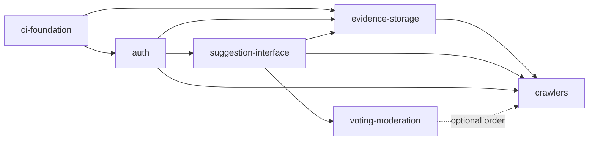

# Plans

Design and implementation plans for `redtape`. One folder per body of work; plans stay in the repo so
they version alongside the code they describe.

## Folders

### [web-frontend/](web-frontend/) — Wave 2 visual alignment

Restyle the existing document list, detail, and location-picker screens: custom Chakra theme (red
brand, Iceberg headings, Inter body), app shell polish, and native Chakra compound components. Does
not add dependency-tree, social, or auth UI — those remain in
[docs/planning/directions/web-frontend/](../docs/planning/directions/web-frontend/README.md).

| Doc | What it is |
| --- | --- |
| [00-architecture.md](web-frontend/00-architecture.md) | Visual contract — tokens, typography, component rules, screen inventory |
| [01-rollout.md](web-frontend/01-rollout.md) | Ten chapters, dependency graph, invariants, per-chapter gate |
| [gaps-and-decisions.md](web-frontend/gaps-and-decisions.md) | Settled brand and scope boundaries |
| [chapters/](web-frontend/chapters/) | One executable plan per chapter |

Status: chapters 1–4 are done (test harness, not-found, red theme, color mode, app shell); see the
[rollout](web-frontend/01-rollout.md) for the rest.

### [document-matrix/](document-matrix/) — Domain × life-situation organization

Two independent taxonomies (domain: car, housing, work…; life situation: moving, birth of a child, job
loss…) as many-to-many tags on documents, Germany seed, filter and matrix APIs, and a web matrix page
with list filters. Postgres only. Ten chapters across data model, backend and frontend.

| Doc | What it is |
| --- | --- |
| [00-architecture.md](document-matrix/00-architecture.md) | Vocabulary, model, seed taxonomy, API and UI contract |
| [01-rollout.md](document-matrix/01-rollout.md) | Ten chapters, dependency graph, invariants, per-chapter gate |
| [gaps-and-decisions.md](document-matrix/gaps-and-decisions.md) | Settled decisions and open seams |
| [chapters/](document-matrix/chapters/) | One executable plan per chapter |

Status: shipped — all ten chapters done. Open seams and deferred work (list-card tags, curation): [gaps-and-decisions.md](document-matrix/gaps-and-decisions.md).

### [floating-nav/](floating-nav/) — Floating navigation

Replace the top toolbar with two circular floating buttons (gothic R brand button, burger menu), move
colour mode (sun/moon switch) and language (submenu) into the menu, drop the Iceberg wordmark, and remove
the matrix view. Frontend only, six chapters.

| Doc | What it is |
| --- | --- |
| [00-architecture.md](floating-nav/00-architecture.md) | Target UI, component tree, visual and accessibility contract |
| [01-rollout.md](floating-nav/01-rollout.md) | Six chapters, dependency graph, invariants, per-chapter gate |
| [gaps-and-decisions.md](floating-nav/gaps-and-decisions.md) | Settled decisions and open seams |
| [chapters/](floating-nav/chapters/) | One executable plan per chapter |

Status: planned — no chapter started. First: [chapters/01-remove-matrix.md](floating-nav/chapters/01-remove-matrix.md).

### [ci-foundation/](ci-foundation/) — Postgres-backed API CI

Run API tests against Postgres in GitHub Actions and local `./ci.sh` (today every DB test is skipped on
SQLite), fail loudly when the database is missing, and verify migrations round-trip with a single head.
Prerequisite for the document-collection suites. Backend and CI only, three chapters.

| Doc | What it is |
| --- | --- |
| [00-architecture.md](ci-foundation/00-architecture.md) | Problem, target state, design |
| [01-rollout.md](ci-foundation/01-rollout.md) | Three chapters, dependency graph, invariants, per-chapter gate |
| [gaps-and-decisions.md](ci-foundation/gaps-and-decisions.md) | Settled decisions and open seams |
| [chapters/](ci-foundation/chapters/) | One executable plan per chapter |

Status: shipped — all three chapters done. See [01-rollout.md](ci-foundation/01-rollout.md) for outcomes.

### The document-collection pipeline

Five suites, in dependency order, take the catalogue from hand-seeded to crawler- and community-grown:
people and crawlers submit through one interface, evidence backs every claim, votes and moderators decide,
and a scheduled crawler produces the first real traffic through all of it.

`evidence-storage` chapters 1–2 (the object-store port and the S3/MinIO adapter) have no suggestion
dependency and can start immediately, in parallel with `ci-foundation` and `auth`. `voting-moderation` and
`crawlers` do not depend on each other and can proceed in parallel once their own prerequisites ship.

### [auth/](auth/) — Login, roles and machine API keys

Supabase Auth (email magic link) for humans, verified by the API via JWT/JWKS; a local `app_user` table
with roles; hashed API keys for machine clients such as crawlers. Twelve chapters across backend and web.

| Doc | What it is |
| --- | --- |
| [00-architecture.md](auth/00-architecture.md) | Vocabulary, request flow, data model, API contract |
| [01-rollout.md](auth/01-rollout.md) | Twelve chapters, dependency graph, invariants, per-chapter gate |
| [gaps-and-decisions.md](auth/gaps-and-decisions.md) | Settled decisions and open seams |
| [chapters/](auth/chapters/) | One executable plan per chapter |

Status: shipped — all twelve chapters done. Open seams: [gaps-and-decisions.md](auth/gaps-and-decisions.md).

### [suggestion-interface/](suggestion-interface/) — One submission API for people and crawlers

A `suggestion` model and API for proposing new documents and new dependency edges; validated, deduplicated,
pending until voted on. Eleven chapters across backend and web.

| Doc | What it is |
| --- | --- |
| [00-architecture.md](suggestion-interface/00-architecture.md) | Vocabulary, data model, payloads, API contract |
| [01-rollout.md](suggestion-interface/01-rollout.md) | Eleven chapters, dependency graph, invariants, per-chapter gate |
| [gaps-and-decisions.md](suggestion-interface/gaps-and-decisions.md) | Settled decisions and open seams |
| [chapters/](suggestion-interface/chapters/) | One executable plan per chapter |

Status: planned — no chapter started. First: [chapters/01-suggestion-model-migration.md](suggestion-interface/chapters/01-suggestion-model-migration.md).

### [evidence-storage/](evidence-storage/) — Screenshots and fetch evidence in Cloudflare R2

An `ObjectStore` port with an S3-compatible adapter (R2 in production, MinIO locally), an `evidence` table
recording what was fetched and when, and upload/read endpoints. Nine chapters.

| Doc | What it is |
| --- | --- |
| [00-architecture.md](evidence-storage/00-architecture.md) | Vocabulary, design, data model, API contract |
| [01-rollout.md](evidence-storage/01-rollout.md) | Nine chapters, dependency graph, invariants, per-chapter gate |
| [gaps-and-decisions.md](evidence-storage/gaps-and-decisions.md) | Settled decisions and open seams |
| [chapters/](evidence-storage/chapters/) | One executable plan per chapter |

Status: planned — no chapter started. First: [chapters/01-object-store-port-and-settings.md](evidence-storage/chapters/01-object-store-port-and-settings.md).

### [voting-moderation/](voting-moderation/) — Votes, thresholds and promotion

Signed-in users vote pending suggestions to approval or rejection; approval promotes a suggestion into the
real catalogue; every vote, transition and moderator override is recorded in an append-only event log.
Twelve chapters.

| Doc | What it is |
| --- | --- |
| [00-architecture.md](voting-moderation/00-architecture.md) | Vocabulary, data model, thresholds, promotion |
| [01-rollout.md](voting-moderation/01-rollout.md) | Twelve chapters, dependency graph, invariants, per-chapter gate |
| [gaps-and-decisions.md](voting-moderation/gaps-and-decisions.md) | Settled decisions and open seams |
| [chapters/](voting-moderation/chapters/) | One executable plan per chapter |

Status: planned — no chapter started. First: [chapters/01-vote-model-migration.md](voting-moderation/chapters/01-vote-model-migration.md).

### [crawlers/](crawlers/) — Discovery crawler

A separate `apps/crawler` package: fetches configured sources politely, extracts document candidates,
captures a screenshot as evidence, and submits both through the suggestion API — as scheduled GitHub
Actions jobs, with no direct database access. Discovery mode only (see the strand's freshness mode).
Eleven chapters.

| Doc | What it is |
| --- | --- |
| [00-architecture.md](crawlers/00-architecture.md) | Vocabulary, package layout, fetching, extraction, scheduling |
| [01-rollout.md](crawlers/01-rollout.md) | Eleven chapters, dependency graph, invariants, per-chapter gate |
| [gaps-and-decisions.md](crawlers/gaps-and-decisions.md) | Settled decisions and open seams |
| [chapters/](crawlers/chapters/) | One executable plan per chapter |

Status: planned — no chapter started. First: [chapters/01-crawler-package-skeleton.md](crawlers/chapters/01-crawler-package-skeleton.md).

## Conventions

- **Frontmatter.** Each plan opens with YAML: `name`, `overview`, an optional `todos` list, and `isProject`.
- **Links.** Relative, from the plan's own folder. Source references point at real files under `apps/web/`.
- **Status.** Recorded in the plan meta line (`**Status:** planned` until shipped).
- **CI.** `./ci.sh` from the repo root is the gate: API ruff, mypy, pytest, then web lint, format, typecheck, **vitest**, and build (after chapter 1).
