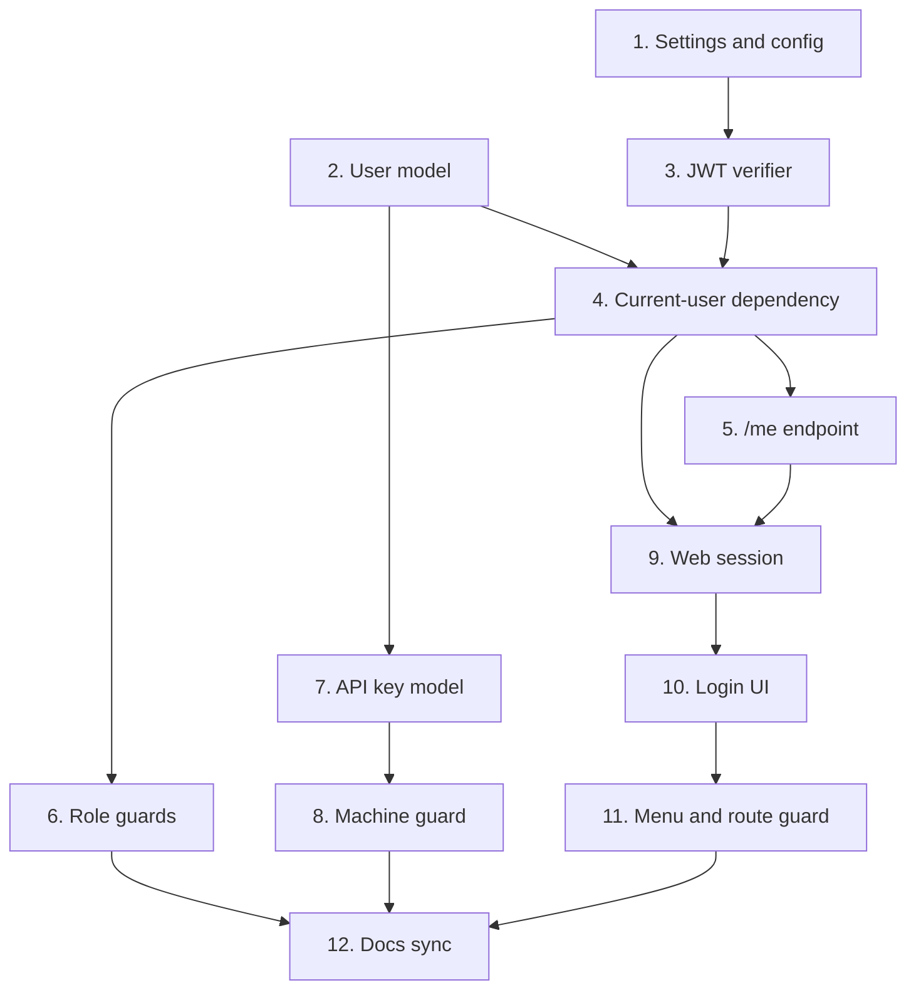

# Auth — Rollout

**Architecture:** [00-architecture.md](00-architecture.md) · **Decisions:** [gaps-and-decisions.md](gaps-and-decisions.md) · **Chapters:** [chapters/](chapters/)

**Prerequisite:** [ci-foundation](../ci-foundation/01-rollout.md) chapters 1–2 (Postgres-backed tests, migration check).

---

## The three invariants

1. **Additive only.** No existing route changes behaviour; public reads stay public. New tables and columns
   only; every migration has a working `downgrade`.
2. **Independently shippable.** After each chapter `./ci.sh` passes and the app runs with **no Supabase
   configuration**: unset auth settings disable login and make protected routes return 401, and the web app
   shows no login entry until chapter 11 wires it.
3. **No secret in the repo.** Keys and URLs come from the environment; tests generate their own signing
   keys; `.env.example` holds placeholders only.

---

## Dependency graph



Chapters 1 and 2 have no dependency on each other and can proceed in parallel; chapter 7 needs only
chapter 2 (migration chain). Chapters 5 and 6 are independent of each other. The web track (9–11) can run
in parallel with 6–8.

---

## Chapters

| # | Chapter | Layer | Gate | Plan | Status |
| --- | --- | --- | --- | --- | --- |
| 1 | Settings and Supabase config | backend | pytest + `./ci.sh` | [01-settings-and-supabase-config.md](chapters/01-settings-and-supabase-config.md) | done |
| 2 | User model and migration | model + migration | pytest + round-trip + `./ci.sh` | [02-user-model-migration.md](chapters/02-user-model-migration.md) | done |
| 3 | JWT verifier | backend | pytest + `./ci.sh` | [03-jwt-verifier.md](chapters/03-jwt-verifier.md) | done |
| 4 | Current-user dependency | backend | pytest + `./ci.sh` | [04-current-user-dependency.md](chapters/04-current-user-dependency.md) | done |
| 5 | `/me` endpoint | backend | pytest + `./ci.sh` | [05-me-endpoint.md](chapters/05-me-endpoint.md) | done |
| 6 | Role guards | backend | pytest + `./ci.sh` | [06-role-guards.md](chapters/06-role-guards.md) | done |
| 7 | API key model and hashing | model + migration | pytest + round-trip + `./ci.sh` | [07-api-key-model-and-hashing.md](chapters/07-api-key-model-and-hashing.md) | done |
| 8 | Machine principal guard | backend | pytest + `./ci.sh` | [08-machine-principal-guard.md](chapters/08-machine-principal-guard.md) | done |
| 9 | Web Supabase session | frontend | vitest + `./ci.sh` | [09-web-supabase-session.md](chapters/09-web-supabase-session.md) | done |
| 10 | Web login UI | frontend + i18n | vitest + `./ci.sh` + manual | [10-web-login-ui.md](chapters/10-web-login-ui.md) | done |
| 11 | Web menu and route guard | frontend + i18n | vitest + `./ci.sh` + manual | [11-web-menu-and-route-guard.md](chapters/11-web-menu-and-route-guard.md) | done |
| 12 | Docs sync | docs | link check | [12-docs-sync.md](chapters/12-docs-sync.md) | done |

Typical negative assertions per slice: expired token, wrong audience, wrong issuer, bad signature, `alg`
none, unknown `kid`, missing header, malformed header, revoked key, unknown key, insufficient role, machine
key on a human-only route.

## Per-chapter gate

```bash
# backend chapters
cd apps/api && python -m pytest tests/<file>.py
cd ../.. && ./ci.sh

# migration chapters, additionally
cd apps/api && alembic upgrade head && alembic downgrade -1 && alembic upgrade head

# web chapters
cd apps/web
npm run test -- <paths>
npm run lint && npm run format:check && npm run typecheck && npm run build
cd ../.. && ./ci.sh
```

**Refactor gate** (reported per chapter): methods ~5 LOC, classes ~100 LOC, at most one level of nesting,
commit at least once per green. Branches `feat/auth-<name>`, conventional commits (`test(api): …` then
`feat(api): …`, or `web` scope), one PR per chapter, never commit to `main`.
