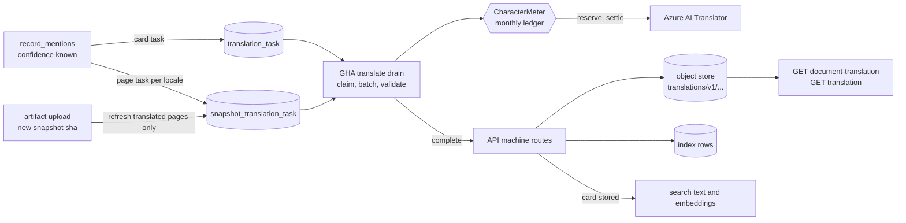

# Azure translation — Architecture

**Rollout:** [01-rollout.md](01-rollout.md) · **Decisions:** [gaps-and-decisions.md](gaps-and-decisions.md) · **Predecessor:** [search-first](../search-first/00-architecture.md)

## Context

Translation runs today on the Cloudflare Workers AI LLM adapter (`llm`, `@cf/qwen/qwen3-30b-a3b-fp8`, `apps/discovery-ingest/discovery_ingest/translation/adapters/cloudflare_llm.py`). Workers AI neurons are a daily allowance. That allowance ran out on 2026-11-11, with `tr` and `uk` enabled and about 7,757 card tasks still pending ([run ledger](../search-first/run-ledger.md)). There is no machine-translation model in the stack.

A `claude-code` engine (chapter 19 of search-first) reached `main` through PR #410. The port now carries `limits` and a `subscription` usage unit, and this suite builds on both. Chapter 17 removes the engine together with the Cloudflare translation adapter.

Azure AI Translator is metered per character, has a free monthly allowance, and reports the billed characters in a response header. That fits batch translation better than neurons, provided spend is reserved before each call and settled after it.

## What changes

| Concern | On `main` today | After this suite |
| --- | --- | --- |
| Translation engine | `llm` (Cloudflare Workers AI) | `azure-translator` (Azure AI Translator, API `2026-06-06`, NMT). `llm` stays selectable for rollback until chapter 17 |
| Units translated | card (title and description) | card; snapshot (complete procedure page); interface strings and taxonomy labels |
| Metering | daily neuron ledger with a query-embedding floor | monthly character ledger `azure_translator_chars`; documents use only the share above a protected card band |
| Languages | `tr uk` enabled, others pending | `en tr ru uk pl ro` (the embedding set minus `de`) |
| Interface switcher | `de en` enabled | `de en tr ru uk pl ro`; machine-accepted locales carry a code and a note |
| Candidate page | title and description popover | plus a collapsed "Document contents" accordion item in the interface language |
| Admin coverage | neuron table and generic free-tier table | plus a Translator section and per-locale translation coverage |

## Pipeline

## Components

### Azure adapter

- One engine behind the existing `TranslationEngine` port: name `azure-translator`, usage unit `characters`, one target language per call. Request shape, limits and error map are in [chapter 02](chapters/02-azure-engine-adapter.md).
- Facts the design depends on, read from Microsoft Learn on 2026-11-11:
  - `POST {endpoint}/translate?api-version=2026-06-06` with `inputs[]` and `targets[]`. This version is not compatible with v3.0.
  - Per request: at most 1,000 inputs and 50,000 characters, counted across all targets. A 3,000-character text sent to three targets counts as 9,000.
  - The billed characters come back in the `X-metered-usage` response header.
  - `textType` is `plain` or `html`. There is no markdown mode.
  - Throttling is HTTP 429 with codes `429000`–`429002`. `403001` means the free quota is used up. No `Retry-After` header is documented.
  - F0 (free) gives 2 million characters a month, with an hourly sliding-window quota of the same size. S1 is pay-as-you-go.
- Language codes `en tr ru uk pl ro` map to themselves. Norwegian would be `nb` and Chinese `zh-Hans` or `zh-Hant`; neither is in scope.
- An engine that cannot repair is declared so: `repairs` is `False` for Azure. An invalid unit fails rather than costing a second identical call.

### Metering and soft limits

- The ledger resource `azure_translator_chars` is monthly (`%Y-%m` UTC) with a default cap of 1,900,000 characters: 95% of the F0 monthly allowance, following the repo's free-tier convention. The resource name is a string in the existing ledger table, so no migration is needed.
- `CharacterMeter` reserves the exact characters before each call, all or nothing, and settles to the characters Azure reports. A refused reservation or a `403001` stops the drain and releases the tasks without consuming an attempt, as the neuron quota stop already does.
- Documents share the cap with cards and interface strings. `FlooredMeter` keeps `(1 − AZURE_DOCUMENT_BUDGET_SHARE) × cap` for them. The share defaults to 0.6, so about 760,000 characters remain for cards and interface strings whatever documents do.
- The GitHub workflow starts a run only when at least `AZURE_TRANSLATOR_MIN_REMAINING_CHARS` remain. Otherwise it exits 3 and skips the job, so a drain never starts only to be denied.

### Snapshot unit

- A snapshot is the cleaned text of a procedure page: the stored HTML snapshot run through `clean_page` (`apps/discovery-ingest/discovery_ingest/extract/clean.py`). Headings, list items, table rows and definition lists stay at line level.
- It is translated as a list of blocks, not as markup. Each (page, locale, content hash) is stored as one canonical JSON object at `translations/v1/snapshots/{catalogue_service_id}/{locale}/{content_sha256}.json`. Blocks avoid Azure's HTML-only markup, and the web never renders markup from the source.
- Translation is per page, not per candidate. One procedure page can mention many candidates, and it is translated once per locale.
- Staleness has two keys:
  - The raw artifact sha, which the API knows, decides whether a task is needed.
  - The cleaned-text hash, which the worker computes, decides whether characters are needed. Raw HTML can change without the text changing (nonces, timestamps), and that case costs zero characters.
- A page is skipped with a marker, not translated, when its cleaned text is under 200 characters (empty JavaScript shells: 111 of 189 sampled snapshots) or when its language is not German.
- Each page is capped at 30,000 characters of cleaned text, the existing default of `clean_page`. A capped page is stored with `truncated` set.

### Read path and UI

- `GET /api/v1/candidates/{id}/document-translation?locale=` resolves the candidate's best mention to its procedure page and reads the blocks from the object store. It never translates and never writes.
- The ETag is the content hash, and `Cache-Control` matches the card translation route.
- Web: a collapsed "Document contents" accordion item on the candidate page, hidden in German. The interface locale picks the translation, and a locale switch refetches.

### Interface strings and locales

- The five non-German interface locales already have complete bundles and review manifest entries from search-first C11 and PRs #400 and #404. All are marked `machine`.
- Acceptance: a locale is enabled only at 100% German key coverage, with either a native-speaker `reviewed` status or an operator's `machine_accepted` decision that names the operator and the date. A tool is never the recorded reviewer ([D5](gaps-and-decisions.md#d5--machine-output-is-labelled-and-no-tool-is-ever-the-reviewer)).
- Machine-made locales show a code (`TR`) and a "machine translated" note in the switcher. The emoji flags stay, because they do not render as flags on Windows.
- Plurals: MT drops the German inflection note, so the plural categories are produced from representative CLDR sample numbers, and `{count}` is restored after translation.

### Admin coverage

- The Translator section reads the budgets query the page already makes, so the monthly meter, period and exhausted state need no new API.
- Per-locale translation coverage is a separate endpoint in the translation feature. It is not a new field on the discovery coverage response, so discovery does not depend on translation.
- Deviation from the approved plan: the page does not show the document floor. The share is a worker setting (`AZURE_DOCUMENT_BUDGET_SHARE`, set in GitHub Actions). Copying it into API settings would create two sources of truth, so the runbook documents it instead.

## Cost model (F0)

| Quantity | Value | Basis |
| --- | --- | --- |
| Monthly cap | 1,900,000 characters | `BUDGET_AZURE_TRANSLATOR_CHARS_MONTHLY` |
| Card and interface-string band | about 760,000 characters | 40% of the cap |
| Document share | about 1,140,000 characters | 60% of the cap |
| Median cleaned page | about 4,300 characters | gold fixtures README, 20 pages |
| One page in 5 target locales | about 21,500 characters | median × 5 |
| Pages per month in the document share | about 50 | 1,140,000 ÷ 21,500 |
| Worst-case page at the 30,000 cap | 150,000 characters across 5 locales | about 13% of the share |
| One candidate card in 5 locales | about 2,000 characters | title plus description (cut at 300) × 5 |
| Candidates per month in the card band | about 380 | 760,000 ÷ 2,000 |
| Candidates per month if documents are paused | about 950 | 1,900,000 ÷ 2,000 |

The first month clears only part of the card and interface-string backlog. The backlog drains over months, best confidence first. The levers are narrower target locales or moving to S1. F0's hourly sliding-window quota (about 33,000 characters a minute) never binds at this volume; the adapter keeps its minimum call interval anyway.

## Seams

- A second engine later: the port stays the seam. Only `adapters/azure_translator*` and the Azure settings class name Azure.
- Out of this suite: LLM deployments, custom or adaptive translation, the Document Translation service, RTL languages, demand-driven translation on accordion expand. See [gaps-and-decisions.md](gaps-and-decisions.md).
