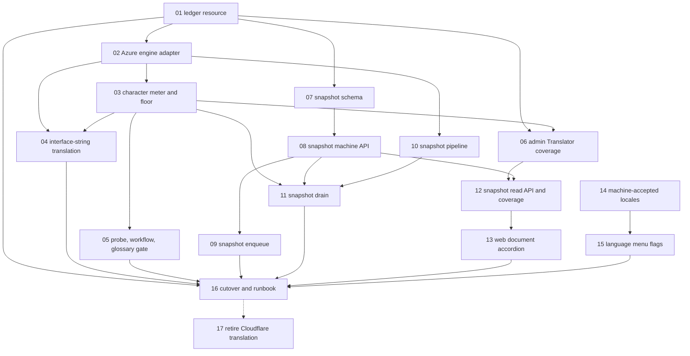

# Azure translation — Rollout

**Architecture:** [00-architecture.md](00-architecture.md) · **Decisions:** [gaps-and-decisions.md](gaps-and-decisions.md) · **Chapters:** [chapters/](chapters/)

**Loop branch:** `feat/plans-azure-translation`
**Release branch:** `main`

## Invariants

The search-first invariants still hold. This suite adds these:

1. Translation is produced only by background workers through the queue. No read path calls a translator, writes a row or enqueues work.
2. Providers sit behind the one `TranslationEngine` port. Only `adapters/azure_translator*` and the Azure settings name Azure.
3. The Azure key lives only in GitHub Actions secrets. Workers hold no database URL, and the API host holds no Azure credential.
4. Characters are reserved on the monthly ledger before each call, all or nothing, and settled to the characters Azure reports.
5. Documents never take the card band. A snapshot reservation may not leave less than the protected share of the cap. A quota stop releases tasks without consuming an attempt.
6. A snapshot is stored as blocks of plain text, never as HTML or markdown.
7. A stored translation carries the source hash it was made from. A stale result is requeued, never stored. For snapshots the raw artifact sha decides whether a task is needed, and the cleaned-text hash decides whether characters are needed.
8. Machine output is labelled as machine-made. A locale is enabled only at 100% key coverage, after a native `reviewed` status or an operator's `machine_accepted` decision that names the operator. A tool is never recorded as the reviewer.
9. Every chapter runs red → green → refactor, its narrow checks, and then `./ci.sh`.
10. No chapter adds right-to-left support or a second translation provider.

## Dependency graph

## Scheduling matrix

| ID | Chapter | Depends on | Touches | Execution | Gate | Status |
| --- | --- | --- | --- | --- | --- | --- |
| AZ01 | Ledger resource `azure_translator_chars` | — | API budgets, ingest budget literal, contract fixture, i18n, docs | chapter-implementer | API and ingest tests + `./ci.sh` | planned |
| AZ02 | Azure engine adapter | AZ01 | ingest `translation/adapters`, Azure settings, harness, `repairs` | chapter-implementer | conformance suite + `./ci.sh` | planned |
| AZ03 | Character meter and floor | AZ02 | ingest meter, floored meter, budget guard, drain wiring | chapter-implementer | drain and meter tests + `./ci.sh` | planned |
| AZ04 | Interface-string translation | AZ02, AZ03 | ingest `i18n`, plural expansion, locale files | chapter-implementer | i18n and parity tests + `./ci.sh` | planned |
| AZ05 | Probe, workflow and glossary gate | AZ03 | ingest probe, workflow, settings | chapter-implementer, then operator live probe | probe and workflow tests + `./ci.sh`; recorded live probe | planned |
| AZ06 | Admin Translator coverage | AZ01, AZ03 | API translation admin route, web coverage components | chapter-implementer | API and Vitest + `./ci.sh` | planned |
| AZ07 | Snapshot schema | AZ01 | API migration, models, leased queue type | chapter-implementer | migration round-trip + `./ci.sh` | planned |
| AZ08 | Snapshot machine API | AZ07 | API translation snapshot routes, store, checks, contract fixture | chapter-implementer | API + contract tests + `./ci.sh` | planned |
| AZ09 | Snapshot enqueue and backfill | AZ08 | API discovery hooks, translation enqueue, backfill script | chapter-implementer | API tests + `./ci.sh` | planned |
| AZ10 | Snapshot pipeline | AZ02 | ingest `snapshot_translation` (pure) | chapter-implementer | golden tests + `./ci.sh` | planned |
| AZ11 | Snapshot drain | AZ03, AZ08, AZ10 | ingest worker, client, CLI, workflow | chapter-implementer | ingest tests + `./ci.sh` | planned |
| AZ12 | Snapshot read API and coverage | AZ06, AZ08 | API candidates and translation routes, OpenAPI snapshot | chapter-implementer | API tests + `./ci.sh` | planned |
| AZ13 | Web document accordion | AZ12 | web candidate detail, hooks, services, i18n | chapter-implementer | Vitest + typecheck/build + `./ci.sh` | planned |
| AZ14 | Machine-accepted locales | — | API enable and locales, manifests, migration, honesty test | chapter-implementer | API and ingest tests + `./ci.sh` | planned |
| AZ15 | Language menu flags | AZ14 | web switcher, i18n | chapter-implementer | Vitest + typecheck/build + `./ci.sh` | planned |
| AZ16 | Cutover and runbook | AZ01–AZ15 | defaults, workflow fallback, operations docs, parity tests | chapter-implementer | docs and config tests + `./ci.sh` | planned |
| AZ17 | Retire Cloudflare translation | AZ16 and one month of operation | ingest adapters, translation settings, harness | operator go-ahead, then chapter-implementer | regression tests + `./ci.sh` | deferred |

## Shared files and merge order

The chief of staff runs one chapter at a time, so there are no parallel batches. These files are touched by several chapters, and the order below is the merge order:

- `apps/api/app/config.py` and `apps/discovery-ingest/discovery_ingest/translation/settings.py`: AZ01, AZ02, AZ03, AZ05, AZ16.
- `apps/api/tests/fixtures/discovery_machine_contract.json`: AZ01 (budget enum), AZ08 (snapshot routes). Regenerate in each chapter that changes it.
- `openapi.schemas.json` and `apps/api/tests/test_openapi_snapshot.py`: AZ12 (document-translation route), AZ14 (`LocaleRead`).
- i18n bundles (`apps/api/scripts/seed_data/translations/*.json` and `apps/web/src/i18n/fallback/*.json`): AZ01, AZ04, AZ06, AZ13, AZ15. Every chapter that adds a key writes all seven locales in the same change.
- `review_manifest.py` and `discovery_ingest/i18n/manifest.py`: AZ14 only.

## Operator actions

| Step | When | Who |
| --- | --- | --- |
| Record the data-processing and region decision (O5) | before AZ05 | operator |
| Create the Azure Translator resource (F0, EU region); record endpoint and region | before AZ05 | operator |
| Set GitHub secrets `AZURE_TRANSLATOR_KEY`, `AZURE_TRANSLATOR_REGION` and optional `AZURE_TRANSLATOR_ENDPOINT`; variable `TRANSLATION_ENGINE` | before AZ05 | operator |
| Run `translate probe --engine azure-translator` once; record the report and the glossary mode (D8) in the run ledger | AZ05 | operator |
| Set Render variables `TRANSLATION_TARGET_LOCALES` and, only if it differs from the default, `BUDGET_AZURE_TRANSLATOR_CHARS_MONTHLY` | AZ16 | operator |
| Accept machine strings per locale (`accepted_by`, `accepted_on` in the manifest) and run `enable_locale.py` | AZ14 and AZ16 | operator |
| Run `backfill_translations.py` for cards, then the snapshot backfill | after AZ16 | operator |
| Set `SNAPSHOT_TRANSLATE_SCHEDULE=enabled` after one inspected manual snapshot drain | after AZ11 | operator |
| Check the coverage page and the monthly meter for two runs; record in the run ledger | after AZ16 | operator |
| Go-ahead for AZ17, after about a month with no rollback | after AZ16 | operator |

## Chapters

Execution order (chief of staff):

1. [Ledger resource](chapters/01-ledger-resource.md)
2. [Azure engine adapter](chapters/02-azure-engine-adapter.md)
3. [Character meter and floor](chapters/03-character-meter-and-floor.md)
4. [Interface-string translation](chapters/04-ui-string-translation.md)
5. [Probe, workflow and glossary gate](chapters/05-probe-workflow-and-glossary-gate.md)
6. [Admin Translator coverage](chapters/06-admin-translator-coverage.md)
7. [Snapshot schema](chapters/07-snapshot-schema.md)
8. [Snapshot machine API](chapters/08-snapshot-machine-api.md)
9. [Snapshot enqueue and backfill](chapters/09-snapshot-enqueue.md)
10. [Snapshot pipeline](chapters/10-snapshot-pipeline.md)
11. [Snapshot drain](chapters/11-snapshot-drain.md)
12. [Snapshot read API and coverage](chapters/12-snapshot-read-api.md)
13. [Web document accordion](chapters/13-web-document-accordion.md)
14. [Machine-accepted locales](chapters/14-locale-machine-accepted.md)
15. [Language menu flags](chapters/15-language-menu-flags.md)
16. [Cutover and runbook](chapters/16-cutover-runbook.md)

Deferred, not in the execution order: [chapter 17, retire the Cloudflare translation adapter](chapters/17-retire-cloudflare-translation.md). It starts only on an operator go-ahead.
