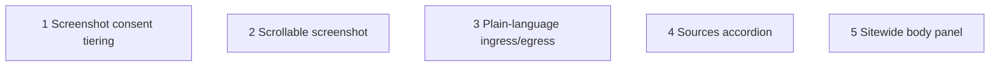

# Candidate view polish — Rollout

**Architecture:** [00-architecture.md](00-architecture.md) · **Decisions:** [gaps-and-decisions.md](gaps-and-decisions.md) · **Chapters:** [chapters/](chapters/)

**Loop branch:** `feat/plans-candidate-view-polish`
**Release branch:** `main`

## The four invariants

1. **No new infrastructure.** Consent tiering stays inside the existing single Cloudflare Browser Run `/snapshot` request (`addStyleTag`/`addScriptTag` fields); no Worker, no Puppeteer/Playwright binding, no new billing surface.
2. **Presentation only.** None of the five chapters changes a data model, a migration, or what the candidate-view suite's API returns. Screenshot bytes, sources data, and ingress/egress edges are read and shown exactly as today; only how and when they are captured or displayed changes.
3. **Reuse existing tokens and patterns.** The body panel reuses the `surface.base`/`border.base`/shadow tokens already used by `SectionCard`; no new design tokens. The sources panel reuses the existing, unused `candidates.sources` i18n key. The heading promotion reuses the existing, unused `*_subtitle` copy. Nothing is invented that already exists.
4. **Every chapter is independently green.** Each chapter names a happy and a negative test before implementation, runs the refactor audit over its containing entity, and passes the local gate. Chapters merge into the loop branch only; the release PR is the only merge into `main`.

## Prerequisites and ownership

- Reuse, do not reopen: the candidate-view suite's data model, API and components (`../candidate-view/00-architecture.md`); the theme's `surface`/`border`/`shadow` tokens and `SectionCard` (`../web-gui-harmonization/00-architecture.md`).
- This suite branches from `main` (the candidate-view and web-gui-harmonization suites are already merged there).
- No production access or live run is needed — every chapter is a code change with a local test gate; nothing here touches staged data or runs against production.

## Dependency graph



All five chapters touch disjoint files and have no sequencing dependency on each other or on a shared chapter. Run them in any order, in parallel if convenient.

## Execution order (chief of staff)

1. [01-screenshot-consent-tiering.md](chapters/01-screenshot-consent-tiering.md)
2. [02-screenshot-scroll-view.md](chapters/02-screenshot-scroll-view.md)
3. [03-neighbour-plain-language.md](chapters/03-neighbour-plain-language.md)
4. [04-sources-accordion.md](chapters/04-sources-accordion.md)
5. [05-body-panel-layout.md](chapters/05-body-panel-layout.md)

(Listed in the order of the original review, not a dependency order — none blocks another.)

## Chapters

| # | Chapter | Layer | Gate | Status |
| --- | --- | --- | --- | --- |
| 1 | [Screenshot consent tiering](chapters/01-screenshot-consent-tiering.md) | ingest | pytest (ingest) + `./ci.sh` | planned |
| 2 | [Scrollable screenshot](chapters/02-screenshot-scroll-view.md) | web | Vitest + `./ci.sh` | planned |
| 3 | [Plain-language ingress/egress](chapters/03-neighbour-plain-language.md) | web | Vitest + `./ci.sh` | planned |
| 4 | [Sources accordion](chapters/04-sources-accordion.md) | web | Vitest + `./ci.sh` | planned |
| 5 | [Sitewide body panel](chapters/05-body-panel-layout.md) | web | Vitest + `./ci.sh` | planned |

## Per-chapter gate

Web chapters:

```bash
cd apps/web
npm run test -- <paths named in the chapter>
npm run lint
npm run format:check
npm run typecheck
npm run build
cd ../..
./ci.sh
```

The ingest chapter runs its narrow pytest path first (`cd apps/discovery-ingest && pytest <paths>`), then `./ci.sh`. A chapter is not green when only the happy path passes.

## Branch and release protocol

For each chapter:

```bash
git checkout feat/plans-candidate-view-polish && git pull
git checkout -b feat/candidate-view-polish-<slug>
```

Each chapter names its branch. Use a test commit followed by an implementation (and refactor, where practical) commit, with conventional commits. Open each chapter PR into the loop branch. After all five chapters are merged, the chief of staff opens one release PR from `feat/plans-candidate-view-polish` to `main`.

No deploy ordering constraint: none of the chapters depends on another being live first, and none needs a production live run.

## Manual smoke after chapter 5

Written into `docs/operations/candidate-view.md` (or a new `candidate-view-polish.md`, chapter author's call) once chapter 5 lands: `/candidates/:id` shows a visible panel boundary against the canvas; the evidence screenshot scrolls vertically and shows no cookie banner on a known-bannered source page; the Ingress/Egress headings read "Documents you need first"/"Documents that need this one"; the Sources section is collapsed by default and expands on click; the same panel boundary appears on `/candidates`, `/documents`, and at least one admin page, in light and dark.
