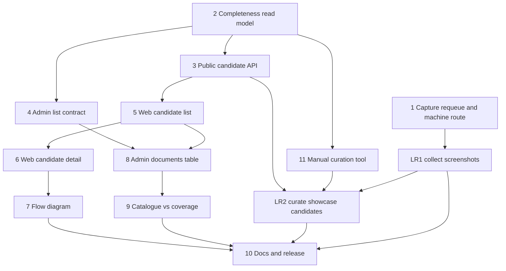

# Candidate view — Rollout

**Architecture:** [00-architecture.md](00-architecture.md) · **Decisions:** [gaps-and-decisions.md](gaps-and-decisions.md) · **Live runs:** [02-live-runs.md](02-live-runs.md) · **Chapters:** [chapters/](chapters/) · **Ledger:** [run-ledger.md](run-ledger.md)

**Loop branch:** `feat/plans-candidate-view`
**Release branch:** `main`

## The six invariants

1. **Read-only product surface.** The candidate pages and routes never emit, vote, edit or delete. The only writes in the suite are the screenshot tasks the requeue tool enqueues, the artifacts the existing drain stores, and the `manual` mentions and edges the showcase curation run writes through the existing machine routes (D19). Nothing extracted is edited or deleted, nothing is emitted.
2. **One completeness rule.** The five flags are computed in one repository query. The public API and the admin list both use it; no second copy of the tag consensus rule exists outside the parity-tested SQL.
3. **Public means unguarded, not unbounded.** The public routes validate every query parameter through the shared list-query contract (422 on an unknown key or value), page at most 100 rows, never return mention internals beyond the documented DTO, and meter screenshot reads.
4. **One table language.** The admin documents table uses the shared `DataTable` kernel and its sort and filter capabilities; no bespoke toolbar or table markup.
5. **No new dependency.** The diagram is SVG, the tooltip is Chakra's, the API adds no package.
6. **Every chapter is independently green.** Each chapter names a happy and a negative test before implementation, runs the refactor audit over its containing entity, and passes the local gate. Chapters merge into the loop branch only; the release PR is the only merge into `main`.

## Prerequisites and ownership

- Reuse, do not reopen: the theme and `AppCard` ([web-frontend](../web-frontend/00-architecture.md)), the DataTable kernel and list contract ([web-gui-harmonization](../web-gui-harmonization/00-architecture.md)), the staging model and artifact policy ([extraction](../extraction/00-architecture.md), [crawlers](../crawlers/00-architecture.md)).
- The extraction loop branch `feat/extraction` is merged into `main` (PR #260). This suite branches from `main`.
- GitHub Actions minutes are exhausted until about 2026-11-01; every gate is local (decision D17).
- Production access for the live run uses `/home/schult_v/.config/redtape/probe.env`, sourced and never printed.

## Dependency graph



Chapter 8 depends on chapter 4 (the sort and filter keys it declares) and on chapter 5 (the `CompletenessChips` component it reuses for the Readiness column). The tooltip and `TruncatedText` are built in chapter 8 itself; chapter 9 reuses them.

## Execution order (chief of staff)

1. [01-capture-requeue.md](chapters/01-capture-requeue.md)
2. [02-completeness-read-model.md](chapters/02-completeness-read-model.md)
3. [11-manual-curation-tool.md](chapters/11-manual-curation-tool.md) (chapter 11, executed here because it needs only chapter 2)
4. [03-public-candidate-api.md](chapters/03-public-candidate-api.md)
5. [04-admin-list-contract.md](chapters/04-admin-list-contract.md)
6. [05-web-candidate-list.md](chapters/05-web-candidate-list.md)
7. [06-web-candidate-detail.md](chapters/06-web-candidate-detail.md)
8. [07-flow-diagram.md](chapters/07-flow-diagram.md)
9. [08-admin-documents-table.md](chapters/08-admin-documents-table.md)
10. [09-catalogue-vs-coverage.md](chapters/09-catalogue-vs-coverage.md)
11. [10-docs-and-release.md](chapters/10-docs-and-release.md)

The **live runs** ([02-live-runs.md](02-live-runs.md)) are not chapters and not an implementer's job; the chief of staff runs them.

- **LR1, screenshot collection**, after chapter 1 is merged **and the owner has deployed the API** (the machine route of chapter 1). If the deploy is not there yet, the chief records the blocker, continues with the chapters that need no screenshots, and runs LR1 before LR2.
- **LR2, showcase curation**, after chapters 2, 11 and 3 are merged **and the owner has deployed the API again** (the manual override and the public list), and after LR1. It completes the highest-ranking candidates by hand and captures their pages first. If the deploy is not there, the chief records the blocker and continues with the web chapters (their tests use stubs); LR2 then runs before chapter 10 so the smoke checklist can name real showcase candidates.

Chapter 10 needs both results to write the expected counts and the showcase list.

## Chapters

| # | Chapter | Layer | Gate | Status |
| --- | --- | --- | --- | --- |
| 1 | [Capture requeue and machine route](chapters/01-capture-requeue.md) | API + ingest | pytest (api, ingest) + `./ci.sh` | planned |
| LR1 | [Screenshot collection](02-live-runs.md#lr1--screenshot-collection) | live (chief of staff) | counts recorded in the ledger | planned |
| 2 | [Completeness read model](chapters/02-completeness-read-model.md) | API | pytest + `./ci.sh` | planned |
| 11 | [Manual curation tool](chapters/11-manual-curation-tool.md) | ingest | pytest (ingest) + `./ci.sh` | planned |
| LR2 | [Showcase curation](02-live-runs.md#lr2--showcase-curation) | live (chief of staff) | candidates complete, recorded in the ledger | planned |
| 3 | [Public candidate API](chapters/03-public-candidate-api.md) | API | pytest + `./ci.sh` | planned |
| 4 | [Admin list contract](chapters/04-admin-list-contract.md) | API | pytest + `./ci.sh` | planned |
| 5 | [Web candidate list](chapters/05-web-candidate-list.md) | web | Vitest + `./ci.sh` | planned |
| 6 | [Web candidate detail](chapters/06-web-candidate-detail.md) | web | Vitest + `./ci.sh` | planned |
| 7 | [Flow diagram](chapters/07-flow-diagram.md) | web | Vitest + `./ci.sh` | planned |
| 8 | [Admin documents table](chapters/08-admin-documents-table.md) | web | Vitest + `./ci.sh` | planned |
| 9 | [Catalogue vs coverage](chapters/09-catalogue-vs-coverage.md) | API + web | pytest/Vitest + `./ci.sh` | planned |
| 10 | [Docs and release](chapters/10-docs-and-release.md) | docs | docs tests + manual smoke + `./ci.sh` | planned |

## Per-chapter gate

Web chapters:

```bash
cd apps/web
npm run test -- <paths named in the chapter>
npm run lint
npm run format:check
npm run typecheck
npm run build
cd ../..
./ci.sh
```

API and ingest chapters run the narrow pytest paths named in the chapter first (`cd apps/api && pytest <paths>`; `cd apps/discovery-ingest && pytest <paths>`), then `./ci.sh`. `./ci.sh` needs Postgres on `127.0.0.1`; on a stale local database use a scratch one, as the harmonization ledger records. A chapter is not green when only the happy path passes.

## Branch and release protocol

For each chapter:

```bash
git checkout feat/plans-candidate-view && git pull
git checkout -b feat/candidate-view-<slug>
```

Each chapter names its branch. Use a test commit followed by an implementation and refactor commit where practical, with conventional commits (`test(api): define the candidate completeness flags`, `feat(api): add the completeness read model`). Open each chapter PR into the loop branch. After chapters 1 to 10 are merged and the ledger is complete, the chief of staff opens one release PR from `feat/plans-candidate-view` to `main`.

Deploy (operator): the API must be deployed **twice** around the live runs: once after chapter 1 (machine sources route, for LR1) and once after chapters 2, 3 and 11 (override and public routes, for LR2); web last, after the release PR. No migration anywhere. The public pages work only once both are live.

## Manual smoke after chapter 10

The checklist is written by chapter 10 into `docs/operations/candidate-view.md#release-smoke-checks`. In short: the showcase candidates named in the ledger are complete (five chips, ingress and egress, diagram, screenshot) and `/candidates` lists candidates ranked by completeness; filters and search reset the page; `/candidates/:id` shows ingress and egress cards and the diagram in light and dark and at narrow width; a screenshot loads and a reload is a 304; `/admin/discovery/documents` has the toolbar in the header, every column sorts and filters, long titles are clipped with a tooltip; catalogue and coverage show different content.
