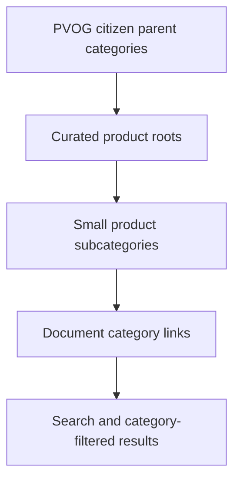
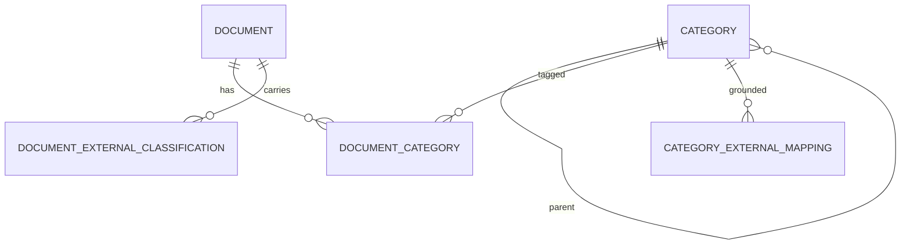

# Category taxonomy migration — Architecture

**Repo:** `redtape` (`apps/api`, `apps/discovery-ingest`, `apps/web`)
**Rollout:** [01-rollout.md](01-rollout.md) · **Decisions:** [gaps-and-decisions.md](gaps-and-decisions.md) · **Chapters:** [chapters/](chapters/)
**Precedent:** [document-matrix](../document-matrix/00-architecture.md) · [situation-tag-hierarchy](../situation-tag-hierarchy/00-architecture.md) · [document-browse-confidence](../document-browse-confidence/00-architecture.md)

## 1. Problem

The product currently exposes two overlapping classification axes:

- `domain`: what the document concerns;
- `life_situation`: the event or state that brings the user to the bureaucracy.

The original matrix UI has already been removed from the web application, but the two axes remain in the database, discovery contracts, public APIs, filters, tags, admin views, and machine/LLM vocabulary. The remaining shape still makes users reason about intersections that are not useful once search becomes the main discovery path.

This suite replaces those axes with one small hierarchical category tree:

The taxonomy is a browse aid, not the document's complete meaning. Search, future embeddings, entity identification, document requirements, and source provenance remain separate concerns.

## 2. Vocabulary

| Term | Meaning |
| --- | --- |
| **Category root** | A small user-facing top-level category. It groups one or more PVOG citizen parent categories. |
| **Subcategory** | A user-facing child of one root. It is a direct category row, not a raw PVOG leaf and not an intersection of old axes. |
| **Category tree** | The complete root → subcategory hierarchy returned by the taxonomy API. |
| **Category link** | A document-to-category relation carrying the persisted confidence score. |
| **PVOG classification** | External source metadata such as root, parent, or leaf code. It is not automatically a user-facing category. |
| **Category chip** | A compact UI link for one canonical root or subcategory. It uses the front page's red semantic color and links to the category-filtered document list. |
| **Category filter** | A request for one or more category codes. Selecting a root includes its descendants; selecting a subcategory matches that node according to the backend contract. |

The codebase must stop using `domain`, `life_situation`, and `life_situation_group` as the product vocabulary after cutover. Legacy names may exist temporarily inside compatibility migrations and mapping tables.

## 3. Taxonomy boundary and source truth

PVOG provides a hierarchy, but the current ingest mostly preserves only the leaf code. The current eight `LifeSituationGroup` rows are a product-curated presentation tier, not a persisted PVOG parent hierarchy. Chapter 1 must therefore freeze a versioned crosswalk before schema work:

1. PVOG audience/root and parent identifiers and labels are captured when available.
2. A small product root set is curated from those parent categories.
3. Product subcategories are defined below those roots with stable English-derived codes and localized names.
4. Each product category records its PVOG source mapping and mapping confidence.
5. Raw PVOG leaf codes remain external classifications and may be retained even when no product category is assigned.
6. Existing domain and life-situation codes receive an explicit migration mapping. Unmapped or ambiguous terms are reported, not silently discarded.
7. GovData documents without PVOG context remain valid documents; they use LLM/manual category evidence or remain uncategorized until evidence exists.

No implementation chapter may invent a new category label or silently repurpose an old code. The frozen vocabulary artifact is the input to seeds, migrations, API schemas, LLM enums, UI labels, and tests.

## 4. Target data model

### `category`

The target taxonomy table is self-referential:

- `id`: stable UUID;
- `parent_id`: nullable for a root, foreign key to `category.id` for a subcategory;
- `code`: immutable ASCII kebab-case public identifier;
- `name_i18n`, `description_i18n`, `icon`, `sort_order`;
- `is_active` or an equivalent lifecycle marker if the migration needs staged activation.

The model must enforce one parent for every subcategory and prevent cycles. It must not encode PVOG leaf codes as product category IDs.

### `document_category`

One row represents one document's membership in one canonical category:

- composite uniqueness on `(document_id, category_id)`;
- persisted `confidence` in `[0, 1]`;
- foreign keys with the same lifecycle guarantees as the current taxonomy links.

The link is the source for document tags, category filtering, and confidence-aware ordering. It is not a matrix cell.

### External classifications

PVOG leaf codes and future external taxonomies are source facts, not user-facing categories. Prefer a separate relation such as `document_external_classification` (or an equivalent normalized source table) with:

- document ID;
- source identifier (`pvog`, later sources);
- external code and optional source path/label;
- source version and capture time where available.

Mention-level source facts remain on discovery mentions where they explain how a category was proposed. Do not lose `catalogue_service_id`, `artifact_id`, `extractor`, `extractor_version`, quotes, or direct source confidence.

## 5. Confidence and evidence

The continuous confidence model from the existing tag work survives the taxonomy merge:

- each category assertion contributes a score;
- independent evidence combines through the existing noisy-OR/scoring rules;
- category inclusion and UI ranking do not reintroduce an axis-specific accept/reject threshold;
- a category chip matches category presence, regardless of confidence, unless the existing browse contract explicitly states otherwise;
- the progress circle may show confidence indirectly, but raw completeness/staging internals are not a public presentation concern.

When old domain and situation links map to the same category, the migration must define whether the new score is the maximum, noisy-OR, or a source-prioritized combination. That choice belongs in [gaps-and-decisions.md](gaps-and-decisions.md) and must be parity-tested.

## 6. API contract

The target public contract has one taxonomy:

- `GET /api/v1/categories`: locale-resolved roots and children;
- `GET /api/v1/discovery/machine/taxonomy`: closed machine vocabulary of active category codes, with source metadata only where workers need it;
- candidate/document list filters accept `filter[category]` as repeated or CSV codes according to the existing list-query convention;
- a root filter includes all active descendants;
- a subcategory filter targets that category node and does not require a second axis;
- document/candidate reads expose canonical category tags with `code`, localized `name`, and `confidence`;
- legacy `domain`, `group`, and `situation` inputs are refused from the compatibility boundary (release day, decision O4) with a 422 that names the parameter, and are not translated;
- `/matrix` is retired only after no runtime or contract consumer remains.

Unknown category codes remain explicit validation errors. The API must not expose PVOG leaf codes as category chips.

## 7. Frontend contract

Search is visually and structurally primary. Category browsing is a compact secondary control:

- one category-tree query replaces the separate domain, group, and situation queries;
- root selection opens or filters its descendants;
- subcategory selection is a direct category selection;
- stable URL parameters use category codes and preserve shareable links;
- old URLs receive a documented compatibility translation during rollout;
- document cards and detail headers render compact category chips for direct canonical category links;
- chips use the same red semantic token as the front page, not hardcoded colors;
- every chip is a real link to the category-filtered document list;
- card composition must avoid nested anchors or other nested interactive elements;
- PVOG leaf/source metadata is not rendered as a category chip.

The document detail view has five accordion items:

1. documents you need first — expanded by default;
2. documents that need this one — expanded by default;
3. flow — expanded by default;
4. evidence — collapsed by default;
5. sources — collapsed by default.

The “Staged and unreviewed” notice and completeness section are removed. Sources render one visually subordinate card per source, using the document-card visual grammar where the source shape permits and a subtler source-card variant where it does not.

## 8. Migration phases

1. Freeze the PVOG/product vocabulary and old-code crosswalk.
2. Add the target schema and external-classification storage.
3. Backfill categories and links idempotently while retaining old tables.
4. Add category API/filter reads and compatibility translation.
5. Move discovery, PVOG, LLM, manual curation, and promotion writes to category codes.
6. Move frontend filters, chips, admin surfaces, document view, and contracts.
7. Compare counts, links, confidence, URLs, and source provenance.
8. Retire old axes and matrix code only after parity gates.

Every migration must distinguish reversible schema rollout from forward-only data backfill. A failed backfill must leave the old read path usable.

## 9. Future embedding and entity boundary

This suite prepares for later vector search by keeping category codes stable, category labels localized, and source/provenance facts separate from taxonomy rows. It does not:

- add `pgvector` columns or embedding jobs;
- choose chunking, embedding models, or ranking;
- identify entities such as `Ausweis` or `Reisepass`;
- turn entity types into category roots;
- replace document requirements or discovery claims with category links.

Future embeddings may use category metadata as filters or features, but they must not be required for category migration correctness.

## 10. Invariants

1. One canonical category tree replaces the user-facing matrix.
2. Every active subcategory has exactly one active parent and no cycle exists.
3. Category codes are stable, language-neutral, and never derived from translated labels.
4. Every migrated document link is traceable to old taxonomy evidence, PVOG evidence, LLM evidence, or manual evidence.
5. No PVOG leaf or source provenance is lost during the axis merge.
6. Category chips always point to the same filter semantics used by front-page browsing.
7. The progress circle remains the only indirect confidence signal in the document view.
8. Staging state and completeness internals are not user-facing.
9. Search remains usable when a document has no category.
10. The matrix is removed only after runtime, contract, and documentation reference scans are clean.
