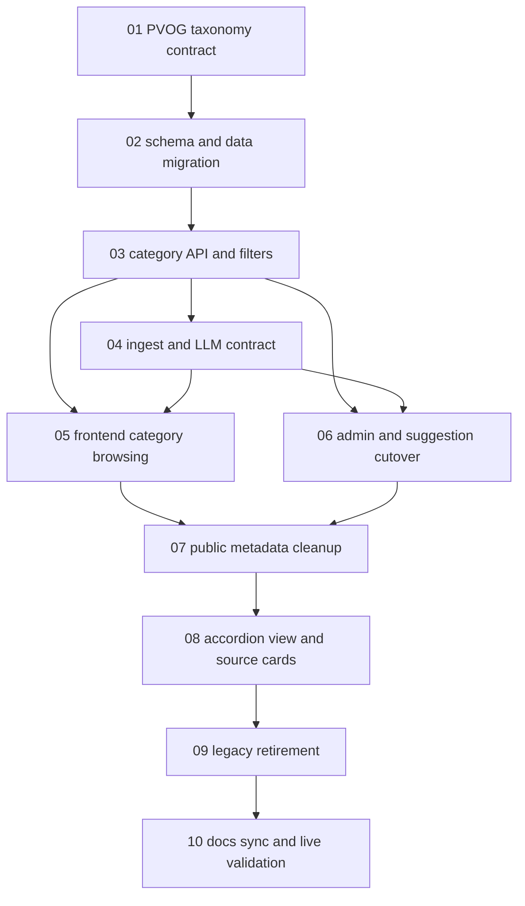

# Category taxonomy migration — Rollout

**Architecture:** [00-architecture.md](00-architecture.md) · **Decisions:** [gaps-and-decisions.md](gaps-and-decisions.md) · **Chapters:** [chapters/](chapters/)

**Loop branch:** `feat/plans-category-taxonomy-migration`
**Release branch:** `main`

## Invariants

1. The product has one user-facing category tree, not a domain × situation matrix.
2. The exact category inventory and old-code crosswalk are frozen before schema backfill.
3. Every category link remains traceable to evidence and retains a continuous confidence score.
4. PVOG source identifiers and discovery provenance survive the axis merge.
5. Search remains usable for documents with no category.
6. Category chips are direct links using the same filter semantics as front-page browsing.
7. Chips use the front page's red semantic token and never contain raw PVOG labels or codes.
8. The document view hides staging/completeness internals while retaining the progress circle.
9. The five document sections are accordion items with the first three open and evidence/sources closed by default.
10. Legacy tables, fields, and `/matrix` are removed only after compatibility and parity evidence.
11. No chapter introduces pgvector, embeddings, or entity identification.
12. Every implementation chapter uses red → green → refactor and runs its named narrow checks before the next dependent chapter.

## Dependency graph

## Execution order

1. Chapter 1 freezes the product vocabulary, PVOG snapshot, source mapping, and old-code crosswalk. It is the only chapter allowed to settle names and category membership.
2. Chapter 2 adds the target tables and idempotent backfill while the old tables remain available.
3. Chapter 3 adds the category tree API, machine vocabulary, backend filter semantics, tag reads, and compatibility translation.
4. Chapter 4 moves PVOG, LLM, manual curation, mention contracts, and promotion writes to category codes.
5. Chapter 5 moves the public web filters and category chips to the tree. The matrix UI is already gone and must not be recreated.
6. Chapter 6 moves admin, suggestions, candidate contracts, completeness internals, and OpenAPI fixtures to the new category vocabulary.
7. Chapter 7 removes the staged/unreviewed notice and completeness presentation/API fields that exist only for that disclosure. Internal ranking data is retained only where still needed.
8. Chapter 8 restructures the document detail view into the five requested accordion items and renders sources as subordinate cards.
9. Chapter 9 retires legacy axes and dormant matrix aggregation after all parity gates pass.
10. Chapter 10 updates category-related documentation and performs read-only post-deploy validation.

Chapters 3 and 4 must not be merged in a way that leaves machine workers with a vocabulary the API cannot validate. Chapters 5–8 may be split into separate PRs but share the public candidate contract and should be sequenced to avoid conflicting DTO changes.

## Chapters

| # | Chapter | App(s) | Gate | Status |
| --- | --- | --- | --- | --- |
| 1 | [PVOG taxonomy contract](chapters/01-pvog-taxonomy-contract.md) | api, discovery-ingest | mapping tests + artifact review | planned |
| 2 | [Category schema and data migration](chapters/02-category-schema-and-data-migration.md) | api | migration round-trip + `./ci.sh` | planned |
| 3 | [Category API and backend filters](chapters/03-category-api-and-backend-filters.md) | api | API tests + `./ci.sh` | planned |
| 4 | [Ingest and LLM category contract](chapters/04-ingest-and-llm-category-contract.md) | api, discovery-ingest | contract/eval tests + `./ci.sh` | planned |
| 5 | [Frontend category browsing](chapters/05-frontend-category-browsing.md) | web | Vitest + typecheck/build + `./ci.sh` | planned |
| 6 | [Admin and suggestion cutover](chapters/06-admin-and-suggestion-contract-cutover.md) | api, web | contract tests + `./ci.sh` | planned |
| 7 | [Public document metadata cleanup](chapters/07-public-document-metadata-cleanup.md) | api, web | DTO/UI regression tests + `./ci.sh` | planned |
| 8 | [Accordion view and source cards](chapters/08-accordion-document-view-and-source-cards.md) | web | accessibility/component tests + `./ci.sh` | planned |
| 9 | [Legacy retirement](chapters/09-legacy-retirement.md) | api, web | reference scan + migration gate + `./ci.sh` | planned |
| 10 | [Docs sync and live validation](chapters/10-docs-sync-and-live-validation.md) | docs, deployed apps | link check + read-only live checks | planned |

## Parallel-safe ownership

- Chapter 1 owns the vocabulary artifact and PVOG mapping decisions. No other chapter edits taxonomy labels.
- Chapter 2 owns new schema/migration files and model relationships.
- Chapter 3 owns category read/filter contracts and backend taxonomy/document/candidate services.
- Chapter 4 owns discovery mention/extraction contracts and PVOG/LLM mapping code.
- Chapter 5 owns public web taxonomy/filter/tag UI. It does not edit discovery-admin components.
- Chapter 6 owns discovery-admin, suggestion, manual-curation, and their public machine contracts.
- Chapter 7 owns public staging/completeness presentation and the corresponding DTO/translation cleanup.
- Chapter 8 owns candidate detail composition, accordion behavior, source-card presentation, and accessibility tests.
- Chapter 9 owns deletion/deprecation migrations and final reference cleanup. It starts only after all preceding chapters are released.
- Chapter 10 owns documentation and read-only evidence. It does not repair production data silently.

If two chapters must touch a shared DTO or translation bundle, the rollout branch merges them sequentially in dependency order.

## Per-chapter gates

Each chapter must:

1. list its exact files and no unrelated cleanup;
2. write one happy-path and one negative-path test before implementation;
3. confirm both tests fail for the intended reason;
4. implement the smallest green change;
5. audit the entire containing method/class/module for branch count, nesting, duplication, data clumps, boolean parameters, types, and docstrings;
6. rerun the narrow suite after each refactor extraction;
7. run the chapter's app checks and the root `./ci.sh` before its PR is merged;
8. record migration counts, crosswalk coverage, or UI contract evidence in [run-ledger.md](run-ledger.md).

## Data migration checkpoints

Before chapter 2 starts:

- the category inventory has stable IDs/codes;
- every old domain and situation code has a mapping state: mapped, intentionally unmapped, or manual-review;
- the PVOG snapshot and mapping version are recorded;
- the score-combination rule is settled.

Before chapter 9 starts:

- every document/candidate has been compared across old and new category projections;
- confidence and source provenance counts match the accepted mapping policy;
- old URL/API compatibility behavior has been exercised;
- no active worker, admin UI, public UI, or test fixture requires the old axes;
- rollback and backup evidence is recorded.

## Branch and release protocol

The documentation suite lands first on a docs branch. Each implementation chapter branches from the loop branch and opens one PR into that branch. Use conventional commits and do not commit directly to `main`.

The release branch may merge to `main` only after chapters 1–9 are green. Chapter 10 records the post-deploy validation; it does not block a release because of an unchanged external system, but it must record the observed state and any explicit follow-up.

## Out of scope

This rollout does not include vector storage, embedding generation, entity identification, mobile taxonomy, unrelated document-view redesign, new source connectors, or reclassification of non-document entities.
