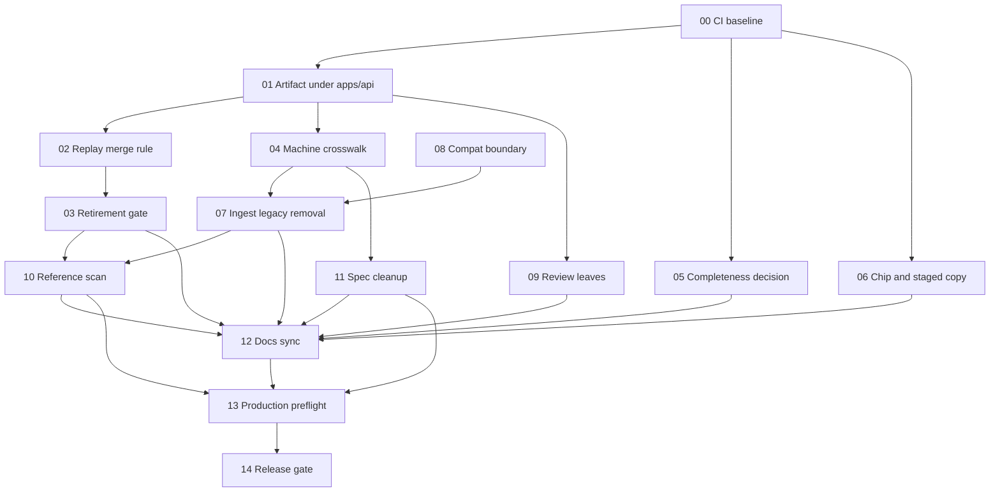

# Category taxonomy remediation — Rollout

**Architecture:** [00-architecture.md](00-architecture.md) · **Gaps and decisions:** [gaps-and-decisions.md](gaps-and-decisions.md) · **Ledger:** [run-ledger.md](run-ledger.md) · **Chapters:** [chapters/README.md](chapters/README.md)

**Loop branch:** `feat/plans-category-taxonomy-migration` (shared with PR 370; D-R6)
**Release branch:** `main`
**Release PR:** [PR 370](https://github.com/vadim-schultz/redtape/pull/370) (`feat/plans-category-taxonomy-migration` into `main`)
**Local CI:** `./ci.sh` from the repository root

This file is the execution contract for the suite. Treat it as a dependency graph, not as a serial list. Schedule with the rules in the chief-of-staff skill. Implementation runs in later sessions (D-R7).

## Pre-flight (human, before chapter 00)

- Merge [PR 369](https://github.com/vadim-schultz/redtape/pull/369) (`fix(ci): restore green main checks`) with a merge commit, not a squash, so PR 370 integrates cleanly. Record the merge commit in the ledger.
- Confirm PR 369 is merged before any chapter starts. This is an open item.

## Dependency graph

The edges from C10 and C11 into C13 are listed explicitly. C12 already implies them, but each chapter's `depends_on` names them, so the graph shows them too.

## Chapter scheduling matrix

| Chapter | depends_on | touches (summary) | execution | gate | status |
| --- | --- | --- | --- | --- | --- |
| C0 | none | `ci.sh`, `test_suggestions_submit.py` | chapter-implementer | fresh-database test file, then `./ci.sh` | planned |
| C1 | C0 | `apps/api/app/shared/taxonomy/`, `shared/category_codes.py`, `scripts/seed_data/category_contract.py`, `test_seed_taxonomy.py`, `.plans` artifact copy (kept) | chapter-implementer | backend gate | planned |
| C2 | C1 | `scripts/category_backfill.py`, `test_category_backfill.py` | chapter-implementer | backend gate | planned |
| C3 | C2 | alembic `20261105_retire_legacy_taxonomy.py`, `scripts/legacy_taxonomy_archive.py`, `scripts/retirement_preflight.py` (new), `test_legacy_taxonomy_migration.py` (new) | chapter-implementer | backend gate, disposable databases only | planned |
| C4 | C1 | machine taxonomy controller, schema, service, route and contract tests, OpenAPI snapshot, ingest `category_mapping.py`, `candidates_api.py`, `harvest/pvog.py`, `.plans` artifact (deleted) | chapter-implementer | backend and ingest gates | planned |
| C5 | C0 (blocked on D-R4) | completeness flags and repository, `public_order.py`, `test_candidate_completeness*.py`, `docs/operations/candidate-view.md` | chapter-implementer | backend gate | blocked (D-R4) |
| C6 | C0 | `CategoryChip.tsx` and test, web and API `i18n` fallback and translation files, `fallback.test.ts` | chapter-implementer | web gate | planned |
| C7 | C4, C8 | ingest `mentions.py`, `curation.py`, `gold.py`, `pvog/domain_mapping.py` (deleted), `pvog/situation_mapping.py`, legacy tests, gold fixtures | chapter-implementer | ingest gate | planned |
| C8 | none | ledger and gaps only; read-only check of worker and bundle versions | chief-of-staff | ledger entry and gaps update | planned |
| C9 | C1 | artifact under `apps/api`, `test_seed_taxonomy.py`, `test_pvog_situation_mapping.py` | chapter-implementer | backend and ingest gates | planned |
| C10 | C3, C7 | `apps/api/tests/test_legacy_reference_scan.py` | chapter-implementer | backend gate | planned |
| C11 | C4 | `CandidateSources.tsx`, `filterParams.ts`, `taxonomy/utils/categoryNames.ts`, `candidates_api.py` (docstring) | chapter-implementer | web and ingest gates | planned |
| C12 | C3, C5, C6, C7, C9, C10, C11 | `docs/planning/STATUS.md`, `docs/operations/discovery-online.md`, ingest README, old suite files | chapter-implementer | docs gate (link check and grep pairs) | planned |
| C13 | C10, C11, C12 | ledger only; read-only against production | chief-of-staff | live read-only preflight | planned |
| C14 | C13 | ledger; release PR 370 | chief-of-staff | `./ci.sh` green, no deploy on merge, user approval | planned |

## Parallel batches

Each batch lists chapters that may run concurrently. A batch member starts only when every `depends_on` chapter is integrated into the loop branch.

- **B0:** C0. C8 is a chief-of-staff action that may run at any time before C7. Its touch set (ledger and gaps) does not overlap any implementation chapter.
- **B1:** C1 and C6. Their touch sets are disjoint: C1 owns the taxonomy backend and the artifact, C6 owns web components and the translation files. C5 joins B1 once D-R4 is confirmed. Its completeness repository and `public_order.py` do not overlap C1 or C6.
- **B2:** C2, C4, and C9. All three depend only on C1, and their touch sets are disjoint. C9 also edits `test_seed_taxonomy.py`, which C1 edits. C9 therefore starts only after C1 is integrated, which is a dependency edge in the graph.
- **B3:** C3, C7 (after C8), C11, and C5 if unblocked. C3 owns the migration and archive files. C7 owns ingest modules. C11 owns web files and one docstring in `candidates_api.py`. C5 owns the completeness repository. The touch sets are disjoint. C7 starts only after C8 is integrated, and C3 only after C2.
- **B4:** C10. It runs alone because it depends on C3 and C7.
- **B5:** C12. It runs alone because it depends on seven chapters.
- **B6:** C13 (chief of staff, read-only).
- **B7:** C14 (chief of staff).

Concurrency note: when CI capacity limits how many implementers run at once, start the critical-path chapters first, and record any reduction and its reason in the ledger.

## Integration order

Integrate into the loop branch serially in this order, even where implementation ran in parallel:

C0, C1, C2, C4, C6, C9, C8, C7, C3, C11, C5, C10, C12, C13, C14.

Each entry follows its `depends_on` chapters in this order. C5 is listed last among the B3 members because it may be unblocked late. If D-R4 is confirmed earlier, it may integrate earlier, but only after C0.

Shared-file serials:

- `apps/discovery-ingest/tests/test_pvog_situation_mapping.py`: C9 before C7.
- `.plans/category-taxonomy-migration/category-contract-v1.json`: C1 keeps the copy, C4 deletes it, and C12 fixes links that point at it.
- `apps/api/tests/test_seed_taxonomy.py`: C1 before C9.
- `apps/discovery-ingest/discovery_ingest/harvest/pvog.py`: C4 only. C9 and C7 must not edit it.

## Critical path

- Path A (eight nodes): C0, C1, C2, C3, C10, C12, C13, C14.
- Path B (eight nodes): C0, C1, C4, C7, C10, C12, C13, C14.

Both paths are critical. C8 sits on Path B through C7, so keep it ready before C4 integrates.

## Per-chapter gate

- **Backend:** in `apps/api`, run `uv run ruff format --check .`, `uv run ruff check .`, `uv run mypy app scripts`, and `uv run pytest <chapter paths>`. Then run `./ci.sh` from the repository root.
- **Ingest:** in `apps/discovery-ingest`, run `uv run ruff format --check .`, `uv run ruff check .`, `uv run mypy discovery_ingest`, and `uv run pytest <chapter paths>`.
- **Web:** in `apps/web`, run `npm run test -- <paths>`, then lint, format check, typecheck, and build.
- **Docs:** run the link check and the grep checks named in the chapter.
- The API pytest run takes several minutes. Run it in the background.
- Each chapter's ledger row records: paired tests (happy and negative), refactor outcome, local CI result, and integration commit.
- Every implementer assignment includes the corporate build block: [corporate-build-env.md](../../.cursor/skills/chief-of-staff/corporate-build-env.md).
- Refactor scope is the containing entity (whole method, class, or helper group), not only the changed lines. Each chapter names its refactor candidates. The ledger records the outcome, including "no change needed".

## Release

- C13 runs first, read-only, against production with the release candidate.
- C14 runs `./ci.sh` on the loop branch, updates PR 370 as the release PR into `main`, and confirms that merging triggers no deploy. This repository has no deploy workflow, so check the external GitOps path.
- Merging to `main` waits for explicit user approval.

## Verification of this session's output

- Every `depends_on` refers to an existing chapter ID (C0 to C14).
- No two chapters in the same batch share a touched path.
- Every implementation chapter names one happy-path test and one negative-path test. Chief-of-staff chapters (C8, C13, C14) name gates instead.
- Relative links in the suite resolve.
- This session changes no code, config, or non-markdown file.

## Open items

- D-R4, the completeness decision. It blocks C5.
- The archive owner and drop date. C12 records them. The user must supply them.
- PR 369 merges before C0 starts (pre-flight).
