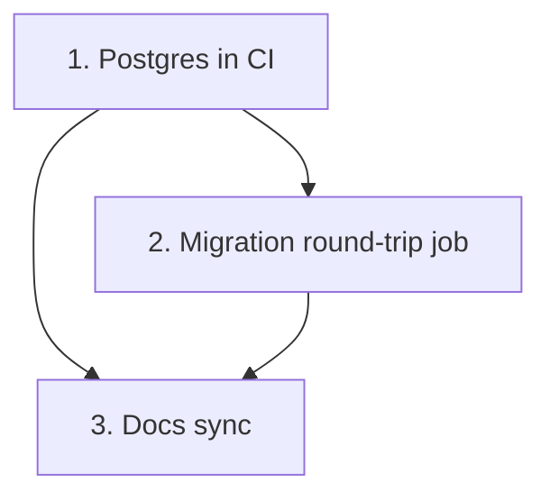

# CI Foundation — Rollout

**Architecture:** [00-architecture.md](00-architecture.md) · **Decisions:** [gaps-and-decisions.md](gaps-and-decisions.md) · **Chapters:** [chapters/](chapters/)

---

## The three invariants

1. **No product code.** Only workflow, `ci.sh`, `conftest.py`, env examples and docs change. No model,
   migration or endpoint is added.
2. **Independently shippable.** After each chapter `./ci.sh` passes on a machine with Docker and the GitHub
   workflow is green. Chapter 1 may surface tests that were silently skipped and are now failing; fixing
   those is part of chapter 1, not deferred.
3. **Loud, never silent.** A configuration that cannot run the DB tests fails in CI. Skipping stays possible
   only locally and only with a visible reason.

---

## Dependency graph



Chapter 2 needs the Postgres service from chapter 1. Nothing here can run in parallel.

---

## Chapters

| # | Chapter | Layer | Gate | Plan | Status |
| --- | --- | --- | --- | --- | --- |
| 1 | Postgres in CI | CI + test harness | pytest (DB tests executed) + `./ci.sh` | [01-postgres-in-ci.md](chapters/01-postgres-in-ci.md) | planned |
| 2 | Migration round-trip job | CI | workflow run + `./ci.sh` | [02-migration-roundtrip-job.md](chapters/02-migration-roundtrip-job.md) | planned |
| 3 | Docs sync | docs | link check | [03-docs-sync.md](chapters/03-docs-sync.md) | planned |

## Per-chapter gate

```bash
docker compose up -d --wait db
cd apps/api
REQUIRE_DB=1 python -m pytest -rs   # DATABASE_URL defaults to the compose Postgres (postgres:postgres@127.0.0.1:5432/redtape)
cd ../.. && ./ci.sh
```

`-rs` prints skip reasons; the gate expects **zero DB-related skips**.

**Refactor gate** (reported per chapter): methods ~5 LOC, classes ~100 LOC, at most one level of nesting,
commit at least once per green. Branches `feat/ci-foundation-<name>`, conventional commits (`test(api): …`,
then `feat(api): …` or `ci: …` for workflow-only changes), one PR per chapter, never commit to `main`.
