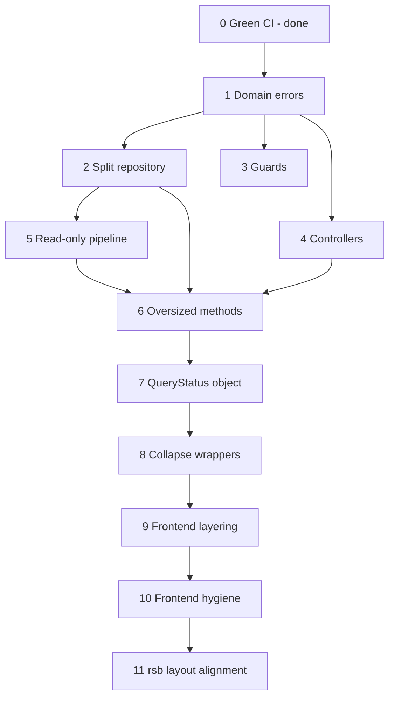

# Code rules remediation — Rollout

**Architecture:** [00-architecture.md](00-architecture.md) · **Decisions:** [gaps-and-decisions.md](gaps-and-decisions.md) · **Chapters:** [chapters/](chapters/) · **Ledger:** [run-ledger.md](run-ledger.md)

**Loop branch:** `feat/plans-code-rules-remediation`
**Release branch:** `main`

**Prerequisite:** none. Chapter 0 is already on `main`, and `./ci.sh` was green there.

## The five invariants

1. **Behaviour-preserving.** Structure changes only; existing endpoints and screens behave the same.
2. **The house rules are the standard** ([00-architecture.md](00-architecture.md) §2): size, parameters, rule of three, nesting, strict types, docstrings.
3. **TDD and refactor gate.** Each slice has a happy-path and a negative-path test, red then green then refactor. Characterization tests come first for pure refactors. The implementer reports the refactor outcome with before/after numbers.
4. **`./ci.sh` green** before every push; remote CI green before merge.
5. **One chapter, one PR into the loop branch.** Never into `main` until the release PR.

## Dependency graph



## Execution order (chief of staff)

Chapter 0 is complete and is not in this list.

1. [chapters/01-discovery-domain-errors.md](chapters/01-discovery-domain-errors.md)
2. [chapters/02-split-discovery-repository.md](chapters/02-split-discovery-repository.md)
3. [chapters/03-guard-session-and-flags.md](chapters/03-guard-session-and-flags.md)
4. [chapters/04-controller-params-and-locale.md](chapters/04-controller-params-and-locale.md)
5. [chapters/05-read-only-catalogue-pipeline.md](chapters/05-read-only-catalogue-pipeline.md)
6. [chapters/06-oversized-service-methods.md](chapters/06-oversized-service-methods.md)
7. [chapters/07-query-status-object.md](chapters/07-query-status-object.md)
8. [chapters/08-collapse-query-status-wrappers.md](chapters/08-collapse-query-status-wrappers.md)
9. [chapters/09-frontend-layering.md](chapters/09-frontend-layering.md)
10. [chapters/10-frontend-hygiene.md](chapters/10-frontend-hygiene.md)
11. [chapters/11-align-with-rsb-layout.md](chapters/11-align-with-rsb-layout.md)

## Chapters

| # | Chapter | Layer | Gate | Plan | Status |
| --- | --- | --- | --- | --- | --- |
| 0 | Green CI | web test config | `./ci.sh` | [00](chapters/00-green-ci.md) | **done** (on `main`) |
| 1 | Discovery domain errors | backend | pytest + `./ci.sh` | [01](chapters/01-discovery-domain-errors.md) | planned |
| 2 | Split `DiscoveryRepository` | backend | pytest + `./ci.sh` | [02](chapters/02-split-discovery-repository.md) | planned |
| 3 | Guard session and flags | backend | pytest + `./ci.sh` | [03](chapters/03-guard-session-and-flags.md) | planned |
| 4 | Controller params and locale | backend | pytest + `./ci.sh` | [04](chapters/04-controller-params-and-locale.md) | planned |
| 5 | Read-only catalogue pipeline | backend | pytest + `./ci.sh` | [05](chapters/05-read-only-catalogue-pipeline.md) | planned |
| 6 | Oversized service methods | backend | pytest + `./ci.sh` | [06](chapters/06-oversized-service-methods.md) | planned |
| 7 | QueryStatus object | frontend | vitest + `./ci.sh` | [07](chapters/07-query-status-object.md) | planned |
| 8 | Collapse QueryStatus wrappers | frontend | vitest + `./ci.sh` | [08](chapters/08-collapse-query-status-wrappers.md) | planned |
| 9 | Frontend layering | frontend | vitest + `./ci.sh` | [09](chapters/09-frontend-layering.md) | planned |
| 10 | Frontend hygiene | frontend | vitest + `./ci.sh` | [10](chapters/10-frontend-hygiene.md) | planned |
| 11 | Align with rsb layout | frontend + docs | vitest + `./ci.sh` | [11](chapters/11-align-with-rsb-layout.md) | planned |

## Per-chapter gate

Backend chapters:

```bash
cd apps/api
uv run ruff format --check . && uv run ruff check . && uv run mypy app scripts
uv run pytest <paths from chapter>
cd ../..
./ci.sh
```

Frontend chapters:

```bash
cd apps/web
npm run test -- <paths from chapter>
npm run lint && npm run format:check && npm run typecheck && npm run build
cd ../..
./ci.sh
```

`./ci.sh` needs Postgres on `127.0.0.1:5432` (it starts `docker compose up -d --wait db` when Docker exists). If Docker or Postgres is missing, report a blocker; do not skip. The API pytest takes several minutes (the discovery admin API file alone ran about 26 minutes in one session; run it in the background).

## Release

After all chapters are merged into the loop branch, open one release PR `feat/plans-code-rules-remediation` to `main`. CoS runbook: [`docs/operations/loops/code-rules-remediation.md`](../../docs/operations/loops/code-rules-remediation.md).
