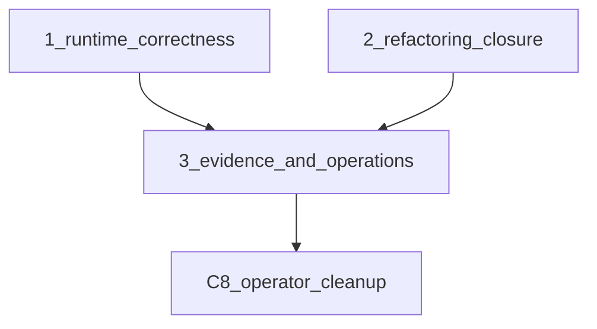

# Codebase audit remediation — Rollout

**Architecture:** [00-architecture.md](00-architecture.md) · **Decisions:** [gaps-and-decisions.md](gaps-and-decisions.md) · **Chapters:** [chapters/](chapters/) · **Ledger:** [run-ledger.md](run-ledger.md)

**Loop branch:** `feat/plans-codebase-audit-remediation`  
**Release branch:** `main`

**Prerequisite:** parent [codebase-audit](../codebase-audit/01-rollout.md) is integrated into `main`.

## Invariants

1. Chapters 1 and 2 are bounded follow-up work. No new product features or dependency upgrades.
2. Chapter 1 uses red → green → refactor for each runtime slice, with paired happy and negative tests.
3. Chapter 2 is behaviour-preserving and keeps existing tests unchanged during its refactor pass.
4. Chapter 3 edits plans and ledgers only. It must not edit `apps/`, workflows, or production configuration.
5. C8 is operator-owned. No chapter runs the cleanup script with `--apply`.
6. One chapter, one branch, one PR into the loop branch. Run `./ci.sh` before push and record unavailable gates explicitly.

## Dependency graph



Chapters 1 and 2 touch disjoint primary areas and may run in parallel. Chapter 3 waits for both.
C8 has no code dependency, but the release gate waits for its operator evidence.

## Scheduling matrix

| ID | Chapter | Depends on | Touches | Execution owner | Gate | Status |
| --- | --- | --- | --- | --- | --- | --- |
| C1 | [Runtime correctness](chapters/01-runtime-correctness.md) | `[]` after parent audit | API suggestions, discovery-admin page shells/tests, discovery-ingest worker CLI/tests | chapter-implementer | Paired red → green tests, refactor report, narrow suites, `./ci.sh` | planned |
| C2 | [Refactoring closure](chapters/02-refactoring-closure.md) | `[]` after parent audit | discovery-admin query hooks/prefetch, query timing constants, duplicate component tree, architecture checks | chapter-implementer | Characterization checks, refactor report, narrow suites, `./ci.sh` | planned |
| C3 | [Evidence and operations](chapters/03-evidence-and-operations.md) | `[C1, C2]` integrated | Remediation report, remediation ledger, gaps/decisions, parent-ledger cross-reference | chief-of-staff | Docs-only diff, evidence rows, C8 handoff, integrated `./ci.sh` | planned |
| C8 | Fixture jurisdiction cleanup | `[C3]` evidence handoff | Production data and read-only endpoint checks | chief-of-staff/operator | Dry run, approved apply, district/city checks | blocked — operator |

The parent audit is an external prerequisite already integrated into `main`; it is not a chapter in
this follow-up graph. The chapter `touches` sets are the derived ownership boundaries because this
older suite did not declare metadata in its chapter frontmatter.

## Parallel batches

### Batch 1

- [Chapter 1 — Runtime correctness](chapters/01-runtime-correctness.md)
- [Chapter 2 — Refactoring closure](chapters/02-refactoring-closure.md)

Chapter 1 owns API emit, web page shells, and ingest CLI validation. Chapter 2 owns discovery-admin
query configuration, the duplicate web component tree, and small shared constants. Rebase if a
shared test or plan file becomes contested.

### Batch 2

- [Chapter 3 — Evidence and operations](chapters/03-evidence-and-operations.md)

This is a docs-only chief-of-staff chapter after chapters 1 and 2 merge.

Batch 1 is safe to run concurrently because its declared source and test ownership is disjoint.
Batch 2 is serialized behind both Batch 1 integrations because its evidence must describe the
integrated result. C8 is intentionally not concurrent with implementation: it is an operator-owned
production gate.

## Integration order

1. Integrate the completed C1 and C2 chapter branches into this loop branch one at a time, after
   inspecting their declared file boundaries and gates. If both are clean, integrate C1 first and
   C2 second.
2. Run the integrated narrow checks and then execute C3 on the loop branch.
3. Perform the C8 operator sequence only after C3 records the handoff. Keep C8 blocked when the
   operator evidence is unavailable.
4. Run the release gate and open the release PR from the loop branch to `main`.

## Critical path and per-chapter gates

The critical path is `C1 or C2 → C3 → C8 → release gate`; Batch 1 has two parallel legs, so its
duration is the slower of C1 and C2. C3 cannot claim closure from a chapter branch that has not been
integrated and verified.

- **C1:** both happy and negative tests for emit persistence, page loading, and CLI bounds; narrow
  API, web, and ingest checks; explicit refactor-gate outcome; local `./ci.sh`.
- **C2:** characterization checks remain green; prefetch has no inline `queryOptions`; one
  `CompletenessChips` tree remains; explicit refactor-gate outcome; local `./ci.sh`.
- **C3:** only plan/docs changes; every chapter row has branch/PR, evidence, refactor, and CI
  status; C8 remains blocked without operator evidence; integrated `./ci.sh`.
- **C8:** dry run, approved apply, and read-only district/city endpoint checks recorded by the
  operator.

### Operator gate

- C8 cleanup dry run, approved apply, and endpoint verification.

The chief of staff records the result in [run-ledger.md](run-ledger.md); implementers do not execute
the production mutation.

## Chapter index

| # | Chapter | Depends on | Layer | Status |
| --- | --- | --- | --- | --- |
| 1 | [Runtime correctness](chapters/01-runtime-correctness.md) | parent audit | API, web, ingest | planned |
| 2 | [Refactoring closure](chapters/02-refactoring-closure.md) | parent audit | web | planned |
| 3 | [Evidence and operations](chapters/03-evidence-and-operations.md) | 1, 2 | plans and docs | planned |

## Chief-of-staff gate

Every implementation chapter reports:

```text
Refactor gate: smells found -> ...; refactorings applied -> ...
Narrow suite: <command>, green after each step.
```

Before release:

- all chapter rows contain branch/PR, red → green evidence, refactor outcome, and CI status;
- T3 exceptions are either removed or recorded with rationale and owner;
- G2 baseline and mypy decisions are explicit;
- `./ci.sh` is green on the loop branch;
- C8 dry-run, approved apply, and post-apply API checks are recorded.

## Verification commands

Implementation chapters use their narrow commands first. The release gate uses:

```bash
cd apps/api
uv run ruff format --check . && uv run ruff check . && uv run mypy app scripts
uv run pytest tests/test_discovery_emit_service.py
cd ../discovery-ingest
uv run ruff format --check . && uv run ruff check . && uv run mypy discovery_ingest
uv run pytest tests/test_operations_drain.py tests/test_worker_drain.py tests/test_ingest_operations_contract.py
cd ../web
npx tsc --noEmit && npx eslint "src/**/*.{ts,tsx}"
npm test -- src/features/discovery-admin src/components/data-display/CompletenessChips src/architecture.test.ts
cd ../..
./ci.sh
```

## Git workflow

```bash
git checkout main && git pull
git checkout -b feat/plans-codebase-audit-remediation
```

Chapter branches use `fix/`, `refactor/`, or `docs/` prefixes and conventional commits. Open chapter
PRs into the loop branch, never directly into `main`; open one release PR after the ledger and C8
gate are complete.

