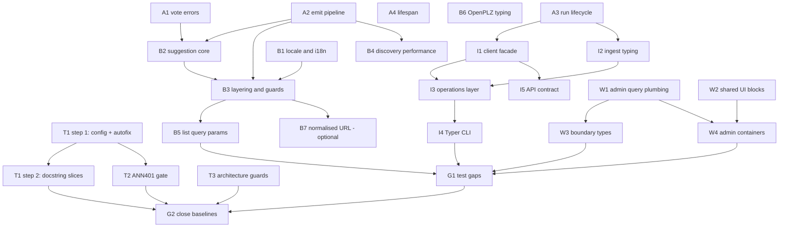

# Codebase audit — Rollout

**Audit report:** [00-audit-report.md](00-audit-report.md) · **Decisions:** [gaps-and-decisions.md](gaps-and-decisions.md) · **Chapters:** [chapters/](chapters/) · **Ledger:** [run-ledger.md](run-ledger.md)

**Loop branch:** `feat/plans-codebase-audit`
**Release branch:** `main`

**Prerequisite:** none. `main` is green at `0e713cc`.

This folder is documentation only. The chapters below are executed later, one `chapter-implementer` agent per chapter.

## The standard for every chapter

1. **One chapter, one branch, one PR into the loop branch.** Never into `main` until the release PR.
2. **Behaviour-preserving** except Wave A (defect fixes, red then green) and the API changes stated in A1 (vote 409 on a promotion conflict; `DELETE .../vote` answers 404 for an unknown and 409 for a decided suggestion instead of 204), A2 (a duplicate or bad claim becomes a skipped item) and B3 (typed pipeline timestamps spelled `Z` instead of `+00:00`). The ingest CLI contract (command names, flags, exit codes) is unchanged, see chapter I4.
3. **Judge by responsibility, not line count.** "Describable without 'and'." Do not extract a method only to shorten it. Keep the rule of three (total arms for one decision, pre-existing included), one nesting level, more than three parameters means an object, and no one-line wrappers.
4. **TDD and refactor gate.** Characterisation tests first where coverage is missing, then red, green, refactor. The PR reports `Refactor gate: smells found -> ..., refactorings applied -> ...` and the narrow suite command, with before and after numbers.
5. **Types and docstrings.** No new `Any`, `any` or silencing cast. Every new public Python symbol has a docstring (imperative mood, states intent, never restates the signature). A chapter that rewrites a file also writes that file's missing docstrings and removes its `D` and `ANN401` baseline entries.
6. **`./ci.sh` green** before every push; remote CI green before merge.
7. **Re-measure at the start** of each Python chapter with `apps/api/scripts/measure_code_rules.py` and `ruff --select D,ANN401 --statistics`, and record the baseline in the PR.

## Dependency graph

## Touches and after

Two chapters conflict only if their `Touches` sets intersect. `After` is a hard dependency.

| Chapter | Touches | After |
| --- | --- | --- |
| T1 step 1 | ruff config of `apps/api` and `apps/discovery-ingest`, auto-fixed whitespace/docstring lines | none; merge before T2 (both edit `select` and `per-file-ignores` in the same two `pyproject.toml` files) |
| T1 step 2 | one directory slice per agent (docstrings only); slices marked "2b" in the chapter wait for the chapters that rewrite their directories | T1 step 1 |
| T2 | ruff and mypy config only | T1 step 1 (merge order) |
| T3 | `apps/web/eslint.config.js`, `apps/web/src/architecture.test.ts`, `apps/api/tests/test_architecture.py` | none |
| A1 | `api/features/voting`, `api/features/suggestions/{controller,handlers,transitions,repository,service}` (the last two for `get_for_update` and `__all__`) | none |
| A2 | `api/features/discovery/{emit,candidate_emit*,emit_preview}`, one-word `skip_reason` type changes in `api/schema/discovery/{emit,candidate_emit,read}.py` | none |
| A3 | `ingest/worker/{run,llm_setup}.py`, `ingest/pvog/client.py`, `ingest/govdata/ckan.py`, `ingest/browser/client.py`, `ingest/cli.py` (`_drain_and_print` only), `ingest/extract/llm/evaluation/command.py`, one test seam in `test_llm_eval_command.py` | none |
| A4 | `api/lifespan.py` | none |
| B1 | `api/{locale_resolution,i18n_resolution,routes}.py`, `api/shared/locale.py`, `api/middleware/locale.py`, `api/features/{locations,taxonomy}`, `api/features/documents/{document_read,service}.py` (two lines), `api/features/suggestions/slugs.py` | none |
| B2 | `api/features/suggestions/{service,repository,handlers}`, the submitter-constructor lines in the discovery emit files | A1, A2 |
| B3 | `api/schema/discovery`, `api/features/{documents,auth}`, `api/features/discovery/{service,url_normalize,admin_service,candidate_admin_service,candidate_list_items}.py`, `artifact_*`, the `*_dict` mappers at the top of `pipeline_rows.py`, `api/features/suggestions/{handlers,service,dependencies}` (narrow port, L11) | A2, B1, B2 |
| B4 | `api/features/discovery/{stage_sync,pipeline_rows,task_enqueue}.py` (`stage_of` hunk only), `api/features/discovery/repository/{task_listing,activity,claims}.py` | A2 |
| B5 | `api/features/discovery/*_controller.py`, the existing `*_list_query.py` provider modules | B3 |
| B6 | `api/services/openplz_client.py` (moved to `api/features/locations/openplz/`), `api/schema/openplz.py`, `api/scripts/` (including the new fixture-row cleanup script for C8), `start.sh` | none |
| B7 | `api/models`, `api/alembic`, `api/features/documents`, `tests/test_check_migrations_script.py` (`CURRENT_HEAD`) | B3 (operator approved 2026-11-02) |
| I1 | `ingest/api_client.py`, new `ingest/client/`, and the call-site switch across about 35 modules (`cli.py`, `worker/*`, `curation*`, all `*_cli.py`, `config.py`) plus 18 test modules and 2 doc links | A3 |
| I2 | `ingest/{pvog,govdata,fim,leika,enrich.py,extract/llm}`, plus `cli.py` mapper signatures, `worker/{enrich_metadata,llm_answer,handler_table,batch,llm_drain}.py` | A3 |
| I3 | new `ingest/operations/`, `ingest/{worker,harvest}/`, `ingest/config.py`, `cli.py` (handlers become thin), `pvog/client.py`, `govdata/ckan.py`, `fim/client.py`, `leika/client.py`, `browser/probe_cli.py`, `extract/llm/evaluation/command.py` | I1, I2 |
| I4 | new `ingest/cli/`, removal of `ingest/cli.py` and the `*_cli.py` modules, `ingest/pyproject.toml`, about 23 test modules that import `discovery_ingest.cli` | I3 |
| I5 | ingest model tests, one API script, one API test, one JSON fixture, the `discovery-ingest-ci.yml` path filter, a three-line fix in `ingest/schemas.py` | I1; sees the final shape of `api/schema/discovery` after A2 and B3 |
| W1 | `web/features/discovery-admin/{hooks,services,types/listControllers.ts}`, `web/services/{api.ts,listQuery/spec.ts}`, `web/hooks/`, the list-state import lines in 3 containers and 7 components | T3 (only to delete its own baseline entries) |
| W2 | `web/components/{feedback,data-display}`, a new `web/utils/` (add a line to `apps/web/CLAUDE.md`), `web/features/auth`, `web/features/*/components` (shared blocks), `taskColumns`/`candidateColumns` imports | T3 (baseline entries); W1 for the `useApi` move only |
| W3 | `web/features/discovery-admin/types`, `web/services/listQuery`, suggestions and documents hooks, types and components touched by deriving the unions, the three column files | W1 |
| W4 | `web/features/discovery-admin/{containers,components}` | W1, W2; rebase against W3 on the column files |
| G1 | tests only (`apps/api/tests`, `apps/discovery-ingest/tests`, `apps/web/src/**/*.test.ts[x]`) | B5, I4, W3, W4 (verifies A2 and A3 delivered their negative-path tests) |
| G2 | lint/mypy config, `docs/planning/STATUS.md`, the "After" table of the ledger | T1, T2, T3, G1 |

## Parallel batches

Each batch runs fully in parallel: one `chapter-implementer` agent per chapter, each in its own git worktree (`isolation: "worktree"`) with its own scratch database. Agents never share the local dev database. The chief of staff merges finished chapters into the loop branch in dependency order and rebases open branches; that is the only integration cost.

| Batch | Chapters | Agents |
| --- | --- | --- |
| 1 | T1 step 1, T2, T3, A1, A2, A3, A4, B1, B6, W1, W2 | 11, disjoint files (merge T1 step 1 before T2) |
| 2 | B2, B4, I1, I2, W3, W4, and the T1 step 2 slices marked "batch 2" (directories no other batch-2 or batch-3 chapter rewrites) | 6 plus the slices |
| 3 | B3, I3, I5 | 3 |
| 4 | B5, I4, B7 (operator approved 2026-11-02), and the T1 step 2 slices marked "2b" (directories rewritten by B2, B3, B4, I1, I2) | 3 to 4 plus the slices |
| 5 | G1, then G2 | 1, then 1 |

Batch sizes are an upper bound. The chief of staff may run fewer at a time to save CI minutes. Within a batch, start the chapters with the longest tail (I-track, W-track) first.

## Finding-to-chapter map

Every finding ID in [00-audit-report.md](00-audit-report.md) has an owning chapter.

| Finding | Chapter | Finding | Chapter |
| --- | --- | --- | --- |
| C1, C7 | A1 | L1, L2 | B2 |
| C2 | A2 | L3 | B4 |
| C3, C5 | A3 | L4 | B7 |
| C4 | A3 (crawl clients), I4 (CLI) | L5, L6, L7, L11 | B3 |
| C6 | A4 | L8 | W1 |
| C8 | B6 | | |
| D1, D2, D3 | B1 | L9 | W4 |
| D4 | I1 | L10 | B5 |
| D5 | I4 | L12 | I3 |
| D6 | I3 | L13 | I1 (client part), I3 (drain, PVOG) |
| D7 | I5 | L14 | B2 (suggestions), B5 (admin) |
| D8 | I2 (shared helpers), I3 (page budget) | T1 | W3 |
| D9 | I3 | T2, T3 | W3 |
| D10, D11 | W1 | T4 | I2 |
| D12, D13, D14 | W2 | T5 | A2, B1, B2, B3, B6 |
| D15 | B6 | T6 | I1 (key, error text), I2 (handler keys) |

| Hygiene item | Chapter |
| --- | --- |
| Dead code, web consistency | W2 |
| Dead parameters, API one-line delegations | B2 |
| Ingest one-line delegations (`_post_catalogue_batches`, `_budget_call`) | I1 |
| `_budget_allows_fetch` | I2 |
| Web one-line wrappers | W1 |
| Misplaced `openplz_client` | B6 |
| Test-coverage gaps | G1 (and the chapter that touches the area) |
| Stale `docs/planning/STATUS.md` | G2 |
| Open size observations | informational, no chapter |

## Chapter index

Chapter files live in [chapters/](chapters/). Filenames are `<ID>-<slug>.md`.

| ID | File | Branch |
| --- | --- | --- |
| T1 | [T1-pydocstyle.md](chapters/T1-pydocstyle.md) | `refactor/pydocstyle` |
| T2 | [T2-any-gate.md](chapters/T2-any-gate.md) | `refactor/any-gate` |
| T3 | [T3-architecture-guards.md](chapters/T3-architecture-guards.md) | `refactor/architecture-guards` |
| A1 | [A1-vote-promotion-errors.md](chapters/A1-vote-promotion-errors.md) | `fix/vote-promotion-errors` |
| A2 | [A2-single-emit-pipeline.md](chapters/A2-single-emit-pipeline.md) | `fix/single-emit-pipeline` |
| A3 | [A3-ingest-run-lifecycle.md](chapters/A3-ingest-run-lifecycle.md) | `fix/ingest-run-lifecycle` |
| A4 | [A4-lifespan-locale-load.md](chapters/A4-lifespan-locale-load.md) | `fix/lifespan-locale-load` |
| B1 | [B1-locale-i18n.md](chapters/B1-locale-i18n.md) | `refactor/locale-i18n` |
| B2 | [B2-suggestion-core.md](chapters/B2-suggestion-core.md) | `refactor/suggestion-core` |
| B3 | [B3-layering-and-guards.md](chapters/B3-layering-and-guards.md) | `refactor/layering-and-guards` |
| B4 | [B4-discovery-performance.md](chapters/B4-discovery-performance.md) | `refactor/discovery-performance` |
| B5 | [B5-list-query-params.md](chapters/B5-list-query-params.md) | `refactor/list-query-params` |
| B6 | [B6-openplz-typing.md](chapters/B6-openplz-typing.md) | `refactor/openplz-typing` |
| B7 | [B7-stored-normalized-url.md](chapters/B7-stored-normalized-url.md) | `refactor/stored-normalized-url` |
| I1 | [I1-ingest-client-facade.md](chapters/I1-ingest-client-facade.md) | `refactor/ingest-client-facade` |
| I2 | [I2-ingest-typing.md](chapters/I2-ingest-typing.md) | `refactor/ingest-typing` |
| I3 | [I3-ingest-operations-layer.md](chapters/I3-ingest-operations-layer.md) | `refactor/ingest-operations-layer` |
| I4 | [I4-ingest-typer-cli.md](chapters/I4-ingest-typer-cli.md) | `refactor/ingest-typer-cli` |
| I5 | [I5-api-ingest-contract.md](chapters/I5-api-ingest-contract.md) | `refactor/api-ingest-contract` |
| W1 | [W1-admin-query-plumbing.md](chapters/W1-admin-query-plumbing.md) | `refactor/admin-query-plumbing` |
| W2 | [W2-shared-ui-blocks.md](chapters/W2-shared-ui-blocks.md) | `refactor/shared-ui-blocks` |
| W3 | [W3-boundary-types.md](chapters/W3-boundary-types.md) | `refactor/boundary-types` |
| W4 | [W4-admin-containers.md](chapters/W4-admin-containers.md) | `refactor/admin-containers` |
| G1 | [G1-test-gaps.md](chapters/G1-test-gaps.md) | `test/audit-test-gaps` |
| G2 | [G2-close-baselines.md](chapters/G2-close-baselines.md) | `chore/close-baselines` |

## Release gate

- [ ] All chapters recorded in [run-ledger.md](run-ledger.md) with red to green evidence and refactor outcome.
- [ ] `ruff check` with `D` and `ANN401` has an empty baseline in `apps/api` and `apps/discovery-ingest`.
- [ ] `./ci.sh` passes on the loop branch; remote CI re-confirms on the release PR.
- [ ] The workflows `.github/workflows/discovery-*.yml` run unchanged against the new CLI.
- [ ] `GET /api/v1/districts?state=14` on production lists 13 districts and no `Kreis Beispiel` (finding C8, chapter B6).
- [ ] Release PR opened from `feat/plans-codebase-audit` to `main`.
