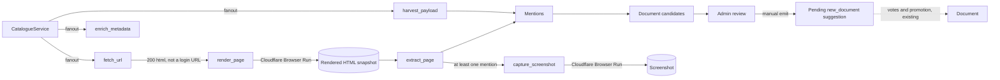

# Crawlers — Architecture

**Rollout:** [01-rollout.md](01-rollout.md) · **Decisions:** [gaps-and-decisions.md](gaps-and-decisions.md) · **Chapters:** [chapters/](chapters/) · **Ledger:** [run-ledger.md](run-ledger.md) · **Parents:** [discovery-layer](../discovery-layer/00-architecture.md), [discovery-online](../discovery-online/00-architecture.md), [discovery-operations](../discovery-operations/00-architecture.md)

This suite replaces the earlier crawlers plan (a standalone `apps/crawler` package with `sources.yaml` and direct suggestion posts). That design predates the discovery layer, which now owns the queue, staging, deduplication, preview and manual emit. The crawl layer is a **consumer of that queue**, not a parallel pipeline.

## 1. Why

The goal of redtape is a **document dependency graph**: which documents a citizen needs before another document can be obtained. The graph needs document *nodes* before it can have *edges*, so the first job of crawling is to populate documents.

Production data from 2026-10-23 (Supabase SQL) shows what the pipeline produces today:

| Observation | Meaning |
| --- | --- |
| 1,423 `fetch_url` tasks: 1,323 pending, 88 completed, 12 failed; one drain run of 50 tasks | At the scheduled cadence (one 50-task drain per six days) the backlog takes months |
| 81 of 88 completed fetches are HTML 200; 7 are 301/302/307 | The fetcher does not follow redirects, so redirects are recorded as success |
| Fetch bodies are discarded; only status, content type and length are logged | Nothing downstream can be extracted or shown |
| 0 entities, 0 claims; no GovData row has `fim_id`, all 893 have `leika_key` | `enrich_metadata` never fires; fanout looks for the wrong key |
| 123 distinct hosts; GovData `portal_url` values are OZG online-service entry points (one is a login URL with a nonce) | Per-host extractors are a long tail; many pages are login walls |
| PVOG `raw_payload.details[]` holds structured xZufi modules (title, text, `links[]`, `filled`) | Candidate documents can be read from data already in the database, with no network call |
| `suggestion`: 2 human rows; `document`: 4 seeded rows; `document_requirement`: 3 | Nothing crawler-made exists downstream yet |

## 2. Vocabulary

| Term | Meaning |
| --- | --- |
| **Procedure** | A catalogue service (a Leistung such as "Anmeldung einer Wohnung"). A procedure is staging context, not a document node |
| **Document candidate** | A deduplicated, not yet emitted document name harvested from one or more sources; keyed by the same slug rule used at promotion |
| **Mention** | One occurrence of a candidate in a procedure, with role, excerpt, source field and optional artifact |
| **Role** | `required` (the procedure asks for this document) or `form` (a form or application belonging to the procedure) |
| **Artifact** | An object-store file with a metadata row: an HTML snapshot (working input, the **rendered** DOM) or a screenshot (evidence) |
| **Render** | A Cloudflare Browser Run quick action that loads a URL in a hosted browser, runs its JavaScript and returns the resulting DOM (and, for evidence, an image) |
| **Browser kinds** | `render_page` and `capture_screenshot`: the task kinds that spend Cloudflare browser time; drained only by their own workflow, never by default |
| **Browser budget** | The browser seconds a run may spend, plus the minimum interval between Cloudflare calls; both come from the free-plan limits |
| **Release** | Handing a claimed task back to `pending` without consuming an attempt, used when a limit (not the page) stopped the work |
| **Extractor** | Worker code that turns one snapshot into mentions; selected by URL and content type |
| **Task kind** | The `discovery_task.kind` value that selects a worker handler |
| **Kind filter** | The `kinds` list a worker sends when claiming, so it only leases work it can perform |

## 3. Flow

Workers own orchestration and API owns persistence. A worker that finishes a task and knows what comes next enqueues the follow-up through an idempotent machine route. The API never needs to know which extractors exist.

The plain `fetch_url` stays the cheap gate in front of the browser: it already applies robots.txt, pacing, redirects and status handling, so no browser time is spent on redirects, errors or login pages. Only a successful HTML page earns a `render_page` task, and only a page that yielded a mention earns a `capture_screenshot`.

## 4. Task kinds

All kinds live in the existing `discovery_task` table. New kinds extend the native `discovery_task_kind` enum with `ALTER TYPE ... ADD VALUE` inside an Alembic autocommit block; the downgrade leaves the labels in place and documents it.

| Kind | Network | Input | Output |
| --- | --- | --- | --- |
| `fetch_url` (existing) | yes | `portal_url` | fetch log, HTML snapshot artifact |
| `enrich_metadata` (existing) | yes | FIM steckbrief URL | entity and claims |
| `harvest_payload` (new) | no | catalogue row `raw_payload` | mentions |
| `extract_page` (new) | no | HTML snapshot artifact | mentions |
| `render_page` (new) | yes, Cloudflare browser | final URL of a successful fetch | rendered HTML snapshot artifact |
| `capture_screenshot` (new) | yes, Cloudflare browser | page URL | screenshot artifact |

There are six kinds in total. `render_page` is added to the enum in chapter 14's migration (chapter 3 added the other three new labels), together with `result_note`.

**Kind-filtered claim.** `TaskClaimRequest` gains `kinds`. When omitted it defaults to the two legacy kinds, so the scheduled drain can never lease a kind it cannot handle and fail it. Today `claim_pending` ([task_queue.py](../../apps/api/app/features/discovery/task_queue.py)) and `list_pending_tasks_for_claim` ([repository/tasks.py](../../apps/api/app/features/discovery/repository/tasks.py)) have no kind filter.

**Task inputs.** `discovery_task` gains nullable `artifact_id` and `input_key` (for example `extractor@version`). The queue's "a completed task for the same target is never re-enqueued" rule then no longer blocks re-extraction after an extractor changes.

**Retry.** `attempt_count`, `not_before` and a `retryable` flag on fail. Transient failures (5xx, timeout, connection reset) return to `pending` with backoff up to a cap. Client errors stay failed.

**Result note.** `discovery_task.result_note` (chapter 14) records why a task completed without producing anything (`no_extractor`, `no_mentions`, `login_wall`, `oversize`). Columns arrive where first used: `input_key` in chapter 3, `attempt_count` and `not_before` in chapter 4, `artifact_id` and `result_note` in chapter 14.

**Release.** `POST /machine/tasks/{id}/release` (chapter 14) returns a claimed task to `pending` and gives back the attempt the claim consumed. Quota and storage limits release; only page-level problems fail.

## 5. Document-first strategy

1. **Harvest** candidate nodes: PVOG payload first (no network), then page extractors.
2. **Deduplicate** by a key equal to `slugify(pick_title(title_i18n))`, the exact rule `NewDocumentHandler.promote` uses, so a candidate collision is a promotion collision.
3. **Review** in the admin Documents screens: titles, mention counts, excerpts, evidence.
4. **Emit manually** as pending `new_document` suggestions. Votes and promotion already exist in the API ([handlers.py](../../apps/api/app/features/suggestions/handlers.py), [transitions.py](../../apps/api/app/features/suggestions/transitions.py)); a web voting UI does not exist yet and is outside this suite.
5. **Edges later.** Mentions with roles preserve the procedure-to-document `requires` relation. Resolving mentions to canonical documents and emitting `new_requirement` suggestions is a later suite; it needs promoted documents to reference.

Procedures are **not** document nodes. The FIM enrichment claims that carry a service title as `new_document` stay staged and are excluded from this path.

### Emit and URL conflicts

`new_document` suggestions conflict on `slug` or normalized `official_url` per jurisdiction, and the payload currently requires `official_url`. Many candidates (for example "Personalausweis") have no URL of their own, and sharing the procedure page URL would reject every second document from the same page. The emit chapter therefore makes `official_url` **optional** in `NewDocumentPayload` (additive): URL conflict checks are skipped when it is absent, `Document.official_url` is already nullable, and provenance travels in `suggestion.source_url`.

## 6. Storage

Both artifact kinds live in an S3-compatible object store; Postgres holds only metadata. The free Supabase database is capped at 500 MB and goes read-only on overflow, so bytes stay out of it. The store is **Cloudflare R2**: 10 GB-month of storage, 1 million Class A (write, list) and 10 million Class B (read, head) operations per month, free egress, in the account that already hosts the frontend and Browser Run. Unlike a capped bucket, **R2 bills past the free tier**, so the application enforces its own caps below the allowance (decision D24, [chapter 23](chapters/23-free-tier-guards.md)).

- **Provider:** Cloudflare R2 through its S3 API (endpoint `https://<account_id>.r2.cloudflarestorage.com`, region `auto`, path-style). Presigned URLs work on that endpoint (not on a custom domain). Supabase Storage or any other S3 service remains a configuration swap.
- **Port and adapters:** `ObjectStore` protocol with `InMemoryObjectStore` (tests) and `S3ObjectStore` (boto3). Adapter tests use `moto`, so CI needs no Docker. Checksum behaviour of recent boto3 against R2 (the default CRC headers are known to trouble non-AWS stores) is settled by a live probe workflow, with `when_required` as the starting default. The port has no `list`, and deduplication uses the database's sha256 unique key, never a HEAD request, so Class A and Class B operations stay small and countable.
- **Optional at boot:** if no object-store settings exist the API still starts; artifact routes answer 503.
- **Capped:** `OBJECT_STORE_MAX_BYTES` (default 8 GiB) is checked against `SUM(discovery_artifact.byte_size)` on every upload; over the cap the route answers 507 and writes nothing, and workers release their tasks and stop with `storage_unavailable`.
- **Uploads are proxied** through the API; storage credentials live only in Render. Reads use a short-lived (five-minute) presigned GET minted per request.
- **Keys are content-addressed:** `discovery/{catalogue_service_id}/{kind}/{sha256}.{ext}`.
- **HTML snapshots are never rendered inline** in the admin UI; they are offered as download or source view. The screenshot is the visual.
- **Snapshots are working input** (the rendered DOM; latest two per service, 4 MB cap, `text/html` only). **Screenshots are evidence** (durable, 8 MB cap, PNG or JPEG). The two `kind` values stay distinct so retention can differ later.

## 7. Staging tables (new)

**`discovery_artifact`**: `id`, `catalogue_service_id` (FK, cascade), `discovery_task_id` (FK, set null), `kind` (`html_snapshot`, `screenshot`), `storage_key`, `sha256`, `content_type`, `byte_size`, `source_url`, `final_url`, `fetched_at`, `created_at`. Unique on `(catalogue_service_id, kind, sha256)`.

**`discovery_document_candidate`**: `id`, `jurisdiction_id`, `key` (unique per jurisdiction), `title_i18n`, `official_url` (nullable), `status` (`staged`, `emitted`), `suggestion_id` (nullable), timestamps.

**`discovery_candidate_mention`**: `id`, `candidate_id` (FK, cascade), `catalogue_service_id` (FK, cascade), `role`, `excerpt`, `source_field`, `artifact_id` (nullable), `extractor`, `extractor_version`, `created_at`. Unique on `(candidate_id, catalogue_service_id, role, source_field)`.

## 8. Worker runtime and scheduling

- The HTTP workers stay in `apps/discovery-ingest` and never receive `DATABASE_URL`. A Cloudflare-native consumer of the machine API is an open seam, not part of this suite.
- There is **no browser in this repository**: no Playwright, no optional extra, no Chromium install, no `apps/crawler` package. Rendering and screenshots are HTTP calls to Cloudflare Browser Run quick actions (the account already hosts the frontend), made by the worker through a `BrowserClient` port with a Cloudflare adapter (chapter 15).
- `discovery-drain.yml` drains the HTTP kinds with multiple batches and a time budget (chapters 2 and 5); its daily schedule is gated by the repository variable `DISCOVERY_DRAIN_SCHEDULE` so the backlog is not consumed as bare liveness probes before `fetch_url` can enqueue `render_page` (chapter 15 deployed). A separate `discovery-render.yml` (variable `DISCOVERY_RENDER_SCHEDULE`) drains the two browser kinds with a run time budget and a browser-seconds budget; it shares the `discovery-drain` concurrency group. `platform-maintenance.yml` keeps the six-day catalogue ingest.
- Manual probe and fixture workflows (`discovery-storage-probe.yml`, `discovery-browser-probe.yml`, `discovery-fim-probe.yml`, `discovery-fixture-capture.yml`) exist so live verification needs only `gh workflow run`.
- Politeness: robots.txt per host (checked by our code before every Cloudflare call, because the browser service does not check it for us), an identifying User-Agent with a contact URL (also sent as the quick action's `userAgent`), a per-host minimum interval, redirect following (maximum five) with the final URL recorded, a body size cap, a content-type allowlist, scheme and private-address blocking, and no attempt to get past login walls.

### Providers

| Provider | Used for | Free allowance that matters |
| --- | --- | --- |
| Cloudflare | Frontend, R2 artifacts, Browser Run (render, screenshot), Workers AI (extraction suite) | R2 10 GB; browser 10 min a day; Workers AI 10,000 neurons a day |
| Supabase | Postgres and auth only | 500 MB database |
| Render | API | Spin-down after idle |
| GitHub | CI and the worker workflows | 2,000 Actions minutes a month shared across repositories; this repository is capped at 1,000 |

### Free-allocation guards

Every free allocation has a **server-side cap below the allowance**, kept in a budget ledger in the API so GitHub runs, local runs and concurrent runs share one count (decisions D23 and D24, [chapter 23](chapters/23-free-tier-guards.md)). The resources that **bill** past the free tier (R2 storage and operations, Workers AI on a paid plan) get the strictest guards.

| Resource | Cap (default) | Behaviour at the cap |
| --- | --- | --- |
| R2 storage | 8 GiB | Upload route answers 507; workers release and stop `storage_unavailable` |
| R2 operations | 400k Class A, 4M Class B a month | Counted by a metered store; over the cap behaves like 507 |
| Browser Run | 480 browser seconds a day, all runs together | The worker's budget is the smaller of the run budget and what is left today; `429` marks the day exhausted |
| Workers AI | 8,000 neurons a day, reserved before every call | Used by the [extraction](../extraction/00-architecture.md) suite; quota errors mark the day exhausted |
| Supabase database | 400 MB soft limit | Machine write routes answer 507; workers stop `db_limit` |
| GitHub Actions | 1,000 minutes a month for this repository, of which a CI reserve (default 600) is not ours to spend | Drain workflows report their minutes and skip themselves when the allowance is gone; schedules stay off by default and local runs are the default for the backlog |

### Cloudflare free-plan budget

| Limit (free plan) | Worker behaviour |
| --- | --- |
| 10 browser minutes a day | `--browser-budget-seconds` (default 480) sums `X-Browser-Ms-Used`; the run stops with `browser_budget` |
| 1 quick-action request every 10 s | A throttle keeps at least 11 s between calls; about 5 pages a minute |
| 3 concurrent browsers, 60 s timeout | One call at a time; navigation timeout 30 s |
| `429` | Release the task and the unstarted batch, stop with `browser_quota`; the run still succeeds |

The rate limit, not the browser minutes, normally binds: a 15-minute run renders about 80 pages, so the 1,423 known pages take roughly 18 runs, about 4.5 hours of runner time in total. The same drain run on the operator's machine costs no Actions minutes. Quota and storage problems **release** tasks (no attempt consumed); only page-level problems fail them. The browser kinds are never in the default kind list. A paid plan removes the throttle without a code change (lower `BROWSER_MIN_INTERVAL_SECONDS`).

## 9. Admin surface

Allowlisted, read-only, behind the existing server admin probe.

- **Menu:** one unbroken row of `react-icons` buttons inside a single `HStack`; every new link is added to the config array, never as a new row or a text link (chapter 9).
- **Documents** (`/admin/discovery/documents`): candidate list with filters, mention counts and status.
- **Document detail** (`/admin/discovery/documents/:id`): mentions with role, excerpt and procedure link, artifacts, emit and suggestion status.
- **Pipeline detail:** an Artifacts panel with snapshot download and screenshot thumbnails.
- **Tasks and Coverage:** kind filter, per-kind counts, attempts, candidate counts and storage bytes.

## 10. Out of scope

Link-following frontier crawling, freshness crawling, LLM extraction (planned separately in the [extraction](../extraction/00-architecture.md) suite), PDF parsing, CAPTCHA or login-wall handling, resolving mentions to canonical documents, emitting `new_requirement` suggestions, a web voting UI, attaching artifacts to suggestions as `evidence` rows (the [evidence-storage](../evidence-storage/00-architecture.md) suite owns that bridge).
