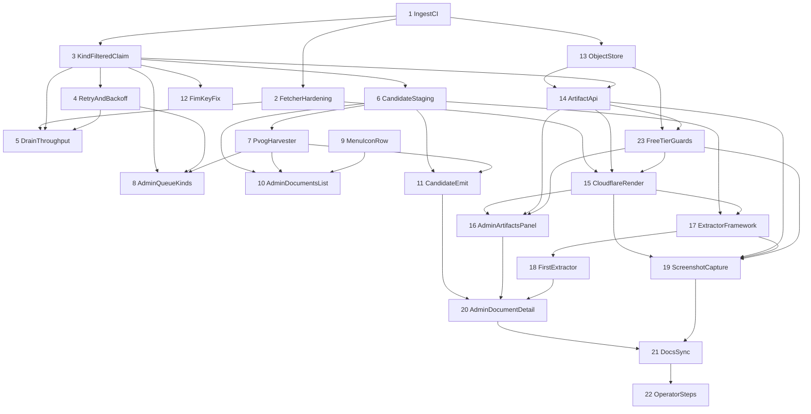

# Crawlers — Rollout

**Architecture:** [00-architecture.md](00-architecture.md) · **Decisions:** [gaps-and-decisions.md](gaps-and-decisions.md) · **Chapters:** [chapters/](chapters/) · **Ledger:** [run-ledger.md](run-ledger.md)

**Loop branch:** `feat/crawlers`
**Release branch:** `main`

**Staged release:** chapters 1–6 were merged to `main` on 2026-10-23 (without remote CI, Actions quota exhausted). `feat/crawlers` stays the loop branch for chapters 7–23, and the final release is a second PR to `main`. Resume instructions: [run-ledger.md](run-ledger.md) § Resume next month.

**Prerequisites (already on `main`):** [discovery-layer](../discovery-layer/01-rollout.md), [discovery-online](../discovery-online/01-rollout.md), [discovery-operations](../discovery-operations/01-rollout.md), [suggestion-interface](../suggestion-interface/01-rollout.md), and the API-side votes, transitions and promotion from [voting-moderation](../voting-moderation/01-rollout.md).

## Invariants

1. **Every chapter is CI-green and shippable on its own.** A chapter that needs live infrastructure (the object store, Cloudflare Browser Run) has unit tests against fakes; its live gate is recorded separately in the ledger and never blocks the merge.
2. **Workers stay HTTP-only.** `apps/discovery-ingest` uses the machine API and an API key; it never receives `DATABASE_URL` and never imports API persistence code.
3. **Additive schema.** New tables, new nullable columns, new enum labels. Nothing existing is renamed or dropped. The default kind filter keeps the scheduled drain on the two legacy kinds.
4. **No automatic emit.** Scheduled jobs harvest and stage; emit is a deliberate operator action.
5. **Storage credentials stay in Render.** GitHub Actions secrets for object storage exist only for the probe workflow.
6. **Procedures are not documents.** Service-level claims are excluded from document-first emit.
7. **Every drain is bounded** by batch count and/or time budget (browser drains also by browser seconds) and reports why it stopped.
8. **Politeness is not optional.** robots.txt, identifying User-Agent, per-host interval, no login-wall bypass.
9. **Navigation links are `react-icons` buttons in one `HStack` row**, added to the config array.
10. **Tests are paired** (happy and negative) with an explicit refactor audit per chapter.
11. **The Cloudflare browser token is narrow and never reaches the API.** A custom token with only "Browser Run - Edit", held as GitHub Actions secrets (`CLOUDFLARE_ACCOUNT_ID`, `CLOUDFLARE_BROWSER_API_TOKEN`) and in the operator's local environment; never in Render, the web app or the repository. The browser kinds (`render_page`, `capture_screenshot`) are never in a default kind list, and a drain of them refuses to start without the token, storage, and both budgets (chapter 15).
12. **The free-plan limits are a design input, not an error.** Hitting the Cloudflare quota or finding storage unavailable releases tasks without consuming an attempt and ends the run successfully (decisions D20, D21).
13. **Every free allocation has a server-side cap below the allowance, kept in the budget ledger** (decisions D23, D24, chapter 23). Resources that bill past the free tier (R2 storage and operations, Workers AI on a paid plan) are capped by the application, never trusted to stop on their own. This repository's GitHub Actions share is capped at 1,000 minutes a month. A worker that cannot read the ledger falls back to its own run budget and says so in its report.

## Dependency graph



Chapters 1–5 touch no new tables. The **documents slice** (6–12) and the **storage slice** (13–16, plus 23) are independent once chapter 5 is merged. Chapter 23 was added by the 2026-10-26 replan and is **executed between chapters 14 and 15**, because the browser budget (15) and the screenshot kind (19) consume its ledger. Chapter 18 is optional (extraction suite). The documents slice runs first so documents appear before anything depends on a bucket. Chapter 9 is independent and small; it lands before chapter 10 so the Documents icon is verified in a single row.

## Execution order

1. [chapters/01-ingest-ci.md](chapters/01-ingest-ci.md)
2. [chapters/02-fetcher-hardening.md](chapters/02-fetcher-hardening.md)
3. [chapters/03-kind-filtered-claim.md](chapters/03-kind-filtered-claim.md)
4. [chapters/04-retry-and-backoff.md](chapters/04-retry-and-backoff.md)
5. [chapters/05-drain-throughput-and-queue-summary.md](chapters/05-drain-throughput-and-queue-summary.md)
6. [chapters/06-candidate-staging-model-and-api.md](chapters/06-candidate-staging-model-and-api.md)
7. [chapters/07-pvog-payload-harvester.md](chapters/07-pvog-payload-harvester.md)
8. [chapters/08-admin-queue-kinds-and-metrics.md](chapters/08-admin-queue-kinds-and-metrics.md)
9. [chapters/09-menu-icon-row.md](chapters/09-menu-icon-row.md)
10. [chapters/10-admin-documents-list.md](chapters/10-admin-documents-list.md)
11. [chapters/11-candidate-emit.md](chapters/11-candidate-emit.md)
12. [chapters/12-fim-key-fix.md](chapters/12-fim-key-fix.md)
13. [chapters/13-object-store-port-and-r2-adapter.md](chapters/13-object-store-port-and-r2-adapter.md)
14. [chapters/14-artifact-model-and-api.md](chapters/14-artifact-model-and-api.md)
15. [chapters/15-cloudflare-render-and-snapshot.md](chapters/15-cloudflare-render-and-snapshot.md)
16. [chapters/16-admin-artifacts-panel.md](chapters/16-admin-artifacts-panel.md)
17. [chapters/17-extractor-framework.md](chapters/17-extractor-framework.md)
18. [chapters/18-first-page-extractor.md](chapters/18-first-page-extractor.md)
19. [chapters/19-screenshot-capture.md](chapters/19-screenshot-capture.md)
20. [chapters/20-admin-document-detail-and-evidence.md](chapters/20-admin-document-detail-and-evidence.md)
21. [chapters/21-docs-sync.md](chapters/21-docs-sync.md)
22. [chapters/22-operator-manual-steps.md](chapters/22-operator-manual-steps.md)
23. [chapters/23-free-tier-guards.md](chapters/23-free-tier-guards.md) — numbered last because it was added last, **executed between 14 and 15**

## Chapters

| # | Chapter | Layer | Gate | Plan | Status |
| --- | --- | --- | --- | --- | --- |
| 1 | Ingest CI | CI | workflow green on PR | [01](chapters/01-ingest-ci.md) | planned |
| 2 | Fetcher hardening | worker | paired tests + CI + live drain | [02](chapters/02-fetcher-hardening.md) | planned |
| 3 | Kind-filtered claim and enum groundwork | API + worker + migration | paired tests + round trip + CI | [03](chapters/03-kind-filtered-claim.md) | planned |
| 4 | Retry and backoff | API + worker + migration | paired tests + round trip + CI | [04](chapters/04-retry-and-backoff.md) | planned |
| 5 | Drain throughput and queue summary | API + CI workflow | paired tests + CI + live drain | [05](chapters/05-drain-throughput-and-queue-summary.md) | planned |
| 6 | Candidate staging model and API | model + migration + API | paired tests + round trip + CI | [06](chapters/06-candidate-staging-model-and-api.md) | planned |
| 7 | PVOG payload harvester | worker + API | paired tests + CI + live drain | [07](chapters/07-pvog-payload-harvester.md) | planned |
| 8 | Admin queue kinds and metrics | API + frontend | paired tests + web CI | [08](chapters/08-admin-queue-kinds-and-metrics.md) | planned |
| 9 | Menu icon row | frontend | Vitest + web CI + browser check | [09](chapters/09-menu-icon-row.md) | planned |
| 10 | Admin Documents list | API + frontend | paired tests + web CI + browser check | [10](chapters/10-admin-documents-list.md) | planned |
| 11 | Candidate emit | API + worker | paired tests + CI + live emit | [11](chapters/11-candidate-emit.md) | planned |
| 12 | FIM key fix | API + worker + probe | paired tests + CI + live probe | [12](chapters/12-fim-key-fix.md) | planned |
| 13 | Object store port and R2 adapter | API + CI workflow | paired tests (moto) + CI + live probe | [13](chapters/13-object-store-port-and-r2-adapter.md) | planned |
| 14 | Artifact model and API (with browser-task groundwork) | model + migration + API | paired tests + round trip + CI | [14](chapters/14-artifact-model-and-api.md) | planned |
| 15 | Cloudflare render and snapshot | worker + CI workflow | probe + paired tests + CI + live render | [15](chapters/15-cloudflare-render-and-snapshot.md) | planned |
| 16 | Admin Artifacts panel (and `render_page` kind) | frontend | paired tests + web CI | [16](chapters/16-admin-artifacts-panel.md) | planned |
| 17 | Extractor framework and `extract_page` | worker | paired tests + CI | [17](chapters/17-extractor-framework.md) | planned |
| 18 | First page extractor (optional) | worker | fixture tests + CI + live drain | [18](chapters/18-first-page-extractor.md) | planned, optional |
| 19 | Screenshot capture | worker | paired tests + CI + live capture | [19](chapters/19-screenshot-capture.md) | planned |
| 20 | Admin document detail and evidence | frontend | paired tests + web CI + browser check | [20](chapters/20-admin-document-detail-and-evidence.md) | planned |
| 21 | Docs sync | docs | link checks + docs tests | [21](chapters/21-docs-sync.md) | planned |
| 22 | Operator manual steps | docs + ops | checklist ticked by the operator | [22](chapters/22-operator-manual-steps.md) | planned |
| 23 | Free-tier guards (budget ledger, caps, metered store) | model + migration + API + worker client | paired tests + round trip + CI | [23](chapters/23-free-tier-guards.md) | planned (executes between 14 and 15) |

## Per-chapter gate

Local checks are best-effort because the development environment is limited. **GitHub Actions is the authoritative gate**: open the chapter PR into `feat/crawlers`, then

```bash
gh pr checks --watch
```

Live verification uses workflow dispatch against the non-production stack, which may be used freely:

```bash
gh workflow run platform-maintenance.yml -f job=discovery
gh run list --workflow=platform-maintenance.yml --limit 3
gh run watch            # pick the dispatched run
gh run view --log       # copy the drain report into the ledger
```

Browser live gates (chapters 15 and 19) spend Cloudflare's free allowance (10 browser minutes a day, one request every 10 seconds) and runner minutes (this repository's share is capped at 1,000 a month; see chapter 23). Keep them short, for example `-f max_tasks=5 -f max_batches=2 -f time_budget_seconds=300`, and never run two in the same day on purpose: the worker's default browser budget leaves a margin of two minutes, not more. Record the `browser_seconds_used` of every run in the ledger.

Narrow test pairs first, then the affected package checks:

```bash
# API chapters
cd apps/api && python -m pytest tests/<file>.py
# migration chapters, additionally
cd apps/api && alembic upgrade head && alembic downgrade -1 && alembic upgrade head
# worker chapters
cd apps/discovery-ingest && python -m pytest tests/<file>.py && ruff check . && mypy discovery_ingest
# web chapters
cd apps/web && npm run test -- <paths> && npm run lint && npm run format:check && npm run typecheck && npm run build
```

Each chapter reports its refactor outcome in the ledger before the next chapter starts. **Refactor gate:** methods about five lines, classes about a hundred, at most one level of nesting, one commit per green step.

## Branch and release protocol

Each chapter uses a feature branch `feat/crawlers-<slug>` from `feat/crawlers` and opens one PR into `feat/crawlers`. Conventional commits (`test(...)` then `feat(...)`). After the ledger is complete, open one release PR from `feat/crawlers` to `main`. Never commit to `main`.

## Exit criteria

- The scheduled drain makes real progress (multi-batch, time-bounded) and reports `remaining`.
- Redirects are followed; transient failures retry; permanent failures stay failed.
- Document candidates exist, deduplicated, with provenance, visible in the admin Documents screens.
- At least one operator-driven emit creates pending `new_document` suggestions from candidates.
- Rendered HTML snapshots (Cloudflare Browser Run, free plan) and screenshots are stored in the object store (Cloudflare R2) and visible in the admin.
- No free allocation was overrun: `GET /machine/budgets` shows usage below every cap (R2 bytes and operations, browser seconds, Actions minutes, database soft limit), and the operator has recorded the Cloudflare plan and billing notifications (chapter 22, S19).
- A render run stays inside both budgets: it ends on `time_budget`, `browser_budget`, `browser_quota` or `queue_empty` without failing tasks, and its report states the browser seconds used.
- At least one page extractor produces candidates from live snapshots (the LLM path of the [extraction](../extraction/01-rollout.md) suite or, optionally, chapter 18).
- The operator checklist is complete and the ledger records run IDs for every live gate.
