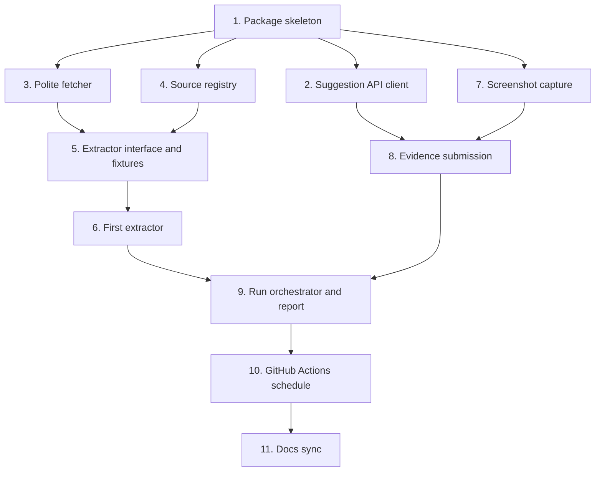

# Crawlers — Rollout

**Architecture:** [00-architecture.md](00-architecture.md) · **Decisions:** [gaps-and-decisions.md](gaps-and-decisions.md) · **Chapters:** [chapters/](chapters/)

**Prerequisites:** [suggestion-interface](../suggestion-interface/01-rollout.md) chapter 6 (machine submit,
idempotency); [evidence-storage](../evidence-storage/01-rollout.md) chapter 5 (evidence upload); [auth](../auth/01-rollout.md) chapter 8 (API keys).

---

## The three invariants

1. **No database access.** `apps/crawler` never imports `app.db` or any SQLAlchemy model; every write is an
   HTTP call with an API key (D3).
2. **Independently shippable.** Chapters 1–5 build and test entirely offline (fixtures, `respx`) with no
   real network call; only chapter 6 (the first real extractor) and chapter 10 (the schedule) touch a real
   site.
3. **Never silently fails.** The orchestrator's exit code reflects real failures; duplicates (D7) and
   individually failed sources are reported, not swallowed, and do not fail the whole run.

---

## Dependency graph



Chapters 2, 3 and 4 have no dependency on each other and can proceed in parallel once chapter 1 exists.
Chapter 7 (screenshots) can proceed in parallel with 2–6.

---

## Chapters

| # | Chapter | Layer | Gate | Plan | Status |
| --- | --- | --- | --- | --- | --- |
| 1 | Crawler package skeleton | tooling | ruff + mypy + pytest + `./ci.sh` | [01-crawler-package-skeleton.md](chapters/01-crawler-package-skeleton.md) | planned |
| 2 | Suggestion API client | backend | pytest (respx) | [02-suggestion-api-client.md](chapters/02-suggestion-api-client.md) | planned |
| 3 | Polite fetcher | backend | pytest (respx) | [03-polite-fetcher.md](chapters/03-polite-fetcher.md) | planned |
| 4 | Source registry | backend | pytest | [04-source-registry.md](chapters/04-source-registry.md) | planned |
| 5 | Extractor interface and fixtures | backend | pytest | [05-extractor-interface-and-fixtures.md](chapters/05-extractor-interface-and-fixtures.md) | planned |
| 6 | First extractor | backend | pytest + manual | [06-first-extractor.md](chapters/06-first-extractor.md) | planned |
| 7 | Screenshot capture | backend | pytest (marked, needs Playwright) | [07-screenshot-capture.md](chapters/07-screenshot-capture.md) | planned |
| 8 | Evidence submission | backend | pytest (respx) | [08-evidence-submission.md](chapters/08-evidence-submission.md) | planned |
| 9 | Run orchestrator and report | backend | pytest + `./ci.sh` | [09-run-orchestrator-and-report.md](chapters/09-run-orchestrator-and-report.md) | planned |
| 10 | GitHub Actions schedule | CI | workflow dry run | [10-github-actions-schedule.md](chapters/10-github-actions-schedule.md) | planned |
| 11 | Docs sync | docs | link check | [11-docs-sync.md](chapters/11-docs-sync.md) | planned |

## Per-chapter gate

```bash
cd apps/crawler
ruff format --check . && ruff check . && mypy crawler
python -m pytest -m "not needs_playwright"   # chapters 1-6, 8-9
python -m pytest -m needs_playwright         # chapter 7 only, requires `playwright install chromium`
cd ../.. && ./ci.sh
```

**Refactor gate** (reported per chapter): methods ~5 LOC, classes ~100 LOC, at most one level of nesting,
commit at least once per green. Branches `feat/crawler-<name>`, conventional commits (`test(crawler): …`
then `feat(crawler): …`), one PR per chapter, never commit to `main`.
