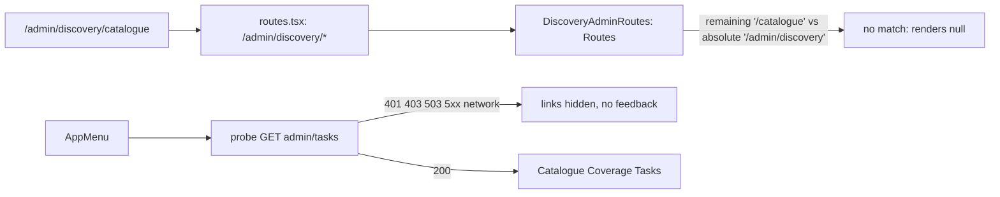

# Discovery admin remediation — Architecture

**Rollout:** [01-rollout.md](01-rollout.md) · **Decisions:** [gaps-and-decisions.md](gaps-and-decisions.md) · **Chapters:** [chapters/](chapters/) · **Parent:** [discovery-admin-ui](../discovery-admin-ui/00-architecture.md) (merged)

---

## 1. Why

The `discovery-admin-ui` suite merged (PRs #150–#155), but an operator signed in with an admin email still cannot review discovery candidates:

1. `/admin/discovery/catalogue`, `/coverage`, and `/tasks` render a **blank page body**.
2. The top-right menu pop-over shows only Browse (magnifier) and Suggest (up arrow). The Catalogue, Coverage, and Tasks links are **absent**.

## 2. Findings

### F1 — Blank pages: descendant `<Routes>` with an absolute path (high confidence)

- [`routes.tsx`](../../apps/web/src/app/routes.tsx) mounts `path: "/admin/discovery/*"` and renders the lazy `DiscoveryAdminRoutes`.
- [`DiscoveryAdminRoutes.tsx`](../../apps/web/src/features/discovery-admin/DiscoveryAdminRoutes.tsx) renders a descendant `<Routes>` whose only top route is the **absolute** `path="/admin/discovery"`.
- React Router 7 matches a descendant `<Routes>` against the pathname **minus the parent's matched base** (`useRoutes`, `remainingPathname`). For `/admin/discovery/catalogue` the remaining path is `/catalogue` (`/` for `/admin/discovery`). Neither equals `/admin/discovery`, so no route matches and `<Routes>` renders `null`.
- The shell (menu, background) renders; the body is blank. This is independent of the guard, auth, API, and worker proxy. Removing a guard alone does not fix it.
- Introduced in `a002211`; the previous suite's chapter 1 added `coverage` inside the same structure.

### F2 — Why tests and review missed it

- [`DiscoveryAdminRoutes.test.tsx`](../../apps/web/src/features/discovery-admin/DiscoveryAdminRoutes.test.tsx) mounts the component directly in a `MemoryRouter` with no parent splat route, so the absolute path matches.
- [`App.test.tsx`](../../apps/web/src/app/App.test.tsx) has no `/admin/discovery/*` case. [`AppMenu.test.tsx`](../../apps/web/src/components/layout/AppMenu.test.tsx) checks `href` values only.
- The previous run ledger left its release gate (Render health, worker-origin 401/403/200, "allowlisted user sees routes") unticked ("live smoke unavailable"), while the docs describe the routes as verified.

### F3 — Missing menu links: the admin probe does not succeed in production

- [`DiscoveryAdminMenuLinks.tsx`](../../apps/web/src/features/discovery-admin/components/DiscoveryAdminMenuLinks.tsx) renders links only when `useDiscoveryAdminProbe()` is `isSuccess`, and hides them on **any** failure without feedback.
- The icon-only Browse/Suggest buttons shipped in the same commit (`2ed8831`) as the discovery links. The deployed bundle therefore contains the links code, and the probe `GET /api/v1/discovery/admin/tasks?limit=1` fails or never succeeds. This is independent of F1.
- Candidate causes (chapter 1 picks one with a single HTTP status):

| Probe result | Meaning |
| --- | --- |
| 403 | Email not on `DISCOVERY_ADMIN_EMAILS`. Likely when ingest works through `DISCOVERY_MACHINE_OPT_IN` and the allowlist is empty or differs from the Supabase login email. |
| 401 | `auth_enabled` off on Render, or JWT verification misconfigured. |
| 503 | `discovery_enabled` false, **or** a Render cold-start/proxy 503. |
| network / 5xx | Render cold start. |

- Code defect that makes the cold-start case permanent: [`useDiscoveryAdminProbe.ts`](../../apps/web/src/features/discovery-admin/hooks/useDiscoveryAdminProbe.ts) sets `retry: false`, which overrides the app-wide `shouldRetry` policy in [`retryPolicy.ts`](../../apps/web/src/app/retryPolicy.ts) designed for a sleeping Render. One transient failure hides the links for the whole session.
- UX gap: the menu cannot tell "not an admin" (hide, by design) from "discovery unavailable" (503, 5xx, network).

### F4 — Minor, no action in this suite

- `renderGuardOutcome` in [`RequireDiscoveryAdmin.tsx`](../../apps/web/src/features/discovery-admin/RequireDiscoveryAdmin.tsx) has a 7-arm `switch`. Extract it on the next change that touches the guard.
- `DiscoveryCoveragePage` uses plain `<Text>` for loading instead of `DiscoveryAdminLoading`.

## 3. Failure paths

## 4. Target state

- One pathless guarded layout route under the `/admin/discovery/*` mount; children use **relative** paths (`index`, `catalogue`, `coverage`, `tasks`, `pipeline/:id`, `*`).
- The admin probe retries transient failures (5xx, network) with the shared policy, capped; it never retries 4xx.
- Probe contract:

| Probe outcome | Menu | Page |
| --- | --- | --- |
| 200 | Catalogue, Coverage, Tasks links | Content |
| 401 | No links | Login redirect |
| 403 | No links, no hint (looks like any non-admin) | `ForbiddenView` |
| 503 / 5xx / network after capped retries | Muted "Discovery unavailable" hint, no links | Disabled/error view with retry |

- Route and menu tests run through `App` (the real route tree), not the component in isolation.

## 5. Scope boundary

In scope: `apps/web`, route and menu tests, locale keys, operator documentation, and an ops-first triage chapter.

Out of scope: discovery API routes, schemas, migrations, ingest workers, Supabase/provider changes, a client-side email allowlist, and **removal of either admin guard**. Render and Cloudflare configuration is verified and documented, not hard-coded.
