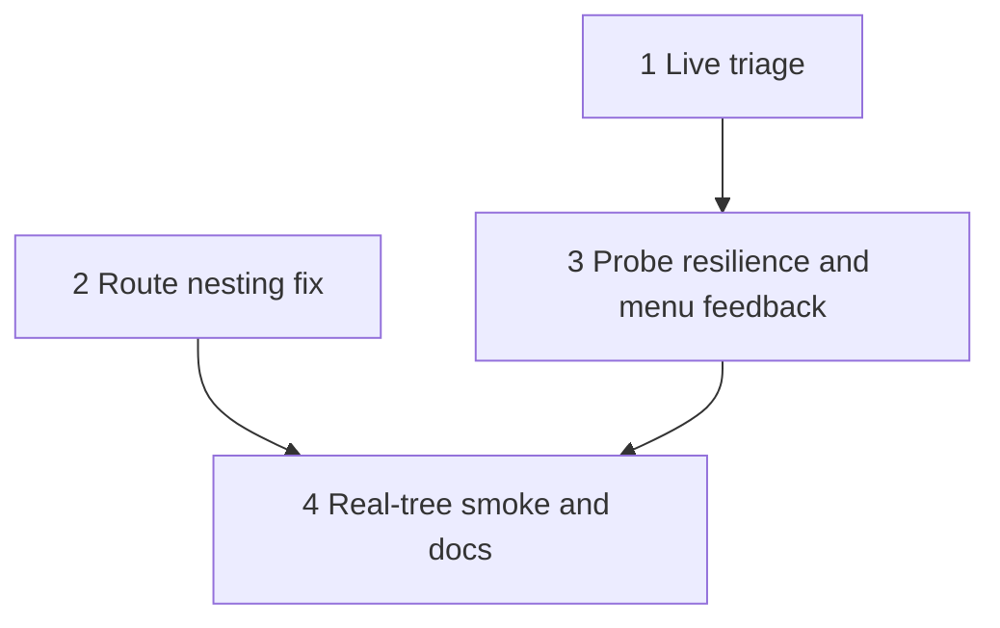

# Discovery admin remediation — Rollout

**Architecture:** [00-architecture.md](00-architecture.md) · **Decisions:** [gaps-and-decisions.md](gaps-and-decisions.md) · **Chapters:** [chapters/](chapters/) · **Ledger:** [run-ledger.md](run-ledger.md)

**Loop branch:** `feat/plans-discovery-admin-remediation`
**Release branch:** `main`

**Prerequisite:** [discovery-admin-ui](../discovery-admin-ui/01-rollout.md) merged to `main`.

## The five invariants

1. **Frontend, docs, and ops only.** No discovery API, schema, migration, or ingest change.
2. **The server stays the authority.** No client email list; neither admin guard is removed (D2).
3. **Tests exercise the real route tree.** Use `App` or a parent splat route, never the nested component alone (D6).
4. **No silent blank or hidden state** for an unexpected failure; "not an admin" may stay quiet by design (D5).
5. **TDD and refactor gate.** Each behavior slice starts with a happy-path and a negative-path test, reaches green, then audits the containing entity before the next slice.

## Dependency graph



## Execution order (chief of staff)

1. [chapters/01-live-triage-probe-and-routes.md](chapters/01-live-triage-probe-and-routes.md)
2. [chapters/02-route-nesting-fix.md](chapters/02-route-nesting-fix.md)
3. [chapters/03-admin-probe-resilience-and-menu-feedback.md](chapters/03-admin-probe-resilience-and-menu-feedback.md)
4. [chapters/04-real-tree-smoke-and-docs.md](chapters/04-real-tree-smoke-and-docs.md)

Chapter 1 needs the operator (bearer token, Render and Cloudflare dashboards). Chief of staff stops with a blocker if the operator has not supplied the triage result.

## Chapters

| # | Chapter | Layer | Gate | Plan | Status |
| --- | --- | --- | --- | --- | --- |
| 1 | Live triage — probe and routes | ops + docs | triage note in ledger | [01](chapters/01-live-triage-probe-and-routes.md) | planned |
| 2 | Route nesting fix | frontend | vitest + `./ci.sh` | [02](chapters/02-route-nesting-fix.md) | planned |
| 3 | Admin probe resilience and menu feedback | frontend | vitest + `./ci.sh` | [03](chapters/03-admin-probe-resilience-and-menu-feedback.md) | planned |
| 4 | Real-tree smoke and docs | frontend + docs | `./ci.sh` + manual smoke | [04](chapters/04-real-tree-smoke-and-docs.md) | planned |

## Per-chapter gate

```bash
cd apps/web
npm run test -- <paths from chapter>
npm run lint
npm run format:check
npm run typecheck
npm run build
cd ../..
./ci.sh
```

Before chapter 2, record the failing test names of the full web suite on the loop branch (the previous ledger noted 10 unrelated failures). Each chapter must add no new failures. The implementer reports the refactor outcome after the narrow suite is green.

## Manual smoke after chapter 4

- `GET /api/v1/discovery/admin/tasks?limit=1` through the web origin returns the status recorded in chapter 1 (or `200` after the config fix).
- An allowlisted user sees Catalogue, Coverage, and Tasks under Documents.
- `/admin/discovery/catalogue`, `/coverage`, `/tasks` render content or a deliberate loading/empty/error state; `/admin/discovery` redirects to the catalogue.
- `/admin/discovery/unknown` shows "Page not found".
- A non-allowlisted user sees no discovery links and gets the forbidden view when navigating directly.
- The browser console shows no React Router "No routes matched location" warning on any admin URL.

## Branch and release protocol

Each chapter uses a feature branch from the loop branch and opens one reviewable PR into the loop branch. Use conventional commits with the test commit before the implementation commit. After all chapters pass, open one release PR from `feat/plans-discovery-admin-remediation` to `main`. CoS: [`docs/operations/loops/discovery-admin-remediation.md`](../../docs/operations/loops/discovery-admin-remediation.md).
