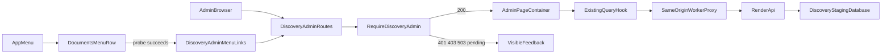

# Discovery admin UI — Architecture

**Rollout:** [01-rollout.md](01-rollout.md) · **Decisions:** [gaps-and-decisions.md](gaps-and-decisions.md) · **Chapters:** [chapters/](chapters/)

---

## 1. Why

The discovery ingest workflow writes staging rows successfully, but the web review surface is incomplete:

- `/admin/discovery/coverage` has no React route. Coverage exists only as
  `GET /api/v1/discovery/admin/coverage` and as chips inside the catalogue page.
- `/admin/discovery/catalogue`, `/tasks`, and `/pipeline/:id` exist, but the shared guard renders `null`
  while auth or the admin probe is pending. An unconfigured Supabase runtime also becomes an indefinite
  wait. API, proxy, or cold-start failures therefore look like a blank page.
- The top-level menu has a Documents row with text links, but it does not expose the discovery review
  pages, an explicit Home action, or icon-only browse/suggest actions.

The remediation keeps the discovery backend contract unchanged. It makes every web state explicit and
connects the existing admin UI to the existing menu primitives.

## 2. Target route and data surface

| URL | Web surface | Data source |
| --- | --- | --- |
| `/admin/discovery` | Redirect to catalogue | None |
| `/admin/discovery/catalogue` | Catalogue rows plus coverage summary | `/catalogue` + `/coverage` |
| `/admin/discovery/coverage` | Dedicated coverage summary | `/coverage` |
| `/admin/discovery/tasks` | Task queue | `/tasks` |
| `/admin/discovery/pipeline/:id` | Pipeline stage and row drill-down | `/catalogue/:id/pipeline` |
| Pipeline emit preview | Existing subview, not a top-level route | `/catalogue/:id/emit-preview` |

Unknown paths below `/admin/discovery/*` must render a deliberate fallback or redirect. They must not
leave an empty outlet.

## 3. Target web architecture

```text
apps/web/src/features/discovery-admin/
├── DiscoveryAdminRoutes.tsx          route dispatch and fallback
├── DiscoveryAdminLayout.tsx          shared title + Outlet
├── RequireDiscoveryAdmin.tsx         auth and server-probe gate
├── containers/
│   ├── DiscoveryCataloguePage.tsx    catalogue orchestration
│   ├── DiscoveryCoveragePage.tsx     coverage orchestration
│   ├── DiscoveryTasksPage.tsx        task query orchestration
│   └── DiscoveryPipelinePage.tsx     pipeline orchestration
├── components/
│   ├── CoverageChips.tsx             reusable coverage summary
│   ├── DiscoveryAdminLoading.tsx     visible loading state
│   ├── DiscoveryAdminDisabled.tsx    actionable 503 state
│   ├── DiscoveryAdminMenuLinks.tsx   allowlisted menu links
│   └── ...                           existing tables and status views
├── hooks/                            existing React Query hooks
├── services/                         existing typed API functions
└── types/                            existing response types

apps/web/src/components/layout/
├── AppMenu.tsx
├── AppLayout.tsx
└── menu/
    ├── AppMenuPanel.tsx              existing shared panel
    ├── DocumentsMenuRow.tsx          browse/suggest icons + discovery links
    └── HomeMenuButton.tsx            full-width Home action

apps/web/src/components/ui/
└── KeyValueRow.tsx                   existing 1fr / 3fr primitive
```

Containers own query orchestration. Components own reusable presentation and status states. API calls
remain in the existing discovery service and hook layers. The shell menu reuses `AppMenuPanel`,
`KeyValueRow`, Chakra `Link`/`IconButton`/`Button`, and the existing auth/probe cache.

## 4. Target flow



The server remains the authority for admin access. The menu shows discovery links only after the
existing admin probe succeeds, so non-admin users do not receive dead or forbidden navigation. The
client must not contain an email allowlist.

## 5. UX contract

- Every admin route has visible loading, success, empty, and failure states.
- `401` redirects to login; `403` shows the existing forbidden view; `503` explains that discovery is
  disabled or not configured; network/API failures show the existing retry pattern.
- Catalogue rows remain useful if coverage chips fail independently. Coverage failure must be visible
  without erasing successfully loaded catalogue rows.
- `/admin/discovery/coverage` uses the existing `CoverageChips` component rather than duplicating
  coverage formatting.
- The menu starts with a full-width Home button linking to `/`; it spans the complete panel above the
  key-value rows.
- Under Documents, Browse Documents and Suggest become icon-only controls with accessible names:
  an existing `react-icons/fa` magnifying-glass icon (`FaSearch`) for browse and an existing
  `react-icons/fa` upward-arrow icon (`FaArrowUp`) for suggest. Tooltips or `title` text may reinforce
  the labels, but `aria-label` remains required.
- Allowlisted discovery links appear under Documents for Catalogue, Coverage, and Tasks. Pipeline is
  reached from a catalogue row because it needs a service id.

## 6. Accessibility and reuse

- Preserve `KeyValueRow`'s `templateColumns="1fr 3fr"` contract and `data-testid`.
- Use `IconButton`/`Button asChild` with router links so keyboard focus and navigation remain native.
- Icons are decorative when an accessible label is supplied by the link; do not remove the label from
  the accessibility tree merely to make the visual control icon-only.
- Keep the existing menu focus, colour-mode, locale, and sign-out behavior unchanged.
- Reuse `QueryError`, `EmptyStateCard`, `CoverageChips`, `AppMenuPanel`, and existing React Query cache
  keys before adding new primitives.

## 7. Scope boundary

In scope: `apps/web`, route/UI tests, menu tests, and operator documentation for the corrected route
surface and smoke sequence.

Out of scope: discovery API schemas, database migrations, ingest workers, auth provider changes, and
the backend email allowlist implementation. Deployment configuration is verified and documented, not
hard-coded into the web bundle.
