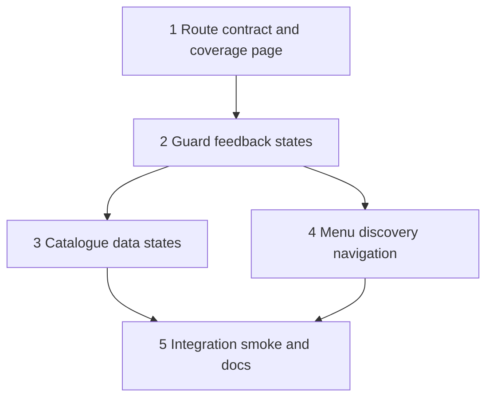

# Discovery admin UI — Rollout

**Architecture:** [00-architecture.md](00-architecture.md) · **Decisions:** [gaps-and-decisions.md](gaps-and-decisions.md) · **Chapters:** [chapters/](chapters/) · **Ledger:** [run-ledger.md](run-ledger.md)

**Loop branch:** `feat/plans-discovery-admin-ui`
**Release branch:** `main`

## The five invariants

1. **Frontend and documentation scope.** Do not change discovery API contracts, database schemas, or
   ingest behavior.
2. **No silent blank states.** Every route, guard, lazy-load, query, and empty result has an explicit
   user-visible state.
3. **Server-authorized navigation.** Discovery links appear only after the existing admin probe returns
   success; the API guard remains authoritative.
4. **Feature architecture.** Containers orchestrate queries; feature components render discovery states;
   layout menu components compose shared Chakra/UI primitives; hooks and services remain typed.
5. **TDD and refactor gate.** Each behavior slice starts with a happy-path and negative-path test,
   reaches green, then audits the containing entity before the next slice.

## Dependency graph



Chapter 1 can establish the route contract first. Chapters 3 and 4 share the guard outcome from
chapter 2 and may be prepared in parallel, but the chief of staff executes them sequentially so each
chapter has a green refactor gate before the next one begins.

## Execution order (chief of staff)

1. [chapters/01-route-contract-and-coverage.md](chapters/01-route-contract-and-coverage.md)
2. [chapters/02-admin-guard-feedback.md](chapters/02-admin-guard-feedback.md)
3. [chapters/03-catalogue-data-states.md](chapters/03-catalogue-data-states.md)
4. [chapters/04-menu-discovery-navigation.md](chapters/04-menu-discovery-navigation.md)
5. [chapters/05-integration-smoke-and-docs.md](chapters/05-integration-smoke-and-docs.md)

## Chapters

| # | Chapter | Layer | Gate | Plan | Status |
| --- | --- | --- | --- | --- | --- |
| 1 | Route contract and coverage page | frontend | vitest + `./ci.sh` | [01](chapters/01-route-contract-and-coverage.md) | planned |
| 2 | Admin guard feedback states | frontend | vitest + `./ci.sh` | [02](chapters/02-admin-guard-feedback.md) | planned |
| 3 | Catalogue data states | frontend | vitest + `./ci.sh` | [03](chapters/03-catalogue-data-states.md) | planned |
| 4 | Menu discovery navigation | frontend | vitest + `./ci.sh` | [04](chapters/04-menu-discovery-navigation.md) | planned |
| 5 | Integration smoke and docs | frontend + docs | `./ci.sh` + manual smoke | [05](chapters/05-integration-smoke-and-docs.md) | planned |

## Per-chapter gate

```bash
cd apps/web
npm run test -- <paths from chapter>
npm run lint
npm run format:check
npm run typecheck
npm run build
cd ../..
./ci.sh
```

The chapter implementer reports the refactor outcome after the narrow suite is green. No chapter is
complete while its tests are green but its containing component, hook, or route entity remains
unreviewed.

## Manual smoke after chapter 5

- Render `/health` returns application JSON before browser checks begin.
- Worker-origin requests to `/api/v1/discovery/admin/tasks`, `/coverage`, and `/catalogue` reach the
  Render API and preserve the bearer token.
- An allowlisted user sees Catalogue, Coverage, and Tasks under Documents.
- A non-allowlisted user does not see discovery links and still receives the existing forbidden state
  when navigating directly.
- `/admin/discovery/coverage`, `/catalogue`, `/tasks`, and a valid pipeline URL all render content or a
  deliberate loading/error/empty state.
- `/admin/discovery/unknown` does not produce an empty outlet.
- Home links to `/`; Browse and Suggest are icon-only, keyboard accessible, and retain their routes.

## Branch and release protocol

Each chapter uses a feature branch from the loop branch and opens one reviewable PR into the loop
branch. Use conventional commits with a test commit before the implementation commit where practical.
After all chapters pass, open one release PR from `feat/plans-discovery-admin-ui` to `main`.
