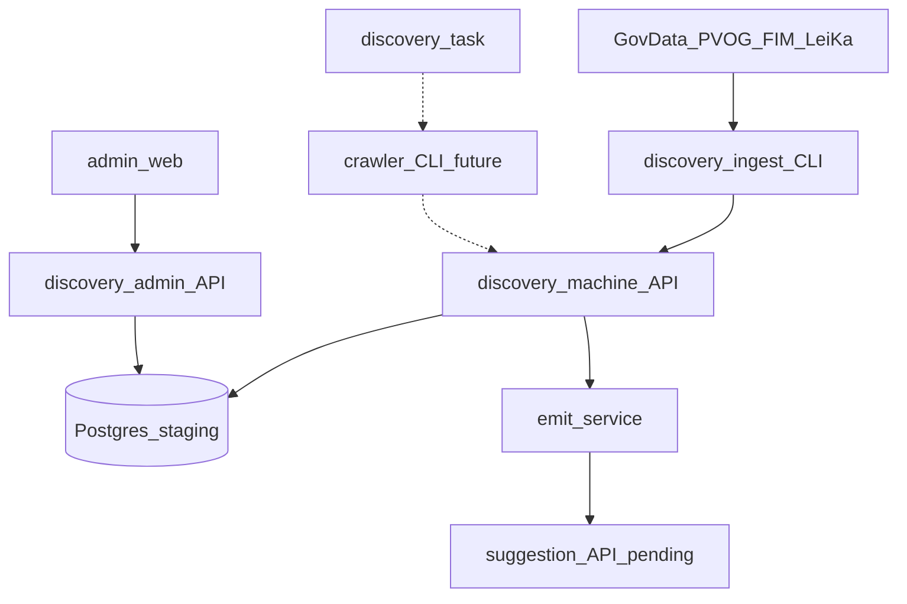

# Discovery layer — Architecture

**Rollout:** [01-rollout.md](01-rollout.md) · **Contract:** [02-staging-model-and-api.md](02-staging-model-and-api.md) · **Decisions:** [gaps-and-decisions.md](gaps-and-decisions.md) · **Chapters:** [chapters/](chapters/)

---

## 1. Why

The public product is **documents** and **dependencies** ([00-master-summary.md](../../docs/planning/00-master-summary.md)). This suite populates staging from GovData/PVOG/FIM/LeiKa and coordinates [crawlers](../crawlers/00-architecture.md); [suggestion-interface](../suggestion-interface/00-architecture.md) remains the moderation boundary.

## 2. Vocabulary

| Term | Meaning |
| --- | --- |
| **Staging graph** | `catalogue_service`, `discovery_entity`, `discovery_claim`, `discovery_task`, `discovery_fetch_log`, `discovery_event` |
| **Pipeline stage (T0–T4)** | Admin-only ingest/fetch/extract labels |
| **Auto-enqueue** | Catalogue upsert creates `discovery_task` immediately |
| **Admin pipeline review** | Read-only ops UI — no approve/reject |

## 3. Architecture

Solid lines are in the CoS loop; the crawler path is deferred to the [crawlers](../crawlers/00-architecture.md) suite (chapter 20 pointer). External API URLs and ingest vs enrich roles: [docs/discovery/government-data-sources.md](../../docs/discovery/government-data-sources.md) (chapter 7a).

## 4. Admin UI

`/admin/discovery/*` — crawler queue, catalogue index, pipeline drill-down, emit preview. Email allowlist (`DISCOVERY_ADMIN_EMAILS`). Not in public navigation.

## 5. Write boundaries

| Client | DATABASE_URL |
| --- | --- |
| Litestar | yes (staging only) |
| Ingest/crawler CLIs | **no** — API key |
| OpenPLZ GHA | yes — locations only |

## 6. Admin pipeline review (read-only)

Auto-enqueue crawlers; **no** approve/reject in admin. Screens:

| Screen | Route | Purpose |
| --- | --- | --- |
| Crawler targets | `/admin/discovery/tasks` | What crawlers will claim next |
| Catalogue index | `/admin/discovery/catalogue` | Imported rows + summary chips |
| Pipeline drill-down | `/admin/discovery/pipeline/:id` | T0 → T1 → fetches → claims → emit per row |
| Emit preview | section on drill-down | `GET …/emit-preview` — no POST to suggestions |

Admin API paths: [01-rollout.md](01-rollout.md). Public app remains documents-only.

## 7. Prerequisites

| Suite | Why |
| --- | --- |
| [ci-foundation](../ci-foundation/01-rollout.md) 1–2 | Postgres-backed API tests and migration round-trip |
| [auth](../auth/01-rollout.md) through machine guard | JWT for admin UI; `X-API-Key` for ingest and emit |
| [suggestion-interface](../suggestion-interface/01-rollout.md) | Chapter 18 POST emit only (`pending` suggestions) |

**Not blocking this loop:** [voting-moderation](../voting-moderation/01-rollout.md), [evidence-storage](../evidence-storage/01-rollout.md), [crawlers](../crawlers/01-rollout.md). See [gaps-and-decisions.md](gaps-and-decisions.md) D10–D11.

Implementable detail: [02-staging-model-and-api.md](02-staging-model-and-api.md).
