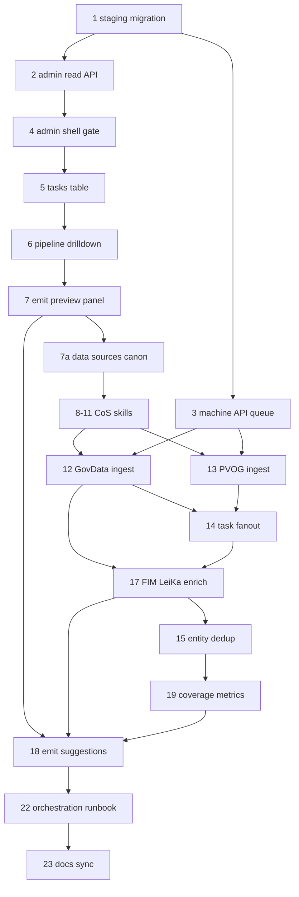

# Discovery layer — Rollout

**Architecture:** [00-architecture.md](00-architecture.md) · **Contract:** [02-staging-model-and-api.md](02-staging-model-and-api.md) · **Decisions:** [gaps-and-decisions.md](gaps-and-decisions.md) · **Chapters:** [chapters/](chapters/) · **Ledger:** [run-ledger.md](run-ledger.md)

**Loop branch:** `feat/plans-discovery-layer`  
**Release branch:** `main`

**Prerequisites:** [ci-foundation](../ci-foundation/01-rollout.md) 1–2; [auth](../auth/01-rollout.md) through machine guard; [suggestion-interface](../suggestion-interface/01-rollout.md) shipped (chapter 18 emit only). Not required: voting-moderation, evidence-storage, crawlers.

---

## The three invariants

1. **Staging is not canonical.**
2. **Each in-loop chapter ships with `./ci.sh` green.**
3. **Workers never import `app.db`.** Ingest lives in `apps/discovery-ingest/` and calls the discovery machine API with `X-API-Key`.

---

## Dependency graph (in-loop)



Chapter 7a can run in parallel with 1–7 once the contract in [02-staging-model-and-api.md](02-staging-model-and-api.md) is stable. Chapters 8–11 are documentation-only but **must not merge** until 7a is on the loop branch.

---

## Execution order — CoS loop (20 chapters)

1. [chapters/01-staging-migration-lineage.md](chapters/01-staging-migration-lineage.md)
2. [chapters/02-admin-discovery-api.md](chapters/02-admin-discovery-api.md)
3. [chapters/03-task-auto-enqueue-claim.md](chapters/03-task-auto-enqueue-claim.md)
4. [chapters/04-admin-shell-email-gate.md](chapters/04-admin-shell-email-gate.md)
5. [chapters/05-crawler-targets-table.md](chapters/05-crawler-targets-table.md)
6. [chapters/06-pipeline-drilldown.md](chapters/06-pipeline-drilldown.md)
7. [chapters/07-emit-preview-panel.md](chapters/07-emit-preview-panel.md)
7a. [chapters/07a-government-data-sources-canon.md](chapters/07a-government-data-sources-canon.md)
8. [chapters/08-cos-govdata-skill.md](chapters/08-cos-govdata-skill.md)
9. [chapters/09-cos-pvog-skill.md](chapters/09-cos-pvog-skill.md)
10. [chapters/10-cos-fim-skill.md](chapters/10-cos-fim-skill.md)
11. [chapters/11-cos-leika-skill.md](chapters/11-cos-leika-skill.md)
12. [chapters/12-govdata-ozg-ingest.md](chapters/12-govdata-ozg-ingest.md)
13. [chapters/13-pvog-ingest-cli.md](chapters/13-pvog-ingest-cli.md)
14. [chapters/14-catalogue-task-fanout.md](chapters/14-catalogue-task-fanout.md)
17. [chapters/17-fim-leika-enrich.md](chapters/17-fim-leika-enrich.md)
15. [chapters/15-discovery-entity-dedup.md](chapters/15-discovery-entity-dedup.md)
19. [chapters/19-coverage-metrics.md](chapters/19-coverage-metrics.md)
18. [chapters/18-emit-suggestions.md](chapters/18-emit-suggestions.md)
22. [chapters/22-orchestration-runbook.md](chapters/22-orchestration-runbook.md)
23. [chapters/23-docs-sync.md](chapters/23-docs-sync.md)

## Deferred (not in CoS execution order)

| # | Chapter | Owner |
| --- | --- | --- |
| 16 | [discovery-claim-evidence](chapters/16-discovery-claim-evidence.md) | evidence-storage seam |
| 20 | [crawler-frontier-adapter](chapters/20-crawler-frontier-adapter.md) | crawlers suite |
| 21 | [llm-extract-flag](chapters/21-llm-extract-flag.md) | open seam |

---

## Chapters

| # | Chapter | Layer | Gate | In loop | Plan | Status |
| --- | --- | --- | --- | --- | --- | --- |
| 1 | Staging migration + lineage | model + migration | pytest + round-trip + `./ci.sh` | yes | [01](chapters/01-staging-migration-lineage.md) | shipped |
| 2 | Admin discovery API | backend | pytest + `./ci.sh` | yes | [02](chapters/02-admin-discovery-api.md) | shipped |
| 3 | Task auto-enqueue + claim | backend | pytest + `./ci.sh` | yes | [03](chapters/03-task-auto-enqueue-claim.md) | shipped |
| 4 | Admin shell + email gate | web | vitest + `./ci.sh` | yes | [04](chapters/04-admin-shell-email-gate.md) | shipped |
| 5 | Crawler targets table | web | vitest + `./ci.sh` | yes | [05](chapters/05-crawler-targets-table.md) | shipped |
| 6 | Pipeline drill-down | web | vitest + `./ci.sh` | yes | [06](chapters/06-pipeline-drilldown.md) | shipped |
| 7 | Emit preview panel | web + API | vitest + pytest + `./ci.sh` | yes | [07](chapters/07-emit-preview-panel.md) | shipped |
| 7a | Government data sources canon | docs | link check + `./ci.sh` | yes | [07a](chapters/07a-government-data-sources-canon.md) | shipped |
| 8 | CoS GovData skill | docs | skill structure check | yes | [08](chapters/08-cos-govdata-skill.md) | shipped |
| 9 | CoS PVOG skill | docs | skill structure check | yes | [09](chapters/09-cos-pvog-skill.md) | shipped |
| 10 | CoS FIM skill | docs | skill structure check | yes | [10](chapters/10-cos-fim-skill.md) | shipped |
| 11 | CoS LeiKa skill | docs | skill structure check | yes | [11](chapters/11-cos-leika-skill.md) | shipped |
| 12 | GovData OZG ingest | ingest + API | pytest + `./ci.sh` | yes | [12](chapters/12-govdata-ozg-ingest.md) | shipped |
| 13 | PVOG ingest CLI | ingest + API | pytest + `./ci.sh` | yes | [13](chapters/13-pvog-ingest-cli.md) | shipped |
| 14 | Catalogue task fanout | backend | pytest + `./ci.sh` | yes | [14](chapters/14-catalogue-task-fanout.md) | shipped |
| 15 | Discovery entity dedup | backend | pytest + `./ci.sh` | yes | [15](chapters/15-discovery-entity-dedup.md) | shipped |
| 16 | Discovery claim evidence | backend | — | **deferred** | [16](chapters/16-discovery-claim-evidence.md) | deferred |
| 17 | FIM + LeiKa enrich | ingest + API | pytest + `./ci.sh` | yes | [17](chapters/17-fim-leika-enrich.md) | shipped |
| 18 | Emit suggestions | backend | pytest + `./ci.sh` | yes | [18](chapters/18-emit-suggestions.md) | shipped |
| 19 | Coverage metrics | backend + web | pytest + vitest + `./ci.sh` | yes | [19](chapters/19-coverage-metrics.md) | shipped |
| 20 | Crawler frontier adapter | crawler | — | **deferred** | [20](chapters/20-crawler-frontier-adapter.md) | deferred |
| 21 | LLM extract flag | backend | — | **deferred** | [21](chapters/21-llm-extract-flag.md) | deferred |
| 22 | Orchestration runbook | docs + ops | manual | yes | [22](chapters/22-orchestration-runbook.md) | shipped |
| 23 | Docs sync | docs | link check | yes | [23](chapters/23-docs-sync.md) | shipped |

---

## Per-chapter gate

```bash
docker compose up -d --wait db
cd apps/api && python -m pytest tests/<file>.py
cd ../.. && ./ci.sh

# migration chapters, additionally
cd apps/api && alembic upgrade head && alembic downgrade -1 && alembic upgrade head

# ingest chapters
cd apps/discovery-ingest
ruff format --check . && ruff check . && mypy discovery_ingest
python -m pytest
cd ../.. && ./ci.sh

# web chapters
cd apps/web
npm run test -- <paths from chapter>
npm run lint && npm run format:check && npm run typecheck && npm run build
cd ../.. && ./ci.sh
```

**Refactor gate** (reported per chapter): methods ~5 LOC, classes ~100 LOC, at most one level of nesting,
no third conditional branch without a dispatcher, commit at least once per green. Branches
`feat/discovery-layer-<slug>` from **loop branch**; conventional commits (`test(api): …` then `feat(api): …`,
or `web` / `ingest` / `docs` scope), one PR per chapter into `feat/plans-discovery-layer`.

---

## Red / green / refactor

Governed by the standing TDD workflow. Every in-loop chapter lists **paired** tests (happy + negative) in its
Red tests table, confirms they fail before green, and ends with a **Refactor gate** outcome.

Typical negative paths:

| Slice | Negative assertion |
| --- | --- |
| Migration | Duplicate external id rejected; downgrade drops staging tables only |
| Machine API | Missing or revoked API key → 401; invalid upsert body → 422 |
| Admin API | Unauthenticated → 401; authenticated but email not on allowlist → 403 |
| Admin web | Non-admin redirected or forbidden view |
| Ingest CLI | API error surfaces non-zero exit; fixture replay is deterministic |
| Emit | Unresolved entity → skip or 422; idempotent replay returns same suggestion id |

---

## Orchestration

Merge this suite to `main`, then launch **chief of staff** on `.plans/discovery-layer/`. Each slice is one
foreground **chapter-implementer**. See [docs/operations/loops/discovery-layer.md](../../docs/operations/loops/discovery-layer.md).
