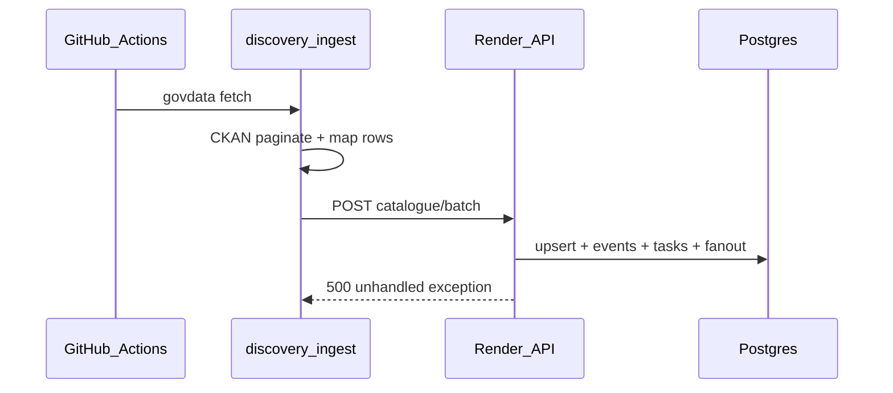

# Discovery online smoke — Architecture

**Rollout:** [01-rollout.md](01-rollout.md) · **Decisions:** [gaps-and-decisions.md](gaps-and-decisions.md) · **Chapters:** [chapters/](chapters/) · **Parent:** [discovery-online](../discovery-online/00-architecture.md) (shipped)

---

## 1. Why

**Platform maintenance** discovery job fails at **GovData OZG catalogue fetch** with
`discovery machine API 500` while `GET /health` returns 200. Render logs show
`POST /api/v1/discovery/machine/catalogue/batch` → 500. GovData CKAN fetch already succeeded; the failure is **API-side** during [`DiscoveryMachineService.batch_upsert`](../../apps/api/app/features/discovery/service.py).

Separately, local `./ci.sh` can feel hung on `test_api_key_service` when pytest inherits a **remote** `DATABASE_URL` from `apps/api/.env` — not an external HTTP dependency.

## 2. Symptom

| Layer | Observation |
| --- | --- |
| GHA | [`platform-maintenance.yml`](../../.github/workflows/platform-maintenance.yml) step **GovData OZG catalogue fetch** exits 1 |
| Ingest | [`DiscoveryMachineApiError`](../../apps/discovery-ingest/discovery_ingest/api_client.py) with opaque JSON body |
| Render | Access log: batch POST **500** immediately after health **200** |

Auth / discovery off would be **401/403/503**, not **500**.

## 3. Failure path

## 4. Leading hypothesis

**`FEDERAL_JURISDICTION_ID` GitHub secret does not match a `jurisdiction` row in production.**

- Ingest sends `jurisdiction_id` on every batch item ([`CatalogueBatchItem`](../../apps/api/app/schema/discovery/machine.py)); FK on [`catalogue_service.jurisdiction_id`](../../apps/api/app/models/discovery/catalogue_service.py).
- Docs default secret to seed UUID `11111111-1111-1111-1111-111111111101` ([`seed_documents.ID_DE`](../../apps/api/scripts/seed_documents.py)).
- OpenPLZ import uses deterministic id `uuid5(redtape-openplz, "jurisdiction:COUNTRY:DE")` → **`44107a34-a8d3-53f9-8dc2-da5b133c12bd`** ([`import_openplz_locations`](../../apps/api/scripts/import_openplz_locations.py)).
- [`seed_documents._find_or_create_jurisdiction`](../../apps/api/scripts/seed_documents.py) reuses existing `(kind, code)` and **does not** insert `11111111…` when OpenPLZ already owns `DE`.

Unhandled `IntegrityError` (FK) → Litestar **500**.

## 5. Other hypotheses (confirm via traceback)

| Hypothesis | Signal |
| --- | --- |
| Discovery migrations missing | `relation "catalogue_service" does not exist` |
| `portal_url` / `target_url` length | `String(500)` in traceback; often **422** from Pydantic first |
| Live GovData shape only | Minimal curl **201** but full fetch **500** |

## 6. Scope

| In scope | Out of scope |
| --- | --- |
| Triage runbook, secret + docs fix, optional API 422 for bad `jurisdiction_id` | Changing GovData CKAN client |
| `ci.sh` pins local Postgres for API pytest (parity with GHA) | Re-running OpenPLZ import |
| CoS chapters only — implementation via chapter-implementers | Live production changes without operator verification |

## 7. CoS orchestration

[`docs/operations/loops/discovery-online-smoke.md`](../../docs/operations/loops/discovery-online-smoke.md)
