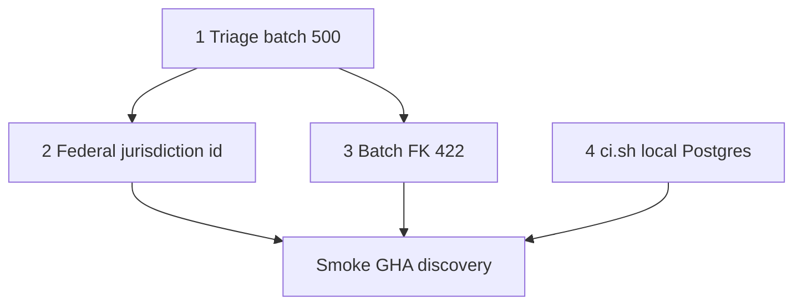

# Discovery online smoke — Rollout

**Architecture:** [00-architecture.md](00-architecture.md) · **Decisions:** [gaps-and-decisions.md](gaps-and-decisions.md) · **Chapters:** [chapters/](chapters/) · **Ledger:** [run-ledger.md](run-ledger.md)

**Loop branch:** `feat/plans-discovery-online-smoke`  
**Release branch:** `main`

**Prerequisites:** [discovery-online](../discovery-online/01-rollout.md) shipped on `main`; production Render + GHA secrets per [discovery-online-production-setup.md](../../docs/operations/discovery-online-production-setup.md).

---

## Invariants

1. **Discovery GHA never uses `DATABASE_URL`.**
2. **Chapter 1 is ops-first** — may complete without a code PR (secret-only fix).
3. **Each code chapter ends with `./ci.sh` green.**
4. **No live GovData/PVOG in PR pytest** — mocks/fixtures only.

---

## Dependency graph



---

## Execution order

1. [chapters/01-triage-batch-500.md](chapters/01-triage-batch-500.md)
2. [chapters/02-federal-jurisdiction-id.md](chapters/02-federal-jurisdiction-id.md)
3. [chapters/03-batch-fk-validation.md](chapters/03-batch-fk-validation.md) — skip if chapter 1 disproves FK
4. [chapters/04-ci-sh-local-postgres.md](chapters/04-ci-sh-local-postgres.md) — may run in parallel with 2–3

**Exit:** `gh workflow run platform-maintenance.yml -f job=discovery` green; Render batch POST **201**.

---

## Chapters

| # | Chapter | Layer | Gate | Plan | Status |
| --- | --- | --- | --- | --- | --- |
| 1 | Triage batch 500 | ops + docs | checklist | [01](chapters/01-triage-batch-500.md) | planned |
| 2 | Federal jurisdiction id | ops + docs + script | smoke curl + GHA | [02](chapters/02-federal-jurisdiction-id.md) | planned |
| 3 | Batch FK → 422 | API | pytest + `./ci.sh` | [03](chapters/03-batch-fk-validation.md) | planned |
| 4 | ci.sh local Postgres | CI | `./ci.sh` | [04](chapters/04-ci-sh-local-postgres.md) | planned |

## Per-chapter gate

```bash
./ci.sh
```

Chapter 1–2 manual verification documented in chapter files (production curl / GHA).

## Release

When the ledger is complete, open release PR **loop branch → `main`**. CoS: [`docs/operations/loops/discovery-online-smoke.md`](../../docs/operations/loops/discovery-online-smoke.md).
