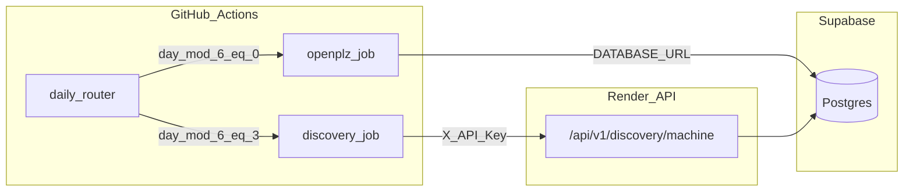

# Discovery online — Architecture

**Rollout:** [01-rollout.md](01-rollout.md) · **Decisions:** [gaps-and-decisions.md](gaps-and-decisions.md) · **Chapters:** [chapters/](chapters/) · **Prerequisite:** [discovery-layer](../discovery-layer/00-architecture.md) (shipped)

---

## 1. Why

[discovery-layer](../discovery-layer/00-architecture.md) ships staging ingest, admin review, and machine emit, but operators still run `apps/discovery-ingest` from a laptop ([`docs/operations/discovery-layer.md`](../../docs/operations/discovery-layer.md)). This suite moves **catalogue refetch**, **task drain**, and **metadata enrich** into **scheduled GitHub Actions** against the live API, and retimes OpenPLZ so Supabase stays active on a **6-day alternating cycle** (3 days OpenPLZ, 3 days discovery).

Scheduled discovery refreshes **staging only** — no automatic `POST …/emit` to suggestions.

## 2. Vocabulary

| Term | Meaning |
| --- | --- |
| **Platform maintenance** | Unified GHA workflow that routes to OpenPLZ or discovery by calendar |
| **Discovery online job** | GHA job: `discovery-ingest` CLIs + worker drain against Render machine API |
| **Machine boundary** | Discovery jobs use `DISCOVERY_API_URL` + `DISCOVERY_API_KEY` — never `DATABASE_URL` |
| **OpenPLZ path** | Migrations + `import_openplz_locations.py` with `DATABASE_URL` (unchanged) |
| **Idempotent refetch** | Re-running ingest must not multiply tasks or claims (OpenPLZ parity) |

## 3. Topology

| Component | Role |
| --- | --- |
| **Cloudflare Workers** | Public SPA; `/api/*` proxied to Render — unchanged |
| **Render** | Litestar API; discovery machine + admin routes |
| **Supabase** | Postgres + Auth JWT for admin UI |
| **GitHub Actions** | Scheduler and batch compute (free tier) |

**Not in scope:** Render cron workers, Cloudflare Workers running Python ingest, or a secret “run ingest” HTTP endpoint on the API.

## 4. Schedule (6-day cycle)

Single workflow (e.g. `.github/workflows/platform-maintenance.yml`) runs **daily** at **02:00 UTC**. First step: `days_since_anchor % 6` where anchor is documented in ops (default `2026-01-01` UTC).

| `days % 6` | Job |
| --- | --- |
| `0` | OpenPLZ import (migrations + import script) |
| `3` | Discovery online (govdata fetch, pvog run, worker drain, enrich) |
| `1,2,4,5` | No-op (success) |

Max gap between DB-touching jobs: **3 days** (under Supabase ~7-day pause). [keep-alive.yml](../../.github/workflows/keep-alive.yml) Render ping remains separate.

Manual override: `workflow_dispatch` inputs `job=openplz|discovery|skip` for debugging.

## 5. Discovery job sequence

1. **Wake API** — retry `GET /health` on Render if cold start.
2. **Catalogue ingest** — `govdata fetch` + `pvog run` → `POST /catalogue/batch` (bounded pages/time).
3. **Worker drain** — `discovery_ingest worker drain --max-tasks N` — claim, fetch, log, complete/fail.
4. **Enrich** — handle `enrich_metadata` tasks (FIM steckbrief → entities/claims); LeiKa per chapter 8 scope.

Admin review stays at `/admin/discovery/*` (email allowlist).

## 6. Secrets matrix

| Secret / env | OpenPLZ job | Discovery job |
| --- | --- | --- |
| `DATABASE_URL` | yes | **no** |
| `DISCOVERY_API_URL` | no | yes (Render **host root**, e.g. `https://redtape-api.onrender.com`) |
| `DISCOVERY_API_KEY` | no | yes (`discovery-scheduled-gha` key) |
| `FEDERAL_JURISDICTION_ID` | no | yes (Germany seed UUID) |

Render dashboard: `DISCOVERY_ADMIN_EMAILS` for admin UI (not used by GHA discovery job).

## 7. Idempotency

Scheduled runs re-fetch the same government APIs. Behavior must match [OpenPLZ idempotency](../../docs/operations/openplz-import.md): upsert by DB unique keys, reconcile races with `IntegrityError` recovery, and **no unbounded duplicate tasks or claims**. See [gaps-and-decisions.md](gaps-and-decisions.md) and chapter 5.

## 8. Data sources

Canon: [`docs/discovery/government-data-sources.md`](../../docs/discovery/government-data-sources.md).

## 9. Relationship to other suites

| Suite | Relationship |
| --- | --- |
| [discovery-layer](../discovery-layer/01-rollout.md) | Reuses machine API, models, `apps/discovery-ingest` |
| [crawlers](../crawlers/00-architecture.md) | Full Playwright crawler deferred; this suite ships a **narrow drain** in `discovery-ingest` |
| [discovery-layer ch.20](../discovery-layer/chapters/20-crawler-frontier-adapter.md) | Partially addressed by worker drain chapter |
