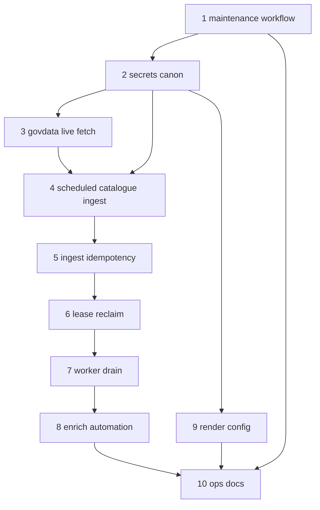

# Discovery online — Rollout

**Architecture:** [00-architecture.md](00-architecture.md) · **Decisions:** [gaps-and-decisions.md](gaps-and-decisions.md) · **Chapters:** [chapters/](chapters/) · **Ledger:** [run-ledger.md](run-ledger.md)

**Loop branch:** `feat/plans-discovery-online`  
**Release branch:** `main`

**Prerequisites:** [discovery-layer](../discovery-layer/01-rollout.md) in-loop chapters shipped on `main` (machine API, `apps/discovery-ingest`, admin UI).

---

## The six invariants

1. **Discovery scheduled jobs never use `DATABASE_URL`.**
2. **OpenPLZ path may use `DATABASE_URL`** (GHA secret).
3. **PR CI does not call live government APIs** — fixtures and mocks only.
4. **Production discovery calls public Render machine API** — retries on 503/cold start.
5. **Each chapter ships with `./ci.sh` green.**
6. **Scheduled re-runs are idempotent** — duplicate refetch must not multiply tasks or claims without bound (OpenPLZ parity, chapter 5).

---

## Dependency graph



---

## Execution order

1. [chapters/01-maintenance-workflow-router.md](chapters/01-maintenance-workflow-router.md)
2. [chapters/02-secrets-and-env-canon.md](chapters/02-secrets-and-env-canon.md)
3. [chapters/03-govdata-live-fetch-cli.md](chapters/03-govdata-live-fetch-cli.md)
4. [chapters/04-scheduled-catalogue-ingest.md](chapters/04-scheduled-catalogue-ingest.md)
5. [chapters/05-ingest-idempotency.md](chapters/05-ingest-idempotency.md)
6. [chapters/06-task-lease-reclaim.md](chapters/06-task-lease-reclaim.md)
7. [chapters/07-ingest-worker-drain.md](chapters/07-ingest-worker-drain.md)
8. [chapters/08-enrich-metadata-automation.md](chapters/08-enrich-metadata-automation.md)
9. [chapters/09-render-production-config.md](chapters/09-render-production-config.md)
10. [chapters/10-ops-runbook-and-docs.md](chapters/10-ops-runbook-and-docs.md)

---

## Chapters

| # | Chapter | Layer | Gate | Plan | Status |
| --- | --- | --- | --- | --- | --- |
| 1 | Maintenance workflow + 6-day router | GHA | workflow lint + `./ci.sh` | [01](chapters/01-maintenance-workflow-router.md) | planned |
| 2 | Secrets & URL canon | docs + ingest | `./ci.sh` | [02](chapters/02-secrets-and-env-canon.md) | planned |
| 3 | GovData live fetch CLI | ingest | pytest + `./ci.sh` | [03](chapters/03-govdata-live-fetch-cli.md) | planned |
| 4 | Scheduled catalogue ingest | GHA + ingest | pytest + `./ci.sh` | [04](chapters/04-scheduled-catalogue-ingest.md) | planned |
| 5 | Ingest idempotency (OpenPLZ parity) | API + ingest | pytest + `./ci.sh` | [05](chapters/05-ingest-idempotency.md) | planned |
| 6 | Task lease reclaim | API | pytest + `./ci.sh` | [06](chapters/06-task-lease-reclaim.md) | planned |
| 7 | Ingest worker drain | ingest | pytest + `./ci.sh` | [07](chapters/07-ingest-worker-drain.md) | planned |
| 8 | Enrich metadata automation | ingest + API | pytest + `./ci.sh` | [08](chapters/08-enrich-metadata-automation.md) | planned |
| 9 | Render production discovery flags | ops | checklist + `./ci.sh` | [09](chapters/09-render-production-config.md) | planned |
| 10 | Ops runbook & docs sync | docs | link check + `./ci.sh` | [10](chapters/10-ops-runbook-and-docs.md) | planned |

## Per-chapter gate

```bash
./ci.sh
```

Chapters touching workflows: validate YAML in PR; optional `workflow_dispatch` dry-run documented in chapter manual verification.

## Release

When the ledger is complete, open release PR **loop branch → `main`**. CoS orchestration: [`docs/operations/loops/discovery-online.md`](../../docs/operations/loops/discovery-online.md).
