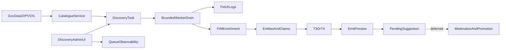

# Discovery operations — Architecture

**Rollout:** [01-rollout.md](01-rollout.md) · **Decisions:** [gaps-and-decisions.md](gaps-and-decisions.md) · **Chapters:** [chapters/](chapters/) · **Parent:** [discovery-layer](../discovery-layer/00-architecture.md) and [discovery-online](../discovery-online/00-architecture.md)

## 1. Why

The discovery staging path now imports catalogue rows, creates durable work items, drains fetch and FIM-enrichment tasks, and exposes a read-only admin surface. This suite turns that working slice into an operator-verifiable loop:



The suite is documentation-first. Its implementation chapters may later change the API, worker, schema, and web code, but this plan itself creates only plan documents.

## 2. Vocabulary

| Term | Meaning |
| --- | --- |
| **Representative row** | One GovData or PVOG catalogue service followed from ingest through enrichment and one manual emit |
| **Catalogue** | Current imported `catalogue_service` state, keyed by `(source, external_id)`; it is not the canonical document catalogue |
| **Task queue** | Persistent `discovery_task` rows with pending, claimed, completed, or failed status |
| **Fetch attempt** | One append-only `discovery_fetch_log` row |
| **Claim** | A staged entity assertion that can become a suggestion |
| **Bounded drain** | A worker invocation limited by batch count and/or wall-clock budget |
| **Successful run** | A persisted worker-run record with a finished status of `succeeded`, not an inference from task timestamps |

## 3. Boundaries

Workers continue to use the machine API and API key. They do not use `DATABASE_URL` or import API persistence code. The existing 15-minute task lease, expired-lease reclaim, priority ordering, catalogue upsert idempotency, claim fingerprint deduplication, and manual emit boundary remain in force.

This suite does not implement:

- `apps/crawler`, broad crawling, source extractors, or a frontier adapter;
- Playwright, screenshots, evidence storage, or evidence refresh;
- automatic emit, voting, moderation, or promotion to canonical documents.

The future crawler must be able to consume the queue or use a separate suggestion path without making current queue or telemetry identifiers unusable. The plan therefore keeps task targets, source identifiers, stable catalogue IDs, and run IDs API-visible and source-neutral.

## 4. Operational data flow

The current pipeline has no reliable run-level success record. Fetch timestamps show activity, but they cannot distinguish a successful bounded drain from a crashed or partial workflow. Queue observability therefore introduces a minimal operational run record, exposed through the machine API:

- `run_id`;
- operation kind, initially `worker_drain`;
- started and finished timestamps;
- status such as `running`, `succeeded`, or `failed`;
- claimed, completed, failed, skipped, and remaining counts;
- bounded-stop reason and failure detail.

The worker owns orchestration; the API owns persistence. A run that disappears before completion remains observable as unfinished or stale rather than being reported as successful.

## 5. Admin surface

The allowlisted `/admin/discovery/*` routes remain read-only:

- Catalogue shows current imported rows and summary metrics.
- Coverage shows queue and run observability.
- Tasks shows durable queue rows and filters.
- Pipeline detail shows one row's tasks, fetch logs, entities, claims, events, and emit preview.

Catalogue, Coverage, and Tasks remain under the existing Documents menu and server-side admin probe. Their controls become icon-based links using the installed `react-icons/fa` package:

- Catalogue: `FaList`;
- Coverage: `FaTasks`, chosen for its progress-bars meaning;
- Tasks: `FaClipboard`.

The exact icon export is verified during implementation. No icon dependency is added. Each icon-only control retains a translated `aria-label` and a visible tooltip or title.

## 6. Product boundary after T4

T4 means that the staged claims are eligible for emit. It does not mean that a canonical document exists:

```text
T4 → manual emit → pending suggestion → future moderation → canonical document
```

`metadata` claims remain preview-only in the current path. Unresolved requirement claims remain skipped until their document UUIDs resolve. The later evidence and voting suites consume this boundary; they are not part of this operational loop.
