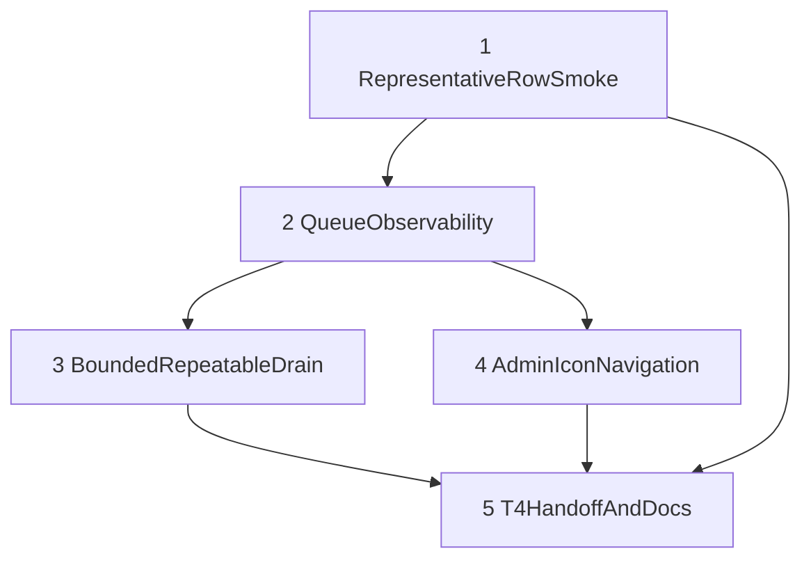

# Discovery operations — Rollout

**Architecture:** [00-architecture.md](00-architecture.md) · **Decisions:** [gaps-and-decisions.md](gaps-and-decisions.md) · **Chapters:** [chapters/](chapters/) · **Ledger:** [run-ledger.md](run-ledger.md)

**Loop branch:** `feat/discovery-operations`
**Release branch:** `main`

**Prerequisites:** [discovery-layer](../discovery-layer/01-rollout.md), [discovery-online](../discovery-online/01-rollout.md), and the existing admin UI are available in the implementation base.

## Invariants

1. This plan suite itself creates documentation only.
2. Discovery workers never use `DATABASE_URL`; all worker persistence remains behind the machine API.
3. Catalogue ingest, task claim, FIM enrichment, claim deduplication, lease reclaim, and manual emit remain idempotent.
4. A drain always has a finite batch or time bound and reports its stopping reason.
5. Run success is persisted explicitly; fetch timestamps are not treated as run health.
6. Admin metrics distinguish backlog, completed history, failed work, stale leases, fetch attempts, source failures, and the last successful run.
7. Admin navigation remains server-authorized and keyboard accessible; icon changes do not add dependencies or alter routes.
8. No crawler, screenshot, evidence, voting, moderation, or automatic promotion implementation enters this suite.
9. Every implementation chapter follows paired happy/negative tests and an explicit refactor audit where code changes are required.

## Dependency graph

The smoke chapter establishes the operator vocabulary and expected stage transitions. Observability defines the run and queue contracts before the drain implementation consumes them. The admin icon chapter can be implemented after the existing probe contract is confirmed, but remains after observability in the chief-of-staff sequence so the final UI can display the agreed metrics.

## Execution order

1. [chapters/01-representative-row-smoke.md](chapters/01-representative-row-smoke.md)
2. [chapters/02-queue-observability.md](chapters/02-queue-observability.md)
3. [chapters/03-bounded-repeatable-drain.md](chapters/03-bounded-repeatable-drain.md)
4. [chapters/04-admin-icon-navigation.md](chapters/04-admin-icon-navigation.md)
5. [chapters/05-t4-handoff-and-docs-sync.md](chapters/05-t4-handoff-and-docs-sync.md)

## Chapters

| # | Chapter | Layer | Gate | Plan | Status |
| --- | --- | --- | --- | --- | --- |
| 1 | Representative row end-to-end smoke | ops + docs | checklist + admin/API observations | [01](chapters/01-representative-row-smoke.md) | planned |
| 2 | Queue observability | API + worker + admin | paired tests + `./ci.sh` | [02](chapters/02-queue-observability.md) | planned |
| 3 | Bounded repeatable worker drain | worker + API | paired tests + `./ci.sh` | [03](chapters/03-bounded-repeatable-drain.md) | planned |
| 4 | Discovery admin icon navigation | frontend | Vitest + `./ci.sh` | [04](chapters/04-admin-icon-navigation.md) | planned |
| 5 | T4 handoff and operations docs sync | docs + ops | link checks + smoke checklist | [05](chapters/05-t4-handoff-and-docs-sync.md) | planned |

## Per-chapter gate

Implementation chapters run the narrowest relevant test pair first, then the affected package checks and root `./ci.sh`. Docs-only chapters run link or reference checks and record the manual smoke result. Each chapter reports its refactor outcome before the next chapter starts.

## Exit criteria

- One representative row reaches enrichment, T3/T4 inspection, preview, and one pending suggestion.
- Queue metrics expose the agreed operational state and a trustworthy last successful bounded run.
- Repeated bounded drains make progress without manual database edits or infinite loops.
- Catalogue, Coverage, and Tasks are accessible icon controls under the existing admin probe.
- The runbook explains the current handoff and points to future crawler/evidence/moderation suites without implementing them.

## Branch and release protocol

Each implementation chapter uses a feature branch from `feat/discovery-operations` and opens one reviewable PR into that loop branch. Documentation-only chapters still use conventional commits and the chapter ledger. After the ledger is complete, open one release PR from `feat/discovery-operations` to `main`.
