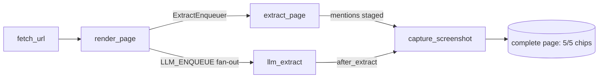

# Discovery throughput — Architecture

**Rollout:** [01-rollout.md](01-rollout.md) · **Decisions:** [gaps-and-decisions.md](gaps-and-decisions.md) · **Chapters:** [chapters/](chapters/) · **Builds on:** [gha-budget](../gha-budget/00-architecture.md), [discovery-operations](../discovery-operations/00-architecture.md), [extraction](../extraction/00-architecture.md), [candidate-view](../candidate-view/00-architecture.md)

## 1. Why

The discovery pipeline's job is to turn catalogue rows into fully-evidenced candidate pages: a domain code, a situation code, at least one dependency edge, an HTML snapshot, and a screenshot — the five completeness chips. Three things currently throttle the rate at which pages reach all five:

1. **The scheduled-task budget is half of what it could be**, split in a way nobody has revisited since it was set (1,000 minutes/month total, 600 reserved for CI, leaving drains only 400).
2. **The cron order makes a hop's output wait a full calendar day** before its consumer workflow runs again, roughly doubling the wall-clock time to a complete page, independent of backlog size.
3. **The queue claims strictly by `(priority, created_at)`**, so a page one chip away from done waits behind a page with zero chips, even though finishing the near-done page is cheaper.

Separately, the LLM extractor discards an entire page's extraction — documents, dependencies, domain code included — merely because it could not also produce a `situation_codes` value, even though every downstream consumer already tolerates an empty one.

Fixing all four and raising the ceiling (budget) at the same time should raise "pages reaching 5/5 completeness per month" sharply without more spend per page.

**Confirmed mechanism behind the current ~2-day latency:**

- `discovery-drain.yml` (04:00 UTC) drains `fetch_url, enrich_metadata, harvest_payload, extract_page`.
- `discovery-render.yml` (05:00 UTC) drains `render_page, capture_screenshot`.
- `discovery-llm.yml` (06:00 UTC) drains `llm_extract`.
- `render_page`'s completion hook creates `extract_page` and (if `LLM_ENQUEUE` is on) `llm_extract` tasks — but `extract_page` is drained by the workflow that already ran *earlier that same day* (04:00, before render's 05:00), so it waits until **tomorrow's** 04:00 run.
- `llm_extract`'s completion creates `capture_screenshot` — but that is drained by `discovery-render.yml`, which already ran *earlier that day* (05:00, before llm's 06:00), so it waits until **tomorrow's** 05:00 run.
- Net: both hops that feed back into an already-run workflow slip a full day, purely from kind-to-workflow bundling and cron order.

The suite is documentation-first: this plan itself creates only plan documents. Its implementation chapters later change GitHub Actions workflow YAML, `apps/api` config and repository code, and `apps/discovery-ingest` extraction code.

## 2. Vocabulary

| Term | Meaning |
| --- | --- |
| **Chip** | One of the five `FLAG_NAMES` booleans (`has_domain`, `has_situation`, `has_edges`, `has_snapshot`, `has_screenshot`) from `candidate_completeness_flags.py` |
| **Complete page** | A `catalogue_service_id` whose best candidate has `completeness == 5` |
| **Pipeline stage** | One of: seed (`fetch_url`, `enrich_metadata`, `harvest_payload`), render (`render_page`), classify (`extract_page`, `llm_extract`), capture (`capture_screenshot`) |
| **Same-day pipeline** | A schedule where every stage's consumer workflow runs after its producer workflow, on the same calendar day, so a task created today is claimable today |
| **Scheduled-task budget** | The `actions_minutes` ledger resource: `BUDGET_ACTIONS_MINUTES_MONTHLY − ACTIONS_CI_RESERVE_MINUTES` |
| **Page-level completeness** | A new, `catalogue_service_id`-keyed count of chips (0–5), distinct from the existing `candidate_id`-keyed `completeness_subquery`, used only to order task claims |
| **Optional situation code** | `PageExtraction.situation_codes` may be omitted or empty; the LLM answer is still valid and is not discarded |

## 3. Target-state design: cron/workflow restructuring

**Recommendation: full same-day restructuring, not a lighter reorder.** Split `extract_page` out of `discovery-drain.yml` and `capture_screenshot` out of `discovery-render.yml` into two new workflow files, and retime all five stages so each hop's consumer runs after its producer, same day:

| Stage | Workflow | Kinds | New UTC time | Old UTC time | Timeout |
| --- | --- | --- | --- | --- | --- |
| Seed | `discovery-drain.yml` (kinds trimmed) | `fetch_url, enrich_metadata, harvest_payload` | 02:00 | 04:00 | 30 min |
| Render | `discovery-render.yml` (kinds trimmed) | `render_page` | 03:00 | 05:00 | 20 min |
| Extract | `discovery-extract.yml` (**new**) | `extract_page` | 04:00 | n/a (was bundled into drain) | 20 min |
| Classify (LLM) | `discovery-llm.yml` (retimed) | `llm_extract` | 04:30 | 06:00 | 20 min |
| Capture | `discovery-screenshot.yml` (**new**) | `capture_screenshot` | 05:00 | n/a (was bundled into render) | 20 min |

These stay as five separate workflow files rather than merging, because each stage has a distinct credential/budget-guard shape: seed/extract need only the Actions-minutes guard; classify needs Cloudflare Workers AI credentials, the `DISCOVERY_LLM_MODEL` gate, and a `neurons` guard; render/capture need Cloudflare Browser Rendering credentials and a `browser_seconds` guard. Merging unrelated failure/skip semantics into one job would make each stage's skip conditions harder to reason about.

**Cost tradeoff, stated plainly:** five scheduled triggers a day instead of three raises baseline per-run overhead (checkout, `setup-python`, budget-check) from roughly 180 to roughly 300 minutes/month. Against the new scheduled-drain cap of 1,000 minutes/month (versus 400 today — see §4 and `gaps-and-decisions.md` D1/D2), this still leaves roughly 700 minutes/month for real work, up from roughly 220 today: both the latency and the headroom improve together, which is what makes the full restructuring affordable now and not before.

**Residual risk, accepted and not engineered around:** if a day's batch or time bound is hit before a stage drains its whole backlog, the overflow for that portion still waits for tomorrow's run of *that* stage — by one day, not two.

## 4. Constraints and invariants

- This suite is documentation only; no product code changes here, only chapter plans for a later chapter-implementer agent.
- Discovery workers stay HTTP-only against the machine API; no `DATABASE_URL` in `apps/discovery-ingest`.
- All existing queue guarantees from [discovery-operations gaps-and-decisions D7](../discovery-operations/gaps-and-decisions.md) remain **except ordering**: the 1–50 claim limit, 15-minute lease, reclaim-on-claim, idempotent catalogue upsert, and claim fingerprint dedup are unaffected.
- **This suite explicitly supersedes `discovery-operations` decision D7's ordering clause.** D7 states "priority/created ordering" as a preserved guarantee; this suite replaces the created-time tie-break within a priority tier with page-completeness-desc, for the throughput goal stated above. See `gaps-and-decisions.md` D5.
- No change to extraction quality, consensus thresholds, or the canonical per-candidate `completeness_subquery`/`completeness_order` used by candidate-browsing lists (`public_filter.py`, `cards.py`, `candidate_relations.py`) — the new page-level ordering is additive and queue-claim-only.
- `domain_codes` stays required; only `situation_codes` becomes optional, exactly matching the user's literal ask.
- Render-dashboard environment variable changes are a manual operator step, never a chapter commit.
