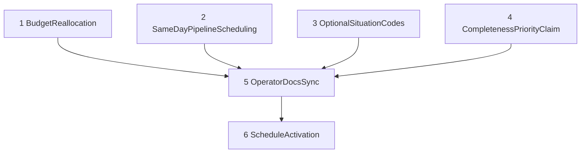

# Discovery throughput — Rollout

**Architecture:** [00-architecture.md](00-architecture.md) · **Decisions:** [gaps-and-decisions.md](gaps-and-decisions.md) · **Chapters:** [chapters/](chapters/) · **Ledger:** [run-ledger.md](run-ledger.md) (created when the loop starts)

**Loop branch:** `feat/plans-discovery-throughput`
**Release branch:** `main`

## Invariants

1. This suite creates documentation only; chapters 1–6 are each one implementable unit for a later chapter-implementer agent.
2. Discovery workers never receive `DATABASE_URL`; all worker persistence stays behind the machine API.
3. The task queue's 1–50 claim limit, 15-minute lease, reclaim, catalogue idempotency, and fingerprint dedup are preserved unchanged.
4. **This suite supersedes [discovery-operations](../discovery-operations/gaps-and-decisions.md) decision D7's ordering clause only**; every other D7 clause is unaffected.
5. `domain_codes` remains required; only `situation_codes` becomes optional.
6. Page-level completeness is a queue-ordering heuristic; it must not change the canonical `completeness_subquery`/`completeness_order` used by candidate lists.
7. Render-dashboard environment variable values are a manual checklist step, never a chapter commit.
8. Every workflow YAML change is validated by a local YAML parse (and `actionlint` if available) before merge — no live cron trigger is awaited to prove syntax.
9. Every code chapter follows paired happy/negative tests and a refactor audit.
10. Conventional commits, one concern per commit, each commit ends with the `Co-Authored-By` line the session provides.

## Dependency graph

Chapters 1–4 are independent code changes with no file overlap and may be implemented in any order, or in parallel. Chapter 5 only starts once all four are merged to the loop branch, since it documents their shipped shape. Chapter 6 runs last because it depends on the new budget, the new workflow files, and the synced docs all existing first; it is the only chapter whose final step is live `gh` commands against the real repository rather than a code commit.

## Execution order (chief of staff)

1. [chapters/01-budget-reallocation.md](chapters/01-budget-reallocation.md)
2. [chapters/02-same-day-pipeline-scheduling.md](chapters/02-same-day-pipeline-scheduling.md)
3. [chapters/03-optional-situation-codes.md](chapters/03-optional-situation-codes.md)
4. [chapters/04-completeness-priority-claim.md](chapters/04-completeness-priority-claim.md)
5. [chapters/05-operator-docs-sync.md](chapters/05-operator-docs-sync.md)
6. [chapters/06-schedule-activation.md](chapters/06-schedule-activation.md)

## Chapters

| # | Chapter | Branch | Status |
| --- | --- | --- | --- |
| 1 | [Budget reallocation (2000/1000/1000)](chapters/01-budget-reallocation.md) | `feat/discovery-throughput-budget-reallocation` | planned |
| 2 | [Same-day pipeline scheduling](chapters/02-same-day-pipeline-scheduling.md) | `feat/discovery-throughput-same-day-pipeline` | planned |
| 3 | [Optional situation codes](chapters/03-optional-situation-codes.md) | `feat/discovery-throughput-optional-situation-codes` | planned |
| 4 | [Completeness-first priority claim](chapters/04-completeness-priority-claim.md) | `feat/discovery-throughput-completeness-priority-claim` | planned |
| 5 | [Operator docs sync](chapters/05-operator-docs-sync.md) | `feat/discovery-throughput-operator-docs-sync` | planned |
| 6 | [Schedule activation](chapters/06-schedule-activation.md) | `feat/discovery-throughput-schedule-activation` | planned |

## Per-chapter gate

Chapters 1, 3, and 4 run their focused tests, then `./ci.sh` in the affected package (`apps/api` or `apps/discovery-ingest`). Chapter 2 has no unit-test harness for workflow YAML; its gate is a YAML parse (and `actionlint` if available) plus, after merge, a live `gh workflow run` smoke per new/changed workflow. Chapter 5 is docs-only; its gate is a grep for stale cron strings plus manual proofreading against the shipped YAML/config. Chapter 6 has no code; its gate is `gh variable list` showing every schedule variable `enabled` and the Render-dashboard budget override confirmed.

## Exit criteria

- All six chapters merged to the loop branch.
- `./ci.sh` green in `apps/api` and `apps/discovery-ingest`.
- `gh variable list` shows `DISCOVERY_DRAIN_SCHEDULE`, `DISCOVERY_RENDER_SCHEDULE`, `DISCOVERY_EXTRACT_SCHEDULE`, `DISCOVERY_LLM_SCHEDULE`, `DISCOVERY_SCREENSHOT_SCHEDULE` all `enabled` and `DISCOVERY_LLM_MODEL` set, recorded in `run-ledger.md`.
- A full day's run shows a page fetched that morning reaching `capture_screenshot` the same day.

## Branch and release protocol

Each chapter uses a feature branch from `feat/plans-discovery-throughput` and opens one reviewable PR into that loop branch. After every chapter's ledger row shows merged with blocker `none`, open one release PR `feat/plans-discovery-throughput` → `main`.
