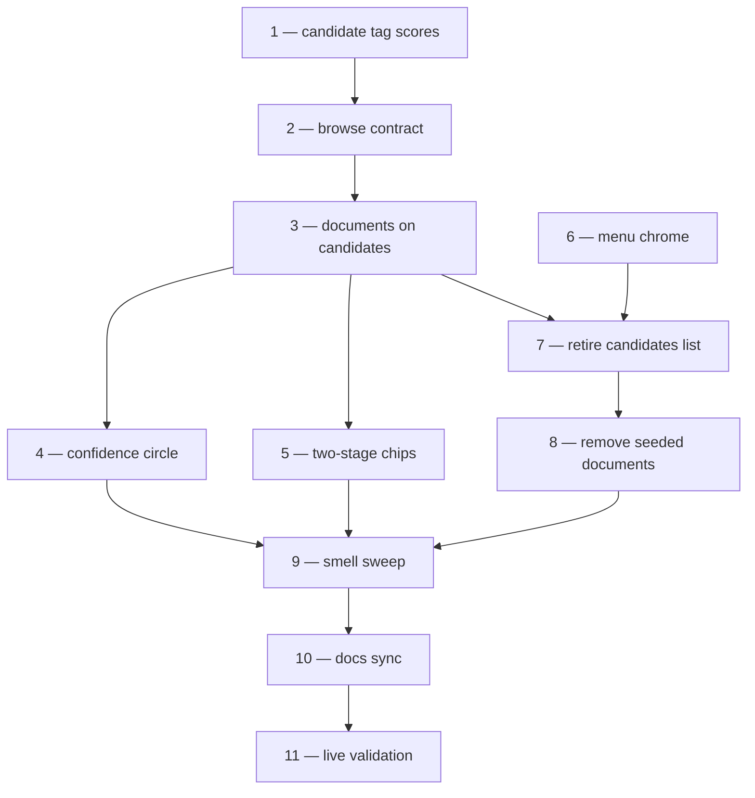

# Document browse by confidence — Rollout

**Architecture:** [00-architecture.md](00-architecture.md) · **Decisions:** [gaps-and-decisions.md](gaps-and-decisions.md) · **Chapters:** [chapters/](chapters/) · **Prior suite:** [situation-tag-hierarchy](../situation-tag-hierarchy/01-rollout.md)

**Loop branch:** `feat/plans-document-browse-confidence`
**Release branch:** `main`

## The invariants

1. **No confidence threshold decides whether a document is listed or a chip matches.** A chip filter matches by the presence of a code on the document, whatever its score. Confidence only orders and colours.
2. **One score definition.** The SQL score model is parity-tested against the Python scorer (`candidate_axis_support`); no third copy of the scoring rule exists.
3. **Sort key and displayed confidence come from the same SQL expression.** The number on the card can never disagree with the order of the list.
4. **Emit, vote and promote are untouched.** They become dormant, documented as such, and not deleted. The only data deletion in the suite is the four seeded documents (chapter 8), by exact id.
5. **No new dependency.** `ProgressCircle` ships with the installed Chakra; the API adds no package.
6. **Every chapter is red / green / refactor.** Each loop names a happy-path and a negative-path test, fails first, and ends with the refactor gate (`~/.claude/skills/chief-of-staff/references/refactoring/refactoring.md`: scan the containing entity against `smells.md`, record `smells found -> refactorings applied` or `no change needed`).
7. **The local gate is authoritative.** `./ci.sh` from the repo root is green before any push (there is no per-app `ci.sh`). Remote CI is checked when available; recent runs (#308–#312) passed, so the old "Actions minutes exhausted" note no longer applies.
8. **The live check (chapter 11) runs only after chapters 1–10 are merged to `main` and deployed.**

## Dependency graph



Chapter 6 touches only the web menu and the suggestion route; it has no code dependency on 1–5 and can run early. It is placed before 7 because both edit `DocumentsMenuRow.tsx` and its tests, and sequential edits avoid a merge conflict. Chapter 8 is independent of the UI chapters (the list no longer reads `document`) but runs after 7 so the UI never depends on the seeded rows.

## Execution order (chief of staff)

1. [Chapter 1 — Candidate tag scores](chapters/01-candidate-tag-scores.md) (`apps/api`)
2. [Chapter 2 — Browse contract](chapters/02-browse-contract.md) (`apps/api`)
3. [Chapter 3 — Documents list on candidates](chapters/03-documents-on-candidates.md) (`apps/web`)
4. [Chapter 4 — Confidence circle](chapters/04-confidence-circle.md) (`apps/web`)
5. [Chapter 5 — Two-stage chips](chapters/05-two-stage-chips.md) (`apps/web`)
6. [Chapter 6 — Menu chrome](chapters/06-menu-chrome.md) (`apps/web`)
7. [Chapter 7 — Retire the candidates list](chapters/07-retire-candidates-list.md) (`apps/web`)
8. [Chapter 8 — Remove seeded documents](chapters/08-remove-seeded-documents.md) (`apps/api`)
9. [Chapter 9 — Smell sweep](chapters/09-smell-sweep.md) (`apps/api`, `apps/web`)
10. [Chapter 10 — Docs sync](chapters/10-docs-sync.md) (docs)
11. [Chapter 11 — Live validation](chapters/11-live-validation.md) (read-only)

## Chapters

| # | Chapter | App(s) | Gate | Plan | Status |
| --- | --- | --- | --- | --- | --- |
| 1 | Candidate tag scores | api | pytest + `./ci.sh` | [chapters/01-candidate-tag-scores.md](chapters/01-candidate-tag-scores.md) | planned |
| 2 | Browse contract (filters, sort, card confidence) | api | pytest + `./ci.sh` | [chapters/02-browse-contract.md](chapters/02-browse-contract.md) | planned |
| 3 | Documents list on candidates (search, sort, paging) | web | vitest + `./ci.sh` | [chapters/03-documents-on-candidates.md](chapters/03-documents-on-candidates.md) | planned |
| 4 | Confidence circle | web | vitest + `./ci.sh` | [chapters/04-confidence-circle.md](chapters/04-confidence-circle.md) | planned |
| 5 | Two-stage swiss-red chips | web | vitest + `./ci.sh` | [chapters/05-two-stage-chips.md](chapters/05-two-stage-chips.md) | planned |
| 6 | Menu chrome (centre Home, close on select, unlink suggest) | web | vitest + `./ci.sh` | [chapters/06-menu-chrome.md](chapters/06-menu-chrome.md) | planned |
| 7 | Retire the candidates list | web | vitest + `./ci.sh` | [chapters/07-retire-candidates-list.md](chapters/07-retire-candidates-list.md) | planned |
| 8 | Remove seeded documents | api | pytest + `./ci.sh` | [chapters/08-remove-seeded-documents.md](chapters/08-remove-seeded-documents.md) | planned |
| 9 | Smell sweep | api, web | `./ci.sh` | [chapters/09-smell-sweep.md](chapters/09-smell-sweep.md) | planned |
| 10 | Docs sync | docs | docs-sync pytest + `./ci.sh` | [chapters/10-docs-sync.md](chapters/10-docs-sync.md) | planned |
| 11 | Live validation | — | — | [chapters/11-live-validation.md](chapters/11-live-validation.md) | done (LR1: [02-live-runs.md](02-live-runs.md)) |

## Per-chapter gate

```bash
./ci.sh                                              # repo root: api ruff/mypy/pytest, then web lint/format/typecheck/vitest/build
cd apps/api && uv run pytest tests/<narrow>.py       # narrow suite named in each api chapter
cd apps/web && npx vitest run <narrow path>          # narrow suite named in each web chapter
```

## Branch and release protocol

Each chapter uses a feature branch off `feat/plans-document-browse-confidence` (naming `feat/document-browse-confidence-<slug>`, given in each chapter) and opens one PR into that loop branch. The plan documents themselves land on `main` first (branch `docs/plans-document-browse-confidence`), because chief-of-staff preflight requires the last chapter file on the release branch. After chapters 1–10 are merged, one release PR from `feat/plans-document-browse-confidence` to `main`; chapter 11 runs after that is deployed.
