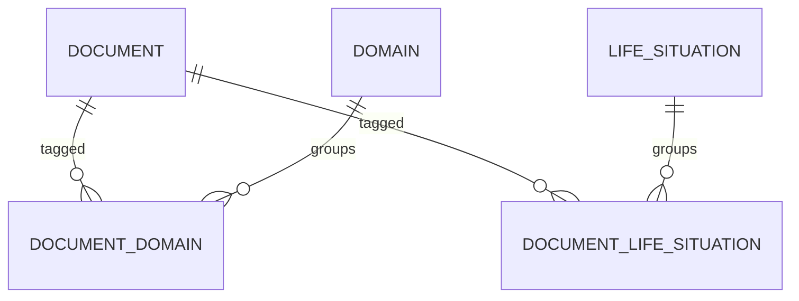

# Document Matrix — Architecture

**Repo:** `redtape` (`apps/api`, `apps/web`).

**Sibling docs:** [01-rollout.md](01-rollout.md) — chapter sequence · [gaps-and-decisions.md](gaps-and-decisions.md) — settled decisions and open seams · [chapters/](chapters/) — executable plans · Related: [data-model chapter](../../docs/planning/directions/data-model-migrations/02-documents-and-requirements.md), [graph resolution](../../docs/planning/directions/data-model-migrations/03-graph-resolution-and-views.md).

**Status:** planned.

---

## 1. Problem statement

The catalog today is a flat list per jurisdiction. [Document](../../apps/api/app/models/document.py) has
a jurisdiction, slug, i18n title/description and URL — nothing says what a paper is *for*. Users do not
arrive with a document name; they arrive with a situation ("we are moving", "I lost my job") or a
topic ("my car", "my boat"). The master summary already promises organization "by domain, life
situation" ([00-master-summary.md](../../docs/planning/00-master-summary.md)) but no plan models it.

This suite adds the two axes as first-class, browsable taxonomies. The dependency graph
(document → required documents) is untouched; the matrix is the **entry point** into it.

---

## 2. Vocabulary (fixed names — use these everywhere)

| Term | German | Meaning | Examples |
| --- | --- | --- | --- |
| **Domain** | Lebensbereich | What area of life a document belongs to | vehicles & mobility, housing, work |
| **Life situation** | Lebenslage | The event or state a user is in | moving house, birth of a child, job loss |
| **Cell** | — | Documents tagged with one domain **and** one situation | *moving house* × *vehicles* → Kfz-Ummeldung |
| **Matrix** | — | The grid of all cells with document counts | rows = situations, columns = domains |

Code names: table/entity `domain`, `life_situation`; API paths `domains`, `life-situations`, `matrix`;
query params `domain`, `situation` (slugs). Do not introduce "category", "topic" or "tag" as synonyms.

---

## 3. Model

| Table | Columns | Constraints |
| --- | --- | --- |
| `domain` | `id` UUID, `slug`, `name_i18n` JSONB, `description_i18n` JSONB, `icon`, `sort_order` | `slug` unique; `de` + `en` keys on every seeded row |
| `life_situation` | same shape | same |
| `document_domain` | `document_id`, `domain_id` | composite PK; FKs `ON DELETE CASCADE` |
| `document_life_situation` | `document_id`, `life_situation_id` | composite PK; FKs `ON DELETE CASCADE` |

Rules:

- **Many-to-many on both axes.** A birth certificate sits in *family & children* and *identity*, and in
  *birth of a child*, *marriage*, and *moving to Germany*.
- **Cells are computed, never stored.** A cell is the intersection of the two join tables.
- **Taxonomies are global**, not jurisdiction-scoped. Which documents exist in a jurisdiction already
  scopes the matrix ([Document.jurisdiction_id](../../apps/api/app/models/document.py)).
- **No change to `document` or `document_requirement`.** Existing columns and endpoints keep their meaning.
- **i18n** follows the existing pattern: JSONB with `de` and `en`, resolved server-side through
  [locale_resolution.py](../../apps/api/app/locale_resolution.py); clients never receive raw JSONB.
- **Slugs** are stable ASCII kebab-case (`umzug`, `geburt-kind`, `fahrzeuge-mobilitaet`) and are the
  public identifiers in URLs and query params.
- **Stay on Postgres.** Intersection counts are plain joins; see
  [gaps-and-decisions.md](gaps-and-decisions.md) D5.

---

## 4. Germany seed taxonomy

Finalized in chapter 2. Flat lists, sorted by `sort_order`.

### Domains (Lebensbereiche)

| Slug | de | en |
| --- | --- | --- |
| `identitaet-personenstand` | Identität & Personenstand | Identity & civil status |
| `wohnen` | Wohnen | Housing |
| `fahrzeuge-mobilitaet` | Fahrzeuge & Mobilität | Vehicles & mobility (car, motorbike, boat, licences) |
| `arbeit-beruf` | Arbeit & Beruf | Work & employment |
| `familie-kinder` | Familie & Kinder | Family & children |
| `bildung` | Bildung | Education |
| `gesundheit-versicherung` | Gesundheit & Versicherung | Health & insurance |
| `steuern-finanzen` | Steuern & Finanzen | Taxes & finance |
| `aufenthalt-migration` | Aufenthalt & Migration | Residence & migration |
| `rente-alter` | Rente & Alter | Retirement & old age |
| `selbststaendigkeit-gewerbe` | Selbstständigkeit & Gewerbe | Self-employment & business |
| `soziales-leistungen` | Soziales & Leistungen | Social benefits |
| `recht-justiz` | Recht & Justiz | Law & justice |

Vehicle kinds (car, motorbike, boat) are **not** separate domains: they are distinct documents inside
`fahrzeuge-mobilitaet` (Kfz-Zulassung, Motorradführerschein, Sportbootführerschein). See D4.

### Life situations (Lebenslagen)

| Slug | de | en |
| --- | --- | --- |
| `umzug` | Umzug | Moving house |
| `geburt-kind` | Geburt eines Kindes | Birth of a child |
| `heirat` | Heirat / Lebenspartnerschaft | Marriage / civil partnership |
| `trennung-scheidung` | Trennung & Scheidung | Separation & divorce |
| `todesfall` | Todesfall | Death of a relative |
| `jobverlust` | Jobverlust | Losing a job |
| `berufseinstieg-jobwechsel` | Berufseinstieg / Jobwechsel | Starting or changing jobs |
| `selbststaendig-machen` | Selbstständig machen | Going self-employed |
| `studium` | Studium | Studying |
| `einschulung` | Einschulung | Starting school |
| `wohnung-mieten` | Wohnung mieten | Renting a home |
| `immobilie-kaufen` | Immobilie kaufen / bauen | Buying or building property |
| `fahrzeug-kaufen` | Fahrzeug kaufen / zulassen | Buying and registering a vehicle |
| `fuehrerschein-erwerben` | Führerschein / Bootsschein erwerben | Getting a driving or boating licence |
| `zuzug-deutschland` | Zuzug nach Deutschland | Moving to Germany |
| `einbuergerung` | Einbürgerung | Naturalisation |
| `krankheit-pflege` | Krankheit / Pflegebedürftigkeit | Illness / care needs |
| `renteneintritt` | Renteneintritt | Retirement |

---

## 5. API contract

Layering follows the project rule: **repos → services → controllers → routers**, each layer talking only
to the one below, as in [features/documents/](../../apps/api/app/features/documents/). Framework is
Litestar (see [documents/controller.py](../../apps/api/app/features/documents/controller.py)).

| Method + path | Returns | Notes |
| --- | --- | --- |
| `GET /api/v1/domains` | `[{slug, name, description, icon}]` | Locale-resolved, ordered by `sort_order` |
| `GET /api/v1/life-situations` | same shape | same |
| `GET /api/v1/documents?domain=&situation=` | existing `DocumentListResponse` | Both optional, combinable, repeatable per axis; unknown slug → 422 |
| `GET /api/v1/documents/{id}` | existing detail + `domains[]`, `life_situations[]` | Additive fields |
| `GET /api/v1/matrix?jurisdiction_id=` | `{cells: [{domain, situation, count}]}` | Only non-empty cells; counts respect the jurisdiction filter |

A new feature package `features/taxonomy/` owns domains, situations and the matrix. The documents
feature never queries taxonomy tables directly: it calls the taxonomy **service** to resolve slugs to
ids (strict layering; a feature's service never reaches into another feature's repo).

---

## 6. Frontend

Code lives under `apps/web/src/features/`, one component per file, directory mirroring hierarchy
(existing pattern: [features/documents/](../../apps/web/src/features/documents/)).

| Surface | Where | Job |
| --- | --- | --- |
| Taxonomy client + hooks | `features/taxonomy/{services,hooks,types}` | Typed fetch + TanStack Query, locale-aware keys |
| Matrix overview | `features/taxonomy/containers/MatrixPage`, route `/matrix` | Situations × domains grid; each cell links to `/documents?domain=…&situation=…` |
| List filters | `features/documents/components/documents-list/` | Domain and situation chips, state in URL search params |
| Tags | `DocumentCard`, `DocumentHeader` | Domain/situation badges, absent when empty |

Rules carried over from [web-frontend/00-architecture.md](../web-frontend/00-architecture.md): Chakra v3
namespace imports, [AppCard](../../apps/web/src/components/data-display/AppCard.tsx) as the card look,
theme tokens only, no hardcoded strings — new keys go into
[apps/api/scripts/seed_data/translations/](../../apps/api/scripts/seed_data/translations/) (`de.json`,
`en.json`) and the web [fallback bundles](../../apps/web/src/i18n/fallback/).

---

## 7. Out of scope

Dependency-closure endpoints and tree UI (graph-resolution strand), situation checklists,
curation/admin UI and community tagging proposals (social-moderation strand), mobile vault taxonomy
(Flutter, later suite), hierarchical situations.
