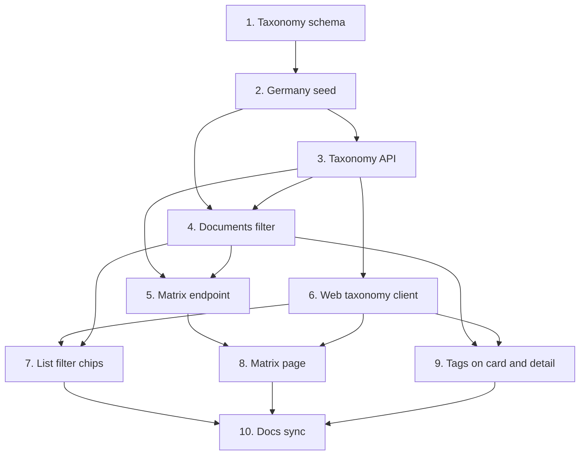

# Document Matrix — Rollout

**Architecture:** [00-architecture.md](00-architecture.md) · **Decisions:** [gaps-and-decisions.md](gaps-and-decisions.md) · **Chapters:** [chapters/](chapters/)

---

## The three invariants

1. **Additive only.** No change to existing `document` / `document_requirement` columns, existing
   endpoints' behavior without the new params, or existing routes.
2. **Independently shippable.** After each chapter `./ci.sh` passes, `/documents` and
   `/documents/:id` still work, and migrations upgrade and downgrade cleanly.
3. **Postgres only.** No graph database, no new infrastructure.

---

## Dependency graph



Backend chapters 3–5 and web chapter 6 can proceed in parallel after chapter 2 if desired; the table
order is the default sequence.

---

## Chapters

| # | Chapter | Layer | Gate | Plan | Status |
| --- | --- | --- | --- | --- | --- |
| 1 | Taxonomy schema | model + migration | pytest + `./ci.sh` | [01-taxonomy-schema.md](chapters/01-taxonomy-schema.md) | planned |
| 2 | Germany seed | DB seed | pytest + `./ci.sh` | [02-germany-seed.md](chapters/02-germany-seed.md) | planned |
| 3 | Taxonomy API | backend | pytest + `./ci.sh` | [03-taxonomy-api.md](chapters/03-taxonomy-api.md) | planned |
| 4 | Documents filter and tags | backend | pytest + `./ci.sh` | [04-documents-filter.md](chapters/04-documents-filter.md) | planned |
| 5 | Matrix endpoint | backend | pytest + `./ci.sh` | [05-matrix-endpoint.md](chapters/05-matrix-endpoint.md) | planned |
| 6 | Web taxonomy client | frontend | vitest + `./ci.sh` | [06-web-taxonomy-client.md](chapters/06-web-taxonomy-client.md) | planned |
| 7 | List filter chips | frontend | vitest + `./ci.sh` | [07-list-filter-chips.md](chapters/07-list-filter-chips.md) | planned |
| 8 | Matrix page | frontend | vitest + `./ci.sh` + manual | [08-matrix-page.md](chapters/08-matrix-page.md) | planned |
| 9 | Tags on card and detail | frontend | vitest + `./ci.sh` | [09-tags-on-card-and-detail.md](chapters/09-tags-on-card-and-detail.md) | planned |
| 10 | Docs sync | docs | link check | [10-docs-sync.md](chapters/10-docs-sync.md) | planned |

---

## Per-chapter gate

```bash
# backend chapters
cd apps/api && python -m pytest <paths named in the chapter>
cd ../.. && ./ci.sh

# frontend chapters
cd apps/web
npm run test -- <paths named in the chapter>
npm run lint && npm run format:check && npm run typecheck && npm run build
cd ../.. && ./ci.sh
```

Migration chapters additionally run `alembic upgrade head`, `downgrade -1`, `upgrade head` against a
local Postgres ([local-development.md](../../docs/operations/local-development.md)).

---

## Red / green / refactor

Governed by the standing TDD workflow. Every chapter lists **paired** tests (happy + negative) in its
Red tests table, confirms they fail before green, and ends with a **Refactor gate** outcome: methods
around 5 LOC, classes around 100 LOC, at most one level of nesting, no third conditional branch without
a dispatcher, commit at least once per green.

Typical negative paths:

| Slice | Negative assertion |
| --- | --- |
| Schema | Duplicate slug rejected; deleting a document cascades its tags |
| Seed | Re-running the seed creates no duplicates; every row has `de` and `en` |
| Taxonomy API | Locale without a translation falls back per existing resolution |
| Filter | Unknown slug → 422; no filter → identical response to today |
| Matrix | Untagged document contributes to no cell; zero-count cells omitted |
| Web | Failed query → `QueryError`, no chips; empty matrix → empty state |

Backend layering: routers → controllers → services → repos; the documents feature calls taxonomy only
through the taxonomy service. Frontend: one component per file, directory mirrors composition.

---

## Git workflow (implementation)

Each chapter: `git checkout main && git pull`, then `git checkout -b feat/matrix-<slug>` (slug in the
chapter's Git workflow section). Conventional commits, one PR per chapter, never commit to `main`.

This documentation pass uses branch `docs/document-matrix-plans` and touches only `.plans/` plus
pointer lines in existing docs.
