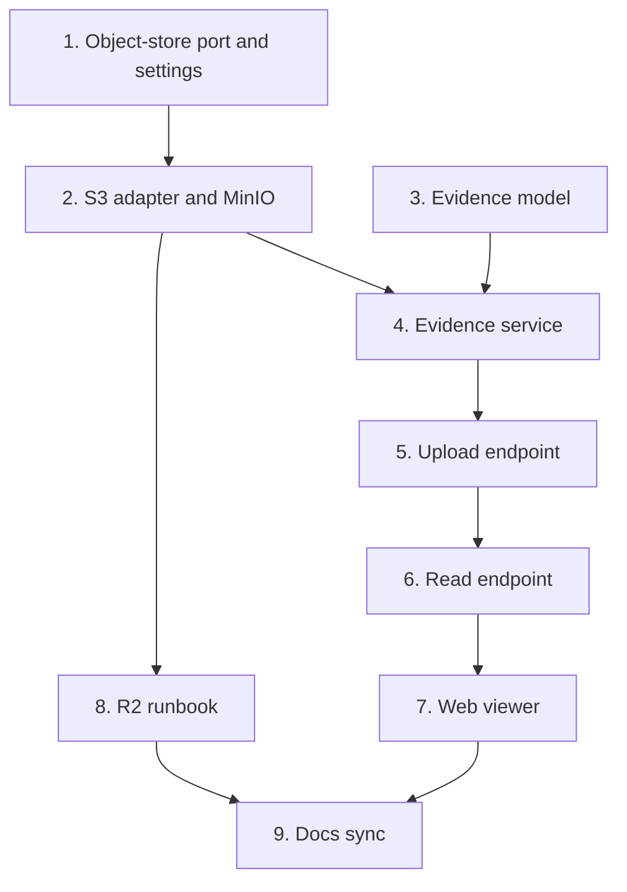

# Evidence Storage — Rollout

> **Amendment (crawlers suite, built on `feat/crawlers`, 2026-10-27).** The [crawlers suite](../crawlers/00-architecture.md) built the object-store port and the S3 adapter itself, in `app/shared/object_store` ([its chapter 13](../crawlers/chapters/13-object-store-port-and-r2-adapter.md)), with **Cloudflare R2** as the provider, configured through `OBJECT_STORE_*` settings (another S3-compatible service is a configuration change), plus a metered store and a byte cap (its chapters 14 and 23). It stores crawler snapshots and screenshots as staging `discovery_artifact` rows. Chapters 1–2 of this suite are therefore **absorbed** by that work and need no build here. The suggestion-keyed `evidence` model, routes and viewer (chapters 3–7) remain here and keep their meaning. Bridging `discovery_artifact` objects to `evidence` rows at emit time is an open seam of this suite: keys are content-addressed, so the bridge is a copy or a shared key. Statements below about building the port and adapter are superseded.

**Architecture:** [00-architecture.md](00-architecture.md) · **Decisions:** [gaps-and-decisions.md](gaps-and-decisions.md) · **Chapters:** [chapters/](chapters/)

**Prerequisites:** [ci-foundation](../ci-foundation/01-rollout.md) 1–2. Chapters 3 onward also need
[suggestion-interface](../suggestion-interface/01-rollout.md) chapter 1 (the `suggestion` table to key
evidence to).

---

## The three invariants

1. **Additive only.** New table, new dependency, new compose service; nothing existing changes.
2. **Independently shippable.** Chapters 1–2 (port, adapter, MinIO) ship with no suggestion table at all —
   they are pure infrastructure and can start immediately, in parallel with ci-foundation and auth.
3. **No credential leaves the API process.** Uploads and downloads are always proxied or presigned by the
   API; R2 keys live only in the API's environment.

---

## Dependency graph



Chapters 1–2 have no dependency on the suggestion table and can start immediately. Chapter 3 depends only on
[suggestion-interface chapter 1](../suggestion-interface/chapters/01-suggestion-model-migration.md) and can
proceed in parallel with 1–2. Chapter 8 can be written any time after chapter 2.

---

## Chapters

| # | Chapter | Layer | Gate | Plan | Status |
| --- | --- | --- | --- | --- | --- |
| 1 | Object-store port and settings | backend | pytest + `./ci.sh` | [01-object-store-port-and-settings.md](chapters/01-object-store-port-and-settings.md) | absorbed by crawlers chapter 13 |
| 2 | S3 adapter and MinIO | backend + compose | pytest + `./ci.sh` | [02-s3-adapter-and-minio.md](chapters/02-s3-adapter-and-minio.md) | absorbed by crawlers chapter 13 |
| 3 | Evidence model and migration | model + migration | pytest + round-trip + `./ci.sh` | [03-evidence-model-migration.md](chapters/03-evidence-model-migration.md) | planned |
| 4 | Evidence service | backend | pytest + `./ci.sh` | [04-evidence-service.md](chapters/04-evidence-service.md) | planned |
| 5 | Evidence upload endpoint | backend | pytest + `./ci.sh` | [05-evidence-upload-endpoint.md](chapters/05-evidence-upload-endpoint.md) | planned |
| 6 | Evidence read endpoint | backend | pytest + `./ci.sh` | [06-evidence-read-endpoint.md](chapters/06-evidence-read-endpoint.md) | planned |
| 7 | Web evidence viewer | frontend + i18n | vitest + `./ci.sh` + manual | [07-web-evidence-viewer.md](chapters/07-web-evidence-viewer.md) | planned |
| 8 | R2 runbook and provisioning | docs + ops | manual | [08-r2-runbook-and-provisioning.md](chapters/08-r2-runbook-and-provisioning.md) | planned |
| 9 | Docs sync | docs | link check | [09-docs-sync.md](chapters/09-docs-sync.md) | planned |

Chapter 8 must land before chapter 5 is deployed to production (Render needs the R2 secrets configured), but
does not block writing or testing chapter 5 locally against MinIO.

## Per-chapter gate

```bash
docker compose up -d --wait db minio
cd apps/api && python -m pytest tests/<file>.py
cd ../.. && ./ci.sh

# migration chapters, additionally
cd apps/api && alembic upgrade head && alembic downgrade -1 && alembic upgrade head

# web chapters
cd apps/web
npm run test -- <paths>
npm run lint && npm run format:check && npm run typecheck && npm run build
cd ../.. && ./ci.sh
```

**Refactor gate** (reported per chapter): methods ~5 LOC, classes ~100 LOC, at most one level of nesting,
commit at least once per green. Branches `feat/evidence-<name>`, conventional commits (`test(api): …` then
`feat(api): …`, or `web`/`docs` scope), one PR per chapter, never commit to `main`.
