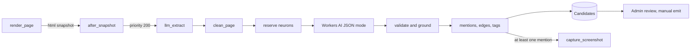

# Extraction — Architecture

**Rollout:** [01-rollout.md](01-rollout.md) · **Decisions:** [gaps-and-decisions.md](gaps-and-decisions.md) · **Chapters:** [chapters/](chapters/) · **Ledger:** [run-ledger.md](run-ledger.md) · **Parent:** [crawlers](../crawlers/00-architecture.md)

The crawlers suite renders pages and stores snapshots, and harvests document names from structured PVOG payloads. It has no way to read a free-text page at scale: the hand-written extractor framework (crawlers chapters 17 and 18) needs one extractor per host across 123 hosts. This suite adds the general reader: one model call per snapshot that turns a procedure page into documents, the dependencies between them, and the front-page chips (domain and life situation) that describe it. It is a **consumer** of the crawlers queue, storage and budget ledger, not a parallel pipeline.

## 1. Why

The goal of redtape is a **document dependency graph** ([crawlers §1](../crawlers/00-architecture.md)). Nodes (documents) and edges (requires) both live in prose on procedure pages: "Bitte bringen Sie mit: Personalausweis, Meldebescheinigung (nicht älter als drei Monate) ...". The candidate staging of crawlers chapter 6 already has the places to put what a reader finds: candidates, mentions with provenance, and roles. Missing today: a reader, the document a procedure *results in* (needed for edges), conditions ("bei Zuzug aus dem Ausland"), edges, and tags.

## 2. Vocabulary (additions)

| Term | Meaning |
| --- | --- |
| **Extraction** | One `llm_extract` task: one snapshot in, validated items out |
| **Cleaner** | `clean_page`: deterministic reduction of a rendered DOM to compact markdown plus its link set |
| **Grounding** | The deterministic check that every extracted item quotes the cleaned text verbatim and every URL comes from the page |
| **Role `issued`** | The document a procedure results in (Personalausweis for "Personalausweis beantragen"); joins `required` and `form` |
| **Edge** | `parent requires required`, staged between candidates with the procedure as provenance |
| **Tag** | A domain or life-situation code from the closed taxonomy (the front-page chips) |
| **Budgeted kind** | A task kind that spends a metered free allocation; drained only by its own workflow; here `llm_extract` (like the browser kinds) |
| **Reservation** | The neurons reserved in the budget ledger before a model call and corrected to the real cost after it |

## 3. Flow



Workers own orchestration, the API owns persistence (crawlers D4). The handler reads the snapshot through the machine content route, cleans it, calls the model, and posts mentions and edges through machine routes. The API never calls the model and never sees a Cloudflare AI credential.

## 4. The queue

One new kind, `llm_extract`, in the existing `discovery_task` table (crawlers D2). Input: the snapshot `artifact_id` (crawlers chapter 14), `input_key = llm:<schema_version>:<model>`, priority 200 (after renders at 100, before screenshots at 300). A new schema version or model enqueues new tasks for the same snapshot through `llm requeue`, never automatically, because re-extraction spends neurons. The kind is **never in a default kind list**, is drained by `discovery-llm.yml` (or locally), and refuses to start without the Workers AI token, a neuron budget and a readable ledger.

## 5. The cleaner

`discovery_ingest/extract/clean.py`, `clean_page(html, base_url) -> CleanPage(text, links, language, truncated, title)`:

- decode with the crawlers chapter 17 function; drop `script`, `style`, `noscript`, `nav`, `header`, `footer`, `aside`, forms, cookie and search widgets; prefer `main`, `[role=main]` or `article` when present and long enough;
- emit compact markdown (headings, list items, table rows as lines, link text with target), collapsing whitespace; collect the absolute link set (resolved against the final URL);
- when the text exceeds the input cap (default 12,000 characters, about 3,500 tokens of German), keep first the sections whose headings match *Unterlagen, Nachweise, Voraussetzungen, Formulare, erforderlich, mitbringen, Antrag*, then the rest in order, and mark `truncated`;
- fall back to the whole body when the main-content selection is shorter than a threshold;
- built on the HTML parser already added in crawlers chapter 7 (no new dependency). **Pre-approved swap:** if the eval (chapter E5) shows poor recall or token waste, the function is reimplemented on Trafilatura behind the same signature.

Cloudflare's markdown conversion was not chosen: `toMarkdown` is not documented to accept HTML or strip boilerplate, and Browser Run's `/markdown` would spend browser time on pages we already hold. The probe (chapter E4) measures `toMarkdown` against the cleaner so the decision rests on numbers.

## 6. The extraction model

`PageExtraction` (pydantic) is both the JSON schema sent to the model and the validator of what comes back:

```text
page_kind        service | form | list | login_or_error | other
domain_codes     up to 2 codes from the taxonomy (may be empty)
situation_codes  up to 3 codes from the taxonomy (may be empty)
documents[]      name        verbatim German, at most 120 characters, no translation
                 role        required | form | issued
                 quote       verbatim from the cleaned text, at most 300 characters
                 url         optional, must be in the page's link set
                 condition   optional free text ("bei Zuzug aus dem Ausland")
                 is_optional bool
dependencies[]   parent, requires (names that appear in documents[]), quote, condition
```

**No translation.** Candidate keys are `slugify(pick_title(title_i18n))` (crawlers D7) and `pick_title` prefers `en`; a model-made English title would make keys unstable across runs. The title is stored as `{"de": name}` (language from the page); translation is a later, separate step (open seam).

**Grounding** (chapter E3, deterministic, after the model): drop any item whose `quote` is not, after whitespace normalisation, a substring of the cleaned text; null any `url` not in the link set; apply the shared noise filter from crawlers chapter 7; deduplicate; cap counts (40 documents, 40 dependencies); drop dependency endpoints that are not in `documents[]`. A model's output is never trusted for anything it cannot quote. **Page text is untrusted** (prompt injection): the model has no tools, its output only reaches staging, and every item must quote the page.

## 7. Tags: domains and life situations

The front-page chips are two closed vocabularies in the database (13 domains such as `housing`, `identity-civil-status`, 18 life situations such as `moving-house`, `birth-of-child`; kebab-case codes with `de` and `en` names), linked to documents through `document_domain` and `document_life_situation`. `NewDocumentPayload` already accepts `domain_codes` and `situation_codes` and rejects unknown ones.

- **The page is a procedure, so the model tags the page**, not each document. The handler copies the page's codes onto every mention it posts.
- **A document's tags are the consensus of its mentions.** The aggregate counts each code over distinct procedures, and is offered to emit only above a support threshold (at least 2 procedures and at least 50 percent of the candidate's tagged procedures). A document seen on one page stays untagged until a second page agrees.
- **Closed set.** The worker fetches the vocabulary from `GET /machine/taxonomy` (codes with short German and English descriptions) and injects it in the prompt (about 500 input tokens, roughly 5 percent of a page's neurons on the 70b model, counted in the budget). The JSON schema lists the codes as an `enum` where JSON mode honours it; the post-processor drops any code not in the vocabulary and counts it.
- **Deterministic first where possible.** PVOG rows come from the v7 Lebenslagen walk. Crawlers chapter 22 step S12b (census F4) checks whether the stored payloads carry categories that map to our situation codes; if so a static mapping fills them for free and the model only fills gaps. Not assumed.
- **Gate.** The eval (chapter E5) measures tag agreement separately; tags reach the emit payload only if it passes its own threshold.

## 8. Edges

New staging table `discovery_candidate_edge` (chapter E1): `parent_candidate_id`, `required_candidate_id`, `catalogue_service_id`, `condition`, `is_optional`, `excerpt`, `basis` (`explicit` from `dependencies[]`, `derived_single_issued` when a page has exactly one `issued` document, which then requires every `required` document of the page), `extractor`, `extractor_version`; unique on parent, required and service. The derived basis is computed by the handler, so the model is not paid output tokens for the common case. Edge **emit** (resolving candidates to promoted `Document` UUIDs and creating `new_requirement` suggestions) stays a later suite: it needs promoted documents, and `DocumentRequirement` has no condition or optional columns.

## 9. Budget and guards

Workers AI free is **10,000 neurons a day**; the free plan fails when it is used up, and a paid Workers plan would bill, so the account stays on Workers Free (crawlers operator step S19). The ledger of [crawlers chapter 23](../crawlers/chapters/23-free-tier-guards.md) holds the daily cap (`neurons`, default 9,500 after [E11](chapters/11-free-tier-caps-95.md), 95 percent of the allowance).

- **Reserve, then adjust.** Before each call the worker reserves `ceil(estimated_input_tokens × input_price + max_tokens × output_price)` neurons (input tokens estimated at one per three characters, a conservative figure for German); a denial stops the run (`llm_budget`). After the call it adjusts by `actual − reserved`, using the response's token usage; when usage is missing it keeps the reservation.
- `max_tokens` is always set (default 1,500); the input is capped at 12,000 characters; at most one repair retry, and only if a second reservation is granted.
- A provider quota error marks the day exhausted (`/exhaust`) and the run stops with `llm_quota`; tasks are **released**, never failed.
- Model prices (neurons per million input and output tokens, from Cloudflare's pricing page, kept in one settings table): llama-3.3-70b-instruct-fp8-fast 26,668 and 204,805; llama-3.1-8b-instruct 25,608 and 75,147; llama-3.1-8b-instruct-fp8-fast 4,119 and 34,868; gpt-oss-20b 18,182 and 27,273; gemma-4-26b-a4b 9,091 and 27,273; qwen3-30b-a3b 4,625 and 30,475.
- At about 3,000 input and 600 output tokens a page costs roughly 200 neurons on the 70b model (about 47 pages a day under a 9,500 cap) and about 120 on llama-3.1-8b-instruct (about 79 a day); the smaller models cost 30 to 70 but are not on Cloudflare's documented JSON-mode list. **The model is chosen by the probe and the eval (chapters E4 and E5), not assumed.** The 1,423 known pages take weeks on the 70b model; queue order makes partial progress useful and the cleaner (fewer input tokens) is the main lever.

## 10. Why not the alternatives

| Option | Verdict |
| --- | --- |
| Browser Run `/json` (render and extract in one call) | Spends a quick-action slot (1 per 10 seconds, shared with rendering) and browser time on pages we already hold, defaults to the costliest model, and our cleaning, grounding and budget checks cannot sit in front of it. Open seam |
| Instructor or Marvin | With JSON mode, `httpx` plus `model_validate_json` is about 40 lines and keeps the worker's httpx and pydantic stance; the `LlmClient` port keeps Instructor or any OpenAI-compatible provider (Groq, Gemini) as a later swap |
| Trafilatura | Pre-approved swap behind `clean_page`, not the default (a new dependency, tuned for articles rather than accordion-style service pages) |
| Cloudflare Queues and Workflows | Rejected and deferred, see [crawlers gaps](../crawlers/gaps-and-decisions.md) |
| A separate queue or table for LLM work | Rejected (crawlers D2): leases, release, dedup, metrics and the admin Tasks view all exist |

## 11. Out of scope

Translation to English, merging or resolving near-duplicate document names, emitting edges or `new_requirement` suggestions, per-document tagging, chunking very long pages, PDF forms, link following, retraining or fine-tuning, a web UI to edit staged items, automatic emit of any kind.
