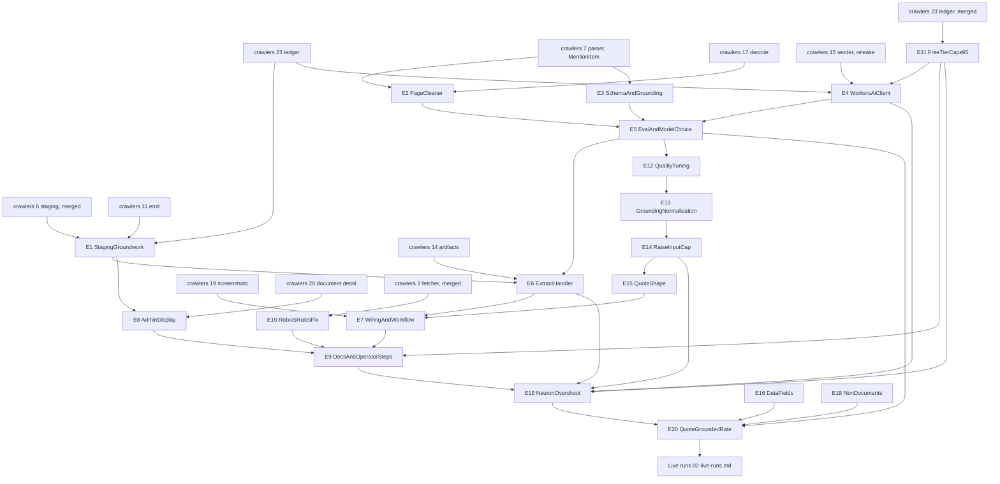

# Extraction — Rollout

**Architecture:** [00-architecture.md](00-architecture.md) · **Decisions:** [gaps-and-decisions.md](gaps-and-decisions.md) · **Chapters:** [chapters/](chapters/) · **Ledger:** [run-ledger.md](run-ledger.md) · **Parent suite:** [crawlers](../crawlers/01-rollout.md)

**Loop branch:** `feat/extraction`
**Release branch:** `main`

**Where to resume (2026-10-30).** E1 to E18 are merged and released. The loop branch `feat/extraction` is 48 commits behind `main` (the release PRs and the web-gui work went to `main`): fast-forward it first (`git merge --ff-only origin/main`, push). Then run **E19**, then **E20**, then the live runs in [02-live-runs.md](02-live-runs.md) (chief of staff, not an implementer), then the second release PR. The ledger hand-off lists the same steps.

**Prerequisites.** Not on `main` yet, tracked in the [crawlers ledger](../crawlers/run-ledger.md): chapters 7 (HTML parser, `MentionItem`, noise filter), 11 (emit), 14 (artifacts), 15 (Cloudflare render, stop reasons, release), 17 (decode, `after_snapshot`), 19 (screenshot enqueue), 20 (document detail page) and **23 (budget ledger)**. The extraction chapters list exactly which of these each needs, so the first ones (E1 to E3) can start as soon as crawlers chapters 7 and 23 are merged, and none of them needs live infrastructure.

## Invariants

1. **Every chapter is CI-green and shippable on its own.** Model calls are faked in tests; a live gate is recorded separately in the ledger and never blocks a merge.
2. **Workers stay HTTP-only.** `apps/discovery-ingest` talks to the machine API and Cloudflare; it never receives `DATABASE_URL`.
3. **Additive schema.** New table, new nullable columns, new enum labels. Nothing existing is renamed or dropped.
4. **No automatic emit.** Extraction stages candidates, mentions, edges and tag suggestions; emit is a deliberate operator action (crawlers D16).
5. **`llm_extract` is a budgeted kind.** Never in a default kind list; a drain refuses to start without the Workers AI token, a neuron budget and a readable ledger (chapters E6 and E7).
6. **No model call without a granted reservation** in the neuron ledger; limits **release** tasks, only pages fail them (crawlers D21, D23).
7. **The Workers AI token is narrow and never reaches the API, Render or the web app.** GitHub Actions secrets and the operator's local environment only.
8. **Grounding is not optional.** An item that does not quote the cleaned text is dropped; a URL not on the page is nulled; a code outside the taxonomy is dropped.
9. **Every drain is bounded** by batch count, run time and neurons, and reports why it stopped.
10. **Tests are paired** (happy and negative) with an explicit refactor audit per chapter. **Refactor gate:** methods about five lines, classes about a hundred, at most one level of nesting, one commit per green step.
11. **Free plans stay free.** The Cloudflare account stays on Workers Free (crawlers S19); the ledger caps sit below the allowances.

## Dependency graph



E1, E2, E3 and E4 are independent of each other. E10 and E11 are independent of E1 to E9 and execute first: E10 decides which pages are fetched and rendered at all, and E11 settles the caps before the first live gate spends neurons. E5 is the gate for the model and prompt: nothing after it is built against an unmeasured model.

## Execution order

0a. [chapters/11-free-tier-caps-95.md](chapters/11-free-tier-caps-95.md) (E11, numbered last, executes first)
0b. [chapters/10-robots-rules-fix.md](chapters/10-robots-rules-fix.md) (E10, numbered after E9, executes second)
1. [chapters/01-staging-groundwork.md](chapters/01-staging-groundwork.md)
2. [chapters/02-page-cleaner.md](chapters/02-page-cleaner.md)
3. [chapters/03-extraction-schema-and-grounding.md](chapters/03-extraction-schema-and-grounding.md)
4. [chapters/04-workers-ai-client-and-probe.md](chapters/04-workers-ai-client-and-probe.md)
5. [chapters/05-eval-harness-and-model-choice.md](chapters/05-eval-harness-and-model-choice.md)
6. [chapters/06-llm-extract-handler.md](chapters/06-llm-extract-handler.md)
6a. [chapters/12-extraction-quality-tuning.md](chapters/12-extraction-quality-tuning.md) (E12, added 2026-10-28 after the first live eval; executes after E6)
6b. [chapters/13-grounding-normalisation.md](chapters/13-grounding-normalisation.md) (E13, added 2026-10-28 from E12's findings; executes after E12)
6c. [chapters/14-raise-the-input-cap.md](chapters/14-raise-the-input-cap.md) (E14, added 2026-10-28, owner decision: quality over throughput; executes after E13)
6d. [chapters/15-quote-shape.md](chapters/15-quote-shape.md) (E15, added 2026-10-28 from E13's findings; executes after E14)
7. [chapters/07-wiring-and-workflow.md](chapters/07-wiring-and-workflow.md)
7a. [chapters/16-documents-not-data-fields.md](chapters/16-documents-not-data-fields.md) (E16, added 2026-10-29, owner approved; executes after E7)
7b. [chapters/17-price-rows-for-candidate-models.md](chapters/17-price-rows-for-candidate-models.md) (E17, added 2026-10-29; executes after E16; then the chief of staff runs the model comparison for X16)
8. [chapters/08-admin-display.md](chapters/08-admin-display.md)
8a. [chapters/18-non-documents-and-tag-restraint.md](chapters/18-non-documents-and-tag-restraint.md) (E18, added 2026-10-29 from the ext-4 eval; executes after E8)
9. [chapters/09-docs-and-operator-steps.md](chapters/09-docs-and-operator-steps.md)
10. [chapters/19-neuron-overshoot.md](chapters/19-neuron-overshoot.md) (E19, added 2026-10-30, owner decision X18: a day should reach the 9,500 cap; executes after E9)
11. [chapters/20-quote-grounded-rate.md](chapters/20-quote-grounded-rate.md) (E20, added 2026-10-30: the grounded-rate target measures quotes on the page; executes after E19)

The live runs after E20 are not a chapter: see **Live gates** below.

## Chapters

Status is `merged` into `feat/extraction`; the proof (verification, refactor outcome, live gate) for each chapter is in [run-ledger.md](run-ledger.md). The mid-suite release [PR #229](https://github.com/vadim-schultz/redtape/pull/229) put E11, E10 and E1 to E6 on `main`; E7, E8, E9 and E12 to E18 go in the final release PR.

| # | Chapter | Layer | Gate | Plan | Status |
| --- | --- | --- | --- | --- | --- |
| E1 | Staging groundwork (kind, role, columns, edges, taxonomy route, tag aggregation) | model + migration + API | paired tests + round trip + CI | [01](chapters/01-staging-groundwork.md) | merged |
| E2 | Page cleaner | worker | fixture tests + recall gate + CI | [02](chapters/02-page-cleaner.md) | merged |
| E3 | Extraction schema, prompt and grounding | worker | paired tests + CI | [03](chapters/03-extraction-schema-and-grounding.md) | merged |
| E4 | Workers AI client, neuron meter and probe | worker + CI workflow | paired tests + CI + live probe | [04](chapters/04-workers-ai-client-and-probe.md) | merged |
| E5 | Eval harness and model choice | worker | gold set + eval run recorded | [05](chapters/05-eval-harness-and-model-choice.md) | merged |
| E6 | `llm_extract` handler | worker | paired tests + CI | [06](chapters/06-llm-extract-handler.md) | merged |
| E7 | Wiring and workflow | worker + CI workflow | paired tests + CI + live drain | [07](chapters/07-wiring-and-workflow.md) | merged |
| E8 | Admin display | API + frontend | paired tests + web CI + browser check | [08](chapters/08-admin-display.md) | merged |
| E9 | Docs sync and operator steps | docs + ops | link checks + docs tests + checklist | [09](chapters/09-docs-and-operator-steps.md) | merged (docs sync, this change) |
| E10 | Robots rules fix (executes second, after E11) | worker | paired tests + real-file fixtures + CI + re-pend counts | [10](chapters/10-robots-rules-fix.md) | merged |
| E11 | Free-tier caps at 95 percent (executes first) | config + workflow + docs | paired tests + ratio guard + CI + budgets route check | [11](chapters/11-free-tier-caps-95.md) | merged |
| E12 | Extraction quality tuning (executes after E6) | worker | paired tests + gold-set re-run | [12](chapters/12-extraction-quality-tuning.md) | merged |
| E13 | Grounding normalisation (executes after E12) | worker | paired tests + recorded answers regress + CI | [13](chapters/13-grounding-normalisation.md) | merged |
| E14 | Raise the input cap to 30,000 characters (executes after E13) | worker + docs | paired tests + CI | [14](chapters/14-raise-the-input-cap.md) | merged |
| E15 | Quote shape: one line per quote, drop screen-reader text (executes after E14) | worker | paired tests + CI | [15](chapters/15-quote-shape.md) | merged |
| E16 | Documents, not data fields: prompt rule `ext-4` (executes after E7) | worker | paired tests + CI | [16](chapters/16-documents-not-data-fields.md) | merged |
| E17 | Price rows for Mistral Small 3.1 and Llama 4 Scout (executes after E16) | worker | paired tests + CI | [17](chapters/17-price-rows-for-candidate-models.md) | merged |
| E18 | Non-documents and tag restraint: prompt `ext-5` and guards (executes after E8) | worker | paired tests + CI | [18](chapters/18-non-documents-and-tag-restraint.md) | merged |
| E19 | Neuron overshoot: a day reaches its cap, overshoot at most one call (executes after E9) | worker + docs | paired tests + CI | [19](chapters/19-neuron-overshoot.md) | planned |
| E20 | Quote-grounded rate: quote-grounded and kept rate in the eval (executes after E19) | worker + docs | paired tests + recorded answers replay + CI | [20](chapters/20-quote-grounded-rate.md) | planned |

## Live gates (chief of staff)

After E20 is merged the chief of staff runs [02-live-runs.md](02-live-runs.md) itself, in order: L0 smoke, L1 live drain with Qwen, L2 calibration against the Cloudflare dashboard, L3 `ext-5` eval of Qwen, Scout and Mistral, L4 the X16 decision, L5 close-out and the release PR. These are the deferred live gates of E7 and E8 and decision X16. Implementers never run them. Owner's go for the production drain: given 2026-10-30, about 40 pages.

## Per-chapter gate

Same protocol as [crawlers](../crawlers/01-rollout.md#per-chapter-gate): GitHub Actions is the authoritative gate (`gh pr checks --watch`), local checks are best effort, and the repository's Actions budget is capped at 1,000 minutes a month (crawlers chapter 23), so run the local gate before every push. Live verification uses workflow dispatch or a local command:

```bash
cd apps/discovery-ingest && python -m pytest tests/<file>.py && ruff check . && mypy discovery_ingest
cd apps/api && python -m pytest tests/<file>.py
cd apps/api && alembic upgrade head && alembic downgrade -1 && alembic upgrade head      # migration chapters
cd apps/web && npm run test -- <paths> && npm run lint && npm run format:check && npm run typecheck && npm run build
python -m discovery_ingest worker drain --kinds llm_extract --max-tasks 5 --max-batches 8 \
  --time-budget-seconds 600 --neuron-budget 4000                                          # live gate, local
```

Live gates spend the free neuron allowance (10,000 a day): keep them small and never run two in one day on purpose. Record `neurons_used` of every run in the ledger.

## Branch and release protocol

Each chapter uses `feat/extraction-<slug>` from `feat/extraction` and opens one PR into `feat/extraction`. Conventional commits (`test(...)` then `feat(...)`). After the ledger is complete, one release PR from `feat/extraction` to `main`. Never commit to `main`. The loop branch must contain the crawlers chapters it depends on: merge `main` (or `feat/crawlers`, if the crawlers release has not happened) into it before E4.

## Exit criteria

- A rendered snapshot becomes grounded candidates, mentions with conditions, staged edges and tag suggestions through `llm_extract`, with no hand-written extractor.
- Every drain stops inside both budgets and reports `neurons_used`; a quota or budget hit releases tasks instead of failing them.
- The eval on the gold set records precision, recall, grounded rate and tag agreement for the chosen model, and the thresholds are met or the shortfall is recorded as a decision.
- The admin shows edges, conditions and suggested tags with support counts; nothing was emitted automatically.
- The operator checklist is complete and the ledger records run IDs for every live gate.
- A UTC day can spend up to the 9,500-neuron cap (E19), and the eval reports the quote-grounded rate and the kept rate separately (E20).
- The first live drain staged real documents, edges and tag suggestions; ten read mentions, the edges and the tags were judged against their pages, and the false positives are listed in the ledger.
- Decision X16 is final: model, prompt version and thresholds are recorded, or the shortfall and the chosen way forward.
