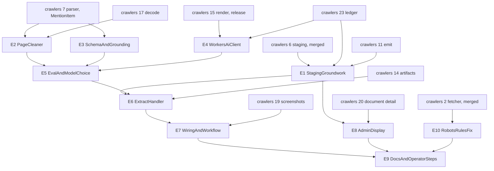

# Extraction — Rollout

**Architecture:** [00-architecture.md](00-architecture.md) · **Decisions:** [gaps-and-decisions.md](gaps-and-decisions.md) · **Chapters:** [chapters/](chapters/) · **Ledger:** [run-ledger.md](run-ledger.md) · **Parent suite:** [crawlers](../crawlers/01-rollout.md)

**Loop branch:** `feat/extraction`
**Release branch:** `main`

**Prerequisites.** Not on `main` yet, tracked in the [crawlers ledger](../crawlers/run-ledger.md): chapters 7 (HTML parser, `MentionItem`, noise filter), 11 (emit), 14 (artifacts), 15 (Cloudflare render, stop reasons, release), 17 (decode, `after_snapshot`), 19 (screenshot enqueue), 20 (document detail page) and **23 (budget ledger)**. The extraction chapters list exactly which of these each needs, so the first ones (E1 to E3) can start as soon as crawlers chapters 7 and 23 are merged, and none of them needs live infrastructure.

## Invariants

1. **Every chapter is CI-green and shippable on its own.** Model calls are faked in tests; a live gate is recorded separately in the ledger and never blocks a merge.
2. **Workers stay HTTP-only.** `apps/discovery-ingest` talks to the machine API and Cloudflare; it never receives `DATABASE_URL`.
3. **Additive schema.** New table, new nullable columns, new enum labels. Nothing existing is renamed or dropped.
4. **No automatic emit.** Extraction stages candidates, mentions, edges and tag suggestions; emit is a deliberate operator action (crawlers D16).
5. **`llm_extract` is a budgeted kind.** Never in a default kind list; a drain refuses to start without the Workers AI token, a neuron budget and a readable ledger (chapters E6 and E7).
6. **No model call without a granted reservation** in the neuron ledger; limits **release** tasks, only pages fail them (crawlers D21, D23).
7. **The Workers AI token is narrow and never reaches the API, Render or the web app.** GitHub Actions secrets and the operator's local environment only.
8. **Grounding is not optional.** An item that does not quote the cleaned text is dropped; a URL not on the page is nulled; a code outside the taxonomy is dropped.
9. **Every drain is bounded** by batch count, run time and neurons, and reports why it stopped.
10. **Tests are paired** (happy and negative) with an explicit refactor audit per chapter. **Refactor gate:** methods about five lines, classes about a hundred, at most one level of nesting, one commit per green step.
11. **Free plans stay free.** The Cloudflare account stays on Workers Free (crawlers S19); the ledger caps sit below the allowances.

## Dependency graph



E1, E2, E3 and E4 are independent of each other. E10 is independent of E1 to E9 and executes first, because it decides which pages are fetched and rendered at all. E5 is the gate for the model and prompt: nothing after it is built against an unmeasured model.

## Execution order

0. [chapters/10-robots-rules-fix.md](chapters/10-robots-rules-fix.md) (E10, numbered last, executes first)
1. [chapters/01-staging-groundwork.md](chapters/01-staging-groundwork.md)
2. [chapters/02-page-cleaner.md](chapters/02-page-cleaner.md)
3. [chapters/03-extraction-schema-and-grounding.md](chapters/03-extraction-schema-and-grounding.md)
4. [chapters/04-workers-ai-client-and-probe.md](chapters/04-workers-ai-client-and-probe.md)
5. [chapters/05-eval-harness-and-model-choice.md](chapters/05-eval-harness-and-model-choice.md)
6. [chapters/06-llm-extract-handler.md](chapters/06-llm-extract-handler.md)
7. [chapters/07-wiring-and-workflow.md](chapters/07-wiring-and-workflow.md)
8. [chapters/08-admin-display.md](chapters/08-admin-display.md)
9. [chapters/09-docs-and-operator-steps.md](chapters/09-docs-and-operator-steps.md)

## Chapters

| # | Chapter | Layer | Gate | Plan | Status |
| --- | --- | --- | --- | --- | --- |
| E1 | Staging groundwork (kind, role, columns, edges, taxonomy route, tag aggregation) | model + migration + API | paired tests + round trip + CI | [01](chapters/01-staging-groundwork.md) | planned |
| E2 | Page cleaner | worker | fixture tests + recall gate + CI | [02](chapters/02-page-cleaner.md) | planned |
| E3 | Extraction schema, prompt and grounding | worker | paired tests + CI | [03](chapters/03-extraction-schema-and-grounding.md) | planned |
| E4 | Workers AI client, neuron meter and probe | worker + CI workflow | paired tests + CI + live probe | [04](chapters/04-workers-ai-client-and-probe.md) | planned |
| E5 | Eval harness and model choice | worker | gold set + eval run recorded | [05](chapters/05-eval-harness-and-model-choice.md) | planned |
| E6 | `llm_extract` handler | worker | paired tests + CI | [06](chapters/06-llm-extract-handler.md) | planned |
| E7 | Wiring and workflow | worker + CI workflow | paired tests + CI + live drain | [07](chapters/07-wiring-and-workflow.md) | planned |
| E8 | Admin display | API + frontend | paired tests + web CI + browser check | [08](chapters/08-admin-display.md) | planned |
| E9 | Docs sync and operator steps | docs + ops | link checks + docs tests + checklist | [09](chapters/09-docs-and-operator-steps.md) | planned |
| E10 | Robots rules fix (executes first) | worker | paired tests + real-file fixtures + CI + re-pend counts | [10](chapters/10-robots-rules-fix.md) | planned |

## Per-chapter gate

Same protocol as [crawlers](../crawlers/01-rollout.md#per-chapter-gate): GitHub Actions is the authoritative gate (`gh pr checks --watch`), local checks are best effort, and the repository's Actions budget is capped at 1,000 minutes a month (crawlers chapter 23), so run the local gate before every push. Live verification uses workflow dispatch or a local command:

```bash
cd apps/discovery-ingest && python -m pytest tests/<file>.py && ruff check . && mypy discovery_ingest
cd apps/api && python -m pytest tests/<file>.py
cd apps/api && alembic upgrade head && alembic downgrade -1 && alembic upgrade head      # migration chapters
cd apps/web && npm run test -- <paths> && npm run lint && npm run format:check && npm run typecheck && npm run build
python -m discovery_ingest worker drain --kinds llm_extract --max-tasks 5 --max-batches 8 \
  --time-budget-seconds 600 --neuron-budget 4000                                          # live gate, local
```

Live gates spend the free neuron allowance (10,000 a day): keep them small and never run two in one day on purpose. Record `neurons_used` of every run in the ledger.

## Branch and release protocol

Each chapter uses `feat/extraction-<slug>` from `feat/extraction` and opens one PR into `feat/extraction`. Conventional commits (`test(...)` then `feat(...)`). After the ledger is complete, one release PR from `feat/extraction` to `main`. Never commit to `main`. The loop branch must contain the crawlers chapters it depends on: merge `main` (or `feat/crawlers`, if the crawlers release has not happened) into it before E4.

## Exit criteria

- A rendered snapshot becomes grounded candidates, mentions with conditions, staged edges and tag suggestions through `llm_extract`, with no hand-written extractor.
- Every drain stops inside both budgets and reports `neurons_used`; a quota or budget hit releases tasks instead of failing them.
- The eval on the gold set records precision, recall, grounded rate and tag agreement for the chosen model, and the thresholds are met or the shortfall is recorded as a decision.
- The admin shows edges, conditions and suggested tags with support counts; nothing was emitted automatically.
- The operator checklist is complete and the ledger records run IDs for every live gate.
