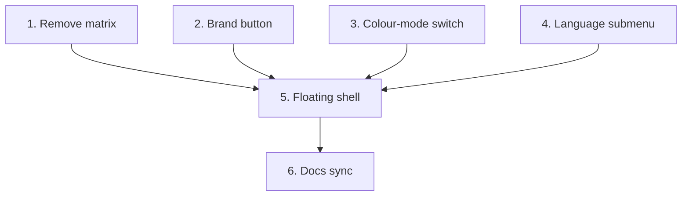

# Floating Nav — Rollout

**Architecture:** [00-architecture.md](00-architecture.md) · **Decisions:** [gaps-and-decisions.md](gaps-and-decisions.md) · **Chapters:** [chapters/](chapters/)

---

## The three invariants

1. **Frontend only.** No API, schema or migration change. Backend matrix endpoint stays (dormant).
2. **Independently shippable.** After each chapter `./ci.sh` passes and `/documents` and `/documents/:id`
   still work. Chapters 2–4 add components that are not yet mounted, so the existing header keeps working
   until chapter 5 swaps the shell.
3. **No dead UI.** Nothing user-visible links to a removed route (chapter 1 removes the link with the route).

---

## Dependency graph



Chapters 2, 3 and 4 have no dependency on each other and can proceed in parallel after chapter 1.

---

## Chapters

| # | Chapter | Layer | Gate | Plan | Status |
| --- | --- | --- | --- | --- | --- |
| 1 | Remove matrix | frontend + i18n | vitest + `./ci.sh` | [01-remove-matrix.md](chapters/01-remove-matrix.md) | shipped |
| 2 | Brand button | frontend | vitest + `./ci.sh` | [02-brand-button.md](chapters/02-brand-button.md) | shipped |
| 3 | Colour-mode switch | frontend | vitest + `./ci.sh` | [03-color-mode-switch.md](chapters/03-color-mode-switch.md) | planned |
| 4 | Language submenu | frontend | vitest + `./ci.sh` | [04-language-submenu.md](chapters/04-language-submenu.md) | planned |
| 5 | Floating shell | frontend | vitest + `./ci.sh` | [05-floating-shell.md](chapters/05-floating-shell.md) | planned |
| 6 | Docs sync | docs | link check | [06-docs-sync.md](chapters/06-docs-sync.md) | planned |

## Per-chapter gate

```bash
cd apps/web
npm run test -- <paths>
npm run lint && npm run format:check && npm run typecheck && npm run build
cd ../.. && ./ci.sh
```

**Refactor gate** (reported per chapter): methods ~5 LOC, classes ~100 LOC, at most one level of nesting,
commit at least once per green. Branches `feat/floating-nav-<name>`, conventional commits
(`test(web): …` then `feat(web): …`), one PR per chapter, never commit to `main`.
