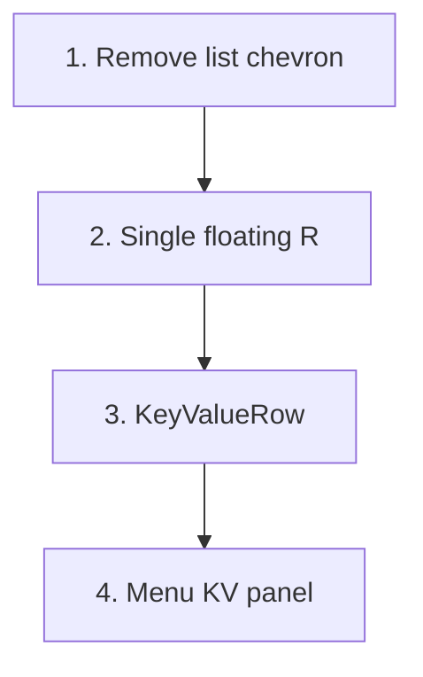

# Frontend UI menu — Rollout

**Architecture:** [00-architecture.md](00-architecture.md) · **Decisions:** [gaps-and-decisions.md](gaps-and-decisions.md) · **Chapters:** [chapters/](chapters/) · **Ledger:** [run-ledger.md](run-ledger.md)

**Loop branch:** `feat/plans-frontend-ui-menu`  
**Release branch:** `main`

---

## The three invariants

1. **Frontend only.** No API, schema or auth gateway changes. Profile Google button is UI-only (`/login`).
2. **Independently shippable.** After each chapter, narrow vitest paths pass and `./ci.sh` passes on the loop branch.
3. **One chapter per MR/PR** into the loop branch only — not into `main` until the suite release MR.

---

## Dependency graph



Chapters are strictly sequential.

---

## Execution order (chief of staff)

1. [chapters/01-remove-list-chevron.md](chapters/01-remove-list-chevron.md)
2. [chapters/02-single-floating-control.md](chapters/02-single-floating-control.md)
3. [chapters/03-key-value-row.md](chapters/03-key-value-row.md)
4. [chapters/04-menu-key-value-panel.md](chapters/04-menu-key-value-panel.md)

---

## Chapters

| # | Chapter | Layer | Gate | Plan | Status |
| --- | --- | --- | --- | --- | --- |
| 1 | Remove list chevron | frontend | vitest + `./ci.sh` | [01-remove-list-chevron.md](chapters/01-remove-list-chevron.md) | planned |
| 2 | Single floating R | frontend | vitest + `./ci.sh` | [02-single-floating-control.md](chapters/02-single-floating-control.md) | planned |
| 3 | KeyValueRow | frontend | vitest + `./ci.sh` | [03-key-value-row.md](chapters/03-key-value-row.md) | planned |
| 4 | Menu KV panel | frontend | vitest + `./ci.sh` | [04-menu-key-value-panel.md](chapters/04-menu-key-value-panel.md) | planned |

## Per-chapter gate

```bash
cd apps/web
npm run test -- <paths from chapter>
npm run lint && npm run format:check && npm run typecheck && npm run build
cd ../.. && ./ci.sh
```

**Refactor gate** (reported per chapter): audit containing method/class per repo rules; re-run narrow tests.

**Branches:** chapter branches `feat/frontend-ui-menu-<slug>` from **loop branch**; conventional commits (`test(web): …` then `feat(web): …`).

## Manual smoke (after chapter 4 on loop branch)

- `/documents` desktop and ~360px: single R top-right; menu in viewport.
- Light/dark; colour switch does not close menu.
- Language flags; anonymous profile shows envelope + Google; signed-in shows user icon.

## Orchestration

Launch **chief of staff** with plan folder `.plans/frontend-ui-menu/`. Each slice is one foreground
`chapter-implementer`. Do not use the loop sentinel runbook for this suite.

Former loop doc: [docs/operations/loops/frontend-ui-improvements.md](../../docs/operations/loops/frontend-ui-improvements.md) (redirect).
