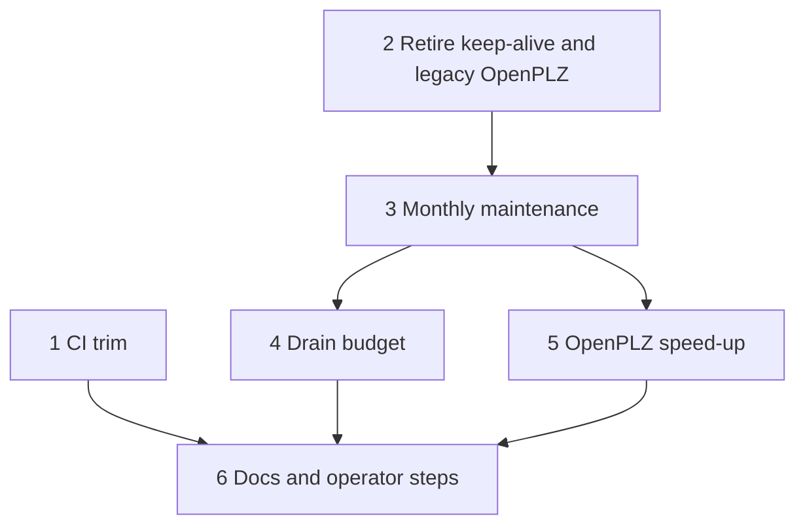

# GitHub Actions budget — Rollout

**Architecture:** [00-architecture.md](00-architecture.md) · **Decisions:** [gaps-and-decisions.md](gaps-and-decisions.md) · **Chapters:** [chapters/](chapters/) · **Ledger:** [run-ledger.md](run-ledger.md)

**Loop branch:** `chore/gha-budget`
**Release branch:** `main`

**Prerequisite (on `main`):** the crawlers staged release (chapters 1–6), which puts `discovery-drain.yml` on `main`.

## Invariants

1. **No remote CI.** The shared Actions quota is exhausted until about 2026-11-01. The gate is local only. Implementers skip `gh pr checks --watch`, merge their chapter PR into the loop branch once the local gate passes, and report `remote ci: not available (billing)`. Nobody dispatches a workflow (`gh workflow run`).
2. **Local gate.** For any workflow file: `docker run --rm -v "$PWD":/repo -w /repo rhysd/actionlint:latest` must be clean (fallback if the image cannot be pulled: parse every workflow with `python3 -c "import sys,yaml; [yaml.safe_load(open(f)) for f in sys.argv[1:]]" .github/workflows/*.yml`). For anything under `apps/api` or `scripts/`: the API section of `./ci.sh` (ruff format, ruff check, mypy, pytest with Postgres from `docker compose`, `REQUIRE_DB=1`).
3. **No unverifiable moving parts.** No new third-party actions, no new action major versions.
4. **No dangling references.** A chapter that removes a file removes every reference to it (docs, `render.yaml` comments, scripts) in the same PR; check with `grep -rn`.
5. **The crawl budget is a repository variable,** never hard-coded.
6. **Conventional commits,** one concern per commit, each commit ends with the `Co-Authored-By` line the session provides.

## Dependency graph

Chapters 2–3 both edit `docs/operations/scheduled-jobs.md`; they run in order, so no conflict arises.

## Execution order

1. [chapters/01-ci-trim.md](chapters/01-ci-trim.md)
2. [chapters/02-retire-keep-alive-and-legacy-openplz.md](chapters/02-retire-keep-alive-and-legacy-openplz.md)
3. [chapters/03-monthly-maintenance.md](chapters/03-monthly-maintenance.md)
4. [chapters/04-drain-budget.md](chapters/04-drain-budget.md)
5. [chapters/05-openplz-import-speedup.md](chapters/05-openplz-import-speedup.md)
6. [chapters/06-docs-and-operator-steps.md](chapters/06-docs-and-operator-steps.md)

After chapter 6, the release PR `chore/gha-budget` → `main` is opened and merged on local gates. Schedules act only from `main`, so the release is what saves minutes.

## Chapters

| # | Plan | Branch |
| --- | --- | --- |
| 1 | [CI trim](chapters/01-ci-trim.md) | `chore/gha-budget-ci-trim` |
| 2 | [Retire keep-alive and legacy OpenPLZ](chapters/02-retire-keep-alive-and-legacy-openplz.md) | `chore/gha-budget-retire-workflows` |
| 3 | [Monthly maintenance](chapters/03-monthly-maintenance.md) | `chore/gha-budget-monthly-maintenance` |
| 4 | [Drain budget](chapters/04-drain-budget.md) | `chore/gha-budget-drain-budget` |
| 5 | [OpenPLZ import speed-up](chapters/05-openplz-import-speedup.md) | `chore/gha-budget-openplz-speedup` |
| 6 | [Docs and operator steps](chapters/06-docs-and-operator-steps.md) | `chore/gha-budget-operator-steps` |
