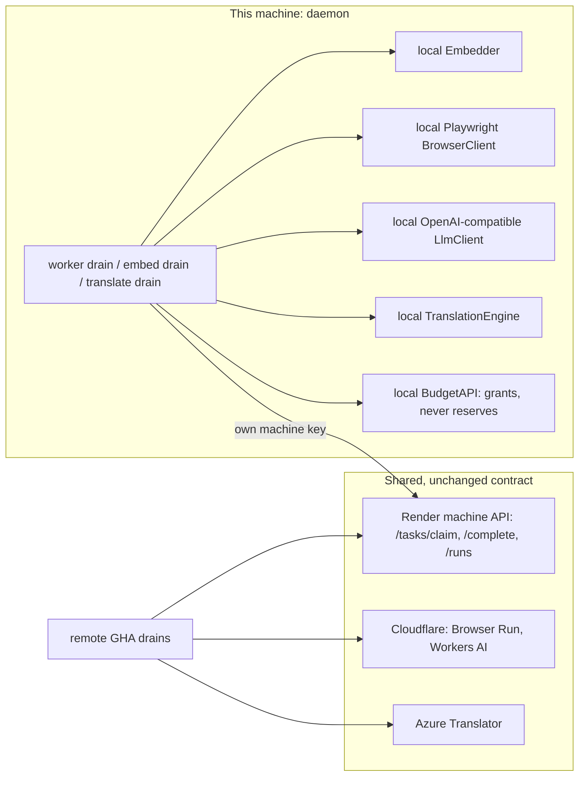

# Local queue drain — Architecture

**Rollout:** [01-rollout.md](01-rollout.md) · **Decisions:** [gaps-and-decisions.md](gaps-and-decisions.md) · **Chapters:** [chapters/](chapters/)

**Builds on:** [discovery-throughput](../discovery-throughput/00-architecture.md), [pipeline-optimisation](../pipeline-optimisation/00-architecture.md). Treats [discovery-admin-flow](../discovery-admin-flow/00-architecture.md) as implemented: the flow page then carries per-stage task counts, recent failures and the budget figures.

## 1. Why

The queues drain at the speed of their quotas, not of their work.

- **Browser time.** The ledger caps Cloudflare Browser Run at 570 browser-seconds a day (`budget_browser_seconds_daily`, `apps/api/app/config.py`). The 2026-11-01 render run used 213.4 browser-seconds for 46 completed renders (about 4.6 s each, failures included). The render queue then held 1,545 pending tasks, so that backlog alone is about 13 days of browser quota, and screenshots draw on the same 570 seconds.
- **Neurons.** Workers AI gets 9,500 neurons a day, shared by LLM extraction, embedding, LLM translation and a 1,000-neuron reserve for query embedding.
- **Azure.** 1.9M characters a month (`budget_azure_translator_chars_monthly`).

The aim is to add workers that claim the same tasks from the same queue, so the queue drains whenever local capacity is free. A task is never worked twice and no quota is spent on work that local hardware can do.

## 2. Queue audit

| Stage (`flow/topology.py`) | Task kinds / queue | Remote engine today | Quota that binds | Local option |
| --- | --- | --- | --- | --- |
| Seed | `fetch_url`, `enrich_metadata`, `harvest_payload` | HTTP from the GHA drain | none paid; per-host politeness | Already runnable: the CLI needs only `DISCOVERY_API_URL` and a machine key |
| Render | `render_page` | Cloudflare Browser Run `/content`, `/snapshot` | 570 browser-s a day (ledger) | Playwright adapter for `BrowserClient` (C2) |
| Extract (rules) | `extract_page` | none | none | Already local (in-process) |
| Extract (LLM) | `llm_extract` | Workers AI `@cf/qwen/qwen3-30b-a3b-fp8` | 9,500 neurons a day, shared | Qwen through llama.cpp's OpenAI-compatible server (C4), CPU or partial GPU offload, one task per claim |
| Screenshot | `capture_screenshot` | Browser Run `/snapshot` | the same 570 browser-s | Playwright (C2) |
| Embed | `embedding_task` rows keyed by model | Workers AI `@cf/qwen/qwen3-embedding-0.6b` | neurons | Local Qwen3-Embedding-0.6B behind a parity gate (C1) |
| Card translation | `translation_task` rows (lanes) | Azure (lane: every task not in the tail) | 1.9M chars a month | Local engine with its own lane (C3) |
| Page translation | snapshot translate | Azure | the same characters | Same local engine (C3) |

Workers AI's `llm` translation engine takes only the tail locales, and `translation_tail_locales` defaults to empty, so it claims nothing unless set.

## 3. What binds a local worker

1. **Ledger.** Every Cloudflare drain reserves from the shared ledger through `BudgetGuard` (`apps/discovery-ingest/discovery_ingest/budget.py`). A local worker that reserves would take Cloudflare headroom from the remote workers. It must bypass the ledger and record its own spend separately. The injection point already exists: `DrainDeps.budget` and `EmbedDeps.budget`/`TranslateDeps.budget` accept a guard.
2. **Claim contract.** `POST /tasks/claim` takes `limit` (at most 50) and `kinds`. Leases last 15 minutes and are owned by the machine key that claimed them. A local worker should use its own machine key, so its leases and audit trail stay separate.
3. **Run records.** Each drain opens a run (`POST /runs`). Starting a run closes every run still `running` after one hour (`STALE_RUN_AFTER`, `apps/api/app/features/discovery/repository/runs.py`). A local daemon therefore runs bounded drains of well under an hour, and always calls finish.
4. **Embeddings are keyed by model.** Search reads `Embedding.model == params.model` and `complete.py` rejects a vector whose model differs from its task. A local vector is usable only when it comes from the same weights and carries the same model string. Query-time embedding stays on Workers AI (`cloudflare_embedder.py`), so parity is a hard gate, not a preference.
5. **Translation lanes.** `features/translation/lanes.py` maps each engine name to a predicate. Azure takes everything outside the tail, and `llm` takes tail locales in the tail band. An engine with no lane takes whatever is left, so a new local engine needs an explicit lane to take work from Azure's share. Azure already upgrades tail rows later (`UPGRADE_BASE`, `priority.py`), so a local first pass can feed that path without a quality cliff.
6. **LLM identity.** Local workers only claim and settle (D10). The task key is set when a render completes, from `LLM_MODEL` (throughput plan, decision D8). The server stores no model name on LLM results (D12), so a local LLM run records its model string in its run report, which is the only record. Results from two models under one key are a quality question for the C4 gate, not a key question.
7. **Politeness.** Fetch pacing (`worker/pacing.py`, `worker/robots.py`) applies per host, not per provider. A local browser must keep the same per-host pacing and must not hit one host from several workers at once. The `browser` type runs renders and screenshots in one process, so one pacer covers both (§10).
8. **Initiation.** The operations drain runs a screenshot sweep before it claims. It queues `capture_screenshot` tasks for rendered pages that lack one, up to `SCREENSHOT_SWEEP_LIMIT` (default 50). A local worker sets that sweep off (`screenshot_sweep_limit=None`, D10). Completing a render still runs the hooks that queue `extract_page` and, with `LLM_ENQUEUE`, `llm_extract`. Those stay on for every worker, because the next stages need them.

## 4. GitHub and hardware

- **The repository is public** (`gh repo view`: `PUBLIC`). Hosted minutes are unmetered: pipeline-optimisation D17 (2026-11-23), and the operator's note of 2026-11-27. The 1,000-minute cap and the 2,000/1,000/1,000 split in the GHA-budget and throughput plans are obsolete. So are the minute prechecks in the drain workflows and the `budget report-minutes` step. Section 9 lists the stale files.
- **Self-hosted runners on a public repository are not recommended.** Microsoft's runner module and the OWASP Actions cheat sheet both warn that fork pull requests can run code on a self-hosted runner, and that runners keep state between jobs ([Microsoft Learn](https://learn.microsoft.com/en-us/training/modules/introduction-to-github-actions/8-explore-runners), [OWASP](https://cheatsheetseries.owasp.org/cheatsheets/GitHub_Actions_Security_Cheat_Sheet.html), [Legit Security](https://www.legitsecurity.com/blog/securing-your-ci/cd-pipeline-exploring-the-dangers-of-self-hosted-agents)). This repository has zero registered runners, and this plan registers none. Local work runs as a daemon that calls the existing CLI, with no runner registration.
- **Hosted runners are still useful for browser work.** They use no Cloudflare seconds and no neurons. Their concurrency caps are not verified here (open item O8).
- **CPU:** 56 logical CPUs (two Xeon E5-2690 v4, 14 cores each, hyper-threaded), AVX2, FMA, F16C and BMI2, no AVX-512.
- **RAM and disk:** 503 GiB RAM and 176 GB free disk.
- **GPU:** the Quadro P2000 (GP106GL, 5 GiB) works since the reboot of 2026-11-28 (D28). The `nvidia` module is loaded with driver 580.178.04, `nouveau` is gone, `/dev/nvidia*` exists, `nvidia-smi` lists the card, and Secure Boot is off. A probe through the CUDA driver API JIT-compiled a PTX kernel for `sm_61`, ran it, and read back the right values. At the check the desktop held 0.8 GiB, so 4.1 GiB was free. The toolkit is the constraint. CUDA 13.0 removed offline compilation and library support for Maxwell, Pascal and Volta, while CUDA 12.x can still build for them ([CUDA features archive](https://docs.nvidia.com/cuda/archive/13.4.1/cuda-features-archive/index.html)). PyTorch 2.14 is the last release with prebuilt wheels for Pascal ([PyTorch notice](https://dev-discuss.pytorch.org/t/notice-cuda-12-6-wheels-will-no-longer-be-published-from-pytorch-2-15-drops-maxwell-pascal-volta/3432.md)). The sources name the Pascal family rather than `sm_61`, so C1 and C4 prove that each runtime runs on this card before it serves work.
- **Concurrency and caps.** The drain that exists today (`worker/batch.py`) claims a batch of up to 50 tasks, then settles it in thread waves: `--concurrency` defaults to 1 and is capped at 4, or 8 for LLM kinds. A local worker claims one task per claim (D11), so it gets its concurrency from `slots` claim loops in one process, each with its own claim of one task (D11, D27). The machine has 56 logical CPUs and is also the development machine, so the fleet's threads are capped at 16 and its VRAM at 3584 MiB, and every worker runs at nice 10 (D27).
- **Tooling:** Docker 29.10 works without sudo (the user is in the `docker` group). gcc, g++ and make are present. cmake and ninja are missing, and both install from PyPI. Ollama, llama.cpp and Chromium are not installed.
- **Network:** pypi.org, huggingface.co, github.com, registry.npmjs.org and ollama.com answer. The Cloudflare API and Azure's translator endpoint answer too (a 404 on the root is a reachable host).

## 5. Model and tool state (web, 2026-11-27)

These are single-source or vendor-adjacent results. Each gate in the rollout measures them on this machine before anything depends on them.

- **Qwen.** Qwen3.8 is the newest Qwen family on Hugging Face (the operator's observation, which the Hub listing matches on 2026-11-27). Qwen3.8-27B is a dense 27.8B model under Apache-2.0, with official GGUF builds at `ggml-org/Qwen3.8-27B-GGUF`. Qwen3.6-35B-A3B and Qwen3.5-35B-A3B are mixture-of-experts models with about 3B active parameters under Apache-2.0; the Qwen3.6 GGUF build is `ggml-org/Qwen3.6-35B-A3B-GGUF`. Qwen3.8-Flash-Next is 180B under a custom licence. Qwen4-Max could not be read (D14). The model is chosen by benchmark (O3). Neither a 27B nor a 35B model fits the free VRAM whole: a 4-bit file is roughly half a byte per parameter, so the 27B file is about 15 GB (an estimate; C4 records the real file sizes). The GPU can take only part of either model.
- **Browser automation.** Patchright, a Playwright fork that patches CDP leaks and needs only an import change, is the easiest upgrade. Camoufox is Firefox-based and Playwright-compatible ([GitHub](https://github.com/daijro/camoufox)). In one May 2026 test of 31 live Cloudflare-protected targets, nodriver had no hard blocks; Patchright scored 25 OK against a raw curl_cffi wrapper's 26 ([benchmark write-up](https://ianlpaterson.com/blog/anti-detect-browser-benchmark-patchright-nodriver-curl-cffi/)). Lightpanda is immature (11 of 20 in one informal test). The results say nothing about screenshot fidelity, which the C2 gate measures.
- **Translation.** No open-weight Qwen translation model is on the Hub: a search of the Qwen organisation for translation returned nothing. Candidate licences, from the Hub: MADLAD-400-3B-MT is Apache-2.0 and covers the six target locales in principle (background knowledge); Opus-MT de-en, de-pl and de-uk are Apache-2.0, while the de-tr, de-ru and de-ro names returned no repository; NLLB-200 distilled 600M is CC-BY-NC-4.0; Tower-Plus-9B is CC-BY-NC-SA-4.0. The project is non-commercial, so the CC-BY-NC candidates are eligible (D16). The quality ranking is not established here. C3 measures it on the project's own German sample (O2).
- **Cloudflare Browser Run.** The Free plan allows 10 browser-minutes a day, with 3 concurrent browsers. The ledger's 570 seconds keeps a margin under the 600-second cap. Quick Actions on Free are documented as one request per 10 seconds, though a mirror and the main page disagree ([Cloudflare limits](https://developers.cloudflare.com/browser-run/limits/), [pricing](https://developers.cloudflare.com/browser-run/pricing/)).

## 6. Shape of a local worker

A local adapter implements one existing port and nothing more: `Embedder` (`extract/embedding/client.py`), `BrowserClient` (`browser/port.py`), `LlmClient` (`extract/llm/client.py`) or `TranslationEngine` (`translation/engine.py`). Queue logic, handlers and reports stay as they are. The CLI gets a `--provider local` switch per kind. A local budget API (`led` above) lets `BudgetGuard` run with nothing reserved from Cloudflare.

## 7. Invariants

| ID | Invariant | Check |
| --- | --- | --- |
| I1 | Same queue, same contract. The only server change is a translation lane entry for each local engine. Claim and complete payloads do not change. | API contract tests stay green. |
| I2 | A local worker never reserves a Cloudflare or Azure resource in the ledger. | C1–C4 tests assert zero ledger reservations on the local path. |
| I3 | No embedding vector is written unless the parity record for its model is present and passing. | C1 negative test: the drain refuses to start without the record. |
| I4 | Every local run stays under one hour, the stale-run window. | C5 test: a time budget at or above 3,600 s is refused at startup. |
| I5 | A local LLM run records its model string in its run report (D12). An embedding vector carries the Cloudflare model name only for weights proven equal. | C1 parity gate; C4 result and report tests. |
| I6 | Per-host pacing and `robots.txt` apply to local fetch and render. | C2 test: renders and screenshots of one host never overlap, across the `browser` type's slots. |
| I7 | Each chapter passes the local gate before it merges: `./ci.sh` in the affected packages. | The run ledger records the gate for each chapter. |
| I8 | Every claim takes one task (`limit=1`, D11). Concurrency comes from `slots` claim loops, never from a larger claim. | C1–C5 claim tests assert `limit=1`; C5 slice 5e asserts that the slot loops overlap. |
| I9 | A local worker creates no tasks ahead of a claim. Settling a task still runs the completion effects the pipeline already has (D10). | C2 and C4 tests: the screenshot sweep is off; a render's completion hooks run once per render. |
| I10 | The facades (`fleet/`, `monitor/`) never import typer or textual. The CLI and the TUI import only the facades and their own packages. | AST fence tests in C6 and C7, following chief's `tests/test_cli_fence.py`. |
| I11 | The dashboard is read-only: it makes only machine `GET` calls and reads local files. It shows no remote budget or quota. | C7 slice 7g: a recording client. C8 exit: no file under `tui/` mentions a budget. |
| I12 | A failing source yields an error value for its panel. `snapshot()` never raises for a source failure. | C7 negative test for each source. |
| I13 | The dashboard never starts or stops a worker process. Only the `workers` commands do. | C8 test: zero fleet calls on every key. |
| I14 | The dashboard is least intrusive: one machine request per queue refresh, no request more often than its interval, no admin route and no write. | C7 scheduler test with a fake clock, and the recording client. |
| I15 | The fleet's configured threads sum to at most 16 and its VRAM to at most 3584 MiB (D27). | C5 slice 5f: a table test over `worker_types.py`, and a negative fixture over the cap. |
| I16 | Every worker process runs at nice 10 or higher, so development work wins the scheduler (D27). | C5 slice 5f: the heartbeat reports `nice` 10. |

## 8. Out of scope

- Registering a GitHub self-hosted runner on this public repository.
- Changing Azure or Cloudflare account settings, or the ledger's caps. Those are operator decisions.
- Replacing Workers AI for query-time embedding. The API still embeds queries on Cloudflare.
- Quality decisions on extraction prompts or the taxonomy.
- Object storage: its byte cap, R2 operations and stored bytes. They are not constraints of local work (D13).
- Budgets and quotas of the remote workers on any local screen, including the dashboard. They do not constrain local work (D20).

## 9. Stale documentation (fix in C0)

A grep for the minute-cap wording (`1,000 min`, `2,000 minutes`, `actions_minutes`, `report-minutes`, `minute precheck`) matched these files. The list is a starting point, not a complete audit.

- Operator docs: `docs/operations/gha-budget.md`, `docs/operations/scheduled-jobs.md`, `docs/operations/deployment-checklist.md`, `docs/operations/extraction-operator-checklist.md`, `docs/operations/crawlers-operator-checklist.md`, `docs/operations/crawlers-post-deploy-human-steps.md`.
- Tests that assert doc or budget text: `apps/api/tests/test_budget_caps_ratio.py`, `apps/api/tests/test_crawlers_docs.py`, `apps/api/tests/test_discovery_budgets.py`, `apps/api/tests/test_discovery_budgets_api.py`.
- Workflows: `budget report-minutes` in `.github/workflows/discovery-drain.yml`, and the minute precheck in the discovery drain workflows. Pipeline-optimisation chapter 16 covers part of this and recorded a partial pass.
- Config and enums: `budget_actions_minutes_monthly` and `actions_ci_reserve_minutes` (`apps/api/app/config.py`), the `actions_minutes` resource (`budget_resources.py`, `schema/discovery/machine.py`, `schema/discovery/flow.py`, `discovery_ingest/budget_models.py`).
- History: `.plans/gha-budget/` and `.plans/discovery-throughput/gaps-and-decisions.md` (D1, D2). Per the admin-flow plan's D13, plan folders are history. Add a superseded note, do not rewrite them.

## 10. Operator dashboard and worker fleet

The operator starts the local workers in the background and watches them from a terminal dashboard (D18, D19). The design follows chief's split (D17): a facade class returns data, and the typer and Textual interfaces wrap it. The dashboard shows only what concerns the local workers: their process status, the queue of the kinds they drain, their heartbeats, the host with the fleet's share of CPU and VRAM, and their logs. The remote workers' budgets and quotas are not shown, because they do not constrain local work (D20). Out of scope for this section: the admin flow page, the run history of other workers, and GitHub run data.

### Layers

| Layer | Module | Holds | Imports |
| --- | --- | --- | --- |
| Facades | `fleet/` (`WorkerFleet`), `monitor/` (`Monitor`) | process start, stop and status; read-only queue, host, heartbeat and log sources | the machine client, psutil, the standard library. Never typer or textual (I10). |
| Interface: CLI | `cli/workers.py`, `cli/dashboard.py` | `workers status`, `up`, `down`, `restart`, and `dashboard` | the facades and typer |
| Interface: TUI | `tui/` | the Textual application and its panels | the `Monitor` facade and textual, behind the `dashboard` extra (D21) |
| Shared | `worker_state.py`, `worker_types.py` (C5) | heartbeat files, the process check, the worker-type table | the standard library |
| Worker | `daemon.py` (C5) | the claim loops, the worker's heartbeats | the drain code of C1–C4 |

### Worker types

Each type is one detached process (D18). `worker_types.py` lists every type with its kinds, its provider and its caps: `slots` (claim loops in flight), `threads` (CPU threads of its runtime) and `vram_mib` (GPU memory). The numbers below are where the plan starts. C1–C4 measure them, and the table changes only when a measurement says so. A type enters the table when its chapter's gate passes, and `workers up` starts every type in the table (D24).

| Type | Kinds | Provider | Slots | Threads | VRAM (MiB) | Chapter |
| --- | --- | --- | ---: | ---: | ---: | --- |
| `browser` | `render_page`, `capture_screenshot` | local Playwright (Chromium) | 3 | 2 | 0 | C2 |
| `extract` | `extract_page` | in-process rules | 1 | 1 | 0 | none needed |
| `llm` | `llm_extract` | local Qwen through llama-server (`-t 6 -np 2`) | 2 | 6 | up to 2048 | C4 |
| `embed` | embedding tasks | local Qwen3-Embedding-0.6B, on the GPU when its parity gate passes | 1 | 1 | up to 1536 | C1 |
| `translate` | translation tasks for the local lane | the local engine chosen in C3 | 2 | 3 | 0 | C3 |
| `seed` | `fetch_url`, `enrich_metadata`, `harvest_payload` | HTTP | 4 | 1 | 0 | none needed |
| **Total** | | | | **14 of 16** | **3584 cap** | |

`browser` merges the former `render` and `capture` types (D29). Chromium's own child processes are outside the thread count, so C2 measures their CPU per page.

### Caps (D27)

- **Threads:** the threads of all types sum to at most 16 logical CPUs, about 29 % of the 56. The rest stays free for development. The daemon sets its runtime's thread count from the table (llama-server `-t`, the embedder's torch threads, the translation engine's threads) and sets `OMP_NUM_THREADS` to the same value.
- **VRAM:** the `vram_mib` values sum to at most 3584 MiB. The desktop holds about 0.8 GiB of the 5 GiB card, and the rest is headroom.
- **Priority:** every worker process calls `os.nice(10)` at start, and its children inherit it.
- **Hard limit, not the default:** a user-level cgroup quota works without root on this machine. `systemd-run --user --scope -p CPUQuota=200%` gave `cpu.max` = `200000 100000`, which is two CPUs. A quota is not the default, because the life of a scope across logout is untested and D25 needs the workers to survive logout. C9 decides whether the fleet gets one.

### Data the dashboard can show

| Data | Source | Access | Refresh | Status |
| --- | --- | --- | --- | --- |
| Queue state of the kinds the local types drain: pending, claimed, failed, completed | machine `GET /tasks/summary`, one request for all those kinds | machine key | 15 s | available (`TaskSummary`) |
| Local worker state | heartbeat files (C5) | local files | 5 s | new |
| Worker process liveness | the pid in the heartbeat and the pidfile, checked against `/proc` | local | 5 s | available |
| Fleet use of the caps | the `threads` and `vram_mib` of the types whose pid matches (C5) | local | 5 s | new |
| Worker logs | the log file of each type, last 64 KiB | local files | on demand | available |
| Host CPU and memory | psutil | local | 5 s | available |
| GPU | `nvidia-smi` (utilisation, VRAM used and free) | local | 5 s | available (driver 580.178.04) |
| llama-server | `GET /health` on localhost, 1 s timeout | local | 5 s | when C4 runs |

Rates and ETAs come from two successive queue snapshots. A source that fails shows its error on its own panel (D22).

### Process model

- `workers up` starts each type as a detached process, with no terminal attached and output appended to a log file. No systemd and no root (D18).
- Processes survive logout. Logind does not kill user processes here (`#KillUserProcesses=no`, the default), and C9 confirms it with a real logout (D25).
- Processes do not survive a reboot. Starting them again is `workers up` (O10).
- The dashboard is a terminal app. The operator runs it in whichever terminal they choose (D19).

### Packaging

The fleet, the monitor and the dashboard ship inside the existing `redtape-discovery-ingest` distribution (D23). The distribution gets a console script, `discovery-ingest`, and extras: `dashboard` (textual, psutil), plus one extra per local provider when its chapter lands. `uv tool install` puts the command on PATH. The launcher runs that installed command, so the workers do not depend on the repository venv.

### Refresh

Queues every 15 s, host and heartbeats every 5 s, logs on demand. Each source runs with its own timeout on a worker thread, so a slow source cannot freeze the screen. These are the least intrusive intervals that keep the view live (D26).
