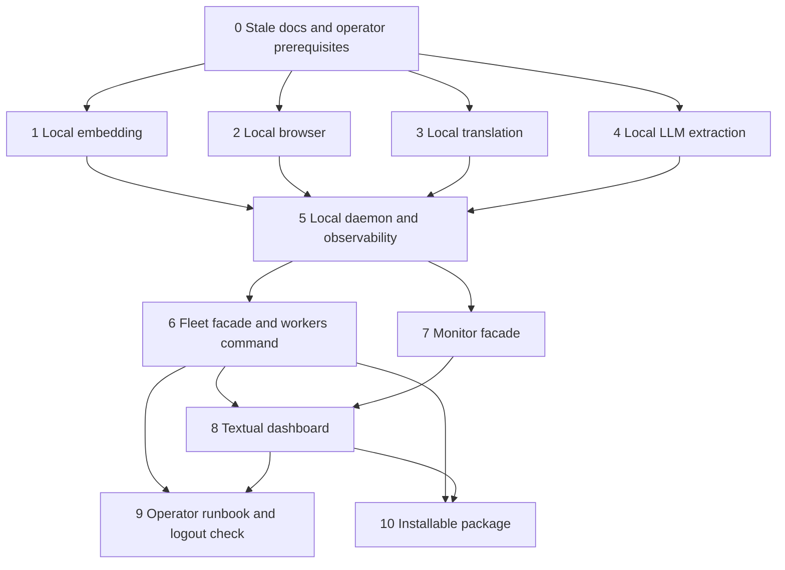

# Local queue drain — Rollout

**Architecture:** [00-architecture.md](00-architecture.md) · **Decisions:** [gaps-and-decisions.md](gaps-and-decisions.md) · **Chapters:** [chapters/](chapters/) · **Ledger:** [run-ledger.md](run-ledger.md) (created when the loop starts)

**Loop branch:** `feat/plans-local-queue-drain`, created from `origin/main` when the loop starts
**Release branch:** `main`

## Invariants

1. Local workers use the existing queue contract (I1 in the architecture). The only server change is a translation lane per local engine.
2. Local work never reserves Cloudflare or Azure resources in the ledger (I2).
3. An embedding vector is written only after its parity gate passes (I3).
4. A local run finishes within one hour (I4).
5. Each stage's gate is measured on this machine, not assumed. A stage that misses its gate stops, and the reason goes to the run ledger.
6. Each code chapter follows red → green → refactor. Each slice has a happy-path test and a negative-path test, both red before the code is written.
7. Conventional commits, one concern per commit, each commit ends with the `Co-Authored-By` line the session provides.
8. Each claim takes one task, `limit=1` (D11). Concurrency comes from `slots` claim loops in one process, never from a larger claim.
9. Local workers create no tasks ahead of a claim (D10).
10. The facades never import the interfaces, and the dashboard never starts or stops a worker process (I10, I13).
11. The dashboard makes no write request and no admin request, and asks no more often than its refresh interval (I11, I14).
12. The fleet stays within its caps: the threads of all types sum to at most 16, their VRAM to at most 3584 MiB, and every worker runs at nice 10 (I15, I16, D27).

## Dependency graph

## Scheduling matrix

| ID | Chapter | Depends on | Batch | Touches | Gate |
| --- | --- | --- | ---: | --- | --- |
| C0 | [Stale docs and operator prerequisites](chapters/00-stale-docs-and-prerequisites.md) | none | 0 | `docs/operations/`, `.plans/gha-budget/`, `.plans/discovery-throughput/`, `.github/workflows/discovery-*.yml`, the tests named in the chapter | `./ci.sh` green in `apps/api`; the stale-wording grep returns no operator-facing hit |
| C1 | [Local embedding](chapters/01-local-embedding.md) | C0 | 1 | `apps/discovery-ingest/discovery_ingest/extract/embedding/`, `worker/embed_drain.py`, `embedding_models.py` | Parity: cosine ≥ 0.999 on 50 texts against Workers AI, on CPU or GPU, and the same top-10 for 20 queries |
| C2 | [Local browser](chapters/02-local-browser.md) | C0 | 1 | `apps/discovery-ingest/discovery_ingest/browser/`, `worker/browser_setup.py`, `worker/browser_spend.py` | Payload parity on 50 canary pages: same status and final URL, screenshot JPEG, no regression in completion rate |
| C3 | [Local translation](chapters/03-local-translation.md) | C0 | 2 | `apps/discovery-ingest/discovery_ingest/translation/`, `worker/translate_meter.py`, `apps/api/app/features/translation/lanes.py` | German benchmark on 3 threads: validation pass rate and speed against Azure on the same units; lane tests green |
| C4 | [Local LLM extraction](chapters/04-local-llm-extraction.md) | C0 | 2 | `apps/discovery-ingest/discovery_ingest/extract/llm/`, `worker/llm_setup.py`, `worker/llm_call.py`, `operations/models.py` | `llama-bench` throughput target met within the `llm` caps; JSON validity ≥ the Workers AI run on the labelled sample |
| C5 | [Local daemon and observability](chapters/05-local-daemon-and-observability.md) | C1–C4 | 3 | `apps/discovery-ingest/discovery_ingest/cli/`, a new `daemon` module, `worker_types.py`, `docs/operations/` | Eight hours of unattended running: no stale run, backoff on empty queue, heartbeats written; the caps of D27 hold |
| C6 | [Process fleet facade and workers command](chapters/06-fleet-facade-and-workers-command.md) | C5 | 4 | `apps/discovery-ingest/discovery_ingest/fleet/`, `cli/workers.py`, `cli/main.py` | `workers status` lists every type; `workers up` starts every type; the fence test is green |
| C7 | [Monitor facade](chapters/07-monitor-facade.md) | C5 | 4 | `apps/discovery-ingest/discovery_ingest/monitor/` | a live read-only snapshot from the API; every source shows data or a named error; one request per queue refresh |
| C8 | [Textual dashboard](chapters/08-textual-dashboard.md) | C6, C7 | 5 | `apps/discovery-ingest/discovery_ingest/tui/`, `cli/dashboard.py` | a 30-minute session in a terminal without a freeze; a source error appears only on its own panel |
| C9 | [Operator runbook and logout check](chapters/09-operator-runbook-and-logout-check.md) | C6, C8 | 6 | `docs/operations/local-worker-fleet.md` | the runbook test green; the workers still running after a real logout |
| C10 | [Installable package](chapters/10-installable-package.md) | C6, C8 | 6 | `apps/discovery-ingest/pyproject.toml`, `apps/discovery-ingest/discovery_ingest/cli/main.py` | `discovery-ingest` runs from any directory; the wheel holds the fleet, monitor and tui packages; the base install has no textual |

Batch 1 holds C1 and C2: no shared path. Batch 2 holds C3 and C4: C3 touches the API lanes, C4 touches the LLM package, and neither touches the other's files. C5 needs every engine it runs.

Batch 4 holds C6 and C7. C6 touches the fleet package and the CLI; C7 touches the monitor package. Neither needs the other. Batch 5 holds C8, which needs both. Batch 6 holds C9 and C10. C10 needs the dashboard extra from C8 and the command from C6.

## Stage ordering and the first decisions

1. **C0 first, alone.** It fixes the docs that now mislead operators, and it gives the local machine a dedicated machine key, which C1–C5 need.
2. **Measure before building.** Two measurements are gates, not chapters. The embedding parity probe runs in C1 before any adapter is written. The `llama-bench` run runs in C4 before the client is written. A failed gate changes the plan, and the ledger records it.
3. **GPU is usable (D28).** The P2000 works since the reboot of 2026-11-28, with 4.1 GiB free beside the desktop. C1 and C4 each measure GPU and CPU, and keep the device that passes its gate. Any GPU use stays within the VRAM cap (3584 MiB across the fleet). Neither the 27B nor the 35B model fits the free VRAM whole, so C4 measures partial offload.

## Per-chapter gate

1. Every red test is committed and fails for the right reason (missing behaviour, not a typo).
2. The chapter's own verification commands pass.
3. `./ci.sh` passes in every package the chapter touches (`apps/api`, `apps/discovery-ingest`, `apps/web` if touched).
4. The refactor report names each candidate and its outcome, including "no change needed".
5. For a stage with a measured gate, the measurement is recorded in the run ledger with its command and output.

## Final gate

1. Every chapter row in the run ledger shows `done`, or `stopped` with the gate that failed.
2. A local daemon has run for eight hours unattended: no stale run, no unhandled error, backoff while the queue is empty.
3. The flow page shows the local worker's runs and its tasks as completed, and neither ledger holds a reservation from local work (I2).
4. `./ci.sh` exits 0 on the loop branch head.
5. The dashboard runs for 30 minutes in a terminal while the workers run in the background. Closing the terminal leaves the workers up, and a logout leaves them running (D25).
6. During the eight-hour run, the summed CPU of the fleet's process tree, sampled once a minute, stays under 16 logical CPUs (I15).
