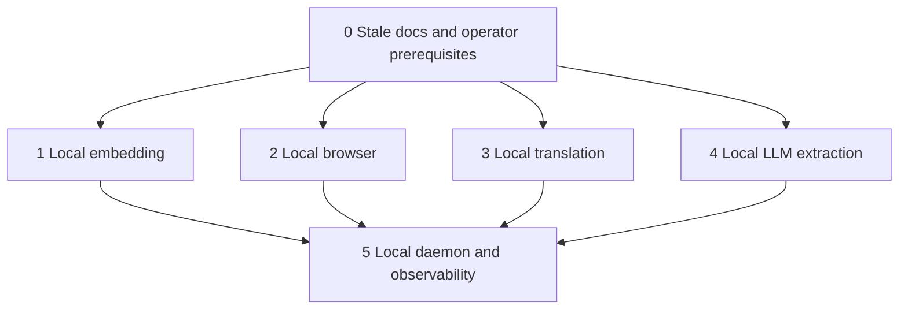

# Local queue drain — Rollout

**Architecture:** [00-architecture.md](00-architecture.md) · **Decisions:** [gaps-and-decisions.md](gaps-and-decisions.md) · **Chapters:** [chapters/](chapters/) · **Ledger:** [run-ledger.md](run-ledger.md) (created when the loop starts)

**Loop branch:** `feat/plans-local-queue-drain` (worktree `/mnt/projects/redtape-wt/local-queue-drain`, based on `origin/main` at `3f75b83e`)
**Release branch:** `main`

## Invariants

1. Local workers use the existing queue contract (I1 in the architecture). The only server change is a translation lane per local engine.
2. Local work never reserves Cloudflare or Azure resources in the ledger (I2).
3. An embedding vector is written only after its parity gate passes (I3).
4. A local run finishes within one hour (I4).
5. Each stage's gate is measured on this machine, not assumed. A stage that misses its gate stops, and the reason goes to the run ledger.
6. Each code chapter follows red → green → refactor. Each slice has a happy-path test and a negative-path test, both red before the code is written.
7. Conventional commits, one concern per commit, each commit ends with the `Co-Authored-By` line the session provides.
8. Each local claim takes one task, `limit=1` (D11).
9. Local workers create no tasks ahead of a claim (D10).

## Dependency graph

## Scheduling matrix

| ID | Chapter | Depends on | Batch | Touches | Gate |
| --- | --- | --- | ---: | --- | --- |
| C0 | [Stale docs and operator prerequisites](chapters/00-stale-docs-and-prerequisites.md) | none | 0 | `docs/operations/`, `.plans/gha-budget/`, `.plans/discovery-throughput/`, `.github/workflows/discovery-*.yml`, the tests named in the chapter | `./ci.sh` green in `apps/api`; the stale-wording grep returns no operator-facing hit |
| C1 | [Local embedding](chapters/01-local-embedding.md) | C0 | 1 | `apps/discovery-ingest/discovery_ingest/extract/embedding/`, `worker/embed_drain.py`, `embedding_models.py` | Parity: cosine ≥ 0.999 on 50 texts against Workers AI, and the same top-10 for 20 queries |
| C2 | [Local browser](chapters/02-local-browser.md) | C0 | 1 | `apps/discovery-ingest/discovery_ingest/browser/`, `worker/browser_setup.py`, `worker/browser_spend.py` | Payload parity on 50 canary pages: same status and final URL, screenshot JPEG, no regression in completion rate |
| C3 | [Local translation](chapters/03-local-translation.md) | C0 | 2 | `apps/discovery-ingest/discovery_ingest/translation/`, `worker/translate_meter.py`, `apps/api/app/features/translation/lanes.py` | German benchmark: validation pass rate and speed against Azure on the same units; lane tests green |
| C4 | [Local LLM extraction](chapters/04-local-llm-extraction.md) | C0 | 2 | `apps/discovery-ingest/discovery_ingest/extract/llm/`, `worker/llm_setup.py`, `worker/llm_call.py`, `operations/models.py` | `llama-bench` throughput target met; JSON validity ≥ the Workers AI run on the labelled sample |
| C5 | [Local daemon and observability](chapters/05-local-daemon-and-observability.md) | C1–C4 | 3 | `apps/discovery-ingest/discovery_ingest/cli/`, a new `daemon` module, `docs/operations/` | Eight hours of unattended running: no stale run, backoff on empty queue, the flow shows local runs |

Batch 1 holds C1 and C2: no shared path. Batch 2 holds C3 and C4: C3 touches the API lanes, C4 touches the LLM package, and neither touches the other's files. C5 needs every engine it runs.

## Stage ordering and the first decisions

1. **C0 first, alone.** It fixes the docs that now mislead operators, and it gives the local machine a dedicated machine key, which C1–C5 need.
2. **Measure before building.** Two measurements are gates, not chapters. The embedding parity probe runs in C1 before any adapter is written. The `llama-bench` run runs in C4 before the client is written. A failed gate changes the plan, and the ledger records it.
3. **GPU (O1) is optional.** The driver is installed, but the P2000 stays on `nouveau` until the machine reboots. C1–C3 run on CPU either way. C4 uses the GPU only if the reboot brings the card up and the model fits in 5 GB of VRAM.

## Per-chapter gate

1. Every red test is committed and fails for the right reason (missing behaviour, not a typo).
2. The chapter's own verification commands pass.
3. `./ci.sh` passes in every package the chapter touches (`apps/api`, `apps/discovery-ingest`, `apps/web` if touched).
4. The refactor report names each candidate and its outcome, including "no change needed".
5. For a stage with a measured gate, the measurement is recorded in the run ledger with its command and output.

## Final gate

1. Every chapter row in the run ledger shows `done`, or `stopped` with the gate that failed.
2. A local daemon has run for eight hours unattended: no stale run, no unhandled error, backoff while the queue is empty.
3. The flow page shows the local worker's runs and its tasks as completed, and the Cloudflare budget counters do not move because of local work.
4. `./ci.sh` exits 0 on the loop branch head.
