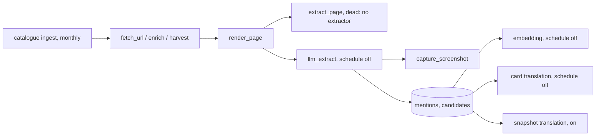

# Pipeline optimisation — Architecture

**Rollout:** [01-rollout.md](01-rollout.md) · **Decisions:** [gaps-and-decisions.md](gaps-and-decisions.md) · **Chapters:** [chapters/](chapters/) · **Builds on:** [gha-budget](../gha-budget/00-architecture.md), [discovery-throughput](../discovery-throughput/00-architecture.md), [discovery-operations](../discovery-operations/00-architecture.md), [azure-translation](../azure-translation/00-architecture.md), [candidate-view-polish](../candidate-view-polish/00-architecture.md), [search-first](../search-first/00-architecture.md)

## 1. Why

The discovery pipeline has five free allotments, and most of them sit unused while the stages that depend on them wait for work:

- **Actions minutes** are shared by every workflow in the repository, and CI is the largest consumer. The ledger counts only the drains.
- **Cloudflare browser seconds** are capped at 570 a day, but the funnel is limited by the Quick Actions rate (one request per 10 s on the Free plan), so a render day uses about 43% of the cap.
- **Workers AI neurons** are capped at 9,500 a day. In the last measured LLM run 930 were used, and the translation and embedding stages that could use the rest are not scheduled.
- **Azure Translator characters** are capped at 1.9 million a month. The backlog is roughly twenty times that, and the adapter's throttling and attempt accounting waste part of what is spent.
- **R2 and the database** are not binding yet, but screenshots are never pruned and events grow with every claim.

The stages also starve each other. The LLM stage is off, so screenshots, which only the LLM stage produces, never arrive. Embedding and card translation are unscheduled, so their queues only grow. The admin shows per-kind counts and budget meters, but not how the stages depend on each other or where an allowance sits unused while work waits.

The suite is documentation-first. This plan creates only plan documents. Its chapters later change workflow YAML, `apps/api` migrations, routes and repositories, `apps/discovery-ingest` drains and browser code, and `apps/web` pages.

## 2. Measured state (2026-11-13)

Figures come from `gh` (repository variables, run logs and run timing) and from the code. Estimates are marked as such.

| Variable | State | Note |
| --- | --- | --- |
| `DISCOVERY_DRAIN`, `DISCOVERY_RENDER`, `DISCOVERY_EXTRACT`, `DISCOVERY_SCREENSHOT` `_SCHEDULE` | enabled | since 2026-11-01 |
| `SNAPSHOT_TRANSLATE_SCHEDULE` | enabled | since 2026-11-13 13:01 UTC |
| `DISCOVERY_LLM_SCHEDULE` | unset | deleted on 2026-11-06 for the taxonomy cutover; the cutover is now on `main` |
| `DISCOVERY_EMBED_SCHEDULE`, `DISCOVERY_TRANSLATE_SCHEDULE` | unset | never enabled; 4,713 embedding tasks and about 4,200 card tasks per locale are waiting |

GitHub's cron runs five to eight hours late in practice, so the same-day ordering from `discovery-throughput` holds only in the order of the runs, not in their spacing.

### 2.1 Flow today

### 2.2 Why each consumer starves

| Consumer | Observed | Root cause |
| --- | --- | --- |
| `fetch_url`, `enrich_metadata`, `harvest_payload` | `queue_empty` every day | The only producer is the monthly catalogue ingest, capped at 15 GovData pages and 50 PVOG pages |
| `extract_page` | `queue_empty` every day | No extractor is registered (`EXTRACTORS = ()`), so no task is created |
| `llm_extract` | not running | Schedule off since 11-07; render keeps enqueuing, so the backlog grows |
| `capture_screenshot` | `queue_empty` | Its only automated producer is an `llm_extract` task that completes |
| embeddings, card translation | skipped | Schedules never enabled |
| `render_page` | about 75 claims a day, 594 left | Quick Actions allow one request per 10 s on the Free plan, the run stops on a 900 s clock, and each page costs two navigations |

### 2.3 Free-tier use

| Resource | Cap | Used now | Demand | Binding limit |
| --- | --- | --- | --- | --- |
| Browser seconds a day | 570 | 244 (43%) | 594 render backlog and about 800 rendered pages without a screenshot (estimate) | the rate limit and the job clock, not browser time |
| Neurons a day | 9,500 | 0 to 930 | LLM about 3,000; embedding backlog about 5,000 once; translation tail about 12 a card-locale | nothing: producers and schedules do |
| Azure characters a month | 1.9 million | not yet measured (the job was enabled today) | about 20 million or more | the cap, and the throttling |
| Actions minutes a month | 2,000 pool (Free plan) | drains about 600 a month; CI about 1,478 in 13 days (estimate, projects to about 3,400) | all eight drains on: 1,470 to 2,850 (estimate) | the pool, mostly CI |
| R2 and database | 9.5 GB; 475 MB soft limit | about 1 GB; about 60 MB | small, but screenshots are never pruned | not binding yet |

### 2.4 Waste found

1. Three of the five daily workflows do nothing and each bills at least one minute.
2. Every stage is a separate job, so setup is paid on every run, and with all stages on the runner minutes of the later stages add up without overlapping useful work.
3. Render waits 11 s per page for the rate limit while nothing else in the pipeline runs.
4. Each page costs two browser navigations (render, then screenshot), and screenshots are gated on the LLM stage.
5. About 30% of render tasks fail, with no recorded reason. The browser ledger books a failed call at its 30 s estimate, so it over-counts.
6. A 429 from Azure burns one of three attempts and the drain moves on inside the same window. The adapter's per-request ceiling is above what the free tier accepts in one request.
7. The neuron 429 on 2026-11-11 (code 4006) happened while the ledger read 7.3k of 9.5k. The cause is not known.
8. The discovery claim has no row lock, failed tasks are terminal, and the dedup identity ignores the artifact.
9. The LLM stage is clock-bound when busy: about 45 tasks in 600 s.
10. The run record holds counts and a stop reason only, is written only by the worker drain, and is not written by a process that is killed by SIGTERM.
11. CI projects to about 3,400 minutes a month against a 2,000-minute pool (estimate). October ended in a lockout.

## 3. Target design

One self-pacing daily pipeline job, a funnel that spends browser calls only where they add value, a planner per free resource, and an admin view that shows the whole flow and where the allowances sit idle.

1. **Spend browser calls where they add value.** Detect changed pages before rendering. Fuse the HTML and the screenshot into one call. Make screenshot capture a sweeper rather than a hook, and keep the five latest captures per page. Classify render failures and requeue only the transient ones. Spike Browser Sessions over CDP against a runner-local fallback.
2. **Producers become sweepers.** The screenshot, LLM and refresh sweepers are bounded per run. Dedup matches on the artifact, and an extraction whose cleaned text has not changed completes without a model call.
3. **One pipeline job.** A Python orchestrator runs the existing CLI commands as subprocesses in three phases. Browser work runs in one process because the rate limit is per process. The deadline is computed in-process and the run closes cleanly on a signal.
4. **A planner per resource.** Neurons are reconciled before any rolling window is built. Azure gets a 429 that does not burn an attempt, a per-minute limiter, pacing that carries over, and an adaptive share between cards and pages. Translation uses Azure for the top priority tier and Workers AI for a card tail that is validated per locale. Actions minutes are measured from GitHub, CI included.
5. **Fill idle capacity.** Stale pages are refreshed, the catalogue is ingested more often, and backfills run for screenshots, embeddings and the prompt-version re-extraction.
6. **See the whole flow.** An admin page at `/admin/discovery/flow` draws the stages as a graph with a state per stage, the last run, the errors, and the allowance each stage spends. A strip at the top shows each resource's use and calls out unused headroom while work waits.
7. **Screenshot history in Tabs** on the public candidate page: up to five captures, newest first and active, older ones to the right.

Expected effect, to be measured by the stats from chapter 2: an active day with every stage costs about 20 to 25 billed minutes instead of 70 to 95; an idle day costs one minute instead of three to six; every rendered page gets a screenshot; neuron use rises from 10% or less to 70 to 90% on days with backlog.

## 4. Vocabulary

| Term | Meaning |
| --- | --- |
| **Stage** | One step of the flow with its own producers, queue, consumer and allowance: seed, render, extract (LLM), capture, embed, card translation, page translation |
| **Allotment** | A free-tier resource with a cap and a ledger resource: browser seconds, neurons, Azure characters, Actions minutes, R2 operations, database bytes |
| **Ready work** | Tasks the claim would return now (`pending`, not delayed, lease free) |
| **State** | One of `dead`, `budget_stopped`, `throttled`, `blocked`, `starved`, `overdue`, `backlogged`, `flowing`, `idle` (chapter 13) |
| **Sweeper** | A bounded producer that enqueues work from stored state on each run, rather than from a hook that fires once |
| **Phase** | One of three ordered groups of concurrent stages in the pipeline job (chapter 12) |
| **Tail** | Card translations for the lower priority tier, done by Workers AI and validated per locale (chapter 7) |

## 5. Operator steps

Steps that only the repository owner can take. Each one that blocks a chapter is expanded into a numbered walkthrough when it stops a run; the activation walkthrough is chapter 15's.

| # | Step | When |
| --- | --- | --- |
| S0 | Tonight, before about 22:40 UTC: the snapshot job (enabled at 13:01 UTC) makes its first scheduled run of up to 300 tasks, with no pacing, and each 429 burns an attempt. Pause it with `gh variable delete SNAPSHOT_TRANSLATE_SCHEDULE`, or accept the run | now |
| S1 | Read the real Actions usage for the month (GitHub, Settings, Billing, Usage, or `gh auth refresh -s user` and the usage API), and record the pool and CI minutes. At the estimated pace the pool runs out around day 18 | now |
| S2 | Verify, then re-enable the LLM drain: run part C of the taxonomy `c8_queries_4.sql` (no `ext-5` rows after 2026-11-06 12:23), confirm production is at the alembic head, then `gh variable set DISCOVERY_LLM_SCHEDULE --body enabled`. The backlog of about 400 needs more than the default run of about 45 tasks, so dispatch one or two runs with `neuron_budget` 4,500 and `time_budget_seconds` 1,000 | wave 0 |
| S3 | Enable `DISCOVERY_EMBED_SCHEDULE`. Three runs of about 1,600 neurons clear the 4,713-task backlog. Once it is empty, each daily run still bills one minute until chapter 12 folds it in | wave 0 |
| S4 | Enable `DISCOVERY_TRANSLATE_SCHEDULE`, only after chapter 6 has merged | wave 2 |
| S5 | Create a Cloudflare account-analytics read token (chapter 3), and a browser token with "Browser Rendering – Edit" access (chapter 10). Keep both out of the repository | wave 0 |
| S6 | Record the Azure F0 reset date from the portal (the `azure-translation` O4 question), before the pacing in chapter 6 is turned on | wave 0 |
| S7 | At activation: set the new variables, delete the retired `*_SCHEDULE` variables, and set the Render caps if they changed. Set `SCREENSHOT_KEEP_PER_PAGE` on Render only if 5 is not wanted | wave 3 |

## 6. Out of scope

- A Worker-hosted drain, or an external trigger in place of GitHub's cron (decision D8).
- A rolling neuron ledger, unless the reconciliation spike (chapter 3) finds that the window is the cause.
- Translating procedure pages on Workers AI. Pages stay on Azure.
- Migrating the candidate `FlowDiagram` onto the new shared `FlowGraph` (decision D12).
- The Cloudflare translation adapter's retirement, which stays with `azure-translation` chapter 17.
