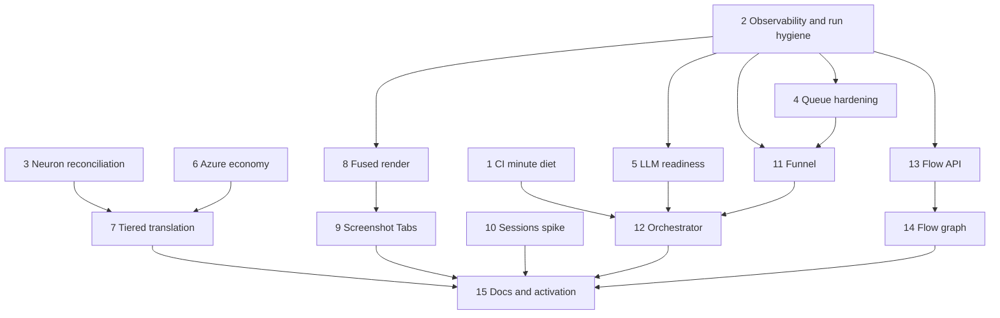

# Pipeline optimisation — Rollout

**Architecture:** [00-architecture.md](00-architecture.md) · **Decisions:** [gaps-and-decisions.md](gaps-and-decisions.md) · **Chapters:** [chapters/](chapters/)

**Loop branch:** `feat/plans-pipeline-optimisation`
**Release branch:** `main`

## Invariants

1. This suite creates documentation only. Each of the fifteen chapters is one implementable unit for a later chapter implementer.
2. Discovery workers never receive `DATABASE_URL`. All worker persistence stays behind the machine API.
3. The task claim limit (1 to 50), the 15-minute lease, reclaim on claim, catalogue idempotency and fingerprint dedup are preserved. Chapter 4 changes the dedup identity only for tasks that carry an artifact, adds a row lock to the discovery claim, and adds a failure class and a requeue route. None of these changes the limit, the lease or the reclaim.
4. The completeness order of [discovery-throughput](../discovery-throughput/gaps-and-decisions.md) chapter 4 stays in force. Chapter 11 adds an epoch to the refresh identity without changing that order.
5. Render-dashboard values and repository variables are operator steps, never a chapter commit. Chapter 15 records them.
6. Every workflow YAML change is checked by a YAML parse and by `actionlint` before merge. No live cron is awaited to prove the syntax.
7. Every API change that alters the OpenAPI document updates `apps/api/tests` snapshot in the same PR.
8. Migrations are reversible and tested by the existing migration round trip (`apps/api/scripts/check_migrations.sh`, run by `api-lint-test.yml`).
9. Every code chapter has paired happy and negative tests and a refactor audit, under the `tdd-workflow` rules: one level of nesting, small methods, layering repos, services, controllers and routers.
10. Web chapters follow `apps/web/CLAUDE.md`: `<X>View/` folders, queries through `queryKeys`, about 100 lines a file.
11. No chapter turns a feature flag on in production. Each one leaves its flag off and names the live gate that enables it.

## Dependency graph

## Execution order (chief of staff)

1. [chapters/01-ci-minute-diet.md](chapters/01-ci-minute-diet.md)
2. [chapters/02-observability-run-hygiene.md](chapters/02-observability-run-hygiene.md)
3. [chapters/03-neuron-reconciliation-spike.md](chapters/03-neuron-reconciliation-spike.md)
4. [chapters/06-azure-economy.md](chapters/06-azure-economy.md)
5. [chapters/10-browser-sessions-spike.md](chapters/10-browser-sessions-spike.md)
6. [chapters/13-pipeline-flow-api.md](chapters/13-pipeline-flow-api.md)
7. [chapters/04-queue-hardening.md](chapters/04-queue-hardening.md)
8. [chapters/05-llm-readiness.md](chapters/05-llm-readiness.md)
9. [chapters/08-fused-render-screenshot-sweeper.md](chapters/08-fused-render-screenshot-sweeper.md)
10. [chapters/14-admin-pipeline-flow-graph.md](chapters/14-admin-pipeline-flow-graph.md)
11. [chapters/09-screenshot-history-tabs.md](chapters/09-screenshot-history-tabs.md)
12. [chapters/07-tiered-translation-routing.md](chapters/07-tiered-translation-routing.md)
13. [chapters/11-funnel-change-detection.md](chapters/11-funnel-change-detection.md)
14. [chapters/12-pipeline-orchestrator.md](chapters/12-pipeline-orchestrator.md)
15. [chapters/15-docs-activation.md](chapters/15-docs-activation.md)

Chapter 15 comes last because it documents the shipped shape and runs the operator activation steps.

## Chapters

| # | Chapter | Branch | Depends on | Size | Status |
| --- | --- | --- | --- | --- | --- |
| 1 | [CI minute diet and real-minute reconciliation](chapters/01-ci-minute-diet.md) | `feat/pipeline-optimisation-ci-minute-diet` | none | M | planned |
| 2 | [Observability and run hygiene](chapters/02-observability-run-hygiene.md) | `feat/pipeline-optimisation-observability` | none | M | planned |
| 3 | [Neuron reconciliation spike](chapters/03-neuron-reconciliation-spike.md) | `feat/pipeline-optimisation-neuron-spike` | none | S | planned |
| 4 | [Queue hardening](chapters/04-queue-hardening.md) | `feat/pipeline-optimisation-queue-hardening` | 2 | L | planned |
| 5 | [LLM readiness](chapters/05-llm-readiness.md) | `feat/pipeline-optimisation-llm-readiness` | 2 | M | planned |
| 6 | [Azure economy](chapters/06-azure-economy.md) | `feat/pipeline-optimisation-azure-economy` | none | M | planned |
| 7 | [Tiered translation routing](chapters/07-tiered-translation-routing.md) | `feat/pipeline-optimisation-tiered-translation` | 3, 6 | M | planned |
| 8 | [Fused render, screenshot sweeper and pruning](chapters/08-fused-render-screenshot-sweeper.md) | `feat/pipeline-optimisation-fused-render` | 2 | L | planned |
| 9 | [Screenshot history Tabs](chapters/09-screenshot-history-tabs.md) | `feat/pipeline-optimisation-screenshot-tabs` | 8 | M | planned |
| 10 | [Browser Sessions spike](chapters/10-browser-sessions-spike.md) | `feat/pipeline-optimisation-sessions-spike` | none | S | planned |
| 11 | [Funnel: change detection, refresh and ingest split](chapters/11-funnel-change-detection.md) | `feat/pipeline-optimisation-funnel` | 2, 4 | L | planned |
| 12 | [Pipeline orchestrator and single workflow](chapters/12-pipeline-orchestrator.md) | `feat/pipeline-optimisation-orchestrator` | 1, 2, 5 | L | planned |
| 13 | [Pipeline flow API](chapters/13-pipeline-flow-api.md) | `feat/pipeline-optimisation-flow-api` | 2 | M | planned |
| 14 | [Admin pipeline flow graph](chapters/14-admin-pipeline-flow-graph.md) | `feat/pipeline-optimisation-flow-graph` | 13 | L | planned |
| 15 | [Docs, drift fixes and staged activation](chapters/15-docs-activation.md) | `feat/pipeline-optimisation-docs-activation` | all | S | planned |

## Waves

| Wave | Chapters | Operator steps before or during the wave |
| --- | --- | --- |
| 0 | 1, 2, 3, 6, 10 | S0 to S3 and S5 to S6 (see the operator table in the architecture) |
| 1 | 13 then 14; 4; 5; 8 then 9 | S2 (LLM schedule) after chapter 5's verification |
| 2 | 7, 11, then 12 | S4 (translate schedule) after chapter 6 |
| 3 | follow-ups, then 15 | S7 at activation |

Within a wave, the chapters are independent except where the arrow is written. Chapter 14 needs chapter 2 in the stats, so the graph shows every stage as soon as chapter 2 lands, and each stage's card fills in as its run rows arrive.

## Per-chapter gate

- Focused tests in the package the chapter touches, then `./ci.sh`.
- Workflow chapters: YAML parse and `actionlint`, plus one `gh workflow run` smoke against `main` after the merge, recorded in the run ledger.
- Migration chapters: the migration round trip and a check that the existing rows read back after the upgrade.
- Live gates are named in each chapter. They run after the merge, with the flag still off, and the result is recorded before the flag is turned on.
- Docs-only chapters: a link and anchor check, plus the drift list in chapter 15.

## Exit criteria

- All fifteen chapters merged to the loop branch, and the release PR merged to `main`.
- `./ci.sh` green in `apps/api`, `apps/discovery-ingest` and `apps/web`.
- The admin flow page shows every stage with a state and a last run, and an allotment strip for each resource.
- A full day's run shows a rendered page with its screenshot the same day, and the Actions minutes of that day are recorded from GitHub.
- Free-tier targets from the architecture's verification table are reported, with any shortfall named.

## Branch and release protocol

Each chapter uses a branch from `feat/plans-pipeline-optimisation` and opens one reviewable PR into that loop branch. Once every chapter's row in the run ledger shows merged with blocker `none`, one release PR goes from `feat/plans-pipeline-optimisation` to `main`. The run ledger is created when the loop starts, as in the other suites.
