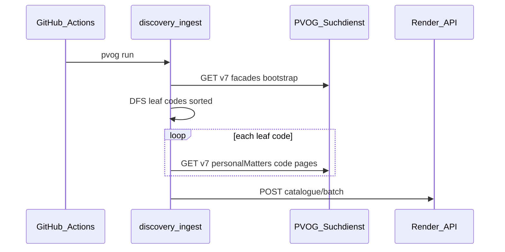

# PVOG v7 ingest — Architecture

**Rollout:** [01-rollout.md](01-rollout.md) · **Decisions:** [gaps-and-decisions.md](gaps-and-decisions.md) · **Chapters:** [chapters/](chapters/) · **Parent:** [discovery-online-smoke](../discovery-online-smoke/00-architecture.md) (GovData/jurisdiction shipped) · **Ingest:** [discovery-layer ch.13](../discovery-layer/chapters/13-pvog-ingest-cli.md)

---

## 1. Why

**Platform maintenance** discovery job passes **GovData OZG catalogue fetch** but fails on **PVOG Suchdienst catalogue run** with `httpx.HTTPStatusError: 400` on bare `GET …/v7/servicedescriptions/000000000000`. PVOG now requires search criteria (`q`, `personalMatters`, or LeiKa). Response shape uses **`serviceDescriptions`** pagination, not the legacy top-level `content` / `next` assumed in [`PvogClient`](../../apps/discovery-ingest/discovery_ingest/pvog/client.py).

Operator secrets (`FEDERAL_JURISDICTION_ID`, `DISCOVERY_API_*`) are already correct when GovData batch succeeds.

## 2. Symptom

| Layer | Observation |
| --- | --- |
| GHA | Step **PVOG Suchdienst catalogue run** exits 1 immediately after GovData (~2+ min) |
| Ingest | `400 Bad Request`, code 1901 — search must include terms, LeiKa IDs, or Lebenslagen |
| API | Not involved until PVOG rows are mapped and posted |

## 3. Target flow

## 4. Deterministic federal crawl

| Step | Behavior |
| --- | --- |
| Bootstrap | `facades=true`, seed `personalMatters=Geburt`, ARS `000000000000` |
| Tree walk | DFS on `facades.personalMatters`; collect **leaf** `code` only; `sorted(set(codes))` |
| Search | Per code: `facades=false`, paginate `page` until `serviceDescriptions.last` |
| Dedupe | Skip duplicate lb `id` across codes in one run |
| Budget | `--max-pages` = global HTTP GET cap (bootstrap counts) |

See [gaps-and-decisions.md](gaps-and-decisions.md) for scope limits (no `q` fan-out; no v5 CSV).

## 5. Scope

| In scope | Out of scope |
| --- | --- |
| [`pvog/client.py`](../../apps/discovery-ingest/discovery_ingest/pvog/client.py), fixtures, tests | Bereitstelldienst, deprecated v5 CSV bulk |
| Canon + ops triage docs | GovData CKAN changes |
| `pvog run` CLI surface unchanged | Live PVOG in `./ci.sh` pytest |

## 6. CoS orchestration

Loop branch and release per [01-rollout.md](01-rollout.md). Chief of staff: [`docs/operations/loops/pvog-v7-ingest.md`](../../docs/operations/loops/pvog-v7-ingest.md) (added in chapter 3).
