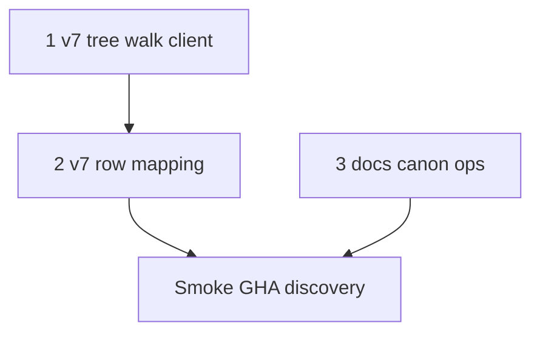

# PVOG v7 ingest — Rollout

**Architecture:** [00-architecture.md](00-architecture.md) · **Decisions:** [gaps-and-decisions.md](gaps-and-decisions.md) · **Chapters:** [chapters/](chapters/) · **Ledger:** [run-ledger.md](run-ledger.md)

**Loop branch:** `feat/plans-pvog-v7-ingest`  
**Release branch:** `main`

**Prerequisites:** [discovery-online-smoke](../discovery-online-smoke/01-rollout.md) on `main` (GovData batch + `FEDERAL_JURISDICTION_ID`); production discovery GHA currently fails on PVOG step only.

---

## Invariants

1. **No new GitHub secrets** for PVOG Suchdienst (public read).
2. **Each chapter ends with** `cd apps/discovery-ingest && uv run pytest tests/test_pvog_client.py tests/test_pvog_cli.py -q` **and** `./ci.sh` when ingest or repo docs change per chapter.
3. **No live PVOG in PR pytest** — mocks/fixtures only.
4. **Federal ARS** remains `000000000000` ([`FEDERAL_ARS`](../../apps/discovery-ingest/discovery_ingest/pvog/client.py)).

---

## Dependency graph



---

## Execution order (chief of staff)

1. [chapters/01-v7-tree-walk-client.md](chapters/01-v7-tree-walk-client.md)
2. [chapters/02-v7-row-mapping.md](chapters/02-v7-row-mapping.md)
3. [chapters/03-docs-canon-ops.md](chapters/03-docs-canon-ops.md)

**Exit:** **Platform maintenance** with `job=discovery` green through **PVOG Suchdienst catalogue run** and **Discovery worker drain**; optional `source=pvog` rows in production catalogue.

---

## Chapters

| # | Chapter | Layer | Gate | Plan | Status |
| --- | --- | --- | --- | --- | --- |
| 1 | v7 tree walk client | ingest | pytest | [01](chapters/01-v7-tree-walk-client.md) | planned |
| 2 | v7 row mapping | ingest | pytest + `./ci.sh` | [02](chapters/02-v7-row-mapping.md) | planned |
| 3 | Docs canon + ops loop | docs | `./ci.sh` | [03](chapters/03-docs-canon-ops.md) | planned |

## Per-chapter gate

```bash
cd apps/discovery-ingest && uv run pytest tests/test_pvog_client.py tests/test_pvog_cli.py -q
./ci.sh
```

Chapter 3 may skip ingest pytest if no ingest code changes in that PR (docs-only).

## Release

When the ledger is complete, open release PR **loop branch → `main`**. CoS: [docs/operations/loops/pvog-v7-ingest.md](../../docs/operations/loops/pvog-v7-ingest.md).
