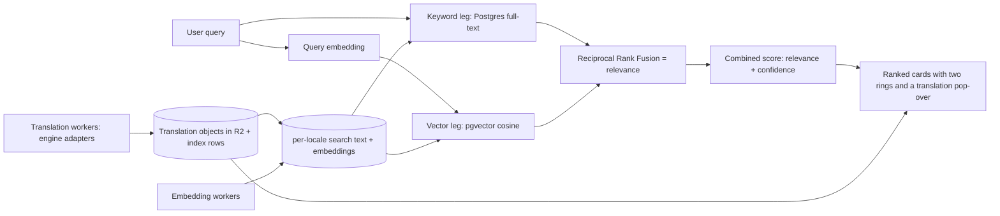
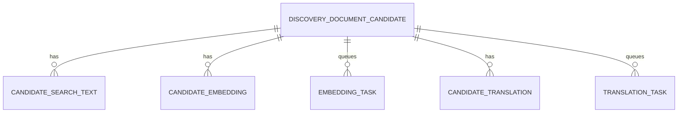
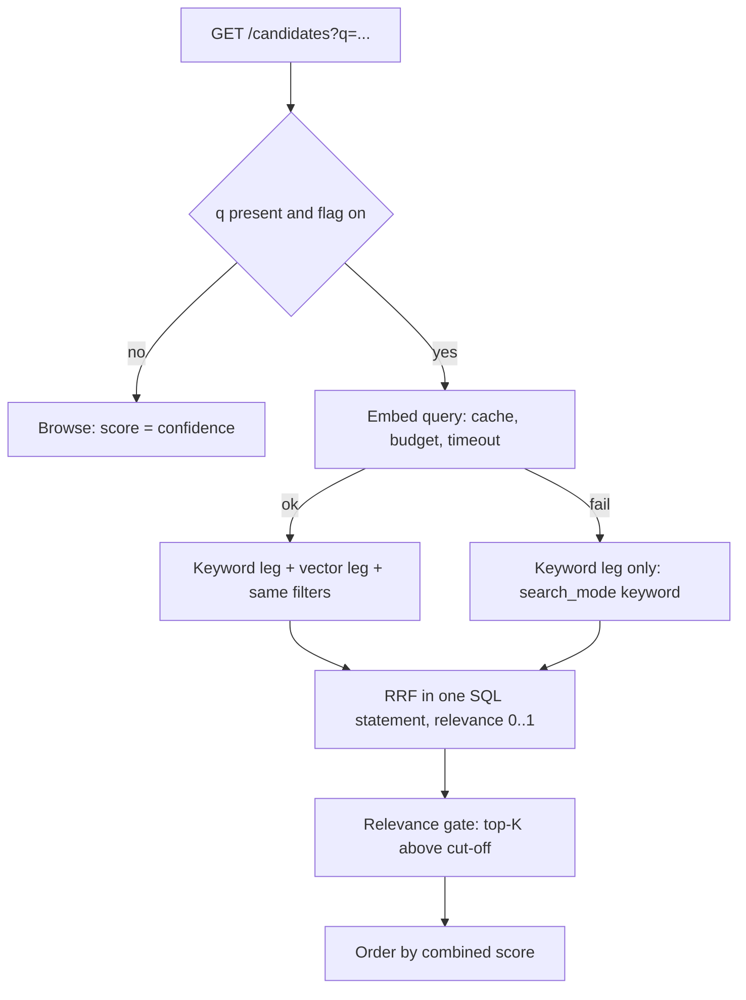

# Search-first — Architecture

**Repo:** `redtape` (`apps/api`, `apps/discovery-ingest`, `apps/web`)
**Rollout:** [01-rollout.md](01-rollout.md) · **Decisions:** [gaps-and-decisions.md](gaps-and-decisions.md) · **Chapters:** [chapters/](chapters/)
**Precedent:** [category-taxonomy-migration](../category-taxonomy-migration/00-architecture.md) (search became primary, embeddings explicitly deferred) · [document-browse-confidence](../document-browse-confidence/00-architecture.md) · [crawlers](../crawlers/00-architecture.md) (task, lease and neuron-budget patterns)

## 1. Problem

`/documents` is a category browse page with a small search box. Its `q` parameter is a case-insensitive title `ILIKE` over `title_i18n` with no index (`apps/api/app/features/discovery/repository/candidate_filter.py`, `title_matches`). It cannot match a description, a synonym, another language, or a paraphrase ("child benefit" for *Kindergeld*). Sorting is a user-visible control (confidence, title or newest, with a direction button) that has little meaning once a query ranks the results. And the documents themselves are German, so readers of other languages cannot tell what a result is about.

This suite moves the product to a search-first, multilingual interface:

Seven interface languages: **de** (source), **en**, **tr**, **ru**, **uk**, **pl**, **ro**.

## 2. Vocabulary

| Term | Meaning |
| --- | --- |
| **Candidate** | A row in `discovery_document_candidate`: the pool the public `/documents` list reads through `GET /api/v1/candidates`. The dormant `document` table is not searched. |
| **Search subject** | The thing a result identifies and dedupes on. Today the candidate id; later a canonical entity id (entity resolution, out of scope). |
| **Translation unit** | The two fields a card shows: the German title and the card description (best mention excerpt). The only text that is translated. |
| **Stored translation** | A JSON object in the Cloudflare R2 bucket (title and description in one target locale, made once by a worker) plus a thin `candidate_translation` index row in Postgres (source hash, provenance `mt` or `human`, engine, model, object key). The text lives in R2, not in the database. |
| **Translation engine** | An adapter behind the `TranslationEngine` port that turns German units into one target language. Cloudflare Workers AI today; Azure AI Translator can be plugged in later without touching the queue, API or UI. |
| **Stale translation** | A stored translation whose source hash differs from the current German unit. Still served, flagged, re-translated at low priority. |
| **Search text** | The derived, per-locale text of a candidate that full-text search and embeddings read (`candidate_search_text`). `de` is built from the title and best mention excerpts; other locales from the stored translation. Rebuildable from R2. |
| **Content hash** | SHA-256 of a search text plus a recipe version. Decides whether an embedding is current. |
| **Embedding task / translation task** | A leased unit of work for a worker: embed one `(candidate, model, locale)` text, or translate one `(candidate, locale)` unit. |
| **RRF** | Reciprocal Rank Fusion: `score(c) = Σ 1 / (k + rank_leg(c))` over the legs that returned `c`; `k` defaults to 60. |
| **Relevance** | RRF normalised to 0..1: `rrf / (legs / (k + 1))`, `legs` = 2 in hybrid mode and 1 in keyword mode. |
| **Confidence** | The existing evidence score of a card (`CardRelations.confidence`). Unchanged by this suite. |
| **Combined score** | `(1 − w) · relevance + w · confidence`, `w = SEARCH_CONFIDENCE_WEIGHT`. The default ordering. |
| **Similarity** | The vector leg's cosine similarity, rescaled to 0..1 relative to the cut-off, for display. Not on the confidence scale. |
| **Search mode** | `browse` (no `q`), `hybrid` (both legs), or `keyword` (keyword leg only: flag off or embedder unavailable). |

## 3. What is searched and translated

- The corpus is the candidate pool (about 4000 rows, short texts). `document` and `GET /api/v1/documents` are dormant and out of scope; `catalogue_service` rows are inputs to candidates, not results.
- Source text is German: `title_i18n` is `{"de": …}` and the card description is the best mention's `excerpt` (plain `Text`). English exists only for taxonomy and jurisdictions.
- **Document text is translated once** by background workers into the six target locales and stored (§5). Translations are machine-made, labelled as such, never overwritten if a human translation exists, and never produced at read time.
- No aliases, alternative names or keywords exist yet. The search-text builder is the single place where they will be added.

## 4. Target data model

### `candidate_search_text`

`(candidate_id FK, locale, text, tsv_native, tsv_simple, content_hash, updated_at)`, primary key `(candidate_id, locale)`.

- `de` row from title and best mention excerpts; other locales from the stored translation.
- `tsv_native` is `to_tsvector(<configuration for the locale>, unaccent(text))` (`de` german, `en` english, `tr` turkish, `ru` russian, `ro` romanian, `pl` and `uk` simple: Postgres has no built-in Polish or Ukrainian configuration); `tsv_simple` is `to_tsvector('simple', unaccent(text))` for exact terminology and identifiers. Both are written by the builder in SQL (not generated columns: `unaccent` is not immutable). GIN indexes on both.

### `candidate_embedding`

`(candidate_id FK, model, locale, dim, text_hash, embedding vector(N), created_at)`, primary key `(candidate_id, model, locale)`.

- One row per embedded locale; `locale` selects which search text it came from.
- `N` and the column type (`vector` or `halfvec`) are fixed by the chapter 1 probe and storage estimate (expected 1024 for `@cf/qwen/qwen3-embedding-0.6b`; unconfirmed until probed).
- HNSW index with `vector_cosine_ops` (`halfvec_cosine_ops` for `halfvec`), initial `m=16`, `ef_construction=64`, tuned in chapter 18.

### `embedding_task` and `translation_task`

Both: `(id, candidate_id FK, locale, <model or source_hash>, status work_task_status, priority, attempt_count, not_before, claimed_at, lease_expires_at, claimed_by_api_key_id, last_error, timestamps)`. Partial unique index on the open states, so enqueue is idempotent: `(candidate_id, model, locale)` for embeddings, `(candidate_id, locale)` for translations. They are dedicated tables, not new `discovery_task` kinds: `discovery_task` requires `catalogue_service_id` and `target_url`, and its claim takes no row lock. A shared leased-queue helper (`FOR UPDATE SKIP LOCKED`, lease, reclaim, retry) serves both.

### `candidate_translation` (index row) and translation objects

Translation text is **not stored in Postgres**. The product owner chose Cloudflare R2 (S3 API, already used for screenshots and snapshots, 10 GB free) so translations never compete with vectors for the 500 MB database, and so full-document translations can follow in the same place.

- **Index row**, `candidate_translation(candidate_id FK, locale, source_hash, source mt|human, engine, model, storage_key, content_sha256, size_bytes, created_at, updated_at)`, primary key `(candidate_id, locale)`. About 200 bytes a row. It answers every question that must be cheap: does a translation exist, is it stale (`source_hash` against the current German unit), who made it, and which object holds the text. The port has no `list` operation (a billed Class A call), so the database is the only index of keys.
- **Object**, key `translations/v1/{candidate_id}/{locale}/card/{content_sha256}.json`, body `{"schema": 1, "unit": "card", "locale", "title", "description", "source_hash", "source", "engine", "model"}`. The key is content-addressed, so a re-translation writes a new object and the old one is deleted after the index row moves (best effort; an orphan is harmless and bounded). The `card` path segment is the unit name: a later full-text package adds units (for example `body`) beside it without moving anything.
- Written once; re-written only when `source_hash` changes, never over a `human` row. All writes go through the API (workers hold no R2 credential, as with artifacts), through the existing metered `ObjectStore`, so translation traffic counts against the R2 Class A and B caps.

## 5. Pipelines

### Embedding

1. A candidate or mention is written (`features/discovery`). The builder recomputes the `de` search text and hash in the same transaction and upserts `candidate_search_text`.
2. If the hash differs from the stored embedding's `text_hash` (or none exists), an `embedding_task` is enqueued or its target hash updated.
3. The embed drain (Python CLI on GitHub Actions, `apps/discovery-ingest`) claims tasks through the machine API, reserves neurons against the shared ledger, calls Workers AI in batches and posts vectors back. Workers never hold `DATABASE_URL`.
4. The API stores a vector only if the task's `text_hash` still equals the current search-text hash for that locale; otherwise it discards the vector and re-enqueues (`stale`).
5. A quota or budget stop releases the batch without consuming attempts, as the existing drains do.

Qwen3-Embedding is instruction-aware: **queries** are embedded with an instruction prefix (`Instruct: <task>\nQuery: <q>`); **documents** are embedded raw.

### Translation

1. When a candidate's translation unit is new or changes, a `translation_task` is enqueued per target locale, highest confidence first, all locales of one candidate together.
2. The translate drain claims tasks through the machine API and translates title and description with the engine selected by `TRANSLATION_ENGINE` (an adapter behind the `TranslationEngine` port, with the shared per-locale glossary and validators; one repair attempt). It reserves usage against the engine's meter and posts results.
3. The API validates the result, writes the translation object to R2 and then moves the index row (`stored`), discards results whose source hash is stale, never overwrites a human translation, and hands the task back without burning an attempt if the object store is unavailable.
4. A stored translation triggers the search-text refresh for that locale from the in-memory result: it is keyword-searchable immediately and an embedding task for that locale's text is queued, so **the embedding is computed from the translated text**.
5. For neuron-metered engines the translate drain stops before it would take the neuron ledger below the floor reserved for request-time query embedding.

**Engine adapters.** `TranslationEngine` is a small port (translate a batch of units into one locale, estimate its usage, declare the usage unit: `neurons` or `characters`). Adapters are registered by name; `TRANSLATION_ENGINE` selects one; a shared conformance suite proves any adapter keeps placeholders, numbers and citations, covers every target locale code, reports usage in its unit and maps provider errors onto the quota, transient, unauthorised and permanent categories the drains already understand. Each stored translation records which `engine` and `model` made it. Azure AI Translator is a planned later adapter; nothing else in the pipeline changes when it arrives.

## 6. Query path

- **Keyword leg** (locale-aware): over the rows of the request locale, `websearch_to_tsquery(<configuration for the locale>, q)` on `tsv_native`; always also `german` against the `de` row (German terms and proper nouns) and `simple` + `unaccent` against `tsv_simple` of both. Best `ts_rank_cd` across those rows per candidate; the existing `title_matches` stays as an extra signal. Queries are normalised locale-aware first (Turkish dotted/dotless I).
- **Vector leg:** cosine distance over `candidate_embedding` rows of the request locale or `de` (best similarity per candidate wins), top-N (default 50), minimum similarity cut-off, `SET LOCAL hnsw.iterative_scan = relaxed_order` so category filters do not starve the result, with a setting to bypass the index.
- **Fusion:** one SQL statement, both legs as ranked CTEs, `FULL OUTER JOIN` on candidate id, `score = Σ 1/(k+rank)`, deduplicated by candidate id, same category and `complete` filters on both legs. One statement keeps the read transactionally consistent and avoids a second session on sync SQLAlchemy.
- **Relevance gate:** the fused pool is capped at top-K (default 100); only candidates in it are ordered.
- **Ordering — the combined score** (decision D2): `combined = (1 − w) · relevance + w · confidence`, default `w = 0.3`, tuned in chapter 18. Ties: relevance, then confidence, then candidate id (deterministic paging). `w = 1` reproduces confidence-first within the pool; `w = 0` is pure relevance. Without `q` there is no relevance term, so the score is the confidence and the order is exactly today's browse order. An explicit `sort_by` from an API client wins over the default; the web never sends one.
- **Fallback:** embedder timeout, error, missing token, exhausted budget, or `SEARCH_HYBRID_ENABLED=false` never fails the request: the response is keyword-only with `search_mode: "keyword"` (flag off keeps the legacy title match).
- **Query embedding at request time** (decision D1, accepted) needs a Workers-AI-scoped token on the API host, a per-query neuron reservation through `BudgetService`, an in-process LRU cache keyed by normalised query and model, an 800–1500 ms timeout, and a rate limit on the public route.

## 7. API contract

`GET /api/v1/candidates` keeps its path and parameters (`q`, `filter[category]`, `filter[complete]`, `offset`, `limit`, `sort_by`, `sort_order`). Additions:

- list response: `search_mode: "browse" | "hybrid" | "keyword"`;
- each card: `similarity: number | null` (0..1, `(cosine − cutoff) / (1 − cutoff)` clipped; `null` outside hybrid matches), `score: number` (the combined score, equals the confidence when browsing), and `translation: {locale, source, stale} | null` for the request locale when it is not `de` and a stored translation exists (availability and provenance only; the text is not in the list, so a page makes no object-store call);
- `sort_by=combined` is the default; the existing keys keep working;
- `GET /api/v1/candidates/{id}/translation?locale=` returns the stored text `{locale, title, description, source, stale, engine}` read from R2 (one object read, `ETag` from `content_sha256`, `If-None-Match` answered `304` without touching the store, short `max-age`); `404` when no row exists, `503` when object storage is not configured;
- `GET /locales` computes `completeness_pct`; `GET /translations` serves only enabled locales.

Machine API (workers): `POST /api/v1/discovery/machine/embeddings/{claim,complete,fail,release}` + summary, and the same for `…/translations/…`, authenticated by the existing `X-API-Key` dependency; `complete` returns a per-item result (`stored | stale | rejected | unavailable`) instead of failing the whole batch.

## 8. Frontend contract

- **Search bar.** A new `SearchHero`: horizontally centred in the panel, larger and visibly raised (new `shadow.raised` semantic token, light and dark), fully rounded, with a round submit `IconButton` carrying a right arrow. It keeps the draft-until-submit behaviour of `ListSearchBox`.
- **Sorting.** The sort select and direction button are removed. Results are always best-first by the combined score. Stale `sort_by`/`sort_order` URL parameters are ignored.
- **Category browse** stays: chips under the search bar, `filter[category]` as today.
- **Result cards** show two rings from one shared `ScoreRing` (Chakra `ProgressCircle`): the existing confidence ring and a new similarity ring. In `keyword` mode the similarity ring is omitted, not shown as 0, and a subtle hint says semantic matching is unavailable.
- **Translation pop-over.** The German text stays primary. A small language button next to the title opens a pop-over with the stored translation in the reader's language, a "machine translation, may contain errors" note, and a note when stale. Opening it reads the stored translation once (`GET …/translation`, cached per candidate and locale, never a model call), shows a loading state and an error state with retry, is keyboard accessible, and sits outside the card link. The trigger itself comes from the list's `translation` summary.
- Layout and copy are checked at German and Russian text lengths and at mobile width.

## 9. Interface languages

- Locales: `de` (source), `en`, `tr`, `ru`, `uk`, `pl`, `ro`. All left-to-right.
- **One list in code** (`SUPPORTED_LOCALES` in `apps/api/app/shared/locale.py`) drives the seed rows and JSONB key validation; `supported_locale.enabled` decides what is served. The web has a matching `localeMeta.ts`; a test ties them together.
- A locale is **never served until enabled**, and enabled only after a recorded native-speaker review of its interface strings and 100% coverage. `completeness_pct` is computed from `ui_translation`. Translating *documents* into a locale does not enable the locale.
- Fallback for existing multilingual data (taxonomy, jurisdictions): requested → `en` → `de` for non-German readers; `de` → `en` for German readers.
- The web `t()` gains plural support (`Intl.PluralRules`; keys `…_one/_few/_many/_other`), `lang` is set before first paint, formatters are central, locale bundles load lazily, and parity tests cover key sets, placeholders and plural forms across all locales. Slavic plurals and case make noun interpolation into sentences unsafe; copy avoids it.
- Interface strings and taxonomy labels are translated by the shared translation core, then reviewed.

## 10. Cost and limits

- **Neurons.** `@cf/qwen/qwen3-embedding-0.6b` is about 1075 neurons per million input tokens; embedding every candidate in seven locales is a few thousand neurons in total against a 9,500/day free budget. **Translation is the expensive part** (generation): its full-corpus cost per engine is projected by the chapter 13 probe before anything is queued, and the plan does not assume it fits. Embedding, query embedding and translation share one ledger; the translate drain keeps a floor so request-time query embedding is never starved.
- **Database.** The budget is the existing `DB_SOFT_LIMIT_BYTES` guard (writes answer 507); there is no separate figure. Today the database holds about 83 MB of the 500 MB Supabase free tier and the corpus is nearly complete, so growth comes from this suite alone. Vectors are about 4 KB per row at 1024 dimensions; seven rows per candidate plus HNSW is on the order of 200 MB, which fits but is the dominant cost, so chapter 1 still decides `vector` versus `halfvec` and a reduced Matryoshka dimension from the measured projection; `EMBEDDING_LOCALES` and a prune tool remain as levers. Translation text is kept out of the database entirely (R2, below); the search-text rows and tsvectors derived from it are small and rebuildable. Rollout invariant 11 is checked in chapters 1, 3, 16 and 18.
- **Object storage (R2).** About 24,000 small objects (4,000 candidates × six locales, a couple of KB each) is a few tens of MB against 10 GB, and about 24,000 Class A writes against the 1M monthly allowance; reads happen only when a reader opens a pop-over. The existing `object_store_max_bytes` check stays artifact-only; translation bytes are reported in the run ledger and counted when full-text translations arrive.
- **GitHub Actions minutes.** The embed and translate drains exit early when the queue summary reports no ready work.

## 11. Seams kept for later work

- **Entity resolution.** Results dedupe on a single subject id (the candidate id today). `candidate_embedding` is keyed by `(candidate_id, model, locale)`; nearest-neighbour search over the same vectors is how candidate-to-candidate resolution would start. The search-text builder is where canonical names and aliases would be added. Translation index rows carry provenance (`source`, `engine`, `model`) so a resolution step can prefer human text.
- **Full-document translation.** The object layout has a unit segment (`card` today); a later package adds `body` units beside it in the same bucket, with its own index rows, size accounting and cost probe.
- **Translation engines.** The `TranslationEngine` port, the registry and the conformance suite are the seam for Azure AI Translator or any other provider.
- **Right-to-left languages.** `localeMeta.ts` is the one place a text-direction field would go.

## 12. Non-goals

Arabic and right-to-left layout; entity resolution; searching the dormant `document` table or `catalogue_service`; live (read-time) translation; translating every mention excerpt (only title and description are translated; chapter 18 checks whether more is worth it); a separate search service; replacing Postgres.
